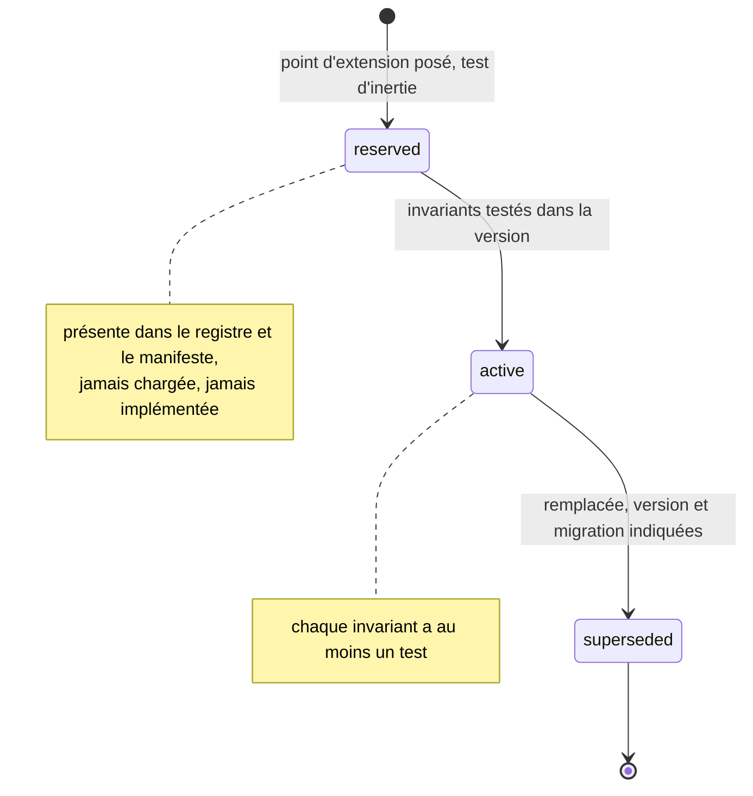
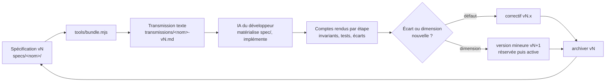
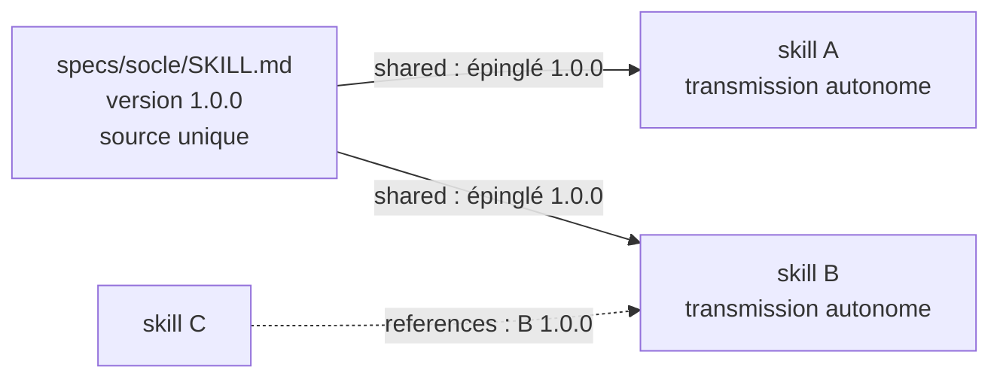

# Principe d'évolution des structures

Ce document décrit comment une spécification de ce dépôt évolue de version en version, sans jamais perdre ce qu'elle a été. Il s'applique à toutes les spécifications de `specs/`. Chaque spécification reprend ces règles dans son propre `SKILL.md` (section « Contrat de version »), qui fait foi pour elle.

## 1. Idée directrice

Une spécification n'est pas un document que l'on réécrit. C'est une structure qui se déploie : chaque version **révèle** une ou plusieurs dimensions qui existaient en germe dans la précédente, sous forme de points d'extension réservés. Rien de ce qui a été garanti n'est retiré en silence.

Trois conséquences :

- une dimension apparaît d'abord comme **réservée** (sa place est posée, inerte et testée comme inerte), puis devient **active** quand ses invariants ont des tests ;
- un invariant ne s'affaiblit jamais ; il peut seulement être remplacé par un invariant plus fort ;
- chaque version précédente reste lisible deux fois : dans `archives/` et dans l'historique Git.

## 2. Unités de structure

| Unité | Rôle | Notation | Exemple |
|---|---|---|---|
| Dimension | axe de la spécification, avec ses invariants et ses tests | `Dn` | `D4` effecteur GitLab |
| Invariant | propriété qui doit toujours tenir, vérifiée par au moins un test | `Dn.INV-k` | `D4.INV-3` : aucun `--force` |
| Point d'extension | emplacement réservé, inerte, pour une dimension future | `En` | `E2` : champs `to` et `thread` rejetés |
| Module | fichier qui porte une ou plusieurs dimensions | `modules/<id>/SKILL.md` | `modules/etats/SKILL.md` |
| Manifeste | déclaration des modules, de leur statut et de la version | `manifest.json` | `"status": "reserved"` |
| Archive | version antérieure figée | `archives/SKILL-vX.Y.Z.md` | `SKILL-v2.1.0.md` |
| Fichier partagé | fichier versionné à part, inclus à l'identique dans plusieurs skills, à une version épinglée | `shared` dans `manifest.json` | `socle/SKILL.md` ← `specs/socle-back-front/SKILL.md` 1.0.0 |
| Référence | skill dont un autre reprend les règles sans l'inclure, à une version citée | `references` dans `manifest.json` | l'analyste référence `expert-java` 1.0.0 |
| Transmission | texte unique destiné à l'IA qui implémente | `transmissions/<nom>-X.Y.Z.md` | `tension-dashboard-gitlab-agent-2.2.0.md` |
| Scénario | cas de test nommé, rattaché à un invariant | lettre + numéro | `T3`, `M7`, `G1` |

Les lettres de scénarios ne réutilisent jamais un préfixe déjà pris par une autre unité. `E` désigne exclusivement les points d'extension.

## 3. Cycle de vie d'une dimension

Une dimension peut aussi naître directement `active`, comme D7 en 2.1.0, à condition que son entrée au registre, ses invariants et leurs scénarios soient écrits dans la même version. Le passage par `reserved` est la voie normale dès qu'une dimension dépend d'autres dimensions encore absentes.

## 4. Contrat de version

1. Chaque version déclare son numéro dans le frontmatter du `SKILL.md` racine et dans `manifest.json`, et ajoute une entrée au journal de révision.
2. Une version mineure ajoute au moins une dimension ou un point d'extension. Sinon, c'est un correctif : seul le numéro de patch change.
3. Une dimension `reserved` ne passe à `active` que si ses invariants ont des tests.
4. Une dimension `active` ne sort du registre qu'en passant à `superseded`, avec la version de remplacement et une section de migration.
5. Un invariant ne s'affaiblit jamais. Son remplacement par un invariant plus fort est signalé.
6. Le schéma de données évolue uniquement par migrations numérotées. Une migration appliquée quelque part n'est jamais modifiée.
7. Chaque événement de journal porte la version de spécification qui l'a produit. Un journal reste rejouable dans toute version de la même famille majeure.
8. Avant de publier une version, la précédente est archivée sous `archives/SKILL-vX.Y.Z.md`. Une archive n'est jamais éditée.

## 5. Boucle d'évolution

La spécification n'évolue pas seule. Elle est corrigée par ce que révèle son implémentation.

C'est une boucle de second ordre : l'IA qui implémente ne fait pas qu'exécuter la spécification, elle en révèle les angles morts. Ses écarts signalés (la consigne lui interdit de corriger la spécification elle-même) sont la matière de la version suivante. Le développeur reste le médiateur : il ratifie chaque changement avant qu'il n'entre dans `specs/`.

## 6. Lecture 7E de l'évolution

L'évolution du dépôt suit elle-même le cycle de l'Axiome 7E, un niveau au-dessus de celui de chaque spécification.

| Phase | Au niveau du dépôt |
|---|---|
| Éléments | dimensions, invariants, points d'extension |
| Espace | le package d'une spécification : `SKILL.md`, `manifest.json`, `modules/` |
| Engendrent | les dépendances entre dimensions, déclarées dans le registre |
| État | le statut de chaque dimension : `reserved`, `active`, `superseded` |
| Expression | la transmission texte, seule forme qui sort du dépôt |
| Évolutif | versions, archives, journal de révision, historique Git |
| Environnement | l'IA qui implémente et le développeur qui ratifie ; leurs retours deviennent les Éléments de la version suivante |

Récursion : une spécification peut contenir son propre cycle 7E (c'est le cas de `tension-dashboard-gitlab-agent`), et le dépôt applique le même cycle à l'ensemble de ses spécifications.

## 7. Publier une nouvelle version

Procédure, dans cet ordre :

1. Copier `SKILL.md` racine dans `archives/SKILL-vX.Y.Z.md` (version courante, avant modification). Ne jamais toucher aux archives existantes.
2. Modifier la spécification : registre, invariants, scénarios, modules.
3. Mettre à jour `version` dans le frontmatter du `SKILL.md` racine et dans `manifest.json`, ainsi que `previousVersions`.
4. Ajouter l'entrée au journal de révision du `SKILL.md` et à `CHANGELOG.md`.
5. Vérifier : `node tools/verifier.mjs` (manifestes, versions, modules, épinglages, références, blocs de code, invariants définis et cités). La relecture humaine reste nécessaire pour le fond : le vérificateur contrôle la structure.
6. Régénérer la transmission : `node tools/bundle.mjs specs/<nom>`. Le script échoue si l'aller-retour n'est pas identique.
7. Commiter la version seule, avec un message `spec(<nom>): version X.Y.Z, <résumé>`, puis la transmission.
8. Ouvrir une pull request ; le développeur ratifie avant fusion.

Les transmissions des versions précédentes restent dans `transmissions/` : elles sont la trace exacte de ce qui a été remis à une IA.

## 8. Fichiers partagés et références

Plusieurs skills peuvent partager un même socle sans perdre leur autonomie de transmission :

- Le fichier partagé n'existe qu'une fois dans le dépôt. `bundle.mjs` l'insère dans chaque transmission, sous le chemin déclaré (`socle/SKILL.md`).
- La version épinglée est vérifiée à chaque assemblage. Faire évoluer le socle oblige donc chaque skill dépendant à décider explicitement de monter son épinglage : c'est voulu, une règle commune ne change pas en silence sous un skill.
- Un socle se marque `"transmissible": false` : il n'a de sens qu'inclus.
- Une référence (`references`) cite un skill dont on reprend les règles, à une version donnée. Si le skill référencé change de version, le skill qui le cite doit être revu et sa référence mise à jour.
- Les identifiants d'un autre skill sont toujours préfixés par son nom (`expert-java:D4.INV-2`), pour ne jamais se confondre avec les invariants locaux.
- Un skill peut inclure le point d'entrée d'un autre skill comme **référentiel** (par exemple `references/expert-java.md` dans l'expert SonarQube) : il en lit les invariants sans en adopter le mode de travail, ce que son en-tête de transmission précise. Le vérificateur n'importe depuis les fichiers partagés que les identifiants du socle (`SCn`) : les `Dn` d'un référentiel ne peuvent pas masquer une faute de frappe sur un invariant local.

## 9. Ajouter une nouvelle spécification

1. Créer `specs/<nom>/` avec `SKILL.md`, `manifest.json`, `ENTETE-TRANSMISSION.md` et `modules/`.
2. Reprendre dans son `SKILL.md` un registre des dimensions, un contrat de version conforme à la section 4, la liste des invariants et les points d'extension.
3. Écrire l'en-tête de transmission avec `{{VERSION}}` dans son titre ; il contient la consigne propre à cette spécification.
4. Générer la première transmission, puis l'ajouter au tableau du `README.md` et à `CHANGELOG.md`.
