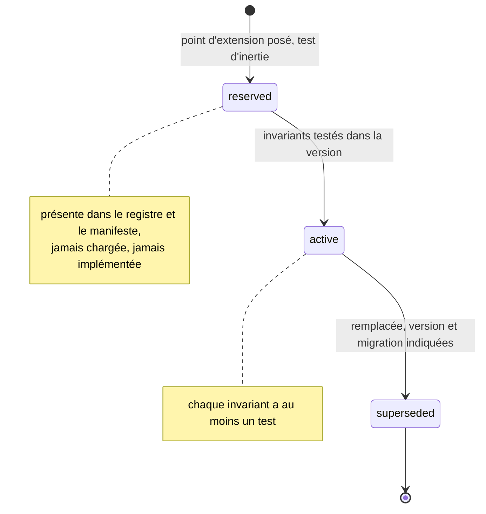
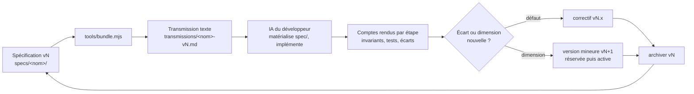
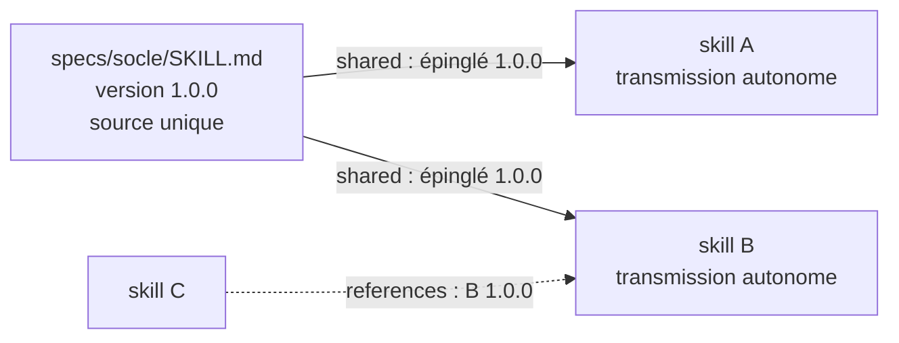

# Principe d'évolution des structures

Ce document décrit comment une spécification de ce dépôt évolue de version en version, sans jamais perdre ce qu'elle a été. Il s'applique à toutes les spécifications de `specs/`. Chaque spécification reprend ces règles dans son propre `SKILL.md` (section « Contrat de version »), qui fait foi pour elle.

## 1. Idée directrice

Une spécification n'est pas un document que l'on réécrit. C'est une structure qui se déploie : chaque version **révèle** une ou plusieurs dimensions qui existaient en germe dans la précédente, sous forme de points d'extension réservés. Rien de ce qui a été garanti n'est retiré en silence.

Trois conséquences :

- une dimension apparaît d'abord comme **réservée** (sa place est posée, inerte et testée comme inerte), puis devient **active** quand ses invariants ont des tests ;
- un invariant ne s'affaiblit jamais ; il peut seulement être remplacé par un invariant plus fort ;
- chaque version précédente reste lisible deux fois : dans `archives/` et dans l'historique Git.

## 2. Unités de structure

| Unité | Rôle | Notation | Exemple |
|---|---|---|---|
| Dimension | axe de la spécification, avec ses invariants et ses tests | `Dn` | `D4` effecteur GitLab |
| Invariant | propriété qui doit toujours tenir, vérifiée par au moins un test | `Dn.INV-k` | `D4.INV-3` : aucun `--force` |
| Point d'extension | emplacement réservé, inerte, pour une dimension future | `En` | `E2` : champs `to` et `thread` rejetés |
| Module | fichier qui porte une ou plusieurs dimensions | `modules/<id>/SKILL.md` | `modules/etats/SKILL.md` |
| Manifeste | déclaration des modules, de leur statut et de la version | `manifest.json` | `"status": "reserved"` |
| Archive | version antérieure figée | `archives/SKILL-vX.Y.Z.md` | `SKILL-v2.1.0.md` |
| Fichier partagé | fichier versionné à part, inclus à l'identique dans plusieurs skills, à une version épinglée | `shared` dans `manifest.json` | `socle/SKILL.md` ← `specs/socle-back-front/SKILL.md` 1.0.0 |
| Référence | skill dont un autre reprend les règles sans l'inclure, à une version citée | `references` dans `manifest.json` | `analyse-projet` référence `java` 1.1.1 |
| Transmission | texte unique destiné à l'IA qui implémente | `transmissions/<nom>-X.Y.Z.md` | `tension-dashboard-gitlab-agent-2.2.0.md` |
| Scénario | cas de test nommé, rattaché à un invariant | lettre + numéro | `T3`, `M7`, `G1` |

Les lettres de scénarios ne réutilisent jamais un préfixe déjà pris par une autre unité. `E` désigne exclusivement les points d'extension. `OC` et `N`, suivis d'un chiffre, désignent exclusivement les ordres cybernétiques et les niveaux d'observation (section 10).

## 3. Cycle de vie d'une dimension

Une dimension peut aussi naître directement `active`, comme D7 en 2.1.0, à condition que son entrée au registre, ses invariants et leurs scénarios soient écrits dans la même version. Le passage par `reserved` est la voie normale dès qu'une dimension dépend d'autres dimensions encore absentes.

## 4. Contrat de version

1. Chaque version déclare son numéro dans le frontmatter du `SKILL.md` racine et dans `manifest.json`, et ajoute une entrée au journal de révision.
2. Une version mineure ajoute au moins une dimension ou un point d'extension. Sinon, c'est un correctif : seul le numéro de patch change.
3. Une dimension `reserved` ne passe à `active` que si ses invariants ont des tests.
4. Une dimension `active` ne sort du registre qu'en passant à `superseded`, avec la version de remplacement et une section de migration.
5. Un invariant ne s'affaiblit jamais. Son remplacement par un invariant plus fort est signalé.
6. Le schéma de données évolue uniquement par migrations numérotées. Une migration appliquée quelque part n'est jamais modifiée.
7. Chaque événement de journal porte la version de spécification qui l'a produit. Un journal reste rejouable dans toute version de la même famille majeure.
8. Avant de publier une version, la précédente est archivée sous `archives/SKILL-vX.Y.Z.md`. Une archive n'est jamais éditée.

## 5. Boucle d'évolution

La spécification n'évolue pas seule. Elle est corrigée par ce que révèle son implémentation.

C'est une boucle de second ordre : l'IA qui implémente ne fait pas qu'exécuter la spécification, elle en révèle les angles morts. Ses écarts signalés (la consigne lui interdit de corriger la spécification elle-même) sont la matière de la version suivante. Le développeur reste le médiateur : il ratifie chaque changement avant qu'il n'entre dans `specs/`.

## 6. Lecture 7E de l'évolution

L'évolution du dépôt suit elle-même le cycle de l'Axiome 7E, un niveau au-dessus de celui de chaque spécification.

| Phase | Au niveau du dépôt |
|---|---|
| Éléments | dimensions, invariants, points d'extension |
| Espace | le package d'une spécification : `SKILL.md`, `manifest.json`, `modules/` |
| Engendrent | les dépendances entre dimensions, déclarées dans le registre |
| État | le statut de chaque dimension : `reserved`, `active`, `superseded` |
| Expression | la transmission texte, seule forme qui sort du dépôt |
| Évolutif | versions, archives, journal de révision, historique Git |
| Environnement | l'IA qui implémente et le développeur qui ratifie ; leurs retours deviennent les Éléments de la version suivante |

Récursion : une spécification peut contenir son propre cycle 7E (c'est le cas de `tension-dashboard-gitlab-agent`), et le dépôt applique le même cycle à l'ensemble de ses spécifications.

## 7. Publier une nouvelle version

Procédure, dans cet ordre :

1. Copier `SKILL.md` racine dans `archives/SKILL-vX.Y.Z.md` (version courante, avant modification). Ne jamais toucher aux archives existantes.
2. Modifier la spécification : registre, invariants, scénarios, modules.
3. Mettre à jour `version` dans le frontmatter du `SKILL.md` racine et dans `manifest.json`, ainsi que `previousVersions`.
4. Ajouter l'entrée au journal de révision du `SKILL.md` et à `CHANGELOG.md`, et mettre à jour `README.md` (tableau des spécifications et schéma).
5. Régénérer le glossaire : `node tools/glossaire.mjs`. Il détaille chaque invariant de chaque spécification et n'est jamais modifié à la main.
6. Régénérer la transmission : `node tools/bundle.mjs specs/<nom>`. Le script échoue si l'aller-retour n'est pas identique.
7. Vérifier : `node tools/verifier.mjs` (manifestes, versions, modules et registre, épinglages, références, archives, points d'extension, blocs de code, invariants définis et cités, y compris ceux d'un autre skill, transmissions fidèles aux fichiers, README et glossaire à jour, noms d'un autre hôte d'IA seulement dans l'historique que `.geminiignore` cache à Gemini CLI). La relecture humaine reste nécessaire pour le fond : le vérificateur contrôle la structure.
8. Commiter la version en un seul commit, avec sa transmission, le glossaire, le README et l'entrée du CHANGELOG, sous le message `spec(<nom>): version X.Y.Z, <résumé>` : le vérificateur passe ainsi sur chaque commit. Deux versions qui se référencent l'une l'autre ne passent le vérificateur qu'ensemble : elles se publient dans un même commit, avec leurs deux transmissions, sous le message `spec(<nom>, <nom>): versions X.Y.Z et X.Y.Z, <résumé>`.
9. Ouvrir une pull request ; le vérificateur y tourne automatiquement, et le développeur ratifie avant fusion.

Les transmissions des versions précédentes restent dans `transmissions/` : elles sont la trace exacte de ce qui a été remis à une IA. La transmission d'une version publiée n'est donc jamais régénérée : si le vérificateur la trouve infidèle aux fichiers, c'est qu'une modification attend une nouvelle version.

## 8. Fichiers partagés et références

Plusieurs skills peuvent partager un même socle sans perdre leur autonomie de transmission :

- Le fichier partagé n'existe qu'une fois dans le dépôt. `bundle.mjs` l'insère dans chaque transmission, sous le chemin déclaré (`socle/SKILL.md`).
- La version épinglée est vérifiée à chaque assemblage : `bundle.mjs` prend la version courante du fichier partagé si elle est épinglée, sinon son archive de cette version, déclarée dans les `previousVersions` du manifeste de la source. Faire évoluer le socle ne change donc rien sous un skill : chaque skill dépendant décide explicitement de monter son épinglage, dans une version à lui. C'est voulu, une règle commune ne change pas en silence sous un skill.
- Un socle se marque `"transmissible": false` : il n'a de sens qu'inclus.
- Une référence (`references`) cite un skill dont on reprend les règles, à une version donnée. Si le skill référencé change de version, le skill qui le cite doit être revu et sa référence mise à jour.
- Les identifiants d'un autre skill sont toujours préfixés par son nom (`java:D4.INV-2`), pour ne jamais se confondre avec les invariants locaux. Le vérificateur s'assure que chacun est défini dans le point d'entrée du skill qu'il nomme.
- Un skill peut inclure le point d'entrée d'un autre skill comme **référentiel** (par exemple `references/java.md` dans l'expert SonarQube) : il en lit les invariants sans en adopter le mode de travail, ce que son en-tête de transmission précise. Le vérificateur n'importe depuis les fichiers partagés que les identifiants des socles, `SCn` pour le socle back-front et `SOn` pour le socle d'observation : les `Dn` d'un référentiel ne peuvent pas masquer une faute de frappe sur un invariant local.

## 9. Ajouter une nouvelle spécification

1. Créer `specs/<nom>/` avec `SKILL.md`, `manifest.json`, `ENTETE-TRANSMISSION.md` et `modules/`.
2. Reprendre dans son `SKILL.md` un registre des dimensions, un contrat de version conforme à la section 4, la liste des invariants et les points d'extension.
3. Écrire l'en-tête de transmission avec `{{VERSION}}` dans son titre ; il contient la consigne propre à cette spécification.
4. Générer la première transmission et régénérer le glossaire, puis ajouter la spécification au tableau du `README.md` et à `CHANGELOG.md`.

## 10. Ordres cybernétiques

Les spécifications de ce dépôt parlent d'ordres cybernétiques depuis leurs premières versions : clauses de second ordre, boucle de la section 5, ordres 1 et 2 de l'orchestrateur C7E, couples O1 et O2 d'Agent2Dev et d'Agent2Test, ordres d'observation du générateur de skills de ticket. Cette section fixe leur vocabulaire commun et définit le troisième ordre. Elle ne change le comportement d'aucune spécification : chacune garde ses mécanismes, et emploie ces termes au sens défini ici.

### 10.1 Ordre cybernétique et niveau d'observation

Deux notions, à ne jamais confondre :

| Notion | Notation | Ce qu'elle désigne |
|---|---|---|
| Ordre cybernétique | `OC1`, `OC2`, `OC3` | la nature d'une boucle : ce qu'elle observe, et ce qu'elle peut changer |
| Niveau d'observation | `N1`, `N2`, `N3` | la place d'un observateur dans un système : ce qu'il observe, d'autres observateurs compris |

Empiler des observateurs dans un même système ne change pas d'ordre : un observateur d'observateurs reste du second ordre. Un système n'observe pas au-delà de N3 ; l'humain est au-dessus.

### 10.2 Les trois ordres

- **OC1, régulation** : une boucle observe un système, le corrige ou alerte, sans observer sa propre manière d'observer. Exemples : le vérificateur, les recettes, les tests déduits des risques, l'observabilité de premier ordre d'Agent2Dev et d'Agent2Test.
- **OC2, observation de l'observation** : l'observateur fait partie de la boucle. Il observe sa propre manière d'observer, de concevoir ou d'apprendre, et en propose l'adaptation, qu'un humain ratifie. Exemples : la boucle d'évolution de la section 5, le registre des concepts de l'orchestrateur C7E, l'apprentissage et la réflexivité d'Agent2Dev et d'Agent2Test, le champ et l'apprentissage du générateur. La régression s'y arrête à des points fixes : constitution, skill, invariants, gouvernance humaine.
- **OC3, régulation de l'écosystème** : les systèmes OC2 du dépôt et leurs environnements humains se régulent ensemble, sans niveau d'observation supplémentaire. Trois couplages le constituent (section 10.3).

### 10.3 Les trois couplages du troisième ordre

1. **Entre systèmes.** Chaque système OC2 se rend observable aux autres dans un milieu commun ; aucun ne se juge seul ; l'état de l'écosystème, versions épinglées, registres et écarts, est lui-même observé.
2. **Entre description et pratique.** Le dépôt observe ce que ses spécifications, ses mesures et ses vues font aux personnes qui s'en servent ; ce retour devient la matière des versions suivantes.
3. **Avec les valeurs.** L'acceptable est un modèle explicite, versionné et épinglé, appliqué avant l'action, observé dans ses refus et ses dérogations, et révisé par une conversation entre sujets distincts, jamais par un agent.

Filiation : ces couplages reprennent trois lectures du troisième ordre, l'environnement poly-sujet à observateur distribué (V. Lepskiy, 2018), la cybernétique des systèmes conceptuels et la réflexivité des systèmes sociaux (S. Umpleby, 1997), le régulateur à troisième modèle, celui de l'acceptable (M. Ashby, 2022). L'objection de H. von Foerster et de R. Glanville, pour qui un troisième ordre retomberait dans les précédents, vaut contre l'empilement d'observateurs : elle fonde la règle 1 de la section 10.5.

### 10.4 Correspondances

| Terme d'une spécification | Où | Sens dans cette section |
|---|---|---|
| « Ordre 1 », « Ordre 2 » | `orchestrateur-c7e`, sections 0 et 6 | OC1, OC2 |
| O1, O2 | `agent2dev`, `agent2test` | OC1, OC2 |
| « ordre 1 », « ordre 2 », « ordre 3 » ; champ `ordre` de `skill-ticket.observation/1` | `generateur-skill-ticket`, module `champ` | N1, N2, N3, dans un système OC2 ; les formats publiés gardent leurs noms |
| « clause de second ordre » | quatorze points d'entrée | OC2 ; une clause qui décrit l'effet d'un outil sur des personnes ou sur une organisation prépare en outre le couplage 2 du troisième ordre, sans changer de texte |
| « effets de second ordre » | `sonarqube`, module `gouvernance`, section 6 | signaux du couplage 2 du troisième ordre, déjà mesurés |

### 10.5 Règles

1. Un troisième ordre ne s'obtient jamais par un niveau d'observation de plus : il n'existe pas de N4, et OC3 n'en est pas un.
2. « Premier ordre », « second ordre » et « troisième ordre » s'emploient au sens de cette section. Un « ordre n » d'un format publié garde son sens de niveau d'observation, sans renommage.
3. Le troisième ordre ne se revendique que pour une boucle fermée avec sa preuve : une dimension OC3 se déclare comme telle dans le registre de sa spécification, colonne « Ordre », et suit le cycle de vie de la section 3, réservée, puis active quand ses invariants ont leurs tests.
4. Une boucle OC3 ne retire aucune ratification humaine, ne fait jamais appeler le second ordre par le premier et ne lève aucun point fixe d'OC2 : elle en rend la dérive observable. Un point fixe ne change que par une version publiée et ratifiée, jamais par un agent.
5. `OC` et `N`, suivis d'un chiffre, sont réservés à ces notations (section 2).

Le premier couplage a sa boucle OC3 active, dans l'observatoire (`observatoire`, dimensions D2 à D5 depuis 1.0.0, D6 depuis 1.1.0) : les instances d'un même système s'y confrontent, leurs retours et leurs récurrences remontent au dépôt par pull request ; deux systèmes différents, le générateur de skills de ticket et l'orchestrateur C7E, s'y confrontent par les invariants du dépôt que citent leurs écarts, proposés à la spécification qui les définit ; et l'effet des propositions ratifiées se suit dans les enveloppes des versions qui les portent. Elle est fermée dans ses limites déclarées : les systèmes qui exportent ne se confrontent que par les invariants du dépôt, et un seul sujet ratifie. Le troisième couplage a sa boucle OC3 active, elle aussi dans l'observatoire (D7 et D8, depuis 1.2.0) : le socle `socle-acceptable` (depuis 1.0.0) fixe le noyau commun de l'acceptable, ce que tous les systèmes refusent, chaque règle un invariant que cite le refus, l'écriture par des kits avec retour arrière, aucune dérogation à une règle du noyau (depuis 1.0.1) et la révision par une version publiée par un humain. Agent2Dev et Agent2Test l'appliquent avant l'action (D26, depuis 1.3.0 et 1.5.0) : leurs constitutions en reprennent le noyau épinglé, leurs gardes citent leur règle, et leurs refus, dérogations et faux refus se tiennent dans leurs journaux et leurs livrables ; leurs refus et les réponses qui y répondent, datés par la rubrique `acceptable` de leurs livrables (depuis 1.3.1 et 1.5.1), sortent de leur instance par l'export que porte l'observatoire, selon la correspondance du socle d'observation (depuis 1.2.0), et s'y confrontent par la règle qu'ils citent ; une règle déclarée infondée par des faux refus dans au moins deux instances remonte, trop large, à la spécification qui la définit, et la ratification décide sans jamais affaiblir une règle du noyau. Elle est fermée dans ses limites déclarées : seul le binôme exporte ses refus, sur des livrables d'épreuve tant qu'il n'est pas construit ; seuls les faux refus récurrents font une proposition ; l'effet d'une proposition sur une règle du noyau reste indécidable ; l'orchestrateur C7E et le générateur de skills de ticket réservent l'application du noyau, les kits attendent la description de leur contrat, et un seul sujet ratifie. Le couplage 2 reste en germe ; partout ailleurs, le dépôt est OC2 à ses deux échelles, la sienne (section 5) et celle de ses systèmes.
