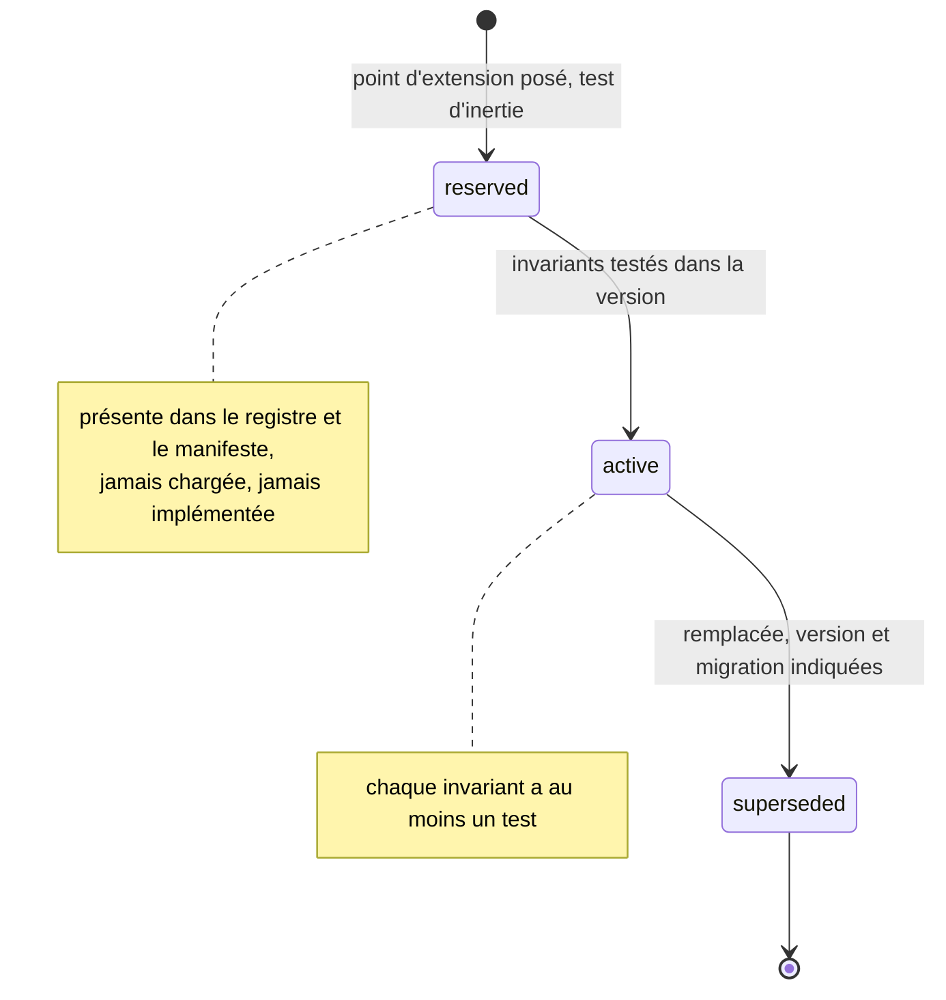
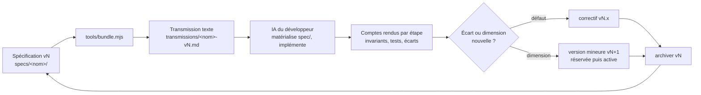
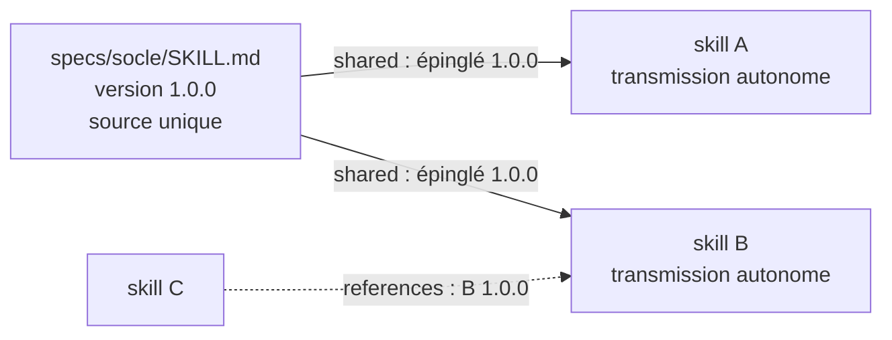

# Principe d'évolution des structures

Ce document décrit comment une spécification de ce dépôt évolue de version en version, sans jamais perdre ce qu'elle a été. Il s'applique à toutes les spécifications de `specs/`. Chaque spécification reprend ces règles dans son propre `SKILL.md` (section « Contrat de version »), qui fait foi pour elle.

## 1. Idée directrice

Une spécification n'est pas un document que l'on réécrit. C'est une structure qui se déploie : chaque version **révèle** une ou plusieurs dimensions qui existaient en germe dans la précédente, sous forme de points d'extension réservés. Rien de ce qui a été garanti n'est retiré en silence.

Trois conséquences :

- une dimension apparaît d'abord comme **réservée** (sa place est posée, inerte et testée comme inerte), puis devient **active** quand ses invariants ont des tests ;
- un invariant ne s'affaiblit jamais ; il peut seulement être remplacé par un invariant plus fort ;
- chaque version précédente reste lisible deux fois : dans `archives/` et dans l'historique Git.

## 2. Unités de structure

| Unité | Rôle | Notation | Exemple |
|---|---|---|---|
| Dimension | axe de la spécification, avec ses invariants et ses tests | `Dn` | `D4` effecteur GitLab |
| Invariant | propriété qui doit toujours tenir, vérifiée par au moins un test | `Dn.INV-k` | `D4.INV-3` : aucun `--force` |
| Point d'extension | emplacement réservé, inerte, pour une dimension future | `En` | `E2` : champs `to` et `thread` rejetés |
| Module | fichier qui porte une ou plusieurs dimensions | `modules/<id>/SKILL.md` | `modules/etats/SKILL.md` |
| Manifeste | déclaration des modules, de leur statut et de la version | `manifest.json` | `"status": "reserved"` |
| Archive | version antérieure figée | `archives/SKILL-vX.Y.Z.md` | `SKILL-v2.1.0.md` |
| Fichier partagé | fichier versionné à part, inclus à l'identique dans plusieurs skills, à une version épinglée | `shared` dans `manifest.json` | `socle/SKILL.md` ← `specs/socle-back-front/SKILL.md` 1.0.0 |
| Référence | skill dont un autre reprend les règles sans l'inclure, à une version citée | `references` dans `manifest.json` | `analyse-projet` référence `java` 1.1.1 |
| Transmission | texte unique destiné à l'IA qui implémente | `transmissions/<nom>-X.Y.Z.md` | `tension-dashboard-gitlab-agent-2.2.0.md` |
| Scénario | cas de test nommé, rattaché à un invariant | lettre + numéro | `T3`, `M7`, `G1` |

Les lettres de scénarios ne réutilisent jamais un préfixe déjà pris par une autre unité. `E` désigne exclusivement les points d'extension. `OC` et `N`, suivis d'un chiffre, désignent exclusivement les ordres cybernétiques et les niveaux d'observation (section 10).

## 3. Cycle de vie d'une dimension

Une dimension peut aussi naître directement `active`, comme D7 en 2.1.0, à condition que son entrée au registre, ses invariants et leurs scénarios soient écrits dans la même version. Le passage par `reserved` est la voie normale dès qu'une dimension dépend d'autres dimensions encore absentes.

## 4. Contrat de version

1. Chaque version déclare son numéro dans le frontmatter du `SKILL.md` racine et dans `manifest.json`, et ajoute une entrée au journal de révision.
2. Une version mineure ajoute au moins une dimension ou un point d'extension. Sinon, c'est un correctif : seul le numéro de patch change.
3. Une dimension `reserved` ne passe à `active` que si ses invariants ont des tests.
4. Une dimension `active` ne sort du registre qu'en passant à `superseded`, avec la version de remplacement et une section de migration.
5. Un invariant ne s'affaiblit jamais. Son remplacement par un invariant plus fort est signalé.
6. Le schéma de données évolue uniquement par migrations numérotées. Une migration appliquée quelque part n'est jamais modifiée.
7. Chaque événement de journal porte la version de spécification qui l'a produit. Un journal reste rejouable dans toute version de la même famille majeure.
8. Avant de publier une version, la précédente est archivée sous `archives/SKILL-vX.Y.Z.md`. Une archive n'est jamais éditée.

## 5. Boucle d'évolution

La spécification n'évolue pas seule. Elle est corrigée par ce que révèle son implémentation.

C'est une boucle de second ordre : l'IA qui implémente ne fait pas qu'exécuter la spécification, elle en révèle les angles morts. Ses écarts signalés (la consigne lui interdit de corriger la spécification elle-même) sont la matière de la version suivante. Le développeur reste le médiateur : il ratifie chaque changement avant qu'il n'entre dans `specs/`.

Depuis le jalon J6, cette boucle est elle-même observée : l'observatoire compte, dans l'historique Git et le CHANGELOG, le délai de chaque pull request, ses reprises, les points hors plan ratifiés et le délai de leur consignation (`observatoire`, module `depot`, D13), et ces comptes se lisent avant chaque plan de jalon (section 10.8).

## 6. Lecture 7E de l'évolution

L'évolution du dépôt suit elle-même le cycle de l'Axiome 7E, un niveau au-dessus de celui de chaque spécification. La dernière colonne le lit au troisième ordre (section 10) : l'écosystème de ses systèmes, ses trois couplages, et le dépôt qui s'observe lui-même.

| Phase | Au niveau du dépôt | Au troisième ordre |
|---|---|---|
| Éléments | dimensions, invariants, points d'extension | les enveloppes que les systèmes exportent, avec leurs refus, leurs kits, leurs signaux et leurs révisions ; les traces de la gouvernance du dépôt, fusions, consignations et points hors plan |
| Espace | le package d'une spécification : `SKILL.md`, `manifest.json`, `modules/` | le socle d'observation, milieu commun ; le magasin local de l'observatoire ; l'historique Git et le CHANGELOG du dépôt |
| Engendrent | les dépendances entre dimensions, déclarées dans le registre | les trois couplages de la section 10.3 : confrontations entre instances et entre systèmes, signaux, refus confrontés par règle |
| État | le statut de chaque dimension : `reserved`, `active`, `superseded` | la viabilité de chaque couplage et du dépôt, prouvée, partielle ou non couverte (section 10.8) ; les versions en usage dans les instances |
| Expression | la transmission texte, seule forme qui sort du dépôt | les propositions de l'observatoire, et les examens indépendants qui précèdent leur ratification |
| Évolutif | versions, archives, journal de révision, historique Git | la révision des formes propres (section 10.7) ; l'effet des propositions ratifiées ; les comptes de la gouvernance, lus avant chaque plan de jalon |
| Environnement | l'IA qui implémente et le développeur qui ratifie ; leurs retours deviennent les Éléments de la version suivante | des sujets distincts : le développeur qui ratifie, l'examinateur sur un autre modèle, les instances et leurs référents ; la pluralité des sujets humains, déclarée, reste non couverte |

Récursion : une spécification peut contenir son propre cycle 7E (c'est le cas de `tension-dashboard-gitlab-agent`), et le dépôt applique le même cycle à l'ensemble de ses spécifications. Au troisième ordre, la récursion se ferme sur le dépôt lui-même : il observe sa gouvernance comme il fait observer ses systèmes, sans niveau d'observation de plus (section 10.5, règle 1).

## 7. Publier une nouvelle version

Procédure, dans cet ordre :

1. Copier `SKILL.md` racine dans `archives/SKILL-vX.Y.Z.md` (version courante, avant modification). Ne jamais toucher aux archives existantes.
2. Modifier la spécification : registre, invariants, scénarios, modules.
3. Mettre à jour `version` dans le frontmatter du `SKILL.md` racine et dans `manifest.json`, ainsi que `previousVersions`.
4. Ajouter l'entrée au journal de révision du `SKILL.md` et à `CHANGELOG.md`, et mettre à jour `README.md` (tableau des spécifications et schéma).
5. Régénérer le glossaire : `node tools/glossaire.mjs`. Il détaille chaque invariant de chaque spécification et n'est jamais modifié à la main.
6. Régénérer la transmission : `node tools/bundle.mjs specs/<nom>`. Le script échoue si l'aller-retour n'est pas identique.
7. Vérifier : `node tools/verifier.mjs` (manifestes, versions, modules et registre, épinglages, références, archives, points d'extension, blocs de code, invariants définis et cités, y compris ceux d'un autre skill, transmissions fidèles aux fichiers, README et glossaire à jour, noms d'un autre hôte d'IA seulement dans l'historique que `.geminiignore` cache à Gemini CLI). La relecture humaine reste nécessaire pour le fond : le vérificateur contrôle la structure.
8. Commiter la version en un seul commit, avec sa transmission, le glossaire, le README et l'entrée du CHANGELOG, sous le message `spec(<nom>): version X.Y.Z, <résumé>` : le vérificateur passe ainsi sur chaque commit. Deux versions qui se référencent l'une l'autre ne passent le vérificateur qu'ensemble : elles se publient dans un même commit, avec leurs deux transmissions, sous le message `spec(<nom>, <nom>): versions X.Y.Z et X.Y.Z, <résumé>`.
9. Ouvrir une pull request ; le vérificateur y tourne automatiquement, et le développeur ratifie avant fusion.

Les transmissions des versions précédentes restent dans `transmissions/` : elles sont la trace exacte de ce qui a été remis à une IA. La transmission d'une version publiée n'est donc jamais régénérée : si le vérificateur la trouve infidèle aux fichiers, c'est qu'une modification attend une nouvelle version.

## 8. Fichiers partagés et références

Plusieurs skills peuvent partager un même socle sans perdre leur autonomie de transmission :

- Le fichier partagé n'existe qu'une fois dans le dépôt. `bundle.mjs` l'insère dans chaque transmission, sous le chemin déclaré (`socle/SKILL.md`).
- La version épinglée est vérifiée à chaque assemblage : `bundle.mjs` prend la version courante du fichier partagé si elle est épinglée, sinon son archive de cette version, déclarée dans les `previousVersions` du manifeste de la source. Faire évoluer le socle ne change donc rien sous un skill : chaque skill dépendant décide explicitement de monter son épinglage, dans une version à lui. C'est voulu, une règle commune ne change pas en silence sous un skill.
- Un socle se marque `"transmissible": false` : il n'a de sens qu'inclus.
- Une référence (`references`) cite un skill dont on reprend les règles, à une version donnée. Si le skill référencé change de version, le skill qui le cite doit être revu et sa référence mise à jour.
- Les identifiants d'un autre skill sont toujours préfixés par son nom (`java:D4.INV-2`), pour ne jamais se confondre avec les invariants locaux. Le vérificateur s'assure que chacun est défini dans le point d'entrée du skill qu'il nomme.
- Un skill peut inclure le point d'entrée d'un autre skill comme **référentiel** (par exemple `references/java.md` dans l'expert SonarQube) : il en lit les invariants sans en adopter le mode de travail, ce que son en-tête de transmission précise. Le vérificateur n'importe depuis les fichiers partagés que les identifiants des socles, `SCn` pour le socle back-front et `SOn` pour le socle d'observation : les `Dn` d'un référentiel ne peuvent pas masquer une faute de frappe sur un invariant local.

## 9. Ajouter une nouvelle spécification

1. Créer `specs/<nom>/` avec `SKILL.md`, `manifest.json`, `ENTETE-TRANSMISSION.md` et `modules/`.
2. Reprendre dans son `SKILL.md` un registre des dimensions, un contrat de version conforme à la section 4, la liste des invariants et les points d'extension.
3. Écrire l'en-tête de transmission avec `{{VERSION}}` dans son titre ; il contient la consigne propre à cette spécification.
4. Générer la première transmission et régénérer le glossaire, puis ajouter la spécification au tableau du `README.md` et à `CHANGELOG.md`.

## 10. Ordres cybernétiques

Les spécifications de ce dépôt parlent d'ordres cybernétiques depuis leurs premières versions : clauses de second ordre, boucle de la section 5, ordres 1 et 2 de l'orchestrateur C7E, couples O1 et O2 d'Agent2Dev et d'Agent2Test, ordres d'observation du générateur de skills de ticket. Cette section fixe leur vocabulaire commun et définit le troisième ordre. Elle ne change le comportement d'aucune spécification : chacune garde ses mécanismes, et emploie ces termes au sens défini ici.

### 10.1 Ordre cybernétique et niveau d'observation

Deux notions, à ne jamais confondre :

| Notion | Notation | Ce qu'elle désigne |
|---|---|---|
| Ordre cybernétique | `OC1`, `OC2`, `OC3` | la nature d'une boucle : ce qu'elle observe, et ce qu'elle peut changer |
| Niveau d'observation | `N1`, `N2`, `N3` | la place d'un observateur dans un système : ce qu'il observe, d'autres observateurs compris |

Empiler des observateurs dans un même système ne change pas d'ordre : un observateur d'observateurs reste du second ordre. Un système n'observe pas au-delà de N3 ; l'humain est au-dessus.

### 10.2 Les trois ordres

- **OC1, régulation** : une boucle observe un système, le corrige ou alerte, sans observer sa propre manière d'observer. Exemples : le vérificateur, les recettes, les tests déduits des risques, l'observabilité de premier ordre d'Agent2Dev et d'Agent2Test.
- **OC2, observation de l'observation** : l'observateur fait partie de la boucle. Il observe sa propre manière d'observer, de concevoir ou d'apprendre, et en propose l'adaptation, qu'un humain ratifie. Exemples : la boucle d'évolution de la section 5, le registre des concepts de l'orchestrateur C7E, l'apprentissage et la réflexivité d'Agent2Dev et d'Agent2Test, le champ et l'apprentissage du générateur. La régression s'y arrête à des points fixes : constitution, skill, invariants, gouvernance humaine.
- **OC3, régulation de l'écosystème** : les systèmes OC2 du dépôt et leurs environnements humains se régulent ensemble, sans niveau d'observation supplémentaire. Trois couplages le constituent (section 10.3).

### 10.3 Les trois couplages du troisième ordre

1. **Entre systèmes.** Chaque système OC2 se rend observable aux autres dans un milieu commun ; aucun ne se juge seul ; l'état de l'écosystème, versions épinglées, registres et écarts, est lui-même observé.
2. **Entre description et pratique.** Le dépôt observe ce que ses spécifications, ses mesures et ses vues font aux personnes qui s'en servent ; ce retour devient la matière des versions suivantes.
3. **Avec les valeurs.** L'acceptable est un modèle explicite, versionné et épinglé, appliqué avant l'action, observé dans ses refus et ses dérogations, et révisé par une conversation entre sujets distincts, jamais par un agent.

Filiation : ces couplages reprennent trois lectures du troisième ordre, l'environnement poly-sujet à observateur distribué (V. Lepskiy, 2018), la cybernétique des systèmes conceptuels et la réflexivité des systèmes sociaux (S. Umpleby, 1997), le régulateur à troisième modèle, celui de l'acceptable (M. Ashby, 2022). L'objection de H. von Foerster et de R. Glanville, pour qui un troisième ordre retomberait dans les précédents, vaut contre l'empilement d'observateurs : elle fonde la règle 1 de la section 10.5.

### 10.4 Correspondances

| Terme d'une spécification | Où | Sens dans cette section |
|---|---|---|
| « Ordre 1 », « Ordre 2 » | `orchestrateur-c7e`, sections 0 et 6 | OC1, OC2 |
| O1, O2 | `agent2dev`, `agent2test` | OC1, OC2 |
| « ordre 1 », « ordre 2 », « ordre 3 » ; champ `ordre` de `skill-ticket.observation/1` | `generateur-skill-ticket`, module `champ` | N1, N2, N3, dans un système OC2 ; les formats publiés gardent leurs noms |
| « clause de second ordre » | quatorze points d'entrée | OC2 ; une clause qui décrit l'effet d'un outil sur des personnes ou sur une organisation prépare en outre le couplage 2 du troisième ordre, sans changer de texte |
| « effets de second ordre » | `sonarqube`, module `gouvernance`, section 6 | signaux du couplage 2 du troisième ordre, déjà mesurés |

### 10.5 Règles

1. Un troisième ordre ne s'obtient jamais par un niveau d'observation de plus : il n'existe pas de N4, et OC3 n'en est pas un.
2. « Premier ordre », « second ordre » et « troisième ordre » s'emploient au sens de cette section. Un « ordre n » d'un format publié garde son sens de niveau d'observation, sans renommage.
3. Le troisième ordre ne se revendique que pour une boucle fermée avec sa preuve : une dimension OC3 se déclare comme telle dans le registre de sa spécification, colonne « Ordre », et suit le cycle de vie de la section 3, réservée, puis active quand ses invariants ont leurs tests.
4. Une boucle OC3 ne retire aucune ratification humaine, ne fait jamais appeler le second ordre par le premier et ne lève aucun point fixe d'OC2 : elle en rend la dérive observable. Un point fixe ne change que par une version publiée et ratifiée, jamais par un agent.
5. `OC` et `N`, suivis d'un chiffre, sont réservés à ces notations (section 2).
6. Toute clause de second ordre d'un point d'entrée a sa ligne au catalogue de la section 10.6, avec sa nature ; une clause qui décrit un effet sur des personnes y nomme son signal, exporté, mesuré, disponible ou déclaré non mesuré, le lieu de sa mesure et ce avec quoi il se lit. Un signal ne se lit jamais seul, et ne classe jamais des personnes : son sujet reste un rôle. `tools/verifier.mjs` confronte le catalogue aux clauses du dépôt.
7. Une forme propre du dépôt ne change que par la révision de la section 10.7 : une version publiée par un humain, qui dit sa migration ; pour un relâchement, ses preuves et l'avis consigné d'un examinateur indépendant, sur un autre modèle que celui qui a préparé le changement ; aucune règle de sûreté affaiblie. La ratification d'une proposition de l'observatoire porte cet avis elle aussi. Un avis ne décide jamais. `tools/verifier.mjs` et l'outil de l'observatoire le contrôlent. Dans une instance, la constitution du binôme suit la même révision, que sa publication contrôle (Agent2Dev et Agent2Test, module `revision`).
8. Chaque couplage de la section 10.3, et le dépôt lui-même, a sa ligne au tableau de viabilité de la section 10.8 : sa boucle, ses preuves, des invariants dont la recette cite des tests, son statut, prouvé, partiel ou non couvert, et ce qui lui manque. Le troisième ordre ne se revendique que là où la ligne dit prouvé, dans les limites qu'elle déclare (règle 3). `tools/verifier.mjs` contrôle le tableau.

Le premier couplage a sa boucle OC3 active, dans l'observatoire (`observatoire`, dimensions D2 à D5 depuis 1.0.0, D6 depuis 1.1.0) : les instances d'un même système s'y confrontent, leurs retours et leurs récurrences remontent au dépôt par pull request ; deux systèmes différents, le générateur de skills de ticket et l'orchestrateur C7E, s'y confrontent par les invariants du dépôt que citent leurs écarts, proposés à la spécification qui les définit ; et l'effet des propositions ratifiées se suit dans les enveloppes des versions qui les portent. Elle est fermée dans ses limites déclarées : les systèmes qui exportent ne se confrontent que par les invariants du dépôt, et un seul sujet ratifie, sur l'avis d'un examinateur indépendant, depuis l'observatoire 1.5.0 (D11, section 10.7). Le troisième couplage a sa boucle OC3 active, elle aussi dans l'observatoire (D7 et D8, depuis 1.2.0) : le socle `socle-acceptable` (depuis 1.0.0) fixe le noyau commun de l'acceptable, ce que tous les systèmes refusent, chaque règle un invariant que cite le refus, l'écriture par des kits avec retour arrière, aucune dérogation à une règle du noyau (depuis 1.0.1) et la révision par une version publiée par un humain. Agent2Dev et Agent2Test l'appliquent avant l'action (D26, depuis 1.3.0 et 1.5.0) : leurs constitutions en reprennent le noyau épinglé, leurs gardes citent leur règle, et leurs refus, dérogations et faux refus se tiennent dans leurs journaux et leurs livrables ; leurs refus et les réponses qui y répondent, datés par la rubrique `acceptable` de leurs livrables (depuis 1.3.1 et 1.5.1), sortent de leur instance par l'export que porte l'observatoire, selon la correspondance du socle d'observation (depuis 1.2.0), et s'y confrontent par la règle qu'ils citent ; une règle déclarée infondée par des faux refus dans au moins deux instances remonte, trop large, à la spécification qui la définit, et la ratification décide sans jamais affaiblir une règle du noyau. Ce que les règles réservent aux kits passe par leur contrat, que le socle décrit sur la fabrication existante de l'hôte, sans la changer (SA8, depuis 1.1.0) : le système qui produit un kit le confronte au noyau avant de le remettre, avec son manifeste `socle-acceptable.kit/1`, un humain le valide à son empreinte, la fabrication l'applique sur l'environnement de son nom, jamais en production, et l'application comme le retour arrière, déclarés par un humain, se consignent dans le journal du système ; Agent2Dev remet le kit dev, le patch d'un scénario, et Agent2Test le kit test, les prérequis de données d'une campagne et leur nettoyage (D27, depuis 1.4.0 et 1.6.0) ; chaque étape d'un kit, remise, validation, application ou échec, retour arrière, sort de son instance par l'export que porte l'observatoire, selon la correspondance du socle d'observation (depuis 1.3.0), et l'observatoire compte les kits par système, environnement et instance (D9, depuis 1.3.0). Elle est fermée dans ses limites déclarées : seul le binôme exporte ses refus, sur des livrables d'épreuve tant qu'il n'est pas construit ; seuls les faux refus récurrents font une proposition ; l'effet d'une proposition sur une règle du noyau reste indécidable ; l'orchestrateur C7E et le générateur de skills de ticket réservent l'application du noyau, et le kit démo avec elle ; le dépôt ne lit ni n'exécute la fabrication, et les kits ne font que se compter, sans proposition, tant qu'ils n'ont pas de données réelles ; un seul sujet ratifie, sur l'avis d'un examinateur indépendant. Depuis le jalon J5a, le noyau et les constitutions d'exemple sont des formes propres du dépôt, qui ne changent que par la révision de la section 10.7 : le noyau ne fait que croître (socle de l'acceptable 1.2.0), et une constitution ne se relâche qu'avec ses preuves et l'avis d'un examinateur indépendant. Depuis le jalon J5b, la constitution de chaque instance du binôme suit la même révision dans l'instance (Agent2Dev 1.5.0, Agent2Test 1.7.0, D28) : chaque publication se classe, et un relâchement n'y passe qu'avec ses preuves et l'examen d'un observateur sur un autre modèle ; ses examens et ses publications sortent de leur instance par l'export que porte l'observatoire, qui les compte, sans proposition (D12, depuis 1.6.0). Depuis le jalon J5c, l'observateur d'ordre 3 d'un arbre du générateur peut juger sur un autre modèle que la session, nommé à la génération (`generateur-skill-ticket` 1.5.0, D11) : `champ.mjs` inscrit ce modèle à chacune de ses observations, et refuse celle qui retomberait sur le modèle de la session ; cette indépendance reste lisible dans le champ du projet, sans export. Le deuxième couplage est ouvert, sans boucle encore : son catalogue nomme le signal de chaque clause qui décrit un effet sur des personnes (section 10.6, règle 6), et les deux signaux que le binôme journalise, décisions aux points de validation et délais de décision, sortent de leur instance par l'export que porte l'observatoire, qui les compte, sans proposition (D10, depuis 1.4.0) ; la campagne de mesure de l'orchestrateur reste réservée. Depuis le jalon J6, qui clôt le passage au troisième ordre, le dépôt observe sa propre gouvernance (`observatoire` 1.7.0, D13) : délais de ratification et de consignation, reprises, points hors plan ratifiés, comptés dans son historique et son CHANGELOG et lus avant chaque plan de jalon ; la section 10.8 tient la viabilité de chaque couplage et du dépôt lui-même, la section 10.9 ses articulations. Partout ailleurs, le dépôt est OC2 à ses deux échelles, la sienne (section 5) et celle de ses systèmes.

### 10.6 Signaux du deuxième couplage

Une clause de second ordre dit comment l'outil fait partie de ce qu'il observe. Quand elle décrit un effet sur des personnes, une équipe ou une organisation, le dépôt doit pouvoir observer cet effet : c'est le deuxième couplage, entre description et pratique. Ce catalogue classe chaque clause du dépôt par sa nature, et donne, pour un effet sur des personnes, le signal qui l'observe, son statut, le lieu de sa mesure et ce avec quoi il se lit (règle 6).

| Statut | Sens |
|---|---|
| `exporté` | le signal sort de son instance, dans l'enveloppe du socle d'observation, et l'observatoire le compte |
| `mesuré` | le système le mesure et le lit, sans qu'il sorte de son instance |
| `disponible` | la donnée existe, sans être lue comme un signal |
| `non mesuré` | aucune donnée : l'absence est déclarée |

| Spécification | Nature | Signal | Statut | Lieu | Lu avec |
|---|---|---|---|---|---|
| `agent-tdd-jira` | effet sur des personnes | critères et scénarios amendés ou rejetés au point V2 d'Agent2Dev | exporté | `observatoire:D10.INV-1` | les points V2 présentés |
| `agent2dev` | structure du second ordre | — | — | — | — |
| `agent2test` | structure du second ordre | — | — | — | — |
| `agents-paralleles-gitlab` | effet sur des personnes | décisions en attente et délai de décision aux points de validation d'Agent2Dev | exporté | `observatoire:D10.INV-1` | les demandes menées de front |
| `analyse-projet` | effet sur des personnes | recommandations retenues ou écartées | non mesuré | — | les constats qui les fondent |
| `angular` | précaution d'observateur | — | — | — | — |
| `capture-sprint-jira` | effet sur des personnes | tickets reclassés à la main ; part du dossier `à classer` | disponible | `capture-sprint-jira:D11.INV-2` | les tickets classés |
| `explication-hote-ia` | effet sur l'observateur | — | — | — | — |
| `generateur-skill-ticket` | structure du second ordre | — | — | — | — |
| `java` | effet sur des personnes | constats et préférences contestés en revue | non mesuré | — | les constats acceptés |
| `scenario-playwright` | effet sur l'observateur | — | — | — | — |
| `skill4appli` | effet sur l'observateur | — | — | — | — |
| `sonarqube` | effet sur des personnes | faux positifs, acceptations, suppressions et exclusions | mesuré | `specs/sonarqube/modules/gouvernance/SKILL.md` | les corrections de la même période |
| `tension-dashboard-gitlab-agent` | effet sur des personnes | écart entre le verdict affiché et l'action choisie | mesuré | `tension-dashboard-gitlab-agent:D5.INV-1` | les verdicts affichés |

Le lieu est un invariant du dépôt, préfixé par sa spécification, ou un fichier du dépôt. Un signal non mesuré le reste jusqu'à ce que sa spécification le journalise, à sa prochaine version : la revue de `java`, le rapport d'`analyse-projet`. Un signal disponible devient mesuré quand son système le lit, puis exporté quand une correspondance du socle d'observation le fait sortir. Une clause qui décrit la structure du second ordre, un effet sur l'observateur ou une précaution d'observateur n'a pas de signal : elle se prouve par les invariants de son système.

### 10.7 Révision des formes propres

Une forme propre est un point fixe du second ordre (section 10.2) : ce qui arrête la régression, et que le troisième ordre garde comme butée tout en rendant sa dérive observable et gouvernée. Le dépôt en a deux :

| Forme propre | Où | La renforcent | La relâchent |
|---|---|---|---|
| le noyau de l'acceptable | `specs/socle-acceptable/SKILL.md`, bloc `noyau` | une entrée ajoutée ; une entrée qui perd `horsKit` | rien : une entrée qui se retire, change de règle ou devient permise dans un kit est refusée |
| les constitutions d'exemple d'Agent2Dev et d'Agent2Test | leur module `noyau`, avec leurs méta-critères | une entrée ajoutée à une liste ; un point ou un invariant ajouté ; une commande ou une règle modifiable retirée ; des bornes resserrées | une entrée d'une liste retirée ou modifiée, rendue dérogeable ou permise dans un kit ; un point ou un invariant retiré ; une commande ou une règle modifiable ajoutée ; des bornes élargies ; un méta-critère changé |

Une forme propre ne change que par une révision :

1. **Publication** : une version de sa spécification, que le développeur publie par pull request ; un agent peut préparer, proposer et examiner, jamais publier.
2. **Migration** : tout changement d'une forme propre dit, au journal de la version, ce que les constitutions et les instances ont à faire, dans une phrase qui commence par « Migration : ».
3. **Preuves** : un relâchement nomme ses preuves au journal, « Preuves : » : une proposition de l'observatoire d'au moins deux instances, ou un incident.
4. **Examen indépendant** : un relâchement, comme la ratification d'une proposition de l'observatoire, porte l'avis d'un examinateur indépendant, un observateur sur un autre modèle que celui qui a préparé le changement, qui n'y a pas pris part et n'écrit que son avis, dans `observatoire/examens/` (spécification `observatoire`, module `examens`) ; le journal de la version qui relâche cite son examen. Un avis ne décide jamais : le développeur ratifie seul, et une ratification contre un avis défavorable lui répond, « Réponse à l'examen ».
5. **Sûreté** : une règle de sûreté ne s'affaiblit jamais, même examinée : le noyau ne fait que croître.

Refuser une proposition, ou renforcer une forme propre, ne demande pas d'examen : c'est le sens sûr, que le développeur prend seul, comme Agent2Dev suspend seul une leçon ou une règle qui dégrade ses résultats. `tools/verifier.mjs` compare le noyau à celui de sa version archivée précédente, et la constitution d'exemple d'Agent2Dev et d'Agent2Test à celle de la transmission de leur version précédente, et exige ce que chaque changement demande ; l'outil de l'observatoire contrôle les examens et les propositions ratifiées.

Dans une instance, la constitution d'Agent2Dev et d'Agent2Test, dérivée de leur constitution d'exemple, est la forme propre de l'instance ; elle suit la même révision, dans l'instance, par leur module `revision` (D28, depuis Agent2Dev 1.5.0 et Agent2Test 1.7.0). Sa publication, commande humaine, la compare à la dernière publiée, que le grand livre porte entière, et la classe selon la table ci-dessus : première, neutre, renforcement ou relâchement. Ce qui ne relâche rien se publie seul ; un relâchement exige l'examen de sa version par un observateur sur un autre modèle, dans `constitution/examens/<version>.md` de l'instance, au format `observatoire.examen/1`, d'objet `constitution`, une réponse s'il est défavorable, et ses preuves : deux faux refus vérifiés de chaque entrée relâchée, ou un incident déclaré, seul possible pour ce qu'aucun refus ne cite. Sans eux, la publication est refusée, dit ce qui manque et n'écrit rien ; une entrée du noyau ne se relâche jamais. Le grand livre inscrit l'examen et la publication ensemble ; la rubrique `revisions` des livrables et des journaux de tests les exporte (socle d'observation 1.5.0, section 6.8), et l'observatoire les compte, par système, par sens et par avis, sans proposition (D12, depuis 1.6.0).

La pluralité des sujets humains reste une limite déclarée : un seul développeur ratifie, et le modèle de l'examinateur se déclare sans se prouver. Référent, pair, commanditaire et évaluateur, quand ils prendront part à une révision, s'ajouteront à l'examen indépendant, sans le remplacer. Au jalon de clôture, J6, le dépôt s'applique sa propre gouvernance par l'observation (section 10.8) ; `EVOLUTION.md` ne devient pas pour autant une forme propre de cette section : son contrat change par une pull request que le développeur ratifie, sans examen indépendant, ce que la section 10.8 compte parmi ce qui manque au dépôt.

### 10.8 Viabilité des couplages

Le passage au troisième ordre se clôt sur ce tableau : pour chaque couplage de la section 10.3, et pour le dépôt lui-même, sa boucle, ses preuves, des invariants du dépôt dont la recette cite des tests, son statut et ce qui lui manque (règle 8).

| Statut | Sens |
|---|---|
| `prouvé` | la boucle est fermée, et chacun de ses maillons a ses invariants testés ; ses limites sont déclarées |
| `partiel` | des maillons ont leur preuve ; la boucle ne se ferme pas, ou ne se ferme que par une pratique qui ne se prouve pas |
| `non couvert` | aucune preuve |

| Couplage | Boucle | Preuves | Statut | Ce qui manque |
|---|---|---|---|---|
| 1. Entre systèmes | les instances exportent ; l'observatoire relève, confronte entre instances et entre systèmes, propose ; un examen indépendant précède la ratification ; l'effet des propositions ratifiées se suit dans les enveloppes des versions qui les portent | `observatoire:D1.INV-2`, `observatoire:D2.INV-1`, `observatoire:D2.INV-2`, `observatoire:D6.INV-1`, `observatoire:D4.INV-2`, `observatoire:D11.INV-1`, `observatoire:D5.INV-1` | prouvé | des données réelles : avec une seule instance sur le poste, les récurrences attendent la deuxième ; un seul sujet ratifie |
| 2. Entre description et pratique | le catalogue de la section 10.6 nomme le signal de chaque clause sur des personnes ; deux signaux du binôme sortent de leur instance et se comptent | `observatoire:D7.INV-1`, `observatoire:D10.INV-1` | partiel | la boucle : aucune proposition ne part d'un signal ; la campagne de mesure de l'orchestrateur, avec un évaluateur indépendant (J4 complet) ; les signaux non mesurés de `java` et d'`analyse-projet` |
| 3. Avec les valeurs | le binôme refuse avant l'action et exporte ses refus ; l'observatoire les confronte par règle et propose une règle trop large ; la révision des formes propres, sous examen indépendant, décide ; les kits et les révisions des instances se comptent | `observatoire:D7.INV-1`, `observatoire:D8.INV-1`, `observatoire:D8.INV-2`, `observatoire:D11.INV-1`, `observatoire:D9.INV-1`, `observatoire:D12.INV-1` | prouvé | le binôme construit et ses livrables réels, à la place des livrables d'épreuve ; l'application du noyau par l'orchestrateur et le générateur, réservée ; un seul sujet ratifie |
| Le dépôt lui-même | un plan, sa ratification, une pull request par jalon, sa fusion, la consignation des points hors plan ; les comptes de la gouvernance, lus avant le plan suivant | `observatoire:D13.INV-1`, `observatoire:D13.INV-2`, `observatoire:D13.INV-3` | partiel | la lecture des comptes avant chaque plan, une pratique sans preuve ; les refus de la CI, non mesurés ; `EVOLUTION.md` hors des formes propres de la section 10.7 ; un seul sujet ratifie |

OC3 ne se revendique que là où la ligne dit prouvé, dans les limites de sa dernière colonne ; une ligne partielle dit ce que le dépôt prouve, sans revendiquer sa boucle. Une ligne ne change de statut qu'avec ses preuves, par la version publiée qui les apporte ou les retire. `tools/verifier.mjs` contrôle le tableau : une ligne par couplage de la section 10.3, dans l'ordre, puis le dépôt ; un statut de la liste ; une boucle décrite ; pour une ligne prouvée ou partielle, chaque preuve un invariant défini, préfixé par sa spécification, dont la ligne de recette cite des tests qui existent sous ces titres ; pour une ligne non couverte, aucune preuve ; pour une ligne partielle ou non couverte, ce qui manque. Il contrôle aussi la colonne « Au troisième ordre » de la lecture 7E de la section 6.

### 10.9 Articulations

Le passage au troisième ordre laissait des choix ouverts autour de lui ; le jalon J6 les tranche ainsi :

- **Le passage** : ouvert par cette section et mené par jalons, de J1 à J6, il est clos. Ce qui manque, en section 10.8, s'ouvrira par un jalon nouveau, sur un plan ratifié ; la campagne de mesure de l'orchestrateur C7E, avec un évaluateur indépendant (J4 complet), reste à mener.
- **L'orchestrateur C7E** : sa version 4.0.0, où le skill de ticket remplacerait la fiche de transformation (voie (a) du bilan du générateur, `specs/generateur-skill-ticket/BILAN.md`), reste une option ultérieure ; la voie (b), un générateur à part qui dépend de l'orchestrateur 3.x sans le modifier, est en vigueur.
- **Le binôme** : Agent2Dev et Agent2Test se couplent par leurs remises et leurs journaux de tests, portés à la main ou par l'échange par dossiers (leur module `echange`) ; n8n n'y est qu'un transport facultatif, et le troisième ordre ne passe pas par lui : l'export que porte l'observatoire lit les livrables, à la source.
- **Le méta-projet 12 facteurs × 7E** : il reste hors du dépôt. S'il exporte un jour, il se relie à l'écosystème par le socle d'observation, comme tout système (`observatoire`, point d'extension E1).
