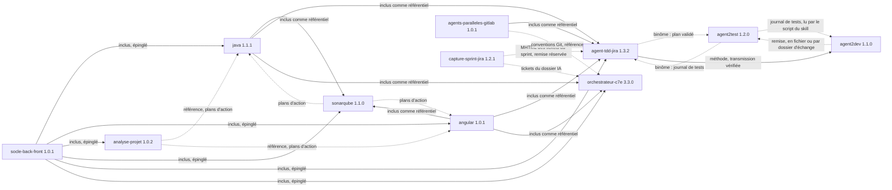

# Agent2Prompt

Spécifications d'agents écrites pour être transmises, en texte seul, à une IA de développement qui construit elle-même le code.

Chaque spécification est un package modulaire versionné : un point d'entrée, un manifeste, un module par dimension, des invariants testables et des points d'extension pour les versions futures. Pour la transmettre, on l'assemble en un texte unique que l'IA reconstruit à l'identique avant d'implémenter.

## Spécifications

| Spécification | Version | Transmission | Objet |
|---|---|---|---|
| [`tension-dashboard-gitlab-agent`](specs/tension-dashboard-gitlab-agent/SKILL.md) | 2.2.0 | [`transmissions/tension-dashboard-gitlab-agent-2.2.0.md`](transmissions/tension-dashboard-gitlab-agent-2.2.0.md) | Fichiers sous tension entre local et distant, tableau de bord temps réel, assistant GitLab à garde-fous |
| [`java`](specs/java/SKILL.md) | 1.1.1 | [`transmissions/java-1.1.1.md`](transmissions/java-1.1.1.md) | Produire et relire un back Java 21, Spring Boot 3.5, PostgreSQL, migrations Flyway ou Liquibase |
| [`angular`](specs/angular/SKILL.md) | 1.0.1 | [`transmissions/angular-1.0.1.md`](transmissions/angular-1.0.1.md) | Produire et relire un front Angular 20, accessibilité RGAA et WCAG comprise |
| [`analyse-projet`](specs/analyse-projet/SKILL.md) | 1.0.2 | [`transmissions/analyse-projet-1.0.2.md`](transmissions/analyse-projet-1.0.2.md) | Analyser un projet back et front en lecture seule : cartographie, rapport et feuille de route, ou plans d'action |
| [`sonarqube`](specs/sonarqube/SKILL.md) | 1.1.0 | [`transmissions/sonarqube-1.1.0.md`](transmissions/sonarqube-1.1.0.md) | SonarQube Server 2026.x : configurer l'analyse et la CI GitLab, examiner le code local avant le push selon les règles du profil (analyse éphémère, moteur SonarLint ou relecture), avec le mode de connexion choisi et une interface locale de pilotage (script Node sans dépendance, tests du projet remontés dans SonarQube avant chaque analyse éphémère, export CSV des règles de l'instance, recette simulée de 26 scénarios back Java et front TypeScript rejouée en CI sous Linux et Windows, recette réelle de 5 scénarios contre l'instance du développeur), trier, corriger ou planifier, gouverner la qualité |
| [`agent-tdd-jira`](specs/agent-tdd-jira/SKILL.md) | 1.3.2 | [`transmissions/agent-tdd-jira-1.3.2.md`](transmissions/agent-tdd-jira-1.3.2.md) | Développement TDD à partir d'une demande Jira en MHTML : analyse avec commentaires, US et critères d'acceptation numérotés, scénarios Gherkin par critère, variantes back et front, cycle rouge, vert, remanié, traçabilité jusqu'aux critères ; binôme avec Agent2Test, verdict d'acceptation par critère ; mode parallèle dans un worktree géré |
| [`agent2test`](specs/agent2test/SKILL.md) | 1.2.0 | [`transmissions/agent2test-1.2.0.md`](transmissions/agent2test-1.2.0.md) | Agent2Test, système de tests en binôme avec agent-tdd-jira : choisir, préparer et jouer avec Playwright les tests essentiels d'une demande sur l'application lancée, un verdict prouvé par critère d'acceptation, points de contrôle humains, apprentissage sous gouvernance, un fichier SQLite unique ouvert par un agent médiateur, remise reçue en fichier ou par un échange par dossiers facultatif, exécution locale |
| [`agent2dev`](specs/agent2dev/SKILL.md) | 1.1.0 | [`transmissions/agent2dev-1.1.0.md`](transmissions/agent2dev-1.1.0.md) | Agent2Dev, système de développement qui applique agent-tdd-jira comme méthode : de la demande Jira au rapport, cycle TDD scénario par scénario, binôme avec Agent2Test ; le moteur rédige, des agents déterministes écrivent et exécutent, le développeur valide à chaque point ; copie de travail et patchs par défaut, un fichier SQLite unique ouvert par un agent médiateur, échange par dossiers facultatif, journal chaîné, apprentissage sous gouvernance, exécution locale |
| [`agents-paralleles-gitlab`](specs/agents-paralleles-gitlab/SKILL.md) | 1.0.1 | [`transmissions/agents-paralleles-gitlab-1.0.1.md`](transmissions/agents-paralleles-gitlab-1.0.1.md) | Plusieurs agents en parallèle sur un dépôt GitLab, une demande Jira par worktree : isolation, hooks communs, script `agt`, garde-fous GitLab, recette de 44 contrôles |
| [`skill4appli`](specs/skill4appli/SKILL.md) | 1.1.0 | [`transmissions/skill4appli-1.1.0.md`](transmissions/skill4appli-1.1.0.md) | Mémoire SQLite d'une application locale et de ses branches git, pour un agent : inventaire fidèle à git, recherche `chemin:ligne`, requêtes en lecture seule, fraîcheur mesurée, watcher de la branche courante chargée dans un worktree dédié, configuration par l'environnement, parité Linux, WSL2 et Windows, lecture 12 facteurs × 7E, agent `memoire-appli` ; script Node sans dépendance et recette de 34 tests fournis dans la spécification, rejoués en CI sous Linux et Windows |
| [`capture-sprint-jira`](specs/capture-sprint-jira/SKILL.md) | 1.2.1 | [`transmissions/capture-sprint-jira-1.2.1.md`](transmissions/capture-sprint-jira-1.2.1.md) | Capture en MHTML des tickets du prochain sprint d'un Jira protégé par un SSO, rangés dans un dossier par section de la page du sprint (`IA`, `DEV`) : connexion faite à la main dans le navigateur du poste, filtre par préfixe de clé et plage de numéros, classement par en-tête de section, dossier `à classer`, capture d'un ticket seul par son adresse, rapport JSON, interface locale et ligne de commande, agent `capteur-sprint`, export par l'API sans SSO ; scripts et recette de 19 scénarios contre un faux Jira fournis dans la spécification, rejoués en CI sous Linux et Windows |
| [`orchestrateur-c7e`](specs/orchestrateur-c7e/SKILL.md) | 3.3.0 | [`transmissions/orchestrateur-c7e-3.3.0.md`](transmissions/orchestrateur-c7e-3.3.0.md) | Orchestrateur fractal C7E, activé au démarrage de l'IA locale sur choix du développeur, avec le fichier des invariants du projet (`meso-contrats.md`) et un référentiel des méso-contrats : à l'ouverture de chaque ticket, un modèle générique de la demande et des questions complémentaires en trouvent le méso-contrat, confirmé avant tout le reste, puis les options par couche (contrat CRUD, endpoints, règles, éléments graphiques, analyse des images PNG de l'objectif) : un ticket full-stack traité comme la transformation maîtrisée d'un système vivant, avec le cycle de l'Axiome 7E, quatre profondeurs de déclinaison, une fiche validée avant toute modification, des tests déduits des risques, des commits par slot compatibles avec les hooks du kit, une boucle de second ordre bornée par un registre de concepts |

Les règles que SonarQube applique au code Java et au code JavaScript / TypeScript sont énumérées dans [`docs/sonarqube/`](docs/sonarqube/README.md) : un tableau par analyseur, 780 règles Java et 583 règles JavaScript / TypeScript, avec leur présence dans Sonar way, ainsi que la liste des scénarios de recette du pilote par langage.

Les transmissions des versions précédentes restent dans `transmissions/` : elles sont la trace exacte de ce qui a été remis à une IA. Les skills `java`, `angular`, `analyse-projet` et `sonarqube` s'appelaient `expert-java`, `expert-angular`, `expert-analyse-projet` et `expert-sonarqube` jusqu'au 21 octobre 2026 : leurs transmissions et archives antérieures gardent ces noms.

Le [glossaire](glossaire.md) détaille chaque invariant `Dn.INV-k` de chaque spécification : dimension, énoncé, modules qui le reprennent et spécifications qui le citent. Il est généré, jamais écrit à la main.

Socle partagé, non transmis seul : [`socle-back-front`](specs/socle-back-front/SKILL.md) 1.0.1 (contrat OpenAPI, erreurs RFC 9457, formats, sécurité, traçabilité, accessibilité). Il est inclus, à une version épinglée, dans chaque transmission des experts, qui restent ainsi autonomes et cohérents entre eux. L'expert SonarQube inclut en plus les points d'entrée des experts Java et Angular comme référentiels d'invariants : une correction faite à partir de SonarQube respecte les mêmes règles qu'une correction faite par l'expert du langage. L'agent TDD inclut de même le point d'entrée du kit `agents-paralleles-gitlab` : en mode parallèle, il y lit les règles du worktree que le kit lui impose. L'agent TDD et Agent2Test se référencent l'un l'autre sans s'inclure : le premier remet son plan validé, le second rend un journal de tests, et chacun cite les invariants de l'autre (`agent2test:D3.INV-1`, `agent-tdd-jira:D7.INV-3`). Agent2Dev référence l'agent TDD comme méthode, sans l'inclure : il en charge la transmission vérifiée, en cite les sections dans ses fiches, en lance les scripts, et lit le journal de tests d'Agent2Test par le script du skill. Skill4Appli est autonome : il n'inclut ni ne référence aucun skill ; son watcher respecte la règle du kit des agents parallèles, une branche jamais extraite deux fois (`agents-paralleles-gitlab:D1.INV-1`), en chargeant la branche courante dans un worktree détaché, un par worktree de demande. Capture-sprint-jira est autonome lui aussi : ses captures sont des MHTML de Chrome, ceux que lit l'ingestion de l'agent TDD (`agent-tdd-jira:D1.INV-1`), et leur remise à l'agent TDD est une dimension réservée. L'orchestrateur C7E inclut le socle et les points d'entrée des experts Java et Angular comme référentiels : son fichier d'invariants du projet, `meso-contrats.md`, les précise sans les contredire. Il reprend les conventions Git du kit `agents-paralleles-gitlab` et la numérotation des critères d'`agent-tdd-jira`, qu'il référence sans les inclure (`agents-paralleles-gitlab:D2.INV-2`, `agent-tdd-jira:D10.INV-1`) ; il lit, par défaut, les tickets du dossier `IA/` de capture-sprint-jira.



## Documents

Ces documents ne sont pas des spécifications : le vérificateur ne les contrôle pas.

| Document | Formats | Objet |
|---|---|---|
| [L'IA, un investissement mesurable](docs/presentation-valeur-ia/presentation-valeur-ia.md) | Markdown avec schémas Mermaid ; [PowerPoint](docs/presentation-valeur-ia/presentation-valeur-ia.pptx) avec notes du présentateur | Montrer à un client ce que son investissement dans l'IA rapporte au développement de ses applications : constats publics sourcés, contrepartie par ticket, garde-fous, seuil de rentabilité, protocole de mesure, pilote avec règle d'arrêt |
| [Mode d'emploi de l'orchestrateur C7E](docs/orchestrateur-c7e/mode-emploi.md) | Markdown avec un schéma Mermaid | Installer `orchestrateur-c7e` 3.3.0 et le faire appeler au démarrage de Gemini CLI, en chargement permanent ou au choix, avec un menu et la commande `/c7e` ; installer le référentiel des méso-contrats, qualifier chaque ticket à son ouverture, choisir ses options et faire analyser les images de l'objectif ; vérifications, usage quotidien, limites et dépannage |

## Structure du dépôt

```
Agent2Prompt/
├── README.md
├── EVOLUTION.md                 principe d'évolution des structures
├── CHANGELOG.md                 historique de toutes les versions
├── glossaire.md                 détail de tous les invariants, généré
├── specs/
│   └── <nom>/
│       ├── SKILL.md             point d'entrée : registre, contrat, invariants
│       ├── manifest.json        modules, statuts, version, fichiers partagés, références
│       ├── ENTETE-TRANSMISSION.md   consigne donnée à l'IA
│       ├── modules/<id>/SKILL.md    un module par dimension
│       └── archives/SKILL-vX.Y.Z.md versions antérieures figées
├── transmissions/
│   └── <nom>-X.Y.Z.md           texte unique remis à l'IA, une par version
├── tools/
│   ├── bundle.mjs               assemblage d'une transmission (Node)
│   ├── glossaire.mjs            génération de glossaire.md
│   ├── installer.mjs            installation d'un skill dans Gemini CLI, depuis sa transmission
│   ├── installer.test.mjs       recette de l'installateur
│   └── verifier.mjs             vérification structurelle de toutes les spécifications
└── docs/
    ├── presentation-valeur-ia/  présentation « L'IA, un investissement mesurable », en Markdown et en PowerPoint
    └── orchestrateur-c7e/       mode d'emploi du lancement de l'orchestrateur C7E dans Gemini CLI
```

## Transmettre une spécification

Coller le contenu du fichier de `transmissions/` dans l'IA du développeur. Aucune pièce jointe n'est nécessaire. Le texte contient :

1. la consigne propre à la spécification : où matérialiser ses fichiers (`spec/` pour `tension-dashboard-gitlab-agent`, `agent2test` et `agent2dev`, qui se construisent dans leur propre projet, `.skills/<nom>/` pour les skills), quoi lire, puis comment travailler ;
2. chaque fichier de la spécification entre `<<<FICHIER chemin>>>` et `<<<FIN chemin>>>` ;
3. une table sha256 pour vérifier la reconstruction (`sha256sum -c`, depuis le dossier où les fichiers ont été matérialisés).

Pour Gemini CLI, l'installateur fait cette reconstruction sans IA et la vérifie : section suivante.

## Installer un skill dans Gemini CLI

`tools/installer.mjs` fait l'étape 0 de la consigne sans IA : il recrée le skill à partir de sa transmission dans `.gemini/skills/<skill>/` du workspace, et vérifie chaque fichier par son empreinte. Depuis le dossier où Gemini CLI est lancé, avec un clone de ce dépôt :

```bash
node ~/dev/Agent2Prompt/tools/installer.mjs orchestrateur-c7e    # version courante du dépôt
node ~/dev/Agent2Prompt/tools/installer.mjs java@1.1.1 angular   # une version transmise précise, plusieurs skills
node ~/dev/Agent2Prompt/tools/installer.mjs --tous               # tous les skills installables
node ~/dev/Agent2Prompt/tools/installer.mjs --liste              # état du dépôt, du workspace et du niveau utilisateur
node ~/dev/Agent2Prompt/tools/installer.mjs --retirer java
```

Sous Windows : `node C:\dev\Agent2Prompt\tools\installer.mjs orchestrateur-c7e`. Un fichier de transmission s'installe aussi seul : `node tools/installer.mjs chemin/vers/java-1.1.1.md`. `--essai` montre ce qui serait fait, sans rien écrire.

Le dossier du skill reçoit les fichiers transmis, la consigne de la transmission (`CONSIGNE.md`) et la table d'intégrité de l'installation (`integrite.sha256`, que vérifie `sha256sum -c integrite.sha256`). Une nouvelle version remplace l'ancienne d'un bloc. L'installateur refuse si des fichiers ont changé depuis l'installation, sauf `--forcer`, et ne touche pas à un dossier qu'il n'a pas installé.

Dans un dépôt Git, il masque le skill à `git status` sans le rendre illisible pour Gemini CLI :

- il l'exclut par l'exclusion locale de Git (`.git/info/exclude`, commune aux worktrees) ;
- il ajoute à `.geminiignore`, lui-même exclu, les négations `!/.gemini/`, `!/.gemini/skills/` et `!/.gemini/skills/<skill>/`.

Les négations sont nécessaires : dans un clone ordinaire, l'outil de lecture de fichiers de Gemini CLI refuse ce qu'exclut `.git/info/exclude`. Un skill exclu sans elles ne livre que son `SKILL.md` à l'activation, et ses modules restent illisibles. Il en va de même pour un skill matérialisé dans `.skills/` et exclu ainsi : les négations sont alors `!/.skills/` et `!/.skills/<skill>/`.

`--visible` laisse le skill dans `git status`, pour le versionner avec le projet. `--utilisateur` l'installe dans `~/.gemini/skills/`, hors de tout dépôt, pour tous les projets et tous les worktrees. L'installateur refuse les spécifications de systèmes à construire (`agent2dev`, `agent2test`, `tension-dashboard-gitlab-agent`), que leur consigne matérialise dans `spec/` de leur propre projet. Il n'installe `analyse-projet` qu'au niveau utilisateur : sa consigne interdit d'écrire dans le projet analysé.

Ensuite, dans Gemini CLI : `/skills reload`, puis `/skills list`. L'installateur affiche la phrase à donner à Gemini CLI à la première utilisation : activer le skill, puis suivre `CONSIGNE.md` à partir de l'étape 1. Si la confiance des dossiers est activée, le workspace doit être de confiance : sinon, Gemini CLI ignore ses skills.

La recette de l'installateur tourne sous Linux et sous Windows (`.github/workflows/recette-installer.yml`). Le même workflow confronte une installation au code de Gemini CLI lui-même (`@google/gemini-cli-core`, version épinglée) : chaque skill est découvert une fois, avec son nom et sa description, et chacun de ses fichiers est lisible.

## Générer une transmission

```bash
node tools/glossaire.mjs                                 # après toute modification d'une spécification
node tools/verifier.mjs                                  # toutes les spécifications, et le glossaire
node tools/bundle.mjs specs/tension-dashboard-gitlab-agent
node tools/bundle.mjs specs/java
```

`verifier.mjs` contrôle les manifestes, les versions, les modules et le registre des dimensions, les fichiers partagés épinglés, les archives, les points d'extension, les blocs de code et les invariants (chaque invariant défini est repris dans un module, chaque invariant cité est défini, y compris celui d'un autre skill, cité sous la forme `java:D4.INV-2`). Il échoue aussi si la transmission de la version courante d'une spécification ne redonne plus exactement ses fichiers, si ce README n'affiche plus les versions courantes, ou si `glossaire.md` ne correspond plus exactement aux spécifications. Il tourne à chaque pull request et à chaque push sur `main` (`.github/workflows/verifier.yml`). La recette de `skill4appli`, dont la spécification contient le code, tourne aussi sous Linux et sous Windows quand ses fichiers changent (`.github/workflows/recette-skill4appli.yml`) : la transmission y est matérialisée comme par l'IA du développeur, puis ses fichiers extraits et testés. Il en va de même pour `capture-sprint-jira` (`.github/workflows/recette-capture-sprint-jira.yml`), dont la recette installe sa dépendance par `npm ci` et pilote le Chrome des images GitHub contre un faux Jira local. `bundle.mjs` lit `manifest.json`, insère les fichiers partagés, écrit `transmissions/<nom>-<version>.md` et échoue si une version épinglée ne correspond pas ou si le texte ne redonne pas exactement chaque fichier. Les scripts de `tools/` demandent Node 20 ou plus récent et n'utilisent que les modules natifs de Node, sans `npm install` ; l'installateur appelle aussi `git` pour le masquage.

## Faire évoluer une spécification

Voir [`EVOLUTION.md`](EVOLUTION.md) : unités de structure, cycle de vie d'une dimension (`reserved`, `active`, `superseded`), contrat de version, procédure de publication. L'historique complet est dans [`CHANGELOG.md`](CHANGELOG.md) et dans `git log`, où chaque version de spécification a son propre commit.
