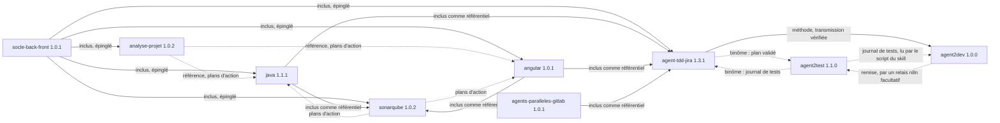

# Agent2Prompt

Spécifications d'agents écrites pour être transmises, en texte seul, à une IA de développement qui construit elle-même le code.

Chaque spécification est un package modulaire versionné : un point d'entrée, un manifeste, un module par dimension, des invariants testables et des points d'extension pour les versions futures. Pour la transmettre, on l'assemble en un texte unique que l'IA reconstruit à l'identique avant d'implémenter.

## Spécifications

| Spécification | Version | Transmission | Objet |
|---|---|---|---|
| [`tension-dashboard-gitlab-agent`](specs/tension-dashboard-gitlab-agent/SKILL.md) | 2.2.0 | [`transmissions/tension-dashboard-gitlab-agent-2.2.0.md`](transmissions/tension-dashboard-gitlab-agent-2.2.0.md) | Fichiers sous tension entre local et distant, tableau de bord temps réel, assistant GitLab à garde-fous |
| [`java`](specs/java/SKILL.md) | 1.1.1 | [`transmissions/java-1.1.1.md`](transmissions/java-1.1.1.md) | Produire et relire un back Java 21, Spring Boot 3.5, PostgreSQL, migrations Flyway ou Liquibase |
| [`angular`](specs/angular/SKILL.md) | 1.0.1 | [`transmissions/angular-1.0.1.md`](transmissions/angular-1.0.1.md) | Produire et relire un front Angular 20, accessibilité RGAA et WCAG comprise |
| [`analyse-projet`](specs/analyse-projet/SKILL.md) | 1.0.2 | [`transmissions/analyse-projet-1.0.2.md`](transmissions/analyse-projet-1.0.2.md) | Analyser un projet back et front en lecture seule : cartographie, rapport et feuille de route, ou plans d'action |
| [`sonarqube`](specs/sonarqube/SKILL.md) | 1.0.2 | [`transmissions/sonarqube-1.0.2.md`](transmissions/sonarqube-1.0.2.md) | SonarQube Server 2026.x : configurer l'analyse et la CI GitLab, trier, corriger ou planifier, gouverner la qualité |
| [`agent-tdd-jira`](specs/agent-tdd-jira/SKILL.md) | 1.3.1 | [`transmissions/agent-tdd-jira-1.3.1.md`](transmissions/agent-tdd-jira-1.3.1.md) | Développement TDD à partir d'une demande Jira en MHTML : analyse avec commentaires, US et critères d'acceptation numérotés, scénarios Gherkin par critère, variantes back et front, cycle rouge, vert, remanié, traçabilité jusqu'aux critères ; binôme avec Agent2Test, verdict d'acceptation par critère ; mode parallèle dans un worktree géré |
| [`agent2test`](specs/agent2test/SKILL.md) | 1.1.0 | [`transmissions/agent2test-1.1.0.md`](transmissions/agent2test-1.1.0.md) | Agent2Test, système de tests en binôme avec agent-tdd-jira : choisir, préparer et jouer avec Playwright les tests essentiels d'une demande sur l'application lancée, un verdict prouvé par critère d'acceptation, points de contrôle humains, apprentissage sous gouvernance, un fichier SQLite par agent, remise reçue par un relais n8n facultatif, exécution locale |
| [`agent2dev`](specs/agent2dev/SKILL.md) | 1.0.0 | [`transmissions/agent2dev-1.0.0.md`](transmissions/agent2dev-1.0.0.md) | Agent2Dev, système de développement qui applique agent-tdd-jira comme méthode : de la demande Jira au rapport, cycle TDD scénario par scénario, binôme avec Agent2Test ; le moteur rédige, des agents déterministes écrivent et exécutent, le développeur valide à chaque point ; copie de travail et patchs par défaut, un fichier SQLite par agent, relais n8n facultatif, journal chaîné, apprentissage sous gouvernance, exécution locale |
| [`agents-paralleles-gitlab`](specs/agents-paralleles-gitlab/SKILL.md) | 1.0.1 | [`transmissions/agents-paralleles-gitlab-1.0.1.md`](transmissions/agents-paralleles-gitlab-1.0.1.md) | Plusieurs agents en parallèle sur un dépôt GitLab, une demande Jira par worktree : isolation, hooks communs, script `agt`, garde-fous GitLab, recette de 44 contrôles |
| [`skill4appli`](specs/skill4appli/SKILL.md) | 1.0.0 | [`transmissions/skill4appli-1.0.0.md`](transmissions/skill4appli-1.0.0.md) | Mémoire SQLite d'une application locale et de ses branches git, pour un agent : inventaire fidèle à git, recherche `chemin:ligne`, requêtes en lecture seule, fraîcheur mesurée, watcher de la branche courante chargée dans un worktree dédié, agent `memoire-appli` ; script Node sans dépendance et recette de 25 tests fournis dans la spécification |

Les transmissions des versions précédentes restent dans `transmissions/` : elles sont la trace exacte de ce qui a été remis à une IA. Les skills `java`, `angular`, `analyse-projet` et `sonarqube` s'appelaient `expert-java`, `expert-angular`, `expert-analyse-projet` et `expert-sonarqube` jusqu'au 21 octobre 2026 : leurs transmissions et archives antérieures gardent ces noms.

Le [glossaire](glossaire.md) détaille chaque invariant `Dn.INV-k` de chaque spécification : dimension, énoncé, modules qui le reprennent et spécifications qui le citent. Il est généré, jamais écrit à la main.

Socle partagé, non transmis seul : [`socle-back-front`](specs/socle-back-front/SKILL.md) 1.0.1 (contrat OpenAPI, erreurs RFC 9457, formats, sécurité, traçabilité, accessibilité). Il est inclus, à une version épinglée, dans chaque transmission des experts, qui restent ainsi autonomes et cohérents entre eux. L'expert SonarQube inclut en plus les points d'entrée des experts Java et Angular comme référentiels d'invariants : une correction faite à partir de SonarQube respecte les mêmes règles qu'une correction faite par l'expert du langage. L'agent TDD inclut de même le point d'entrée du kit `agents-paralleles-gitlab` : en mode parallèle, il y lit les règles du worktree que le kit lui impose. L'agent TDD et Agent2Test se référencent l'un l'autre sans s'inclure : le premier remet son plan validé, le second rend un journal de tests, et chacun cite les invariants de l'autre (`agent2test:D3.INV-1`, `agent-tdd-jira:D7.INV-3`). Agent2Dev référence l'agent TDD comme méthode, sans l'inclure : il en charge la transmission vérifiée, en cite les sections dans ses fiches, en lance les scripts, et lit le journal de tests d'Agent2Test par le script du skill. Skill4Appli est autonome : il n'inclut ni ne référence aucun skill ; son watcher respecte la règle du kit des agents parallèles, une branche jamais extraite deux fois (`agents-paralleles-gitlab:D1.INV-1`), en chargeant la branche courante dans un worktree détaché, un par worktree de demande.



## Structure du dépôt

```
Agent2Prompt/
├── README.md
├── EVOLUTION.md                 principe d'évolution des structures
├── CHANGELOG.md                 historique de toutes les versions
├── glossaire.md                 détail de tous les invariants, généré
├── specs/
│   └── <nom>/
│       ├── SKILL.md             point d'entrée : registre, contrat, invariants
│       ├── manifest.json        modules, statuts, version, fichiers partagés, références
│       ├── ENTETE-TRANSMISSION.md   consigne donnée à l'IA
│       ├── modules/<id>/SKILL.md    un module par dimension
│       └── archives/SKILL-vX.Y.Z.md versions antérieures figées
├── transmissions/
│   └── <nom>-X.Y.Z.md           texte unique remis à l'IA, une par version
└── tools/
    ├── bundle.mjs               assemblage d'une transmission (Node)
    ├── glossaire.mjs            génération de glossaire.md
    └── verifier.mjs             vérification structurelle de toutes les spécifications
```

## Transmettre une spécification

Coller le contenu du fichier de `transmissions/` dans l'IA du développeur. Aucune pièce jointe n'est nécessaire. Le texte contient :

1. la consigne propre à la spécification : où matérialiser ses fichiers (`spec/` pour `tension-dashboard-gitlab-agent`, `agent2test` et `agent2dev`, qui se construisent dans leur propre projet, `.skills/<nom>/` pour les skills), quoi lire, puis comment travailler ;
2. chaque fichier de la spécification entre `<<<FICHIER chemin>>>` et `<<<FIN chemin>>>` ;
3. une table sha256 pour vérifier la reconstruction (`sha256sum -c`, depuis le dossier où les fichiers ont été matérialisés).

## Générer une transmission

```bash
node tools/glossaire.mjs                                 # après toute modification d'une spécification
node tools/verifier.mjs                                  # toutes les spécifications, et le glossaire
node tools/bundle.mjs specs/tension-dashboard-gitlab-agent
node tools/bundle.mjs specs/java
```

`verifier.mjs` contrôle les manifestes, les versions, les modules et le registre des dimensions, les fichiers partagés épinglés, les archives, les points d'extension, les blocs de code et les invariants (chaque invariant défini est repris dans un module, chaque invariant cité est défini, y compris celui d'un autre skill, cité sous la forme `java:D4.INV-2`). Il échoue aussi si la transmission de la version courante d'une spécification ne redonne plus exactement ses fichiers, si ce README n'affiche plus les versions courantes, ou si `glossaire.md` ne correspond plus exactement aux spécifications. Il tourne à chaque pull request et à chaque push sur `main` (`.github/workflows/verifier.yml`). `bundle.mjs` lit `manifest.json`, insère les fichiers partagés, écrit `transmissions/<nom>-<version>.md` et échoue si une version épinglée ne correspond pas ou si le texte ne redonne pas exactement chaque fichier. Les trois scripts demandent Node 20 ou plus récent et n'utilisent que les modules natifs (`node:fs`, `node:crypto`, `node:path`), sans `npm install`.

## Faire évoluer une spécification

Voir [`EVOLUTION.md`](EVOLUTION.md) : unités de structure, cycle de vie d'une dimension (`reserved`, `active`, `superseded`), contrat de version, procédure de publication. L'historique complet est dans [`CHANGELOG.md`](CHANGELOG.md) et dans `git log`, où chaque version de spécification a son propre commit.
