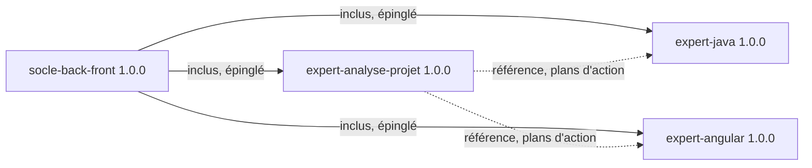

# Agent2Prompt

Spécifications d'agents écrites pour être transmises, en texte seul, à une IA de développement qui construit elle-même le code.

Chaque spécification est un package modulaire versionné : un point d'entrée, un manifeste, un module par dimension, des invariants testables et des points d'extension pour les versions futures. Pour la transmettre, on l'assemble en un texte unique que l'IA reconstruit à l'identique avant d'implémenter.

## Spécifications

| Spécification | Version | Transmission | Objet |
|---|---|---|---|
| [`tension-dashboard-gitlab-agent`](specs/tension-dashboard-gitlab-agent/SKILL.md) | 2.2.0 | [`transmissions/tension-dashboard-gitlab-agent-2.2.0.md`](transmissions/tension-dashboard-gitlab-agent-2.2.0.md) | Fichiers sous tension entre local et distant, tableau de bord temps réel, assistant GitLab à garde-fous |
| [`expert-java`](specs/expert-java/SKILL.md) | 1.0.0 | [`transmissions/expert-java-1.0.0.md`](transmissions/expert-java-1.0.0.md) | Produire et relire un back Java 21, Spring Boot 3.5, PostgreSQL |
| [`expert-angular`](specs/expert-angular/SKILL.md) | 1.0.0 | [`transmissions/expert-angular-1.0.0.md`](transmissions/expert-angular-1.0.0.md) | Produire et relire un front Angular 20, accessibilité RGAA et WCAG comprise |
| [`expert-analyse-projet`](specs/expert-analyse-projet/SKILL.md) | 1.0.0 | [`transmissions/expert-analyse-projet-1.0.0.md`](transmissions/expert-analyse-projet-1.0.0.md) | Analyser un projet back et front en lecture seule : cartographie, rapport et feuille de route, ou plans d'action |

Socle partagé, non transmis seul : [`socle-back-front`](specs/socle-back-front/SKILL.md) 1.0.0 (contrat OpenAPI, erreurs RFC 9457, formats, sécurité, traçabilité, accessibilité). Il est inclus, à une version épinglée, dans chaque transmission des trois experts, qui restent ainsi autonomes et cohérents entre eux.



## Structure du dépôt

```
Agent2Prompt/
├── README.md
├── EVOLUTION.md                 principe d'évolution des structures
├── CHANGELOG.md                 historique de toutes les versions
├── specs/
│   └── <nom>/
│       ├── SKILL.md             point d'entrée : registre, contrat, invariants
│       ├── manifest.json        modules, statuts, version, fichiers partagés, références
│       ├── ENTETE-TRANSMISSION.md   consigne donnée à l'IA
│       ├── modules/<id>/SKILL.md    un module par dimension
│       └── archives/SKILL-vX.Y.Z.md versions antérieures figées
├── transmissions/
│   └── <nom>-X.Y.Z.md           texte unique remis à l'IA, une par version
└── tools/
    ├── bundle.mjs               assemblage d'une transmission (Node)
    └── verifier.mjs             vérification structurelle de toutes les spécifications
```

## Transmettre une spécification

Coller le contenu du fichier de `transmissions/` dans l'IA du développeur. Aucune pièce jointe n'est nécessaire. Le texte contient :

1. la consigne : matérialiser la spécification dans `spec/`, la lire, proposer un plan, attendre la validation, implémenter par étapes ;
2. chaque fichier de la spécification entre `<<<FICHIER chemin>>>` et `<<<FIN chemin>>>` ;
3. une table sha256 pour vérifier la reconstruction (`sha256sum -c`).

## Générer une transmission

```bash
node tools/verifier.mjs                                  # toutes les spécifications
node tools/bundle.mjs specs/tension-dashboard-gitlab-agent
node tools/bundle.mjs specs/expert-java
```

`verifier.mjs` contrôle les manifestes, les versions, les modules, les fichiers partagés épinglés, les blocs de code et les invariants (chaque invariant défini est repris dans un module, chaque invariant cité est défini). `bundle.mjs` lit `manifest.json`, insère les fichiers partagés, écrit `transmissions/<nom>-<version>.md` et échoue si une version épinglée ne correspond pas ou si le texte ne redonne pas exactement chaque fichier. Les deux scripts demandent Node 20 ou plus récent et n'utilisent que les modules natifs (`node:fs`, `node:crypto`, `node:path`), sans `npm install`.

## Faire évoluer une spécification

Voir [`EVOLUTION.md`](EVOLUTION.md) : unités de structure, cycle de vie d'une dimension (`reserved`, `active`, `superseded`), contrat de version, procédure de publication. L'historique complet est dans [`CHANGELOG.md`](CHANGELOG.md) et dans `git log`, où chaque version de spécification a son propre commit.
