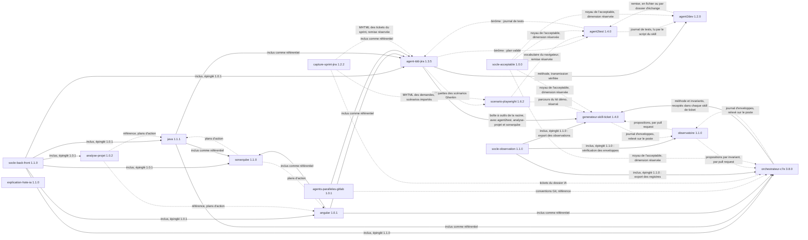

# Agent2Prompt

Spécifications d'agents écrites pour être transmises, en texte seul, à une IA de développement qui construit elle-même le code.

Chaque spécification est un package modulaire versionné : un point d'entrée, un manifeste, un module par dimension, des invariants testables et des points d'extension pour les versions futures. Pour la transmettre, on l'assemble en un texte unique que l'IA reconstruit à l'identique avant d'implémenter.

## Spécifications

| Spécification | Version | Transmission | Objet |
|---|---|---|---|
| [`tension-dashboard-gitlab-agent`](specs/tension-dashboard-gitlab-agent/SKILL.md) | 2.2.0 | [`transmissions/tension-dashboard-gitlab-agent-2.2.0.md`](transmissions/tension-dashboard-gitlab-agent-2.2.0.md) | Fichiers sous tension entre local et distant, tableau de bord temps réel, assistant GitLab à garde-fous |
| [`java`](specs/java/SKILL.md) | 1.1.1 | [`transmissions/java-1.1.1.md`](transmissions/java-1.1.1.md) | Produire et relire un back Java 21, Spring Boot 3.5, PostgreSQL, migrations Flyway ou Liquibase |
| [`angular`](specs/angular/SKILL.md) | 1.0.1 | [`transmissions/angular-1.0.1.md`](transmissions/angular-1.0.1.md) | Produire et relire un front Angular 20, accessibilité RGAA et WCAG comprise |
| [`analyse-projet`](specs/analyse-projet/SKILL.md) | 1.0.2 | [`transmissions/analyse-projet-1.0.2.md`](transmissions/analyse-projet-1.0.2.md) | Analyser un projet back et front en lecture seule : cartographie, rapport et feuille de route, ou plans d'action |
| [`sonarqube`](specs/sonarqube/SKILL.md) | 1.1.0 | [`transmissions/sonarqube-1.1.0.md`](transmissions/sonarqube-1.1.0.md) | SonarQube Server 2026.x : configurer l'analyse et la CI GitLab, examiner le code local avant le push selon les règles du profil (analyse éphémère, moteur SonarLint ou relecture), avec le mode de connexion choisi et une interface locale de pilotage (script Node sans dépendance, tests du projet remontés dans SonarQube avant chaque analyse éphémère, export CSV des règles de l'instance, recette simulée de 26 scénarios back Java et front TypeScript rejouée en CI sous Linux et Windows, recette réelle de 5 scénarios contre l'instance du développeur), trier, corriger ou planifier, gouverner la qualité |
| [`agent-tdd-jira`](specs/agent-tdd-jira/SKILL.md) | 1.3.5 | [`transmissions/agent-tdd-jira-1.3.5.md`](transmissions/agent-tdd-jira-1.3.5.md) | Développement TDD à partir d'une demande Jira en MHTML : analyse avec commentaires, US et critères d'acceptation numérotés, scénarios Gherkin par critère, variantes back et front, cycle rouge, vert, remanié, traçabilité jusqu'aux critères ; binôme avec Agent2Test, verdict d'acceptation par critère ; mode parallèle dans un worktree géré |
| [`agent2test`](specs/agent2test/SKILL.md) | 1.4.0 | [`transmissions/agent2test-1.4.0.md`](transmissions/agent2test-1.4.0.md) | Agent2Test, système de tests en binôme avec agent-tdd-jira : choisir, préparer et jouer avec Playwright les tests essentiels d'une demande sur l'application lancée, un verdict prouvé par critère d'acceptation, un navigateur qui regarde comme une personne et rend compte de ce qu'il voit et ne voit pas, points de contrôle humains, apprentissage sous gouvernance, un fichier SQLite unique ouvert par un agent médiateur, remise reçue en fichier ou par un échange par dossiers facultatif, exécution locale |
| [`agent2dev`](specs/agent2dev/SKILL.md) | 1.2.0 | [`transmissions/agent2dev-1.2.0.md`](transmissions/agent2dev-1.2.0.md) | Agent2Dev, système de développement qui applique agent-tdd-jira comme méthode : de la demande Jira au rapport, cycle TDD scénario par scénario, binôme avec Agent2Test ; le moteur rédige, des agents déterministes écrivent et exécutent, le développeur valide à chaque point ; copie de travail et patchs par défaut, un fichier SQLite unique ouvert par un agent médiateur, échange par dossiers facultatif, journal chaîné, apprentissage sous gouvernance, exécution locale |
| [`agents-paralleles-gitlab`](specs/agents-paralleles-gitlab/SKILL.md) | 1.0.1 | [`transmissions/agents-paralleles-gitlab-1.0.1.md`](transmissions/agents-paralleles-gitlab-1.0.1.md) | Plusieurs agents en parallèle sur un dépôt GitLab, une demande Jira par worktree : isolation, hooks communs, script `agt`, garde-fous GitLab, recette de 44 contrôles |
| [`skill4appli`](specs/skill4appli/SKILL.md) | 1.1.1 | [`transmissions/skill4appli-1.1.1.md`](transmissions/skill4appli-1.1.1.md) | Mémoire SQLite d'une application locale et de ses branches git, pour un agent : inventaire fidèle à git, recherche `chemin:ligne`, requêtes en lecture seule, fraîcheur mesurée, watcher de la branche courante chargée dans un worktree dédié, configuration par l'environnement, parité Linux, WSL2 et Windows, lecture 12 facteurs × 7E, agent `memoire-appli` ; script Node sans dépendance et recette de 34 tests fournis dans la spécification, rejoués en CI sous Linux et Windows |
| [`capture-sprint-jira`](specs/capture-sprint-jira/SKILL.md) | 1.2.2 | [`transmissions/capture-sprint-jira-1.2.2.md`](transmissions/capture-sprint-jira-1.2.2.md) | Capture en MHTML des tickets du prochain sprint d'un Jira protégé par un SSO, rangés dans un dossier par section de la page du sprint (`IA`, `DEV`) : connexion faite à la main dans le navigateur du poste, filtre par préfixe de clé et plage de numéros, classement par en-tête de section, dossier `à classer`, capture d'un ticket seul par son adresse, rapport JSON, interface locale et ligne de commande, agent `capteur-sprint`, export par l'API sans SSO ; scripts et recette de 19 scénarios contre un faux Jira fournis dans la spécification, rejoués en CI sous Linux et Windows |
| [`orchestrateur-c7e`](specs/orchestrateur-c7e/SKILL.md) | 3.8.0 | [`transmissions/orchestrateur-c7e-3.8.0.md`](transmissions/orchestrateur-c7e-3.8.0.md) | Orchestrateur fractal C7E, activé au démarrage de l'IA locale sur choix du développeur, avec le fichier des invariants du projet (`meso-contrats.md`) et un référentiel des méso-contrats : à l'ouverture de chaque ticket, un modèle générique de la demande et des questions complémentaires en trouvent le méso-contrat principal et, au besoin, ses compléments, confirmés avant tout le reste, puis les options par couche (contrat CRUD, endpoints, variantes de représentation d'une ressource et leur mise à jour en temps réel, règles, éléments graphiques, analyse des images PNG de l'objectif) : un ticket full-stack traité comme la transformation maîtrisée d'un système vivant, avec le cycle de l'Axiome 7E, quatre profondeurs de déclinaison, une fiche validée avant toute modification, des tests déduits des risques, des commits par slot compatibles avec les hooks du kit, une boucle de second ordre bornée par un registre de concepts ; ses registres s'exportent, minimisés, vers le socle d'observation, par un outil que le développeur lance depuis le clone |
| [`generateur-skill-ticket`](specs/generateur-skill-ticket/SKILL.md) | 1.4.0 | [`transmissions/generateur-skill-ticket-1.4.0.md`](transmissions/generateur-skill-ticket-1.4.0.md) | Générateur de skills de ticket C7E : un ticket décomposé en arbre de sous-tickets, un skill assemblé par nœud depuis le référentiel des méso-contrats, installé et lancé dans Gemini CLI, observé dans un champ partagé et vu augmenté ; chaque ticket entraîne le générateur, qui propose ses évolutions au développeur ; dépend de l'orchestrateur sans le modifier ; ses observations s'exportent, minimisées, vers le socle d'observation |
| [`observatoire`](specs/observatoire/SKILL.md) | 1.1.0 | [`transmissions/observatoire-1.1.0.md`](transmissions/observatoire-1.1.0.md) | Observatoire de l'écosystème, sur le poste : relève les journaux d'enveloppes des projets, les confronte entre instances, et entre systèmes par les invariants du dépôt que citent leurs écarts, observe l'état de l'écosystème, écrit des propositions minimisées apportées au dépôt par pull request, et suit l'effet des ratifiées ; premier couplage du troisième ordre, il propose et n'applique jamais |
| [`explication-hote-ia`](specs/explication-hote-ia/SKILL.md) | 1.1.0 | [`transmissions/explication-hote-ia-1.1.0.md`](transmissions/explication-hote-ia-1.1.0.md) | Agent qui explique le fonctionnement de l'outil d'IA qui l'exécute, Gemini CLI ou un hôte non reconnu décrit sans être nommé, d'abord pour les développeurs qui hésitent à s'en servir faute d'en voir le fonctionnement : parcours découverte qui ouvre la boîte noire en sept questions, en langage simple, chaque étape montrée sur le poste, sans chercher à convaincre ; boucle d'un tour, contexte de chaque requête, outils et politique, confiance, composants, mémoire, modèle, ce qui sort du poste et angles morts, appliqués à l'installation observée ; carte de l'installation et diagnostic d'un comportement ; chaque affirmation étiquetée par sa provenance ; repères vérifiés sur Gemini CLI 0.67.0 et rejoués en CI contre l'hôte réel, sous Node 26.13.0, sans qu'aucun appel ne quitte le poste ; script Node en lecture seule qui ne rend aucun secret, recette de 28 tests rejouée sous Linux et Windows, avec Node 20, 24 et 26.13.0, sous-agent `explicateur-hote` et commandes `/hote:explique`, `/hote:carte`, `/hote:pourquoi` ; se diffuse seul, indépendant du dépôt : son dossier, ou un fichier `.skill`, s'installe par `gemini skills install`, avec son mode d'emploi joint, [`MODE-EMPLOI.md`](specs/explication-hote-ia/MODE-EMPLOI.md) |
| [`scenario-playwright`](specs/scenario-playwright/SKILL.md) | 1.6.2 | [`transmissions/scenario-playwright-1.6.2.md`](transmissions/scenario-playwright-1.6.2.md) | Scénarios côté utilisateur joués dans le Chrome du poste par Playwright : texte de départ inspiré de Gherkin, en français ou en anglais, écrit par le développeur ou importé sans IA d'une demande Jira (page MHTML ou adresse, connexion à la main), d'un fichier `.feature` ou d'une archive d'export, des tests de Xray et de Zephyr Scale lus par leur API en lecture seule, jeton par variable d'environnement, ou, sans jeton, des pages de tests de Xray enregistrées en HTML complet, lues sans rien exécuter (test manuel converti pas à pas, clé du test pour identité, provenance et comparaison au réimport), traduit en TOML par l'IA sur un squelette produit sans IA, puis ratifié, et contrôlé sans IA (empreinte, lignes, marques, variables) ; index sans IA du code front et back du projet (routes, éléments et noms accessibles, libellés traduits, endpoints, validations), lu à la traduction, qui propose les cibles et signale une cible absente ; vérifications hors de l'écran (requêtes de la page, API en GET avec la session du navigateur, fichiers téléchargés), sans en-tête, cookie ni jeton relevé ; préparation et nettoyage des données depuis des lignes marquées du texte, par l'API avec la session du navigateur et le jeton anti-CSRF recopié, ou par un autre scénario ratifié, valeurs gardées et suffixe unique, nettoyage joué même après un échec ; export sans IA du scénario ratifié en test `@playwright/test` du projet, dans le seul dossier de tests désigné, sans identifiant, la connexion laissée à l'équipe, test périmé dit quand le scénario change ; campagne de scénarios dans une seule fenêtre, une seule connexion, chaque vérification avec sa copie d'écran, chaque test avec son verdict, conforme, non conforme ou bloqué, et rapport de conformité prêt à coller dans Jira, en balisage wiki de Data Center et en page HTML pour Cloud ; résultats d'une exécution ou d'une campagne au format d'import de Xray, Cloud ou Data Center, ou de Zephyr Scale, sous la clé retenue à l'import, sans rien envoyer ; jeu d'actions fermé commun avec le navigateur d'Agent2Test, cibles par rôle et nom accessible, aucun code exécuté dans la page, origines gardées, mutations hors du poste sur autorisation explicite, connexion à la main dans un profil dédié, rapport avec captures et instantanés ARIA, désignation d'une cible à la souris, agent `pilote-scenario` et commandes `/scenario:*` |

Les règles que SonarQube applique au code Java et au code JavaScript / TypeScript sont énumérées dans [`docs/sonarqube/`](docs/sonarqube/README.md) : un tableau par analyseur, 780 règles Java et 583 règles JavaScript / TypeScript, avec leur présence dans Sonar way, ainsi que la liste des scénarios de recette du pilote par langage.

Les transmissions des versions précédentes restent dans `transmissions/` : elles sont la trace exacte de ce qui a été remis à une IA. Les skills `java`, `angular`, `analyse-projet` et `sonarqube` s'appelaient `expert-java`, `expert-angular`, `expert-analyse-projet` et `expert-sonarqube` jusqu'au 21 octobre 2026 : leurs transmissions et archives antérieures gardent ces noms.

Le [glossaire](glossaire.md) détaille chaque invariant `Dn.INV-k` de chaque spécification, et ceux des socles (`SCn.INV-k`, `SOn.INV-k`, `SAn.INV-k`) : dimension, énoncé, modules qui le reprennent et spécifications qui le citent. Il donne aussi la notation des ordres cybernétiques et des niveaux d'observation. Il est généré, jamais écrit à la main.

Socle partagé, non transmis seul : [`socle-back-front`](specs/socle-back-front/SKILL.md) 1.1.0 (contrat OpenAPI, erreurs RFC 9457, formats, sécurité, traçabilité, accessibilité, événements temps réel par WebSocket STOMP). Il est inclus, à une version épinglée, dans chaque transmission des experts, qui restent ainsi autonomes et cohérents entre eux. Chaque skill choisit la version qu'il épingle, courante ou archivée : l'orchestrateur C7E épingle la 1.1.0, les autres skills gardent la 1.0.1 jusqu'à ce qu'ils décident de monter. Second socle, non transmis seul lui aussi : [`socle-observation`](specs/socle-observation/SKILL.md) 1.1.0 (enveloppe commune des observations, propositions, décisions et écarts des systèmes de second ordre, journal en ajout seul et chaîné, minimisation, correspondances avec leurs formats), milieu du troisième ordre (`EVOLUTION.md`, section 10) ; le générateur et l'orchestrateur C7E l'incluent, épinglé, et exportent dans son enveloppe, chacun dans son journal, sous le même sel d'instance ; l'observatoire l'inclut, épinglé, pour vérifier les enveloppes qu'il relève. Troisième socle, non transmis seul lui aussi : [`socle-acceptable`](specs/socle-acceptable/SKILL.md) 1.0.0 (noyau commun de ce que tous les systèmes refusent, intentions, actions, écritures, secrets et leçons, chaque règle un invariant que cite le refus ; écriture par les kits dev, test et démo, avec retour arrière ; dérogations et faux refus ; épinglage par les constitutions, sans retrait ni affaiblissement), couplage des valeurs du troisième ordre (`EVOLUTION.md`, section 10) ; Agent2Dev, Agent2Test, l'orchestrateur C7E et le générateur le référencent, chacun à une dimension réservée, sans l'inclure ni l'appliquer encore. L'expert SonarQube inclut en plus les points d'entrée des experts Java et Angular comme référentiels d'invariants : une correction faite à partir de SonarQube respecte les mêmes règles qu'une correction faite par l'expert du langage. L'agent TDD inclut de même le point d'entrée du kit `agents-paralleles-gitlab` : en mode parallèle, il y lit les règles du worktree que le kit lui impose. L'agent TDD et Agent2Test se référencent l'un l'autre sans s'inclure : le premier remet son plan validé, le second rend un journal de tests, et chacun cite les invariants de l'autre (`agent2test:D3.INV-1`, `agent-tdd-jira:D7.INV-3`). Agent2Dev référence l'agent TDD comme méthode, sans l'inclure : il en charge la transmission vérifiée, en cite les sections dans ses fiches, en lance les scripts, et lit le journal de tests d'Agent2Test par le script du skill. Skill4Appli est autonome : il n'inclut ni ne référence aucun skill ; son watcher respecte la règle du kit des agents parallèles, une branche jamais extraite deux fois (`agents-paralleles-gitlab:D1.INV-1`), en chargeant la branche courante dans un worktree détaché, un par worktree de demande. Capture-sprint-jira est autonome lui aussi : ses captures sont des MHTML de Chrome, ceux que lit l'ingestion de l'agent TDD (`agent-tdd-jira:D1.INV-1`), et leur remise à l'agent TDD est une dimension réservée. L'orchestrateur C7E inclut le socle et les points d'entrée des experts Java et Angular comme référentiels : son fichier d'invariants du projet, `meso-contrats.md`, les précise sans les contredire. Il reprend les conventions Git du kit `agents-paralleles-gitlab` et la numérotation des critères d'`agent-tdd-jira`, qu'il référence sans les inclure (`agents-paralleles-gitlab:D2.INV-2`, `agent-tdd-jira:D10.INV-1`) ; il lit, par défaut, les tickets du dossier `IA/` de capture-sprint-jira. Explication-hote-ia est autonome : il n'inclut ni ne référence aucun skill ; il explique l'hôte qui exécute les autres, et la recette de l'installateur le découvre dans Gemini CLI comme eux. Scenario-playwright est autonome lui aussi : il référence Agent2Test, dont il reprend le vocabulaire du navigateur et ses règles (`agent2test:D4.INV-2`, `agent2test:D4.INV-4`), et agent-tdd-jira, dont il recopie les étiquettes des scénarios Gherkin (`agent-tdd-jira:D2.INV-3`), sans les inclure ; la remise de ses scénarios à Agent2Test et le parcours du kit démo du générateur sont des dimensions réservées.



## Documents

Ces documents ne sont pas des spécifications : le vérificateur ne les contrôle pas. Chaque spécification transmissible a son mode d'emploi dans `docs/<nom>/mode-emploi.md` ; le socle `socle-back-front`, qui ne se transmet qu'inclus dans les experts, n'en a pas.

| Document | Formats | Objet |
|---|---|---|
| [L'IA, un investissement mesurable](docs/presentation-valeur-ia/presentation-valeur-ia.md) | Markdown avec schémas Mermaid ; [PowerPoint](docs/presentation-valeur-ia/presentation-valeur-ia.pptx) avec notes du présentateur | Montrer à un client ce que son investissement dans l'IA rapporte au développement de ses applications : constats publics sourcés, changement de paradigme, contrepartie par ticket, garde-fous, seuil de rentabilité, protocole de mesure, pilote avec règle d'arrêt |
| [Mode d'emploi de l'orchestrateur C7E](docs/orchestrateur-c7e/mode-emploi.md) | Markdown avec un schéma Mermaid | Installer `orchestrateur-c7e` 3.8.0 et le faire appeler au démarrage de Gemini CLI, en chargement permanent ou au choix, avec un menu et la commande `/c7e` ; installer le référentiel des méso-contrats, qualifier chaque ticket à son ouverture, choisir ses options et faire analyser les images de l'objectif ; exporter ses registres vers le socle d'observation ; vérifications, usage quotidien, limites et dépannage |
| [Mode d'emploi du générateur de skills de ticket](docs/generateur-skill-ticket/mode-emploi.md) | Markdown avec un schéma Mermaid | Installer `generateur-skill-ticket` 1.4.0, faire qualifier et décomposer un ticket, vérifier l'arbre et son plan de commits, générer, installer et lancer ses skills de ticket dans Gemini CLI, suivre le champ et la vue, clore en versant l'apprentissage du ticket au registre du projet, décider des propositions qu'il en tire, retirer, et exporter les observations du projet vers le socle d'observation ; recette, essais sur le poste à chaque ticket, dépannage |
| [Mode d'emploi de l'observatoire](docs/observatoire/mode-emploi.md) | Markdown avec un schéma Mermaid | Installer `observatoire` 1.1.0, inscrire les projets qui exportent, relever leurs journaux dans le magasin local, lire l'état de l'écosystème, confronter les instances et les systèmes, proposer par pull request, ratifier et suivre l'effet ; dépannage |
| [Mode d'emploi de l'expert Java](docs/java/mode-emploi.md) | Markdown avec un schéma Mermaid | Installer `java` 1.1.1, cadrer mode, périmètre et versions, produire avec plan validé et build vert, ou relire avec la grille de revue ; mise à jour, dépannage |
| [Mode d'emploi de l'expert Angular](docs/angular/mode-emploi.md) | Markdown avec un schéma Mermaid | Installer `angular` 1.0.1, cadrer mode, versions et choix du projet, produire avec `ng lint`, `ng test` et `ng build`, ou relire ; accessibilité RGAA et WCAG ; dépannage |
| [Mode d'emploi de l'analyse de projet](docs/analyse-projet/mode-emploi.md) | Markdown avec un schéma Mermaid | Installer `analyse-projet` 1.0.2 au niveau utilisateur, choisir le livrable (cartographie, rapport, plans), cadrer périmètre, axes et profondeur ; lecture seule ; dépannage |
| [Mode d'emploi de l'expert SonarQube](docs/sonarqube/mode-emploi.md) | Markdown avec un schéma Mermaid | Installer `sonarqube` 1.1.0, jeton et modes de connexion, cinq missions, examen local avant le push par trois moteurs, interface de pilotage, recettes ; tableaux des règles Java et JavaScript / TypeScript dans le même dossier |
| [Mode d'emploi de l'agent TDD](docs/agent-tdd-jira/mode-emploi.md) | Markdown avec un schéma Mermaid | Installer `agent-tdd-jira` 1.3.5, en clone ordinaire ou en mode parallèle, enregistrer la demande en MHTML, franchir les points V1 à V5, binôme avec Agent2Test ; dépannage |
| [Mode d'emploi d'Agent2Test](docs/agent2test/mode-emploi.md) | Markdown avec un schéma Mermaid | Construire `agent2test` 1.4.0 dans son propre projet en huit lots, puis mener une campagne par les points de contrôle CP-0 à CP-5, le navigateur rendant compte de ce qu'il voit et ne voit pas ; binôme, faire évoluer, dépannage |
| [Mode d'emploi d'Agent2Dev](docs/agent2dev/mode-emploi.md) | Markdown avec un schéma Mermaid | Construire `agent2dev` 1.2.0 en neuf lots avec la méthode agent-tdd-jira, puis traiter une demande par les points V0 à V5 et CP-4, patchs par défaut ; binôme, dépannage |
| [Mode d'emploi des agents parallèles](docs/agents-paralleles-gitlab/mode-emploi.md) | Markdown avec un schéma Mermaid | Installer le kit `agents-paralleles-gitlab` 1.0.1 avec l'IA, disposition autour du dépôt nu, cycle d'une demande par `agt`, garde-fous GitLab, recette de 44 contrôles ; dépannage |
| [Mode d'emploi de Skill4Appli](docs/skill4appli/mode-emploi.md) | Markdown avec un schéma Mermaid | Installer `skill4appli` 1.1.1 du bon côté du git, recette, agent `memoire-appli`, modes `travail` et `miroir`, commandes, variables et codes de sortie ; dépannage |
| [Mode d'emploi de la capture de sprint](docs/capture-sprint-jira/mode-emploi.md) | Markdown avec un schéma Mermaid | Installer `capture-sprint-jira` 1.2.2, capturer un sprint ou un ticket en MHTML après connexion SSO à la main, classement par section, réglages ; dépannage |
| [Mode d'emploi des scénarios Playwright](docs/scenario-playwright/mode-emploi.md) | Markdown avec un schéma Mermaid | Installer `scenario-playwright` 1.6.2, écrire un texte de départ ou importer les scénarios d'une demande Jira, d'un fichier `.feature`, les tests de Xray et de Zephyr Scale, ou, sans jeton, leurs pages enregistrées, indexer le code du projet, faire traduire et ratifier, vérifier à l'écran et hors de l'écran, préparer et nettoyer les données par l'API ou par un scénario, jouer un scénario dans le Chrome du poste avec une connexion à la main, lire le rapport, jouer une campagne et rendre son rapport de conformité à coller dans Jira, mettre le scénario dans les tests `@playwright/test` du projet, rendre les résultats à Xray ou à Zephyr Scale, désigner une cible à la souris ; garde-fous et dépannage |
| [Mode d'emploi du tableau de bord des fichiers sous tension](docs/tension-dashboard-gitlab-agent/mode-emploi.md) | Markdown avec un schéma Mermaid | Construire `tension-dashboard-gitlab-agent` 2.2.0 dans un projet neuf, en six étapes testées, effecteur GitLab en essai à blanc ; vérifications sur la machine réelle |
| [Comprendre l'IA avant de s'en servir](docs/explication-hote-ia/mode-emploi.md) | Markdown avec un schéma Mermaid | À diffuser aux développeurs : sept questions sur Gemini CLI et leurs réponses, lisibles sans rien installer ; pour essayer sans risque, l'agent `explication-hote-ia` 1.1.0 et son parcours découverte, avec le renvoi à son mode d'emploi |
| [Mode d'emploi d'explication-hote-ia](specs/explication-hote-ia/MODE-EMPLOI.md) | Markdown avec un schéma Mermaid | Joint au skill, à côté de son point d'entrée, et diffusé avec lui : installer `explication-hote-ia` 1.1.0 sans le dépôt, par `gemini skills install` depuis son dossier ou un fichier `.skill`, extraction et recette, sous-agent et commandes `/hote:*` ; parcours découverte, modes carte et pourquoi, export du prompt système, ce qui sort du poste ; mise à jour, retrait, diffusion, dépannage |

## Structure du dépôt

```
Agent2Prompt/
├── README.md
├── installer.mjs                installation ou mise à jour de tous les skills et agents dans Gemini CLI
├── installer.cmd                le même, pour CMD sous Windows
├── .geminiignore                historique figé que Gemini CLI ne lit pas
├── EVOLUTION.md                 principe d'évolution des structures
├── CHANGELOG.md                 historique de toutes les versions
├── glossaire.md                 détail de tous les invariants, généré
├── specs/
│   └── <nom>/
│       ├── SKILL.md             point d'entrée : registre, contrat, invariants
│       ├── manifest.json        modules, statuts, version, fichiers partagés, références
│       ├── ENTETE-TRANSMISSION.md   consigne donnée à l'IA
│       ├── modules/<id>/SKILL.md    un module par dimension
│       ├── archives/SKILL-vX.Y.Z.md versions antérieures figées
│       └── outils/, tests/, exemples/   pour generateur-skill-ticket, orchestrateur-c7e et observatoire : outils lancés depuis le clone, recette, exemples, non transmis
├── observatoire/
│   └── propositions/            propositions de l'observatoire, apportées par pull request, minimisées
├── transmissions/
│   └── <nom>-X.Y.Z.md           texte unique remis à l'IA, une par version
├── tools/
│   ├── bundle.mjs               assemblage d'une transmission (Node)
│   ├── glossaire.mjs            génération de glossaire.md
│   ├── installer.mjs            installation d'un skill dans Gemini CLI, depuis sa transmission
│   ├── installer.test.mjs       recette de l'installateur
│   ├── installer-racine.test.mjs   recette de installer.mjs, à la racine
│   └── verifier.mjs             vérification structurelle de toutes les spécifications
└── docs/
    ├── presentation-valeur-ia/  présentation « L'IA, un investissement mesurable », en Markdown et en PowerPoint
    ├── orchestrateur-c7e/       mode d'emploi du lancement de l'orchestrateur C7E dans Gemini CLI
    ├── sonarqube/               mode d'emploi, règles Java et JavaScript / TypeScript, scénarios du pilote
    └── <nom>/mode-emploi.md     un mode d'emploi par spécification transmissible
```

## Transmettre une spécification

Coller le contenu du fichier de `transmissions/` dans l'IA du développeur. Aucune pièce jointe n'est nécessaire. Le texte contient :

1. la consigne propre à la spécification : où matérialiser ses fichiers (`spec/` pour `tension-dashboard-gitlab-agent`, `agent2test` et `agent2dev`, qui se construisent dans leur propre projet, `.skills/<nom>/` pour les skills), quoi lire, puis comment travailler ;
2. chaque fichier de la spécification entre `<<<FICHIER chemin>>>` et `<<<FIN chemin>>>` ;
3. une table sha256 pour vérifier la reconstruction (`sha256sum -c`, depuis le dossier où les fichiers ont été matérialisés).

Pour Gemini CLI, l'installateur fait cette reconstruction sans IA et la vérifie : sections suivantes.

## Installer ou mettre à jour tous les skills et agents

`installer.mjs`, à la racine du dépôt, installe ou met à jour dans Gemini CLI tous les skills installables et les agents qu'ils portent, au niveau utilisateur : `~/.gemini/`, ou `$GEMINI_CLI_HOME/.gemini/`, pour tous les projets. Depuis n'importe quel dossier, avec un clone à jour :

```bash
git -C ~/dev/Agent2Prompt pull
node ~/dev/Agent2Prompt/installer.mjs              # installer ou mettre à jour tout
node ~/dev/Agent2Prompt/installer.mjs --liste      # état de chaque skill, agent et commande
node ~/dev/Agent2Prompt/installer.mjs --retirer    # retirer ce qui est intact
```

Sous Windows, dans CMD : `C:\dev\Agent2Prompt\installer.cmd`, avec les mêmes options. `--workspace <dossier>` installe au niveau d'un projet plutôt qu'au niveau utilisateur, masqué à Git ; `--essai` montre ce qui serait fait, sans rien écrire.

- **Skills** : chaque skill installable, depuis sa transmission courante, comme le fait `tools/installer.mjs` (section suivante) : fichiers transmis, consigne, fichiers que le skill tire de ses modules, table d'intégrité. Les systèmes à construire ne s'installent pas.
- **Agents et commandes** : ceux que portent les skills installés, `capteur-sprint`, `explicateur-hote` avec ses commandes `/hote:explique`, `/hote:carte` et `/hote:pourquoi`, `memoire-appli`, et `pilote-scenario` avec ses commandes `/scenario:importer`, `/scenario:indexer`, `/scenario:traduire`, `/scenario:jouer` et `/scenario:designer`, copiés dans `~/.gemini/agents/` et `~/.gemini/commands/`. Comme le demandent leurs modules, seule la copie s'adapte à Gemini CLI : outils nommés comme Gemini CLI dans l'en-tête, chemin du skill installé. Le fichier du skill ne change pas.
- **Mise à jour** : un skill intact est mis à jour en place, et les fichiers ajoutés depuis son installation, comme `node_modules`, restent. Un skill, un agent ou une commande changé depuis son installation reste tel quel : sa nouvelle version est déposée dans `~/.gemini/agent2prompt/a-fusionner/`, avec la liste des écarts. Une fois la fusion faite à la main, `--fusionne <nom>` en fait la base de l'installation. `--forcer` prend la nouvelle version telle quelle, après avoir sauvegardé les changements locaux dans `~/.gemini/agent2prompt/sauvegardes/`.
- **État** : l'empreinte de chaque copie installée est tenue dans `~/.gemini/agent2prompt/installation.json`, que Gemini CLI ne lit pas.

Ensuite, dans les sessions ouvertes de Gemini CLI : `/skills reload`, `/agents reload` et `/commands reload`. L'installateur dit ce qui reste à faire, comme `npm ci` pour les dépendances de `capture-sprint-jira` et de `scenario-playwright`, et donne le chemin du clone qu'attend `generateur-skill-ticket`.

Gemini CLI ne lit pas l'historique figé du dépôt : `.geminiignore` lui cache les archives des versions publiées et les anciennes transmissions qui citent un autre hôte d'IA. Elles restent telles que publiées, et `tools/verifier.mjs` refuse ce nom partout ailleurs.

## Installer un skill dans Gemini CLI

`tools/installer.mjs` fait l'étape 0 de la consigne sans IA : il recrée le skill à partir de sa transmission dans `.gemini/skills/<skill>/` du workspace, et vérifie chaque fichier par son empreinte. Depuis le dossier où Gemini CLI est lancé, avec un clone de ce dépôt :

```bash
node ~/dev/Agent2Prompt/tools/installer.mjs orchestrateur-c7e    # version courante du dépôt
node ~/dev/Agent2Prompt/tools/installer.mjs java@1.1.1 angular   # une version transmise précise, plusieurs skills
node ~/dev/Agent2Prompt/tools/installer.mjs --tous               # tous les skills installables
node ~/dev/Agent2Prompt/tools/installer.mjs --liste              # état du dépôt, du workspace et du niveau utilisateur
node ~/dev/Agent2Prompt/tools/installer.mjs --retirer java
```

Sous Windows : `node C:\dev\Agent2Prompt\tools\installer.mjs orchestrateur-c7e`. Un fichier de transmission s'installe aussi seul : `node tools/installer.mjs chemin/vers/java-1.1.1.md`. `--essai` montre ce qui serait fait, sans rien écrire.

Le dossier du skill reçoit les fichiers transmis, la consigne de la transmission (`CONSIGNE.md`), les fichiers que le skill tire de ses modules (ceux de la table `attendu` de sa commande d'extraction, contrôlés par leur empreinte) et la table d'intégrité de l'installation (`integrite.sha256`, que vérifie `sha256sum -c integrite.sha256`). Une nouvelle version remplace l'ancienne d'un bloc. L'installateur refuse si des fichiers ont changé depuis l'installation, sauf `--forcer`, et ne touche pas à un dossier qu'il n'a pas installé.

Dans un dépôt Git, il masque le skill à `git status` sans le rendre illisible pour Gemini CLI :

- il l'exclut par l'exclusion locale de Git (`.git/info/exclude`, commune aux worktrees) ;
- il ajoute à `.geminiignore`, lui-même exclu, les négations `!/.gemini/`, `!/.gemini/skills/` et `!/.gemini/skills/<skill>/`.

Les négations sont nécessaires : dans un clone ordinaire, l'outil de lecture de fichiers de Gemini CLI refuse ce qu'exclut `.git/info/exclude`. Un skill exclu sans elles ne livre que son `SKILL.md` à l'activation, et ses modules restent illisibles. Il en va de même pour un skill matérialisé dans `.skills/` et exclu ainsi : les négations sont alors `!/.skills/` et `!/.skills/<skill>/`.

`--visible` laisse le skill dans `git status`, pour le versionner avec le projet. `--utilisateur` l'installe dans `~/.gemini/skills/`, hors de tout dépôt, pour tous les projets et tous les worktrees. L'installateur refuse les spécifications de systèmes à construire (`agent2dev`, `agent2test`, `tension-dashboard-gitlab-agent`), que leur consigne matérialise dans `spec/` de leur propre projet. Il n'installe `analyse-projet` qu'au niveau utilisateur : sa consigne interdit d'écrire dans le projet analysé ; ni `observatoire`, qui observe plusieurs projets depuis le clone, sans écrire dans aucun.

Ensuite, dans Gemini CLI : `/skills reload`, puis `/skills list`. L'installateur affiche la phrase à donner à Gemini CLI à la première utilisation : activer le skill, puis suivre `CONSIGNE.md` à partir de l'étape 1. Si la confiance des dossiers est activée, le workspace doit être de confiance : sinon, Gemini CLI ignore ses skills.

`explication-hote-ia` se diffuse aussi seul, sans ce dépôt : `gemini skills install` l'installe depuis son dossier ou un fichier `.skill`, et son mode d'emploi, [`specs/explication-hote-ia/MODE-EMPLOI.md`](specs/explication-hote-ia/MODE-EMPLOI.md), joint au skill, donne chaque étape.

Les recettes des deux installateurs tournent sous Linux et sous Windows (`.github/workflows/recette-installer.yml`). Le même workflow confronte leurs installations au code de Gemini CLI lui-même (`@google/gemini-cli-core`, version épinglée) : chaque skill est découvert une fois, avec son nom et sa description, chacun de ses fichiers est lisible, et chaque sous-agent copié par `installer.mjs` se charge sans erreur. Il vérifie aussi, avec le même code, que `.geminiignore` cache au dépôt son historique figé et rien d'autre.

## Générer une transmission

```bash
node tools/glossaire.mjs                                 # après toute modification d'une spécification
node tools/verifier.mjs                                  # toutes les spécifications, et le glossaire
node tools/bundle.mjs specs/tension-dashboard-gitlab-agent
node tools/bundle.mjs specs/java
```

`verifier.mjs` contrôle les manifestes, les versions, les modules et le registre des dimensions, les fichiers partagés épinglés, les archives, les points d'extension, les blocs de code et les invariants (chaque invariant défini est repris dans un module, chaque invariant cité est défini, y compris celui d'un autre skill, cité sous la forme `java:D4.INV-2`). Il échoue aussi si la transmission de la version courante d'une spécification ne redonne plus exactement ses fichiers, si ce README n'affiche plus les versions courantes, ou si `glossaire.md` ne correspond plus exactement aux spécifications. Il vérifie aussi que les noms d'un autre hôte d'IA et de son éditeur ne figurent que dans l'historique que `.geminiignore` cache à Gemini CLI, et que ce fichier ne cache aucune version courante. Il tourne à chaque pull request et à chaque push sur `main` (`.github/workflows/verifier.yml`), aussi sur une extraction en fins de ligne CRLF, comme celle de Git sous Windows : le vérificateur, `bundle.mjs` et `glossaire.mjs` lisent les fichiers en fins de ligne Unix, et donnent le même résultat. La recette de `skill4appli`, dont la spécification contient le code, tourne aussi sous Linux et sous Windows quand ses fichiers changent (`.github/workflows/recette-skill4appli.yml`) : la transmission y est matérialisée comme par l'IA du développeur, puis ses fichiers extraits et testés. Il en va de même pour `capture-sprint-jira` (`.github/workflows/recette-capture-sprint-jira.yml`), dont la recette installe sa dépendance par `npm ci` et pilote le Chrome des images GitHub contre un faux Jira local. De même pour `explication-hote-ia` (`.github/workflows/recette-explication-hote-ia.yml`) ; un second travail y confronte les repères du skill au Gemini CLI réel, à une version épinglée et sous Node 26.13.0, sans qu'aucun appel ne quitte le poste : l'hôte tourne contre une fausse API locale qui garde ses requêtes, un proxy témoin note et refuse toute autre sortie, et `strace` relève chaque connexion (`.github/scripts/reperes-hote.mjs`). De même pour `scenario-playwright` (`.github/workflows/recette-scenario-playwright.yml`), dont la recette installe `playwright-core`, et `@playwright/test` pour les tests exportés, par `npm ci`, et joue ses scénarios dans le Chrome des images GitHub, contre une application de démonstration, un Jira, un Xray et un Zephyr Scale factices locaux, et un projet de démonstration front et back pour l'index du code, puis joue leurs tests exportés par `@playwright/test` et les compare au skill étape par étape, joue des campagnes et vérifie leurs verdicts, leurs copies d'écran et leurs rapports de conformité, avec Node 22, 24 et 26. `bundle.mjs` lit `manifest.json`, insère les fichiers partagés à leur version épinglée, la courante ou une archivée de leur source, écrit `transmissions/<nom>-<version>.md` et échoue si une version épinglée n'est ni courante ni archivée ou si le texte ne redonne pas exactement chaque fichier. Les scripts de `tools/` demandent Node 20 ou plus récent et n'utilisent que les modules natifs de Node, sans `npm install` ; l'installateur appelle aussi `git` pour le masquage.

## Faire évoluer une spécification

Voir [`EVOLUTION.md`](EVOLUTION.md) : unités de structure, cycle de vie d'une dimension (`reserved`, `active`, `superseded`), contrat de version, procédure de publication, ordres cybernétiques et niveaux d'observation. L'historique complet est dans [`CHANGELOG.md`](CHANGELOG.md) et dans `git log`, où chaque version de spécification a son propre commit.
