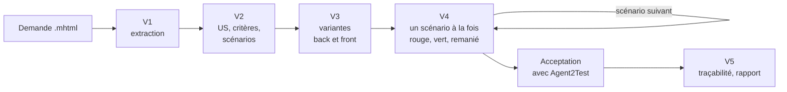

# Mode d'emploi : l'agent TDD à partir d'une demande Jira

Ce mode d'emploi fait travailler l'IA du développeur comme [`agent-tdd-jira`](../../specs/agent-tdd-jira/SKILL.md) 1.3.2 : partir d'une demande Jira enregistrée en MHTML, en tirer les US et leurs critères d'acceptation numérotés, décliner chaque critère en scénarios Gherkin, proposer des variantes de réalisation back Java et front Angular, puis réaliser les scénarios un par un en cycle **rouge, vert, remanié**, avec une traçabilité jusqu'aux commits.

L'agent avance par points de validation : sans votre réponse explicite, il ne passe pas à l'étape suivante.



## 1. Prérequis

- Une IA locale qui lit, écrit et exécute dans le projet : Gemini CLI, Claude Code ou équivalent.
- Le code du back (Java 21, Spring Boot 3.5) et du front (Angular 20), avec leurs outils de build et de test.
- La demande Jira enregistrée en MHTML **après avoir déplié tous les commentaires** : depuis Chrome, « Enregistrer sous », page Web, fichier unique. Pour tout un sprint, [`capture-sprint-jira`](../capture-sprint-jira/mode-emploi.md) le fait pour vous.
- La transmission : [`transmissions/agent-tdd-jira-1.3.2.md`](../../transmissions/agent-tdd-jira-1.3.2.md), ou un clone d'Agent2Prompt.

## 2. Installer

**Dans Gemini CLI**, depuis la racine du projet :

```bash
node <Agent2Prompt>/tools/installer.mjs agent-tdd-jira
```

Puis `/skills reload`, et « Active le skill agent-tdd-jira. L'étape 0 de sa consigne est faite. Lis `CONSIGNE.md` dans son dossier et suis-la à partir de l'étape 1. »

**Dans une autre IA**, coller la transmission : l'IA crée `.skills/agent-tdd-jira/` et vérifie chaque fichier.

**En mode parallèle**, dans la disposition du [kit des agents parallèles](../agents-paralleles-gitlab/mode-emploi.md), le skill se pose une seule fois hors des worktrees (`~/dev/<projet>/.skills/agent-tdd-jira/`), ou au niveau utilisateur (`--utilisateur`). La consigne de lancement de l'agent indique le worktree : l'agent vérifie le skill par ses empreintes et ne le réécrit pas.

Le skill inclut le socle back-front, les points d'entrée des experts Java et Angular et celui du kit des agents parallèles, comme référentiels.

## 3. Démarrer une demande

L'agent vous demande :

- le fichier `.mhtml` de la demande ; en mode parallèle, il est déjà dans `travail/` ;
- l'accès au code et ses versions réelles ;
- le mode d'authentification de l'application (jeton porteur ou cookie de session), qui conditionne certaines variantes du front.

## 4. Les cinq points de validation

| Point | Vous validez | Ce que l'agent a produit |
|---|---|---|
| **V1** | l'extraction est complète et fidèle | résumé, description, commentaires, pièces jointes, dans `demande.json` |
| **V2** | les US, les critères numérotés `<CLÉ>-CAnn`, les scénarios de chaque critère, les réponses aux questions | critères sourcés ou marqués « proposé » ; scénarios Gherkin en français, étiquetés `@<CLÉ>-Snn` et `@<CLÉ>-CAnn` |
| **V3** | une variante back et une variante front par scénario | variantes `B1`, `B2`…, `F1`, `F2`…, avec la combinaison recommandée |
| **V4** | chaque scénario réalisé, avant le suivant | test étiqueté rouge pour la raison attendue, code minimal vert, remaniement, commit local |
| **V5** | la matrice de traçabilité et le rapport | de la demande aux critères, aux scénarios, aux tests et aux commits ; projet de commentaire Jira, que vous publiez vous-même |

Une contradiction entre la description et un commentaire devient une question : l'agent ne la tranche pas.

## 5. En binôme avec Agent2Test

Après le dernier scénario, [Agent2Test](../agent2test/mode-emploi.md) joue les tests essentiels de la demande sur l'application lancée et rend **un verdict par critère d'acceptation**. Un défaut applicatif confirmé revient en cycle TDD. L'agent TDD ne démarre ni n'arrête l'application, ne lance aucun batch et ne conteste aucun verdict : un désaccord vous est remonté.

## 6. Ce qui ne se négocie pas

- Le fichier MHTML n'est jamais modifié ; l'agent n'écrit jamais dans Jira.
- Aucune ligne de code de production avant un test étiqueté qui échoue pour la bonne raison.
- Un seul scénario à la fois ; le suivant attend l'acceptation du précédent.
- Tout code respecte le socle et les invariants des experts Java et Angular ; une variante qui en viole un n'est jamais recommandée.
- Aucune nouvelle dépendance sans validation. Aucun push sans demande explicite ; **en mode parallèle, aucun push, même sur demande**, et un refus « REFUS : » d'un garde-fou du kit arrête l'agent.

## 7. Mettre à jour, retirer

- **Mettre à jour** : `git pull` dans Agent2Prompt, puis la même commande d'installation. Une demande en cours garde ses fichiers (`demande.json`, `.feature`, suivi) : finissez-la avant de changer de version, ou relisez le journal de révision du skill.
- **Retirer** : `node <Agent2Prompt>/tools/installer.mjs --retirer agent-tdd-jira`.

## 8. Dépannage

| Symptôme | Cause probable | Remède |
|---|---|---|
| Commentaires absents de l'extraction | page enregistrée sans déplier les commentaires | réenregistrer le MHTML après avoir tout déplié |
| L'agent refuse d'écrire du code | aucun test rouge pour ce scénario | c'est la règle : valider d'abord le test qui échoue |
| L'agent attend sans avancer | un point de validation n'a pas reçu de réponse explicite | répondre au point V en cours |
| « REFUS : » en mode parallèle | garde-fou du kit, par exemple un push ou une branche partagée | lire le message ; agir vous-même si c'est voulu, jamais par l'agent |
| Verdict d'Agent2Test contesté | désaccord sur un critère | trancher vous-même ; l'agent ne réécrit pas un verdict |

La lecture directe de Jira par son API est une dimension réservée : elle n'est pas appliquée en 1.3.
