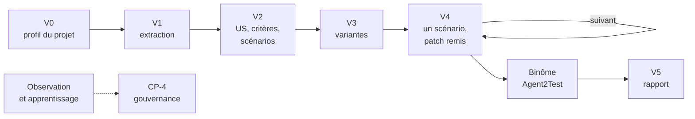

# Mode d'emploi : construire et utiliser Agent2Dev

[`agent2dev`](../../specs/agent2dev/SKILL.md) 1.1.0 est la **spécification d'un système à construire**, pas un skill qu'on installe. Une IA la reçoit dans le dépôt d'Agent2Dev et l'implémente par lots, sous votre validation.

Agent2Dev applique le skill [`agent-tdd-jira`](../agent-tdd-jira/mode-emploi.md) **comme méthode** : d'une demande Jira exportée en MHTML, il tire les US, les critères d'acceptation, les scénarios Gherkin et les variantes, puis réalise chaque scénario en cycle TDD, jusqu'à la traçabilité, en binôme avec [Agent2Test](../agent2test/mode-emploi.md). Le moteur rédige ; des agents déterministes écrivent et exécutent ; vous validez à chaque point.

## 1. Prérequis

- Une IA locale qui écrit et exécute du code : Gemini CLI, Claude Code ou équivalent.
- Node 22.13 ou plus récent (24 recommandé), git 2.30 ou plus récent ; les données tiennent dans un fichier SQLite, par `node:sqlite`.
- Le projet à faire évoluer (back Java, front Angular), avec ses outils de build et de test.
- La transmission : [`transmissions/agent2dev-1.1.0.md`](../../transmissions/agent2dev-1.1.0.md), et celle de la méthode : [`transmissions/agent-tdd-jira-1.3.2.md`](../../transmissions/agent-tdd-jira-1.3.2.md).

L'installateur d'Agent2Prompt refuse cette spécification : elle se matérialise dans `spec/` de son propre projet.

## 2. Construire

1. Ouvrir l'IA à la racine du dépôt d'Agent2Dev et coller la transmission.
2. **Étape 0** : l'IA crée `agent2dev/spec/` et vérifie chaque fichier. Elle vous demande ensuite **la transmission d'agent-tdd-jira 1.3.2**, qu'elle place telle quelle dans `test/fixtures/methode/` : c'est la méthode qu'Agent2Dev charge, vérifiée par ses empreintes, et jamais recopiée dans son code.
3. **Étape 1** : lecture, sans code.
4. **Étape 2** : plan soumis à votre validation. Rien ne s'écrit avant.
5. **Étape 3** : implémentation en neuf lots, chacun testé en simulation et sans réseau, chacun clos par votre validation :

| Lot | Contenu |
|---|---|
| 1 | noyau et bus |
| 2 | données (agent médiateur du fichier SQLite), journal, référentiel, méthode |
| 3 | substrat : profil du projet, dépôt, exécutant |
| 4 | cadrage et orchestration |
| 5 | conception et réalisation |
| 6 | binôme, échange par dossiers, traçabilité |
| 7 | observateur, apprenant, réflexif : premier et second ordre |
| 8 | interfaces : serveur MCP, tableau de bord |
| 9 | exploitation et guide de démarrage |

6. **Étape 4** : recette contre les critères d'acceptation globaux, et compte rendu.

## 3. Utiliser : une demande, sept points

| Point | Vous décidez |
|---|---|
| **V0** Profil | les commandes de build et de test du projet, au premier usage et après une modification du fichier de construction |
| **V1** Extraction | la demande extraite du MHTML est complète et fidèle |
| **V2** US, critères, scénarios | valider, répondre aux questions, corriger, ou rejeter la demande |
| **V3** Variantes | une variante back et une variante front par scénario |
| **V4** Scénario | accepter : un **patch** vous est remis, ou un commit si l'écriture est autorisée ; ou ajuster |
| **V5** Rapport | accepter, corriger, ou recalculer après un patch appliqué |
| **CP-4** Gouvernance | ratifier, amender ou refuser une leçon proposée par le système, depuis le tableau de bord ; effet à la demande suivante |

**Par défaut, Agent2Dev n'écrit pas dans votre arbre** : il travaille dans une copie de travail et remet un patch par scénario accepté, que vous appliquez vous-même. L'écriture directe est une autorisation à donner explicitement.

**Le binôme** : entre V4 et V5, vous ouvrez la campagne d'Agent2Test, puis donnez à Agent2Dev le chemin du journal de tests, ou déclarez la demande sans binôme. En mode `dossiers`, facultatif, l'échange porte la remise et relève le journal ; le mode `manuel` est le défaut.

## 4. Ce qui ne se négocie pas

- La méthode est agent-tdd-jira 1.3.2, lue depuis sa transmission vérifiée : rien n'en est réécrit.
- Seul l'agent `depot` écrit dans un arbre du projet ; il ne pousse jamais, et dans votre arbre ne fusionne pas, ne rebase pas, ne change pas de branche.
- Seules s'exécutent les commandes du profil ratifié et les scripts du skill, sans shell ; l'application n'est ni démarrée, ni arrêtée, ni déployée ; aucun batch.
- Aucun code de production avant un test étiqueté qui échoue pour la bonne raison.
- Aucun point de validation sauté ou décidé par le système ; journal et grand livre en ajout seul.
- Tout tourne en local ; les interfaces n'écoutent que sur `127.0.0.1`.

## 5. Faire évoluer

Une nouvelle version arrive par une nouvelle transmission : remplacez `spec/` à l'identique, et la transmission de la méthode si son épinglage change. Demandez ensuite à l'IA un plan pour l'écart, d'après le journal de révision de `spec/SKILL.md`. Les écarts relevés sur la spécification se ratifient dans Agent2Prompt (`EVOLUTION.md`, § 5).

## 6. Dépannage

| Symptôme | Cause probable | Remède |
|---|---|---|
| Aucune commande ne s'exécute | profil V0 non ratifié, ou fichier de construction modifié | ratifier le profil en V0 |
| Méthode refusée au chargement | transmission d'agent-tdd-jira absente ou altérée | replacer la transmission 1.3.2 telle quelle dans `test/fixtures/methode/` |
| Rien n'apparaît dans votre arbre | écriture non autorisée, comportement par défaut | appliquer le patch remis en V4, ou autoriser l'écriture |
| V5 attend | journal de tests d'Agent2Test non fourni | donner son chemin, ou déclarer la demande sans binôme |

La mémoire longue et l'autonomie accrue sont des dimensions réservées, non appliquées en 1.1.
