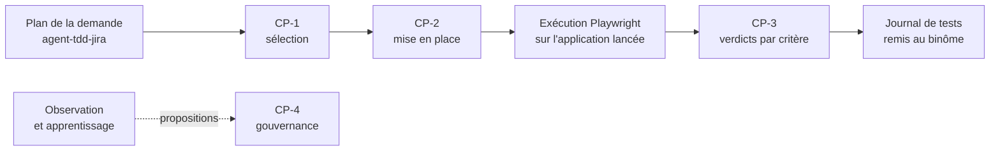

# Mode d'emploi : construire et utiliser Agent2Test

[`agent2test`](../../specs/agent2test/SKILL.md) 1.2.0 est la **spécification d'un système à construire**, pas un skill qu'on installe. Une IA la reçoit dans un projet séparé de l'application et l'implémente par lots, sous votre validation.

Agent2Test choisit, prépare et joue avec Playwright les tests essentiels d'une demande sur l'application Angular **que vous avez lancée**, et rend **un verdict prouvé par critère d'acceptation**. Son plan vient d'[`agent-tdd-jira`](../agent-tdd-jira/mode-emploi.md) : US, critères numérotés, scénarios Gherkin. Il travaille en binôme avec [Agent2Dev](../agent2dev/mode-emploi.md) ou avec l'agent TDD.

## 1. Prérequis

- Une IA locale qui écrit et exécute du code : Gemini CLI, Claude Code ou équivalent.
- Node 22.13 ou plus récent (24 recommandé), Playwright 1.63 ou plus récent ; les données tiennent dans un fichier SQLite, par `node:sqlite` : aucun serveur de base de données.
- L'application Angular lancée par vous sur votre poste, et un navigateur du côté de la session SSO.
- Docker Compose seulement pour un moteur local souverain (Ollama).
- La transmission : [`transmissions/agent2test-1.2.0.md`](../../transmissions/agent2test-1.2.0.md).

L'installateur d'Agent2Prompt refuse cette spécification : elle se matérialise dans `spec/` de son propre projet.

## 2. Construire

1. Créer un projet vide `agent2test/`, **hors du dépôt de l'application**, ouvrir l'IA à sa racine et coller la transmission.
2. **Étape 0** : l'IA écrit `spec/` et vérifie chaque fichier.
3. **Étape 1** : lecture, sans code.
4. **Étape 2** : plan soumis à votre validation (arborescence, choix techniques ouverts, questions). Rien ne s'écrit avant.
5. **Étape 3** : implémentation en huit lots, chacun testé en simulation et sans réseau, chacun clos par votre validation :

| Lot | Contenu |
|---|---|
| 1 | noyau et bus |
| 2 | données (agent médiateur du fichier SQLite), journal, référentiel |
| 3 | plan, mémoire, cartographie de l'application |
| 4 | exécution : navigateur, préparateur, verdict, orchestrateur |
| 5 | sélection des tests essentiels |
| 6 | observateur, apprenant, réflexif : premier et second ordre |
| 7 | interfaces : serveur MCP, tableau de bord, échange par dossiers |
| 8 | exploitation et guide de démarrage |

6. **Étape 4** : recette contre les critères d'acceptation globaux de la spécification, et compte rendu : invariants couverts, scénarios passés, écarts, questions ouvertes.

## 3. Utiliser : une campagne, six points de contrôle

Entre deux points, les agents avancent seuls ; à chaque point, un humain décide.

| Point | Moment | Qui décide |
|---|---|---|
| **CP-0** Session | connexion silencieuse en échec, ou session expirée | l'opérateur, qui se connecte dans la fenêtre ouverte |
| **CP-1** Sélection | tests essentiels retenus pour la demande | le testeur : valider, corriger avec commentaire, rejeter |
| **CP-2** Mise en place | profil d'environnement, parcours nouveaux ou modifiés | le testeur ou le développeur |
| **CP-3** Verdicts | échecs, indéterminés, scénarios bloqués | le testeur : confirmer, contester (le désaccord est consigné), demander une réparation |
| **CP-4** Gouvernance | leçon, recalibrage, quarantaine proposés par le système | le référent qualité, depuis le tableau de bord seulement ; effet à la campagne suivante |
| **CP-5** Préalable | scénario qui exige un batch Java | le développeur, qui lance le batch lui-même, ou déclare le scénario non joué |

Le niveau d'autonomie de chaque point se fixe dans `configuration/humaine.json`, que le système lit et n'écrit jamais.

**Le binôme** : la remise d'Agent2Dev ou de l'agent TDD arrive en fichier, ou par un échange par dossiers facultatif. Elle n'ouvre aucune campagne : vous redémarrez l'application sur le commit remis, puis ouvrez la campagne. Le journal de tests repart par le même chemin.

## 4. Ce qui ne se négocie pas

- L'application testée n'est jamais modifiée, ni démarrée, ni arrêtée, ni déployée par Agent2Test ; aucun batch lancé.
- Agent2Test ne rédige ni ne corrige aucune US, aucun critère, aucun scénario.
- Aucun identifiant SSO détenu, saisi ou journalisé.
- Le moteur ne produit que des données validées ; aucun code qu'il produit n'est exécuté ni injecté dans une page.
- Aucun verdict sans preuve, aucun verdict réécrit ; journal et grand livre en ajout seul.
- Tout tourne en local ; les interfaces n'écoutent que sur `127.0.0.1`.

## 5. Faire évoluer

Une nouvelle version arrive par une nouvelle transmission : remplacez `spec/` à l'identique, puis demandez à l'IA un plan pour l'écart, d'après le journal de révision de `spec/SKILL.md`. Les écarts qu'elle relève sur la spécification deviennent la matière de la version suivante, à ratifier dans Agent2Prompt (`EVOLUTION.md`, § 5).

## 6. Dépannage

| Symptôme | Cause probable | Remède |
|---|---|---|
| CP-0 à chaque scénario | session SSO expirée, ou navigateur du mauvais côté de WSL2 | lancer Agent2Test du côté du navigateur qui porte la session |
| Campagne bloquée en CP-5 | scénario qui exige un batch | lancer le batch vous-même, ou déclarer le scénario non joué |
| Verdict « indéterminé » | preuve insuffisante | examiner en CP-3 ; demander une réparation du parcours |
| La remise n'ouvre rien | comportement voulu | redémarrer l'application sur le commit remis, puis ouvrir la campagne |

L'accessibilité automatisée et le profil de recette partagé sont des dimensions réservées, non appliquées en 1.2.
