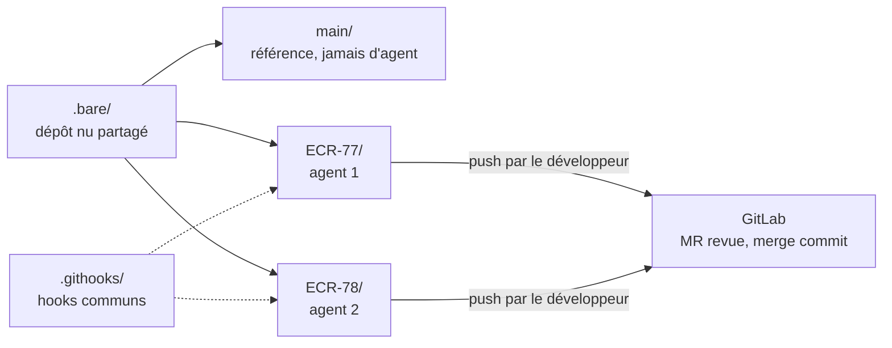

# Mode d'emploi : plusieurs agents en parallèle sur un dépôt GitLab

Ce mode d'emploi installe le kit [`agents-paralleles-gitlab`](../../specs/agents-paralleles-gitlab/SKILL.md) 1.0.1 : faire travailler plusieurs agents de développement en même temps sur un même dépôt GitLab, **une demande Jira par worktree**, sans qu'aucun ne puisse abîmer le code d'un autre ni la branche d'intégration.

**Une demande Jira = une branche = un worktree = un agent.** Chaque agent commite localement ; il ne pousse pas, ne fusionne pas et n'a aucun accès à GitLab. Seule une merge request revue, fusionnée par un humain, atteint la branche d'intégration.



## 1. Prérequis

- Git 2.38 ou plus récent, bash 4 ou plus récent (Git Bash sous Windows), un accès SSH au dépôt GitLab.
- Une IA locale qui exécute des commandes : Gemini CLI, Claude Code ou équivalent.
- La transmission : [`transmissions/agents-paralleles-gitlab-1.0.1.md`](../../transmissions/agents-paralleles-gitlab-1.0.1.md).

## 2. Installer, avec l'IA

Le kit ne s'installe pas comme un skill dans le projet : il crée une **disposition** autour du dépôt. Collez la transmission dans l'IA, qui mène l'installation en trois étapes, sans rien écrire avant votre confirmation.

1. **Matérialiser** : l'IA vous demande le dossier racine du kit (par exemple `~/dev/<projet>/`) et y crée `.skills/agents-paralleles-gitlab/`, hors de tout worktree.
2. **Cadrage** : elle vous demande, puis reformule dans une fiche à confirmer :
   - l'URL SSH du dépôt GitLab, et s'il faut créer un dépôt nu neuf ou partir d'un clone existant ;
   - la branche d'intégration (`develop` par défaut, sinon `AGT_BASE`) ;
   - l'édition GitLab (Free, Premium, Ultimate), qui fixe les garde-fous disponibles ;
   - les points chauds du projet, s'ils diffèrent de ceux par défaut (`AGT_POINTS_CHAUDS`) ;
   - la présence de Husky ou d'un outil qui réécrit `core.hooksPath`.
3. **Installation** : elle crée la disposition, écrit les six fichiers du kit à l'identique, lance `recette.sh` (44 contrôles, sur des copies dans un dossier de test), puis `./agt ls`, qui doit afficher « hooks : actifs » et aucune ALERTE. Elle remplit enfin la fiche GitLab, que le Maintainer applique : l'IA ne configure pas GitLab elle-même.

Disposition obtenue :

```
~/dev/<projet>/
├── .bare/              dépôt nu partagé
├── .githooks/          hooks communs à tous les worktrees
├── .skills/            skills des agents, posés une seule fois
├── agt                 script d'orchestration
├── regles-gitlab.txt   push rules à appliquer par le Maintainer
├── recette.sh          recette du kit
├── main/               worktree de référence : jamais d'agent, jamais de commit
└── ECR-77/             une demande, sa branche, son agent
```

## 3. Le cycle d'une demande

| Étape | Qui | Commande |
|---|---|---|
| Préparer | développeur | `./agt new ECR-77 export-csv`, puis déposer la demande dans `ECR-77/travail/` |
| Répartir | développeur | `./agt collisions` : mener de front ou séquencer les demandes qui touchent les mêmes fichiers |
| Réaliser | agent | un scénario à la fois, commit local ; `./agt sync ECR-77` entre deux scénarios, jamais pendant que l'agent écrit |
| Publier | développeur | `./agt diff ECR-77`, `git -C ECR-77 push`, merge request en brouillon |
| Nettoyer | développeur | `./agt done ECR-77` après fusion, ou `--abandon` |

`./agt ls` donne l'état de toutes les demandes ; `./agt reset ECR-77` repart de zéro tant que rien n'est publié. Une demande empilée sur une autre se crée avec la base en dernier argument de `agt new`.

## 4. Ce qui ne se négocie pas

- **Aucune écriture dans GitLab par l'IA**, aucun jeton demandé, lu ou écrit.
- **Aucun `--force`** ni `--force-with-lease`, aucune réécriture d'un commit publié : rebase tant que la branche est locale, fusion ensuite.
- Le code du kit est reproduit à l'identique ; une adaptation passe par les variables `AGT_BASE`, `AGT_REMOTE` et `AGT_POINTS_CHAUDS`.
- Aucune commande destructive sur votre dépôt : `recette.sh` travaille sur des copies.
- Les fichiers de travail (`travail/`, `.skills/`, demandes enregistrées en MHTML) sont exclus par `.bare/info/exclude`, commun aux worktrees : le `.gitignore` du projet ne change pas.

## 5. Avec les autres skills du dépôt

- [`agent-tdd-jira`](../agent-tdd-jira/mode-emploi.md) est l'agent qui travaille dans chaque worktree, en mode parallèle.
- [`skill4appli`](../skill4appli/mode-emploi.md) et [`orchestrateur-c7e`](../orchestrateur-c7e/mode-emploi.md) se posent une seule fois dans `.skills/`, ou au niveau utilisateur, pour tous les worktrees.
- [`capture-sprint-jira`](../capture-sprint-jira/mode-emploi.md) produit les demandes en MHTML à déposer dans `travail/`.

## 6. Vérifier

- `bash recette.sh <dossier de test>` : 44 contrôles, ligne finale sans échec.
- `./agt ls` : « hooks : actifs », aucune ALERTE.
- Après une mise à jour de Husky ou d'un outil semblable : vérifier que `core.hooksPath` pointe toujours vers `.githooks/`.

## 7. Dépannage

| Symptôme | Cause probable | Remède |
|---|---|---|
| `./agt ls` : hooks inactifs | `core.hooksPath` réécrit par Husky | rétablir `git config core.hooksPath "$PWD/.githooks"` ; voir le module `hooks`, § 5 |
| « branche déjà extraite » | Git refuse une même branche dans deux worktrees | c'est voulu : une demande, un agent |
| `agt done` refuse | la branche n'est pas fusionnée dans la base distante | fusionner la MR, ou `agt done <CLÉ> --abandon` si l'abandon est décidé |
| `agt sync` refuse | modifications non commitées dans le worktree | laisser l'agent finir et commiter son scénario |
| Push refusé par GitLab | push rules ou branche protégée | normal pour une branche d'intégration : passer par une MR |

Les dimensions réservées, contrôle de GitLab par API et tension entre dépôts, ne sont pas appliquées en 1.0.
