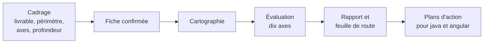

# Mode d'emploi : l'analyse de projet

Ce mode d'emploi fait travailler l'IA du développeur comme l'analyste [`analyse-projet`](../../specs/analyse-projet/SKILL.md) 1.0.2 : comprendre, auditer ou préparer l'évolution d'un projet Java Spring Boot, PostgreSQL et Angular, **en lecture seule**. Vous choisissez le livrable ; l'analyste ne le choisit jamais à votre place.

| Livrable | Contient | Ne contient pas | Usage typique |
|---|---|---|---|
| `cartographie` | composants, dépendances, endpoints, flux back-front, données, infrastructure | aucun jugement | prise en main, documentation |
| `rapport` | la cartographie, des constats prouvés par axe, des recommandations, une feuille de route priorisée, une annexe `analyse.json` | aucun plan d'exécution | audit, arbitrage, décision d'investissement |
| `plans` | le rapport, plus des plans d'action prêts pour les experts Java et Angular | aucune exécution | préparation d'un chantier |



## 1. Prérequis

- Une IA qui lit les sources : Gemini CLI, Claude Code ou équivalent.
- Les dépôts du back et du front, en lecture.
- Pour l'installation automatique : un clone d'Agent2Prompt et Node 20 ou plus récent. À défaut, la transmission seule : [`transmissions/analyse-projet-1.0.2.md`](../../transmissions/analyse-projet-1.0.2.md).

## 2. Installer

La consigne interdit d'écrire dans le projet analysé : le skill s'installe donc **au niveau utilisateur**, hors du dépôt.

```bash
node <Agent2Prompt>/tools/installer.mjs analyse-projet --utilisateur   # ~/.gemini/skills/analyse-projet/
```

L'installateur refuse l'installation dans le workspace. Puis, dans Gemini CLI : `/skills reload`, et « Active le skill analyse-projet. L'étape 0 de sa consigne est faite. Lis `CONSIGNE.md` dans son dossier et suis-la à partir de l'étape 1. »

**Dans une autre IA**, coller la transmission ; l'IA garde le skill en mémoire de travail ou l'écrit hors du projet analysé.

## 3. Le cadrage

L'analyste pose ses questions en une seule fois, puis reformule les réponses dans une fiche que vous confirmez avant toute lecture du projet.

| Question | Valeurs | Défaut si vous ne tranchez pas |
|---|---|---|
| Livrable | `cartographie`, `rapport`, `plans` | aucun : à vous de choisir |
| Périmètre | projet entier, back seul, front seul, une fonctionnalité de bout en bout | projet entier |
| Axes (rapport, plans) | tous, ou une sélection parmi les dix | tous |
| Profondeur | `survol` (échantillonnage déclaré) ou `complète` | `complète` pour une fonctionnalité, `survol` sinon |
| Destinataires | développeurs, responsable technique, direction | développeurs |
| Contraintes | échéance, budget, gel de version, RGAA | aucune |

Si un build ou une installation de dépendances est nécessaire, l'analyste demande votre accord explicite et le fait dans une copie des dépôts.

Les dix axes de l'évaluation couvrent : le socle back-front, les architectures du back et du front, la qualité du code, les tests, la sécurité, la performance, l'accessibilité, les versions et la dette, l'exploitation.

## 4. Ce que vous recevez

- **Cartographie** : la carte du projet, sans jugement.
- **Rapport** : une synthèse, des constats chacun avec sa preuve (fichier, ligne, extrait ou commande), des recommandations, une feuille de route par phases, les limites de l'analyse, et l'annexe `analyse.json`, lisible par programme, aux identifiants stables d'une analyse à l'autre.
- **Plans** : un plan par chantier (`PLAN-01`, `PLAN-02`…), destiné à l'expert Java ou Angular, avec ses invariants visés, ses étapes, ses critères d'acceptation, ses risques et son retour arrière ; un changement de contrat produit des plans liés, dans un ordre de livraison compatible. Pour l'exécuter, confiez-le à l'expert concerné ([Java](../java/mode-emploi.md), [Angular](../angular/mode-emploi.md)).

## 5. Ce qui ne se négocie pas

- **Lecture seule** : rien ne change dans le code, la configuration, l'historique Git ni aucun système externe.
- **Un constat a une preuve** ; sans preuve, c'est une hypothèse étiquetée, ou une question.
- **Ce qui n'a pas été lu est déclaré** dans les limites, jamais comblé par une supposition.
- Les versions et états de support sont vérifiés au moment de l'analyse, et sourcés.
- Aucun secret recopié dans le rapport ni dans l'annexe.
- L'analyste n'exécute aucun plan.

## 6. Mettre à jour, retirer

- **Mettre à jour** : `git pull` dans Agent2Prompt, puis `node <Agent2Prompt>/tools/installer.mjs analyse-projet --utilisateur`.
- **Retirer** : `node <Agent2Prompt>/tools/installer.mjs --retirer analyse-projet --utilisateur`.

## 7. Dépannage

| Symptôme | Cause probable | Remède |
|---|---|---|
| L'installateur refuse | installation demandée dans le workspace | ajouter `--utilisateur` |
| Le rapport annonce beaucoup de limites | profondeur `survol`, ou sources inaccessibles | passer en `complète` sur un périmètre réduit, ou donner l'accès manquant |
| Des constats restent « hypothèse » | preuve impossible sans exécuter | autoriser un build dans une copie, ou accepter l'hypothèse |
| Deux analyses ne se comparent pas | périmètre ou axes différents | reprendre la même fiche de cadrage ; les identifiants de l'annexe sont stables à cadrage égal |

La comparaison automatique entre deux analyses successives est une dimension réservée (`delta`) : elle n'est pas appliquée en 1.x.
