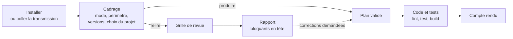

# Mode d'emploi : l'expert Angular

Ce mode d'emploi fait travailler l'IA du développeur comme l'expert [`angular`](../../specs/angular/SKILL.md) 1.0.1 : produire ou relire un front Angular 20, standalone et à signaux, accessible selon le RGAA 4.1 et les WCAG 2.2 AA, dans le respect du socle commun back-front.

| Mode | L'expert | Il remet |
|---|---|---|
| **produire** | écrit composants, templates, styles, services et tests ensemble, après validation d'un plan | le code, les tests, les résultats de `ng lint`, `ng test` et `ng build`, un compte rendu |
| **relire** | examine le code sans le modifier | un rapport de revue classé par gravité |



## 1. Prérequis

- Une IA locale qui lit et écrit les fichiers du projet : Gemini CLI, Claude Code ou équivalent.
- Le dépôt du front, avec Node.js 20.19, 22.12 ou 24, et l'Angular CLI du projet.
- Un navigateur sans interface pour `ng test` ; Playwright et `@axe-core/playwright` si le projet a des tests de bout en bout.
- Pour l'installation automatique : un clone d'Agent2Prompt et Node 20 ou plus récent. À défaut, la transmission seule : [`transmissions/angular-1.0.1.md`](../../transmissions/angular-1.0.1.md).

## 2. Installer

**Dans Gemini CLI**, depuis la racine du projet :

```bash
node <Agent2Prompt>/tools/installer.mjs angular
```

Puis, dans Gemini CLI : `/skills reload`, et « Active le skill angular. L'étape 0 de sa consigne est faite. Lis `CONSIGNE.md` dans son dossier et suis-la à partir de l'étape 1. »

**Dans une autre IA**, coller le contenu de la transmission : l'IA crée `.skills/angular/`, y écrit chaque fichier à l'identique et les vérifie avec la table d'intégrité.

Le socle commun back-front est inclus, épinglé en 1.0.1.

## 3. Le cadrage

L'expert demande, avant tout travail :

- le **mode** : produire ou relire ;
- le **périmètre** : une fonctionnalité, des composants, une branche ou une demande ;
- les **versions réelles**, par `ng version` ;
- les **choix déjà faits** dans le projet : bibliothèque de composants (Angular Material, DSFR…), outil de tests unitaires (Karma ou Jest), bibliothèque OIDC, générateur du client d'API.

| Élément | Cible |
|---|---|
| Angular | 20.x, dernier correctif |
| TypeScript | 5.8, `strict` |
| Build | constructeur `application` (esbuild) |
| Lint | `angular-eslint`, règles d'accessibilité des templates actives |
| Composants | `input()`, `output()`, `model()`, contrôle de flux `@if`, `@for`, `@switch` |

Les API expérimentales d'Angular 20 (`resource`, `httpResource`) et la montée vers Angular 22 relèvent d'une dimension réservée : l'expert ne les emploie pas.

## 4. Produire

1. L'expert lit le code concerné, `angular.json`, `package.json`, `tsconfig` et la configuration ESLint, puis propose un **plan** : fichiers, invariants visés, tests prévus.
2. Vous validez le plan.
3. Il écrit composants, services et tests ensemble, puis lance `ng lint`, `ng test` et `ng build`.
4. Il remet un **compte rendu** : fichiers, invariants couverts, résultats, écarts.

L'accessibilité fait partie de « terminé » : un parcours modifié passe le contrôle axe des tests de bout en bout quand le projet en a.

## 5. Relire

L'expert délimite le périmètre, applique la grille du module `revue` et remet un rapport classé par gravité, bloquants en tête. Chaque constat cite son emplacement, l'invariant concerné, sa gravité et une correction proposée. Aucun fichier n'est modifié sans votre demande ; une correction repasse par le mode produire.

## 6. Ce qui ne se négocie pas

- Le socle l'emporte pour tout ce qui traverse la frontière back-front.
- Aucune dépendance npm nouvelle sans validation ; aucune API Angular inventée.
- Aucun secret dans le front ; le jeton d'accès ne va jamais dans `localStorage`, une URL ou un journal.
- RGAA 4.1 et WCAG 2.2 AA font partie de la définition de « terminé ».
- La convention en place l'emporte, sauf si elle viole un invariant.

## 7. Mettre à jour, retirer

- **Mettre à jour** : `git pull` dans Agent2Prompt, puis la même commande d'installation ; `--forcer` si des fichiers du skill ont été modifiés.
- **Retirer** : `node <Agent2Prompt>/tools/installer.mjs --retirer angular`.

## 8. Dépannage

| Symptôme | Cause probable | Remède |
|---|---|---|
| `ng test` attend un navigateur | lancement interactif | `ng test --watch=false` avec un navigateur sans interface |
| L'expert signale `*ngIf` ou `*ngFor` | syntaxe dépréciée en Angular 20 | migrer vers `@if` et `@for`, ou garder la convention du projet si vous le décidez |
| Écart de versions annoncé | projet hors Angular 20 | dire comment procéder |
| Seul `SKILL.md` est lu | skill exclu de Git sans négation dans `.geminiignore` | réinstaller avec l'installateur |

Le même skill sert de référentiel à [`sonarqube`](../sonarqube/mode-emploi.md) et à [`orchestrateur-c7e`](../orchestrateur-c7e/mode-emploi.md).
