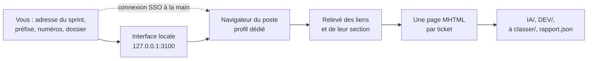

# Mode d'emploi : capturer les tickets d'un sprint Jira

Ce mode d'emploi installe [`capture-sprint-jira`](../../specs/capture-sprint-jira/SKILL.md) 1.2.1 : enregistrer en MHTML les tickets du prochain sprint d'un Jira protégé par un SSO, **rangés dans un dossier par section de la page du sprint** (`IA`, `DEV`…), sans les ouvrir un à un. Vous vous connectez vous-même dans la fenêtre du navigateur : aucun identifiant ne passe par le skill.



## 1. Prérequis

- Node 20 ou plus récent.
- Chrome installé sur le poste ; Edge ou le Chromium de Playwright à défaut.
- Un écran : la capture ouvre une fenêtre visible, pour la connexion SSO. Sous Windows avec WSL2, installez et lancez le skill **du côté où Chrome est installé**, en général Windows.
- Python 3, seulement pour le script d'export par l'API, facultatif.
- La transmission : [`transmissions/capture-sprint-jira-1.2.1.md`](../../transmissions/capture-sprint-jira-1.2.1.md).

## 2. Installer, avec l'IA

Collez la transmission dans l'IA. Elle mène quatre étapes :

1. **Matérialiser** : `.skills/capture-sprint-jira/` à l'emplacement que vous indiquez, sinon dans votre dossier personnel. Le skill ne dépend d'aucun projet.
2. **Fichiers exécutables et recette** : les scripts sont tirés des modules par la commande d'extraction du module `execution`, § 8, qui vérifie leurs empreintes. Puis `npm ci`, qui installe la seule dépendance, `playwright-core`, sans télécharger de navigateur. Puis `npm test` (sous Linux sans écran, `xvfb-run -a npm test`) : 20 scénarios contre un faux Jira local, 132 contrôles, aucun échec ; sans Python, un scénario est sauté.
3. **L'agent** : elle vous propose d'installer `agent/capteur-sprint.md`, dans `.claude/agents/` pour Claude Code ou comme consigne système, et rejoue avec vous les scénarios A1 à A5.
4. **Première capture**, avec vous (§ 3).

Dans Gemini CLI, `node <Agent2Prompt>/tools/installer.mjs capture-sprint-jira` fait l'étape 1 ; demandez ensuite à l'IA de suivre `CONSIGNE.md` à partir de l'étape 1.

## 3. Capturer un sprint

1. Depuis le dossier du skill : `npm run capture`, puis ouvrir http://127.0.0.1:3100.
2. Saisir l'adresse de la page du sprint, le préfixe des clés, la plage de numéros, les sections de la page (`IA` et `DEV` par défaut) et le dossier de sortie. La page les garde dans votre navigateur : ils ne sont écrits dans aucun fichier du skill.
3. Ouvrir le sprint, **se connecter dans la fenêtre** (SSO, MFA), vérifier que les tickets sont affichés.
4. Lancer la capture : l'avancement et le rapport s'affichent.

Résultat, dans le dossier de sortie :

```text
IA/ABCDE-3512.mhtml          un fichier par ticket, dans le dossier de sa section
DEV/ABCXY-3520.mhtml
à classer/ABCDE-3530.mhtml   aucun en-tête de section avant ce ticket sur la page
sprint.mhtml                 la page du sprint elle-même
rapport.json                 filtre, sections comptées, catégorie ou erreur de chaque ticket
```

Recapturer dans le même dossier remplace le fichier de chaque ticket et retire sa copie d'un autre dossier de catégorie.

**Un ticket seul** : dans l'interface, par son adresse, ou en ligne de commande :

```bash
npm run capture:cli -- --ticket "https://jira.exemple.org/browse/ABC-3512" --dossier IA
```

**En ligne de commande** pour tout un sprint : `npm run capture:cli -- "<page du sprint>" [options]`, Entrée dans le terminal remplaçant le bouton.

**Export par l'API**, quand votre Jira accepte un mot de passe ou un jeton, sans SSO : `npm run export` (interface sur le port 3000), ou `python3 scripts/jira_sprint_export.py --board <tableau>`.

## 4. Réglages

| Variable | Effet |
|---|---|
| `JIRA_CAPTURE_CHANNEL` | navigateur : `chrome` par défaut, `msedge`, ou `chromium` après `npx playwright-core install chromium` |
| `JIRA_CAPTURE_PROFILE` | dossier du profil dédié du navigateur, où la session SSO est gardée |
| `JIRA_CAPTURE_PAGE_TIMEOUT_MS` | délai d'attente d'une page de ticket |

Derrière un proxy d'entreprise, `npm ci` lit `HTTPS_PROXY` ou la configuration de npm.

## 5. Ce qui ne se négocie pas

- Aucun identifiant demandé, lu ou saisi : la connexion se fait à la main, dans la fenêtre.
- L'adresse, le préfixe et les numéros de votre Jira ne sont écrits dans aucun fichier du skill ni d'un dépôt.
- Aucun fichier capturé n'est déplacé d'une catégorie à l'autre sans votre accord.
- Les scripts ne s'adaptent pas : un écart ou un besoin nouveau vous est signalé.

## 6. Avec les autres skills

Les MHTML capturés sont ceux que lit l'ingestion de l'[agent TDD](../agent-tdd-jira/mode-emploi.md) ; l'[orchestrateur C7E](../orchestrateur-c7e/mode-emploi.md) lit par défaut ceux du dossier `IA/`. Dans le [kit des agents parallèles](../agents-paralleles-gitlab/mode-emploi.md), un MHTML se dépose dans `travail/` du worktree de la demande. La remise automatique à l'agent TDD est une dimension réservée.

## 7. Dépannage

| Symptôme | Cause probable | Remède |
|---|---|---|
| La fenêtre ne s'ouvre pas | pas d'écran, ou navigateur absent | lancer sur le poste qui a Chrome ; sous WSL2, préférer Windows |
| Tickets en `à classer` | aucun en-tête de section avant eux sur la page | vérifier les noms de sections saisis, ou classer à la main après accord |
| Avertissement « IA précède plusieurs groupes » | en-tête répété ou page mal rendue | vérifier la page du sprint, puis relancer |
| Erreurs de session dans le rapport | session SSO expirée pendant la capture | se reconnecter dans la fenêtre, relancer : les tickets déjà capturés sont remplacés |
| Pages incomplètes | ticket lent à charger | augmenter `JIRA_CAPTURE_PAGE_TIMEOUT_MS` |
| `npm ci` échoue | proxy d'entreprise | configurer `HTTPS_PROXY` ou `npm config set proxy` |
