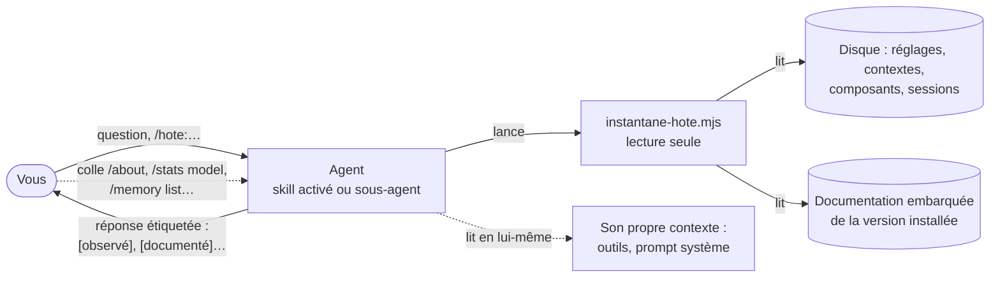

# Mode d'emploi : un agent qui explique l'outil d'IA qui l'exécute

Ce mode d'emploi installe [`explication-hote-ia`](../../specs/explication-hote-ia/SKILL.md) 1.0.0. Le skill fait d'un agent l'explicateur de l'outil d'IA qui l'exécute, Gemini CLI ou un hôte qu'il ne reconnaît pas. L'agent dit comment cet hôte fonctionne, en général et dans votre installation, à partir de ce qu'il observe et de la documentation de la version installée. Chaque affirmation porte sa provenance. La spécification fournit :

- un script Node en lecture seule, qui ne rend aucun secret ;
- une recette de 28 tests ;
- le sous-agent `explicateur-hote` ;
- les commandes `/hote:explique`, `/hote:carte` et `/hote:pourquoi`.

L'agent ne se croit pas sur parole : il ne tire de sa propre impression ni son modèle, ni sa version, ni ses limites.



## 1. Prérequis

- Gemini CLI ou équivalent. Les repères du skill sont vérifiés sur Gemini CLI 0.67.0 : pour une autre version, l'agent les cite « à revérifier » et lit la documentation de la version installée. Tout autre outil est décrit par ce qui s'en observe, sans être nommé.
- Node 20 ou plus récent ; celui qui fait tourner Gemini CLI suffit.
- Linux, WSL2, macOS ou Windows natif.
- Une session interactive. En mode non interactif, Gemini CLI ne déclare au modèle ni `activate_skill` ni `run_shell_command`, et le skill ne peut pas lancer son script (repère H17). Ce mode s'applique avec `-p`, sans terminal, ou quand `CI` ou `GITHUB_ACTIONS` vaut `true`.
- La transmission : [`transmissions/explication-hote-ia-1.0.0.md`](../../transmissions/explication-hote-ia-1.0.0.md).

## 2. Installer

**Le skill, au niveau utilisateur** : il explique l'hôte quel que soit le projet.

```bash
node <Agent2Prompt>/tools/installer.mjs explication-hote-ia --utilisateur
```

L'installateur vérifie chaque fichier et écrit le skill dans `~/.gemini/skills/explication-hote-ia/`. Dans Gemini CLI, demandez ensuite à l'IA de suivre `CONSIGNE.md` à partir de l'étape 1 :

1. elle lit le skill ;
2. elle tire de ses modules les six fichiers exécutables, par la commande d'extraction du module `execution`, § 8, qui vérifie leurs empreintes ;
3. elle lance la recette : `node --test tests/instantane-hote.test.mjs`. Attendu : 28 tests réussis sous Linux et WSL2, 27 réussis et 1 sauté sous Windows et macOS.

Puis `/skills reload`.

**Le sous-agent et les commandes**, avec votre accord :

- copier `agent/explicateur-hote.md` dans `~/.gemini/agents/`, en remplaçant, dans la copie seulement, `<DOSSIER_DU_SKILL>` par le chemin absolu du dossier du skill ;
- copier les trois fichiers de `commandes/hote/` dans `~/.gemini/commands/hote/` ;
- puis `/agents reload` et `/commands reload`.

**Dans un autre outil** : collez la transmission. L'IA matérialise le skill dans `.skills/explication-hote-ia/`. Le sous-agent s'installe comme sous-agent de cet outil, s'il en accepte, ou comme consigne système.

## 3. Trois modes

| Mode | Commande, ou demande | Ce que l'agent rend |
|---|---|---|
| expliquer | `/hote:explique [question]`, « comment tu fonctionnes ? », « que reçoit le modèle à chaque tour ? » | le mécanisme, puis ce qui en est en place chez vous ; sans question, un parcours guidé en huit étapes, une étape à la fois |
| carte | `/hote:carte`, « qu'est-ce qui est actif ici ? » | réglages et leur couche, confiance du dossier, fichiers de contexte par palier, composants actifs, masqués ou ignorés |
| pourquoi | `/hote:pourquoi <comportement>`, « pourquoi ce skill n'apparaît pas ? » | un diagnostic : chaque hypothèse confirmée ou écartée par une observation nommée, la cause retenue, la correction décrite sans être appliquée |

**Session principale ou sous-agent ?** Les questions sur la session en cours se posent dans la session principale, skill activé : son contexte, ce que reçoit le modèle, les outils déclarés. Le sous-agent a son propre contexte et ne voit pas celui de la session qui l'appelle. Il sert à la carte et au diagnostic, sans encombrer la session.

## 4. Lire une réponse

| Étiquette | Sens |
|---|---|
| `[observé : …]` | lu pendant la session : sortie du script, fichier, ou commande de l'interface que vous avez collée |
| `[déclaré : …]` | donné sans vérification : ce que l'agent voit de son propre contexte, une option, votre affirmation |
| `[documenté : Gemini CLI <version>, <document>]` | documentation embarquée dans le paquet installé |
| `[déduit : …]` | conclusion tirée d'observations citées |
| `[inconnu : …]` | non observable d'ici, avec le moyen de l'observer quand il en existe un |

Entre deux sources contradictoires, l'observation l'emporte sur la documentation, qui l'emporte sur la déduction. L'agent dit la contradiction, avec ses deux sources. En 0.67.0, il en connaît plusieurs entre la documentation et le code (module `modele-hote`, § 10). Exemple : les `GEMINI.md` des sous-dossiers ne sont pas chargés au démarrage, ils ne le sont qu'à la demande.

Certaines réponses ne peuvent venir que de vous : l'agent ne lance pas les commandes de l'interface. Il vous demande de les lancer et de coller ce qu'elles affichent :

| Question | Commande |
|---|---|
| quel modèle a répondu | `/stats model` |
| quelle version tourne | `/about` |
| quels fichiers de contexte sont chargés | `/memory list` |
| quels outils sont actifs | `/tools desc`, `/policies list` |
| la confiance imposée par un IDE | `/permissions trust` |

Le texte exact du prompt système s'obtient en l'exportant :

```bash
GEMINI_WRITE_SYSTEM_MD=~/systeme-exporte.md gemini
```

Le fichier est écrit au démarrage, puis `/quit`. Donnez un chemin hors du projet, jamais la valeur `1`. Ne versionnez pas le fichier : il contient vos mémoires. Ensuite : `/hote:explique analyse le prompt exporté ~/systeme-exporte.md`.

## 5. Ce qui sort du poste

L'agent explique ce que Gemini CLI envoie hors du poste, et le montre réglage par réglage chez vous [observé : `config`]. Constat vérifié sur 0.67.0 par la recette des repères (repère H1). Avec les réglages par défaut, Gemini CLI envoie, en plus des requêtes au modèle :

- des statistiques d'usage à `play.googleapis.com`, même en mode non interactif ;
- en mode interactif, une recherche de mise à jour sur `registry.npmjs.org`.

Les deux continuent quand l'API du modèle est locale. Ces réglages les coupent :

```json
{
  "privacy": { "usageStatisticsEnabled": false },
  "general": { "enableAutoUpdate": false, "enableAutoUpdateNotification": false }
}
```

L'agent décrit cette modification ; il ne l'applique que si vous le lui demandez explicitement.

## 6. Le script

```bash
node <dossier du skill>/scripts/instantane-hote.mjs <commande> [--format texte]
```

| Commande | Effet |
|---|---|
| `hote` | famille de l'hôte et nature de la preuve, paquet, version, documentation embarquée, options de lancement sous Linux et WSL |
| `config` | couches de réglages, valeur effective et couche de chaque réglage observé, confiance du dossier, `.env`, variables |
| `contexte` | fichiers de contexte par palier, imports, mémoire privée, trace de la dernière session ; `--prompt-systeme <fichier>` pour un prompt exporté |
| `composants` | skills, sous-agents, commandes, extensions, serveurs MCP, hooks, politiques, fichiers d'exclusion |
| `doc [chemin]` | documentation embarquée : la liste, ou un document |
| `tout` | les quatre premières ensemble |

Codes de sortie : 0 réussite, 1 usage, 2 introuvable, 3 chemin refusé, 4 erreur interne. Le script ne fait que lire : il ne crée aucun fichier, ne lance aucun processus et n'ouvre aucune connexion. Il rend des noms, jamais de valeurs secrètes, et aucun texte de conversation.

## 7. Ce qui ne se négocie pas

- Rien n'est modifié pendant une explication. Une modification de configuration se décrit (fichier, clé, valeur, effet) et ne s'applique que sur votre demande explicite.
- Aucune valeur secrète n'est recopiée, ni dans une réponse, ni dans un fichier.
- La documentation de la version installée fait foi ; un repère d'une autre version se signale « à revérifier ».
- L'IA n'adapte pas le script : un écart ou un échec de la recette vous est rapporté tel quel.

## 8. Mettre à jour, retirer

- **Nouvelle version de Gemini CLI** : rien à faire pour que l'agent reste juste. Il observe la version, cite ses repères « à revérifier » et lit la documentation installée. La version suivante du skill se vérifie en épinglant la nouvelle version dans la recette des repères.
- **Nouvelle version du skill** : relancer l'installateur, puis l'extraction et la recette.
- **Retirer** : `node <Agent2Prompt>/tools/installer.mjs --retirer explication-hote-ia --utilisateur`, puis supprimer les copies du sous-agent et des commandes.

## 9. Dépannage

| Symptôme | Cause probable | Remède |
|---|---|---|
| `/hote:carte` inconnu | commandes non copiées, ou dossier non fiable : Gemini CLI ignore alors toute commande personnalisée, même celles de l'utilisateur | copier les commandes, `/commands reload` ; faire confiance au dossier |
| le skill ne s'active pas avec `gemini -p` | mode non interactif : `activate_skill` et `run_shell_command` ne sont pas déclarés | une session interactive |
| la version rendue n'est pas celle de `/about` | paquet trouvé par le PATH (`déduit`), alors qu'un autre s'exécute | `--paquet` vers le paquet qui s'exécute |
| `contexte` ne trouve pas le `GEMINI.md` du projet | script lancé hors de la racine du workspace | relancer depuis la racine, ou `--racine` |
| la trace de session décrit une autre conversation | plusieurs sessions sur le projet, ou une session sans tour abouti, que Gemini CLI supprime au lancement suivant | comparer `debut` à l'heure de la session ; `/memory list` fait foi |
| le sous-agent dit qu'il ne voit pas la session | normal : son contexte est séparé | poser la question dans la session principale, skill activé |
| la recette saute T9 | Windows ou macOS : T9 lit `/proc` | normal |

Les dimensions réservées, d'autres hôtes reconnus par adaptateur (D10) et la comparaison de deux instantanés (D11), ne sont pas appliquées en 1.0.
