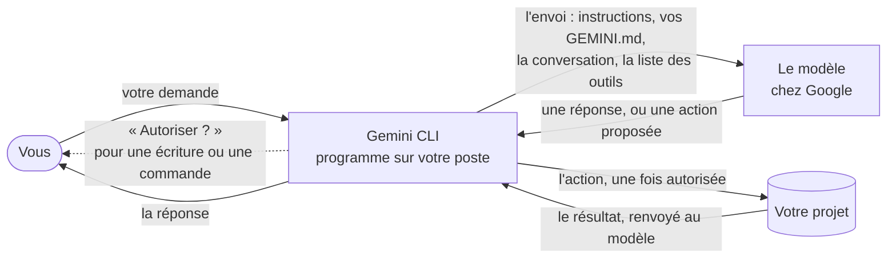

# Comprendre l'IA avant de s'en servir

Vous hésitez à vous servir de l'IA parce que vous ne voyez pas ce qu'elle fait ? Cette page ouvre la boîte. Elle a deux parties :

1. **Comprendre avant de s'en servir** : sept questions et leurs réponses, à lire sans rien installer.
2. **Essayer sans risque** : un agent qui explique Gemini CLI en vous le montrant sur votre poste, sans rien modifier. Il se diffuse seul, avec son propre mode d'emploi.

Le but n'est pas de vous convaincre, mais de vous donner de quoi décider : les limites et les risques sont dits aussi clairement que les garde-fous. Les réponses décrivent Gemini CLI 0.67.0. Elles ont été vérifiées le 6 novembre 2026 dans sa documentation, dans son code et par des essais réels.

## Partie 1. Comprendre avant de s'en servir

Le chemin d'une demande, de votre clavier jusqu'à la réponse :

### 1. Qu'est-ce que c'est, au juste ?

Deux pièces. Gemini CLI est un programme qui tourne sur votre poste ; le modèle de langage, lui, tourne chez Google. Le modèle ne fait que produire du texte à partir de ce que le programme lui envoie, et il ne garde rien d'une requête à l'autre : à chaque fois, le programme lui renvoie tout ce qu'il faut. C'est le programme qui agit sur votre poste : il lit, cherche, écrit et lance des commandes, quand le modèle le propose.

**Vous gardez la main** : le programme est chez vous. Vous le lancez, vous l'arrêtez (`/quit`), vous le réglez.

### 2. Que reçoit le modèle quand je tape une demande ?

À chaque requête, Gemini CLI assemble un envoi :

- des instructions système, le mode d'emploi que Gemini CLI donne au modèle ;
- vos fichiers `GEMINI.md`, les consignes du projet et les vôtres ;
- la conversation ;
- la liste des outils que le modèle peut demander d'utiliser.

Le modèle ne voit rien d'autre : ni votre écran, ni le reste de votre disque, sauf ce qu'un outil lit pour lui (question 3).

**Vous gardez la main** : ce que vous écrivez dans vos `GEMINI.md` part à chaque requête. `/memory show` affiche ce qui est chargé. L'agent de la partie 2 peut vous montrer l'envoi lui-même.

### 3. Que voit-il de mon code ?

Au premier message, Gemini CLI joint les noms des dossiers et des fichiers du projet, 200 au plus, mais pas leur contenu. Le modèle ne lit un fichier que par un outil de lecture, ou quand vous le citez avec `@chemin`. Les outils de recherche ignorent ce qu'excluent `.gitignore` et `.geminiignore`. Une commande shell, elle, peut lire un fichier exclu : elle vous est demandée avant de s'exécuter (question 5).

**Vous gardez la main** : lancez Gemini CLI depuis le dossier du projet, pas depuis votre dossier personnel. Listez dans `.geminiignore` ce qu'il ne doit pas parcourir. Citez les fichiers utiles.

### 4. Comment décide-t-il d'agir ?

Par une boucle. Le modèle propose une action : lire un fichier, chercher, écrire, lancer une commande. Gemini CLI la confronte à ses règles : il l'exécute, la refuse ou vous la demande. Puis il renvoie le résultat au modèle, qui propose la suite, et ainsi de suite jusqu'à sa réponse.

**Vous gardez la main** : vous pouvez refuser une action proposée, ou interrompre la requête avec `Ctrl+C`. `/tools desc` liste les outils disponibles.

### 5. Peut-il modifier ou casser quelque chose ?

Par défaut, chaque modification de fichier et chaque commande vous est demandée avant de s'exécuter, sauf celles que vous avez approuvées pour la suite. Les autres garde-fous :

- le mode plan ne fait que lire ;
- dans un dossier que vous n'avez pas déclaré fiable, ni les réglages, ni les consignes, ni les commandes du projet ne sont chargés ;
- les points de reprise, si vous les activez, permettent de revenir en arrière (`/restore`).

À l'inverse, l'option `--yolo` fait tout accepter sans rien demander : elle supprime le premier garde-fou.

**Vous gardez la main** : lisez chaque proposition avant de l'accepter. Travaillez sous git, pour voir et annuler chaque changement. N'approuvez pas tout d'avance.

### 6. Où partent mes données, et que retient-il ?

Le contenu de chaque envoi (question 2) part chez Google, à chaque requête. Avec les réglages par défaut, Gemini CLI envoie aussi des statistiques d'usage et, en mode interactif, cherche une mise à jour.

Le modèle ne retient rien. Ce qui reste est écrit sur votre poste : dans vos `GEMINI.md`, et dans les sessions enregistrées, que `/resume` permet de reprendre ou de supprimer.

Ce que Google fait des données dépend de votre mode de connexion. Les conditions applicables sont décrites dans la documentation de Gemini CLI (`resources/tos-privacy.md`).

**Vous gardez la main** : ne mettez dans la conversation que ce que vous accepteriez d'envoyer chez Google. Deux réglages coupent les statistiques et la mise à jour (mode d'emploi de l'agent, [« Ce qui sort du poste »](../../specs/explication-hote-ia/MODE-EMPLOI.md#ce-qui-sort-du-poste)).

### 7. Peut-il se tromper, et comment le vérifier ?

Oui. Le modèle produit le texte le plus plausible à partir de ce qu'il a reçu. Il ne sait de votre projet que ce qu'il a lu, et il peut se tromper avec assurance : sur un nom de fonction, une option, un résultat. La documentation de Gemini CLI le reconnaît : elle présente la recherche web comme un moyen d'éviter que l'agent n'invente.

**Vous gardez la main** : relisez chaque modification, lancez les tests, et demandez « d'où tiens-tu ça ? ». Ne lui confiez pas ce que vous ne pouvez pas vérifier. L'agent de la partie 2 donne l'exemple : chacune de ses affirmations dit d'où elle vient.

## Partie 2. Essayer sans risque

L'agent [`explication-hote-ia`](../../specs/explication-hote-ia/SKILL.md) 1.1.0 explique Gemini CLI en vous le montrant sur votre poste. Pendant qu'il explique, il ne modifie rien : c'est une première utilisation sans risque. Il reprend les sept questions de la partie 1 dans un parcours découverte, une à la fois, chacune en trois temps : la réponse simple, ce qu'elle montre sur votre poste, ce que vous gardez en main. Et il dit d'où il tient chaque affirmation : « vu sur votre poste », « d'après la documentation de Gemini CLI 0.67.0 », « je ne peux pas le savoir d'ici ».

Le skill se diffuse seul : son dossier, ou un fichier `.skill`, s'installe par Gemini CLI lui-même, et il ne demande rien d'autre que Node. Son mode d'emploi voyage avec lui, à côté de son point d'entrée : [Mode d'emploi d'explication-hote-ia](../../specs/explication-hote-ia/MODE-EMPLOI.md). Il décrit l'installation en six étapes, l'usage, la mise à jour, le retrait et la diffusion du skill.
