# Mode d'emploi : le générateur de skills de ticket

Ce mode d'emploi fait résoudre un ticket par un arbre de skills de ticket, avec le générateur [`generateur-skill-ticket`](../../specs/generateur-skill-ticket/SKILL.md) 1.4.4. Le ticket est qualifié et décomposé avec l'IA du développeur ; les outils du générateur, lancés depuis un clone d'Agent2Prompt, vérifient l'arbre, assemblent un skill par nœud depuis le référentiel des méso-contrats de l'orchestrateur C7E, l'installent et le lancent dans Gemini CLI. Ensuite, chaque nœud se résout dans sa propre session, par son skill et ses agents, et chaque niveau voit le ticket augmenté des observations des autres. L'orchestrateur n'est pas modifié : le skill de ticket tient lieu de fiche de transformation. Ce que les skills et le générateur observent s'exporte enfin, minimisé, vers le socle d'observation du dépôt.

```mermaid
flowchart LR
  Q["Qualifier et décomposer<br/>avec l'IA"] --> V["arbre.mjs<br/>verifier, plan"]
  V --> G["generer.mjs<br/>un skill par nœud"]
  G --> I["installer-arbre.mjs<br/>installer, lancer"]
  I --> R["racine : documents,<br/>ratification"]
  R --> F["feuilles : analyse,<br/>ratification, TDD"]
  F --> C["racine : kits,<br/>remise, clôture"]
  C --> X["retirer<br/>transmissions archivées"]
  X --> O["observation.mjs exporter<br/>journal d'enveloppes"]
```



## 1. Prérequis

- Un clone d'Agent2Prompt, `<dépôt>`, et Node 20 ou plus récent ; Node 22 ou plus récent pour la recette.
- Gemini CLI 0.67.0, lancé dans le projet, que le développeur a marqué de confiance.
- La clé du ticket racine, et sa demande : capture MHTML du ticket Jira, ou son texte.
- Facultatif : la copie du projet du fichier d'invariants, `docs/c7e/meso-contrats.md`, et son référentiel, `docs/c7e/referentiel-meso-contrats.toml` ; à défaut, les modèles de l'orchestrateur.

## 2. Installer le générateur

```bash
node <dépôt>/tools/installer.mjs generateur-skill-ticket
```

Le générateur s'installe comme les autres skills, dans `.gemini/skills/generateur-skill-ticket/`, masqué à Git : il ne remplace aucun skill ni aucun agent déjà installé. Sa transmission porte sa consigne, ses modules et le socle d'observation ; ses outils restent dans le clone, où ils lisent les sources dont héritent les skills de ticket, à leurs versions épinglées. Sans Gemini CLI, la transmission seule suffit : [`transmissions/generateur-skill-ticket-1.4.4.md`](../../transmissions/generateur-skill-ticket-1.4.4.md).

## 3. Faire résoudre un ticket

1. Activer le générateur et lui donner le chemin du clone et la demande. L'IA qualifie le ticket racine avec le module `qualification` de l'orchestrateur, puis le décompose s'il le faut : un fichier TOML par nœud, dans `docs/demandes/<clé>/arbre/`. L'arbre est aussi le plan des commits de la branche : la racine déclare les scénarios de l'US, chacun avec les couches qu'il touche s'il les dit, et `arbre.mjs proposer` propose pour chaque tâche un commit par scénario et par thème, un scénario ne se croisant qu'avec les thèmes de ses couches. Chaque écart au référentiel rencontré en chemin se note dans le relevé d'apprentissage du ticket.
2. Vérifier l'arbre et lire le plan : `node <dépôt>/specs/generateur-skill-ticket/outils/arbre.mjs verifier docs/demandes/<clé>/arbre`, puis `plan`, qui liste aussi les commits planifiés. Faire corriger l'arbre, et le plan, jusqu'à ce qu'ils conviennent.
3. Générer : `node <dépôt>/specs/generateur-skill-ticket/outils/generer.mjs generer docs/demandes/<clé>/arbre --sortie <travail>`, `<travail>` hors du projet. Aucun token n'est consommé.
4. Installer et vérifier : `node <dépôt>/specs/generateur-skill-ticket/outils/installer-arbre.mjs installer <travail>/transmissions`, puis `verifier <clé>`.
5. Lancer la racine : `installer-arbre.mjs lancer <clé>`. Elle fait rédiger les documents de la clé, présente l'arbre avec eux et attend la ratification, puis indique le prochain nœud prêt et sa commande, à lancer dans une nouvelle session.

## 4. Suivre un arbre

- `installer-arbre.mjs liste` : l'état de chaque nœud, du champ d'observation (critères prouvés, en écart, menacés, désaccords, observations attendues) et de la vue augmentée.
- `docs/demandes/<clé>/vue.html` : la vue augmentée, pour le développeur, régénérée par `node .gemini/skills/ticket-<clé>/outils/vue.mjs generer docs/demandes/<clé>`. Elle s'ouvre sur ce qui est à traiter, par gravité.
- Les corrections et les choix du développeur se déposent dans le champ par les skills ; deux corrections au même motif font proposer une adaptation de la méthode à l'observateur d'ordre 2, examinée par celui d'ordre 3, puis retenue ou refusée par le développeur.

## 5. Clore, apprendre et retirer

À la clôture de la racine, qu'elle ait des sous-tickets ou non, les kits contrôlés et la campagne d'Agent2Test ouverte, le skill racine verse l'apprentissage du ticket au registre du projet, `docs/c7e/registre-apprentissage.jsonl` : ce qui a été relevé à la qualification, et ce que le champ et les commits du ticket font remonter, chaque entrée à sa profondeur CRI (macro, méso-contrats, méso-composants, micro). Il attend l'ouverture de la campagne : le registre est suivi par Git dès qu'un ticket l'a versionné, et un fichier suivi modifié rendrait la remise périmée. Tu versionnes ensuite toi-même le relevé du ticket et le registre, avec le dossier du ticket ; le skill ne les commite pas. Un motif relevé dans deux tickets devient une proposition : tu la retiens ou la refuses, et c'est toi qui écris ce que tu retiens dans le référentiel ; deux refus le mettent en veille. `node .gemini/skills/ticket-<clé>/outils/apprentissage.mjs registre tendance` montre, ticket après ticket, si le système apprend ou dérive ; `registre propositions --cible generateur` donne en Markdown les évolutions du générateur à porter au dépôt Agent2Prompt. Puis `installer-arbre.mjs retirer <clé>` archive les transmissions dans `docs/demandes/<clé>/skills/`, où elles se versionnent avec le ticket, et retire skills, agents, commandes et relevé. Rien de l'arbre ne reste dans `.gemini`.

## 6. Exporter les observations

Une fois les tickets fusionnés sur la branche d'intégration du projet, `node <dépôt>/specs/generateur-skill-ticket/outils/observation.mjs exporter --projet .`, depuis le projet, traduit le champ de chaque ticket et le registre d'apprentissage dans le journal d'enveloppes du projet, `docs/c7e/observations.jsonl`, au format du socle d'observation : en ajout seul et chaîné, sans texte ni référence en clair, chaque clé, nœud, chemin ou commit par son empreinte salée. Tu versionnes le journal et sa tête, `docs/c7e/observations.tete`, avec le projet ; l'outil ne commite rien. Le sel de l'instance, tiré au premier export du projet, de quelque système qu'il soit, reste dans le répertoire Git commun du projet, `<git-common-dir>/agent2prompt/sel`, hors de l'arbre de travail : il n'est jamais versionné, affiché ni exporté, et l'export de l'orchestrateur C7E, qui tient son propre journal, `docs/c7e/observations-orchestrateur-c7e.jsonl`, le partage. Un autre clone du projet en a besoin pour continuer les journaux : recopie-le toi-même au même emplacement ; sans lui, tout journal d'enveloppes du projet arrête l'export, plutôt que de changer l'identité de l'instance. Un second export n'ajoute que les enregistrements nouveaux ; `observation.mjs verifier` relève un journal altéré, et `observation.mjs etat` compte les enveloppes par type, par ordre et niveau, et ce qui attend l'export.

## 7. Recette et essais sur le poste

```bash
node --test "specs/generateur-skill-ticket/tests/*.test.mjs"     # depuis la racine du dépôt
SKILL_TICKET_GEMINI=gemini node --test specs/generateur-skill-ticket/tests/installation.test.mjs
```

Ce qui demande un modèle s'éprouve sur le poste, à chaque ticket réel, avec l'arbre qu'il a produit, et non sur les arbres d'exemple, figés pour la recette automatique : la présentation de l'arbre et l'attente de la ratification (module `installation`, recette P4), la rédaction des documents, l'appel des observateurs, et la mesure réelle des tokens sur une feuille de l'arbre (module `mesure`), avec la clé de Gemini CLI, jamais demandée ni affichée. Ce qui s'écarte de l'attendu se note dans le relevé du ticket.

## 8. Dépannage

| Symptôme | Cause | Remède |
|---|---|---|
| `arbre.mjs verifier` donne des écarts | une règle du référentiel ou de la décomposition n'est pas tenue | corriger le ticket du nœud cité ; une inconnue qui changerait la composition se demande au développeur |
| la génération s'arrête sur une source | une source a changé de version (orchestrateur, socle, référentiel, skill de la boîte à outils) | le générateur doit la reprendre dans une version à lui |
| l'installation refuse un fichier | il a été modifié depuis l'installation, ou n'a pas été écrit par l'installateur | le restaurer, ou `--forcer` en connaissance de cause |
| Gemini CLI ignore les skills | dossier non marqué de confiance | marquer le dossier de confiance dans Gemini CLI ; le générateur ne le fait jamais à la place du développeur |
| la vue est dite périmée | un dépôt a eu lieu depuis sa génération | la régénérer |
| un nœud dit les invariants du projet différents de ceux de sa production, ou leur copie absente | `docs/c7e/meso-contrats.md` a changé depuis la génération de l'arbre, ou n'existe pas dans le projet | la copie du projet fait foi : le nœud dit d'abord les sections qui diffèrent ; pour produire l'arbre sur cet état, le régénérer avec `--invariants-projet docs/c7e/meso-contrats.md` |
| Agent2Test dit la remise périmée, un fichier suivi modifié : `docs/c7e/registre-apprentissage.jsonl` | la clôture d'apprentissage a eu lieu avant l'ouverture de la campagne | mettre l'ajout de côté, `git stash push docs/c7e/registre-apprentissage.jsonl`, ouvrir la campagne, puis le reprendre, `git stash pop` ; ensuite seulement, versionner relevé et registre |
| l'export dit le sel de l'instance absent, ou qu'il n'est pas celui du journal | nouveau clone, sel effacé ou remplacé, alors que le journal existe | recopier dans `<git-common-dir>/agent2prompt/sel` le sel du clone qui a commencé le journal ; ne jamais le versionner |
| l'export dit une source altérée | un champ ou le registre a été modifié hors de leurs scripts | `champ.mjs verifier` ou `apprentissage.mjs registre verifier` en donne le détail ; une source altérée ne s'exporte pas |
| l'export dit le journal altéré, ou Git un conflit dans `docs/c7e/observations.jsonl` | le journal a été modifié à la main, ou exporté sur deux branches | reprendre le journal et sa tête de la branche d'intégration, puis exporter de nouveau, sur elle seule |
