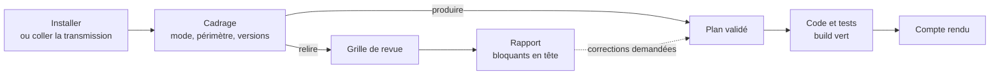

# Mode d'emploi : l'expert Java

Ce mode d'emploi fait travailler l'IA du développeur comme l'expert [`java`](../../specs/java/SKILL.md) 1.1.1 : produire ou relire un back Java 21, Spring Boot 3.5 et PostgreSQL, selon des invariants vérifiables et le socle commun back-front.

| Mode | L'expert | Il remet |
|---|---|---|
| **produire** | écrit ou modifie le code et ses tests ensemble, après validation d'un plan | le code, les tests, le résultat du build, un compte rendu |
| **relire** | examine le code sans le modifier | un rapport de revue classé par gravité |



## 1. Prérequis

- Une IA locale qui lit et écrit les fichiers du projet : Gemini CLI, Claude Code ou équivalent.
- Le dépôt du back, avec son wrapper Maven ou Gradle.
- Docker sur le poste : les tests d'intégration s'appuient sur Testcontainers et PostgreSQL.
- Pour l'installation automatique : un clone d'Agent2Prompt et Node 20 ou plus récent. À défaut, la transmission seule : [`transmissions/java-1.1.1.md`](../../transmissions/java-1.1.1.md).

## 2. Installer

**Dans Gemini CLI**, depuis la racine du projet :

```bash
node <Agent2Prompt>/tools/installer.mjs java
```

Puis, dans Gemini CLI : `/skills reload`, et « Active le skill java. L'étape 0 de sa consigne est faite. Lis `CONSIGNE.md` dans son dossier et suis-la à partir de l'étape 1. » L'installateur vérifie chaque fichier par son empreinte et masque le skill à Git sans le rendre illisible (README du dépôt, « Installer un skill dans Gemini CLI »).

**Dans une autre IA**, coller le contenu de la transmission. L'IA crée `.skills/java/` dans le dépôt, y écrit chaque fichier à l'identique, puis les vérifie avec `sha256sum -c` contre la table d'intégrité en fin de texte.

Le skill contient le socle commun back-front (`socle/SKILL.md`), épinglé en 1.0.1 : rien d'autre à installer.

## 3. Le cadrage

Avant tout travail, l'expert demande :

- le **mode** : produire ou relire ;
- le **périmètre** : une fonctionnalité, des fichiers, une branche ou une demande précise ;
- les **versions réelles** du projet, lues dans `pom.xml` ou `build.gradle` et par `java -version`.

| Composant | Version cible |
|---|---|
| Java | 21 |
| Spring Boot | 3.5.x, dernier correctif |
| PostgreSQL | 14 ou plus récent, celle du projet |
| Migrations | Flyway ou Liquibase, l'outil déjà en place |
| Tests | JUnit 5, AssertJ, Mockito, Testcontainers, ArchUnit |

Si le projet diffère de ces versions, l'expert le signale et demande comment procéder : il n'adapte jamais le code en silence. La migration vers Spring Boot 4 est une dimension réservée, qu'il n'applique pas.

## 4. Produire

1. L'expert lit le code concerné et propose un **plan** : fichiers touchés, invariants visés, tests prévus.
2. Vous validez le plan, ou le corrigez.
3. Il écrit le code et ses tests ensemble, puis lance le build complet (`./mvnw verify` ou `./gradlew check`).
4. Il remet un **compte rendu** : fichiers, invariants couverts, résultat du build, écarts.

Un invariant visé sans contrôle automatisé n'est pas tenu pour respecté : soit un test le vérifie, soit le compte rendu le liste en « contrôle manuel » avec sa justification.

## 5. Relire

L'expert délimite le périmètre, applique la grille du module `revue`, puis remet un rapport. Chaque constat cite `fichier:ligne`, l'invariant concerné, sa gravité et une correction proposée.

| Gravité | Exemples |
|---|---|
| **Bloquant** | requête SQL par concaténation, endpoint protégé accessible anonymement, montant en `double`, migration modifiée |
| **Majeur** | `open-in-view` actif, N+1 sur un écran de liste |
| **Mineur** | écart de convention sans risque immédiat |
| **Suggestion** | amélioration argumentée |

L'expert ne corrige rien de lui-même. Si vous demandez une correction, elle repasse par le mode produire, plan compris.

## 6. Ce qui ne se négocie pas

- Le socle l'emporte pour tout ce qui traverse la frontière back-front : contrat OpenAPI, erreurs RFC 9457, formats, sécurité, traçabilité.
- Aucune nouvelle dépendance sans votre validation ; aucune API inventée.
- Aucun secret dans le code, la configuration versionnée, les tests ou les journaux.
- Dans un projet existant, la convention en place l'emporte, sauf si elle viole un invariant : l'expert le signale alors.

## 7. Mettre à jour, retirer

- **Mettre à jour** : `git pull` dans Agent2Prompt, puis la même commande d'installation. L'installateur refuse si des fichiers du skill ont été modifiés depuis l'installation, sauf `--forcer`.
- **Retirer** : `node <Agent2Prompt>/tools/installer.mjs --retirer java`.
- **État** : `--liste` montre la version du dépôt à côté de la version installée.

## 8. Dépannage

| Symptôme | Cause probable | Remède |
|---|---|---|
| Les tests d'intégration échouent au démarrage | Docker absent ou arrêté | démarrer Docker ; Testcontainers en a besoin |
| L'expert annonce un écart de versions | le projet n'est pas en Java 21 ou Spring Boot 3.5 | dire comment procéder : adapter au projet, ou planifier la montée |
| Seul `SKILL.md` est lu, pas les modules | skill exclu de Git sans négation dans `.geminiignore` | réinstaller avec l'installateur, ou ajouter les négations à la main |
| L'expert modifie du code en mode relire | mode mal posé au cadrage | rappeler le mode : en relire, aucun fichier ne change |

Le même skill sert de référentiel à [`sonarqube`](../sonarqube/mode-emploi.md) et à [`orchestrateur-c7e`](../orchestrateur-c7e/mode-emploi.md) : leurs corrections respectent les invariants `java:Dn.INV-k`.
