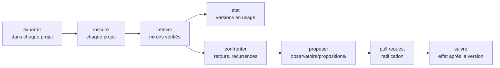

# Mode d'emploi : l'observatoire

Ce mode d'emploi met en place l'observatoire de l'écosystème, [`observatoire`](../../specs/observatoire/SKILL.md) 1.0.0, sur le poste du développeur. L'observatoire relève les journaux d'enveloppes que les systèmes exportent dans ses projets, les confronte d'une instance à l'autre, observe l'état de l'écosystème, écrit des propositions minimisées que le développeur apporte au dépôt par pull request, et suit l'effet de celles que la ratification fait entrer dans une version. Il propose et n'applique jamais ; ce qu'il relève reste sur le poste.



## 1. Prérequis

- Un clone d'Agent2Prompt, `<dépôt>`, qui est un dépôt Git, et Node 20 ou plus récent ; Node 22 ou plus récent pour la recette.
- Des projets dont les systèmes exportent leurs observations : pour le générateur de skills de ticket, `observation.mjs exporter` ([mode d'emploi du générateur](../generateur-skill-ticket/mode-emploi.md), section 6), qui écrit `docs/c7e/observations.jsonl`.

## 2. Installer l'observatoire

```bash
node <dépôt>/tools/installer.mjs observatoire --utilisateur
```

Le skill s'installe au niveau utilisateur seulement, dans `~/.gemini/skills/observatoire/` : il observe plusieurs projets depuis le clone, sans écrire dans aucun. Il sert à l'IA qui t'aide à lire ce que l'observatoire tire et à rédiger les propositions. Sa transmission porte sa consigne, ses modules et le socle d'observation ; son outil reste dans le clone : [`transmissions/observatoire-1.0.0.md`](../../transmissions/observatoire-1.0.0.md). L'outil se lance aussi sans IA, depuis le clone.

## 3. Inscrire et relever

```bash
node specs/observatoire/outils/observatoire.mjs inscrire --projet <dossier>
node specs/observatoire/outils/observatoire.mjs relever
```

Depuis le clone. `inscrire` enregistre le projet et son instance, l'empreinte que portent ses enveloppes ; un projet copié, ou un worktree, reste la même instance. `relever` vérifie chaque journal inscrit selon le socle et le recopie dans le magasin, en ajout seul. Le magasin est dans le répertoire Git commun du clone, `<git-common-dir>/agent2prompt/observatoire/` : jamais versionné, partagé par les worktrees du clone ; un nouveau clone n'a qu'à réinscrire ses projets. `etat`, `confronter`, `proposer` et `suivre` relèvent d'abord.

## 4. Lire l'état, confronter, proposer

```bash
node specs/observatoire/outils/observatoire.mjs etat
node specs/observatoire/outils/observatoire.mjs confronter
node specs/observatoire/outils/observatoire.mjs proposer
```

`etat` dit, pour chaque instance, la version de chaque système qui exporte, à jour, en retard ou inconnue du dépôt. `confronter` liste les candidats : un retour, une proposition qu'une instance a retenue pour une spécification, dès une instance ; une récurrence, un même motif à la même profondeur dans au moins deux instances. `proposer` écrit une proposition par candidat nouveau dans `observatoire/propositions/`, à la racine du clone : relis-la, rédige sous « Ce qui change » la règle à changer et pourquoi, sans aucune donnée d'un projet, puis commite-la et ouvre la pull request. L'outil ne commite rien. `--json` donne `etat`, `confronter` et `suivre` en JSON.

## 5. Ratifier et suivre

La pull request de ratification inscrit le statut dans l'en-tête de la proposition : `statut: ratifiee`, avec `version`, la version du système qui la porte, et `pr`, son numéro ; ou `statut: refusee`, avec `pr`. Une proposition ouverte ou ratifiée ne se répète pas ; une refusée ne revient qu'avec une instance nouvelle.

```bash
node specs/observatoire/outils/observatoire.mjs suivre
```

Pour chaque proposition ratifiée, `suivre` compare la part de son motif dans les enveloppes du système avant et après la version qui la porte : effet observé, non observé, ou indécidable tant qu'il n'y a pas vingt enveloppes de chaque côté.

## 6. Recette et essais sur le poste

```bash
node --test "specs/observatoire/tests/*.test.mjs"
node specs/observatoire/outils/observatoire.mjs verifier
```

La recette, depuis la racine du clone, produit ses instances d'épreuve par l'export du générateur, dans des dossiers temporaires, avec un magasin et un dépôt temporaires : elle n'écrit ni dans le magasin du clone, ni dans ses propositions. `verifier` contrôle le magasin et les propositions du dépôt.

## 7. Dépannage

| Symptôme | Cause | Remède |
|---|---|---|
| « le clone d'Agent2Prompt n'est pas un dépôt Git » | le clone a été copié sans son répertoire `.git` | lancer l'outil depuis un vrai clone |
| `inscrire` dit qu'il n'y a aucun journal | le projet n'exporte pas encore | exporter d'abord, avec l'outil de son système |
| `relever` dit un journal altéré | le journal ou sa tête a été modifié à la main | reprendre le journal et sa tête depuis l'historique Git du projet ; le miroir reste tel quel jusque-là |
| `relever` dit un journal réécrit depuis le dernier relevé | le journal a été refait, même avec une chaîne cohérente | reprendre le journal versionné qui prolonge le miroir ; un journal refait de bout en bout ne se relève plus |
| `relever` dit le magasin altéré | un fichier du magasin a été modifié | supprimer `<git-common-dir>/agent2prompt/observatoire/`, réinscrire les projets et relever : le magasin se reconstruit depuis les journaux |
| `etat` compte des enveloppes écartées | une instance exporte une version qu'aucune version publiée du dépôt ne connaît | mettre le clone à jour, ou le système de l'instance à une version publiée |
| `confronter` ne trouve aucune récurrence | une seule instance inscrite | inscrire une deuxième instance ; les retours remontent sans elle |
