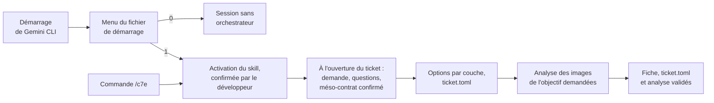

# Mode d'emploi : lancer l'orchestrateur C7E dans Gemini CLI

Ce mode d'emploi installe la spécification [`orchestrateur-c7e`](../../specs/orchestrateur-c7e/SKILL.md) 3.4.0 dans un projet et la fait appeler au démarrage de l'IA locale, Gemini CLI. Le skill ne s'applique qu'au choix du développeur, selon l'un de deux chargements :

| Chargement | Le choix se fait | Au démarrage, le contexte contient |
|---|---|---|
| **permanent** | une fois, par l'import du fichier de démarrage | le point d'entrée du skill et le fichier d'invariants, environ 90 Ko |
| **au choix** | à chaque session, au menu ou par la commande `/c7e` | le nom et la description du skill, et le menu |

Ces deux chargements ne sont pas les modes de modulation A, B et C du skill, qui règlent la méthode une fois le skill choisi.

Une fois l'orchestrateur choisi, chaque ticket est d'abord **qualifié**, à son ouverture. L'IA range sa demande dans le modèle générique de la demande du référentiel des méso-contrats, une combinaison de possibilités de modification de l'application établies à son analyse, pose les questions que le ticket laisse ouvertes, et propose le méso-contrat (M01 à M04, puis les catégories du projet), que vous confirmez avant tout le reste. Viennent ensuite les options au choix sur chaque couche, l'analyse des images PNG de l'objectif quand il y en a, et la fiche de transformation.

---

## 1. Prérequis

- Gemini CLI, lancé à la racine du projet.
- Pour le chargement au choix, la prise en charge des skills : la commande `/skills list` doit répondre.
- Un clone du dépôt Agent2Prompt, pour l'installateur `tools/installer.mjs`. À défaut, la transmission seule : [`transmissions/orchestrateur-c7e-3.4.0.md`](../../transmissions/orchestrateur-c7e-3.4.0.md).
- Node 20 ou plus récent, pour l'installateur et pour extraire le référentiel, et `sha256sum`, fourni par Git Bash sous Windows, pour vérifier les fichiers.

Deux dépôts interviennent :

- **Agent2Prompt** contient la spécification (`specs/orchestrateur-c7e/`) et sa transmission. Il ne contient aucun fichier de `docs/c7e/` : ceux-là appartiennent au projet.
- **Le dépôt du projet** reçoit le skill, puis les fichiers du projet, que l'IA y crée à l'installation à partir des modèles du skill (§ 3).

Le dossier `transmissions/` d'Agent2Prompt contient un fichier par version de chaque spécification, que génère `tools/bundle.mjs` à partir de `specs/`. Ce texte unique comprend :

1. la consigne donnée à l'IA ;
2. chaque fichier du skill, entre `<<<FICHIER chemin>>>` et `<<<FIN chemin>>>` ;
3. une table d'empreintes sha256.

L'installateur lit ce fichier ; sans clone, on le colle tel quel dans Gemini CLI. Les transmissions des versions précédentes y restent, comme trace exacte de ce qui a été remis à une IA.

## 2. Installer le skill

1. Choisir l'emplacement :

   | Chargement et disposition | Emplacement du skill |
   |---|---|
   | permanent | `.skills/orchestrateur-c7e/` |
   | au choix, clone ordinaire | `.gemini/skills/orchestrateur-c7e/` |
   | au choix, kit `agents-paralleles-gitlab` | `~/.gemini/skills/orchestrateur-c7e/`, une seule installation pour tous les worktrees |

2. Pour un chargement au choix, installer le skill avec l'installateur du dépôt, depuis la racine du projet :

   ```bash
   node <Agent2Prompt>/tools/installer.mjs orchestrateur-c7e                 # .gemini/skills/orchestrateur-c7e/
   node <Agent2Prompt>/tools/installer.mjs orchestrateur-c7e --utilisateur   # ~/.gemini/skills/, avec le kit
   ```

   Il recrée les fichiers de la transmission, vérifie leurs empreintes, garde la consigne dans `CONSIGNE.md` et masque le skill à Git sans le rendre illisible (README du dépôt, « Installer un skill dans Gemini CLI »). Dans Gemini CLI, après `/skills reload` : « Active le skill orchestrateur-c7e. L'étape 0 de sa consigne est faite. Lis `CONSIGNE.md` dans son dossier et suis-la à partir de l'étape 1. » L'IA installe alors les fichiers du projet (§ 3).
3. Pour un chargement permanent, ou sans clone du dépôt, coller la transmission dans Gemini CLI, en précisant l'emplacement choisi. L'IA crée les fichiers à l'identique, les vérifie avec la table d'intégrité, puis installe les fichiers du projet (§ 3).
4. Masquer le skill à Git sans le rendre illisible pour Gemini CLI (§ 11.3 du skill). Dans un clone ordinaire, son outil de lecture refuse les fichiers qu'exclut `.git/info/exclude` : un skill exclu ainsi ne livre que son `SKILL.md` à l'activation, et ses modules restent illisibles. L'installateur s'en charge. À la main, ajouter à `.git/info/exclude` le dossier du skill et `/.geminiignore`, et à `.geminiignore` une négation par niveau :
   - chargement au choix : `!/.gemini/`, `!/.gemini/skills/` et `!/.gemini/skills/orchestrateur-c7e/` ;
   - chargement permanent : `!/.skills/` et `!/.skills/orchestrateur-c7e/`.

   Inutile au niveau utilisateur, hors de tout dépôt.
5. Pour le chargement au choix, vérifier que le dossier du skill porte le nom de son `name` : `orchestrateur-c7e`.

**Mettre à jour le skill.** Après `git pull` dans le clone d'Agent2Prompt, relancer la même commande. La nouvelle version remplace l'ancienne d'un bloc, et `--liste` montre la version du dépôt à côté de la version installée.

- L'installateur refuse si des fichiers du skill ont changé depuis l'installation ; `--forcer` les remplace.
- Un skill collé par l'IA, sans `integrite.sha256`, n'est remplacé qu'avec `--forcer`.
- Les fichiers du projet (§ 3) ne changent pas. Pour savoir si une version en change les modèles, lire son entrée au journal de révision du skill (§ 17).

**Retirer le skill** : `--retirer orchestrateur-c7e`, qui retire aussi ses lignes de `.git/info/exclude` et de `.geminiignore`.

## 3. Préparer les fichiers du projet

Ces fichiers appartiennent au dépôt du projet, pas à Agent2Prompt. L'IA crée ceux de `docs/c7e/` à l'installation, étape 2 de la consigne, et ceux de `docs/demandes/<CLÉ>/` à chaque ticket, à partir des modèles du skill. Dans Agent2Prompt, ces modèles se trouvent sous `specs/orchestrateur-c7e/`, aux mêmes chemins.

| Fichier | Emplacement | Qui l'écrit | Modèle, dans le skill |
|---|---|---|---|
| invariants du projet | `docs/c7e/meso-contrats.md` | le développeur, qui remplit les valeurs `ADAPTER` | `meso-contrats.md` |
| référentiel des méso-contrats | `docs/c7e/referentiel-meso-contrats.toml` | le développeur, qui adapte catégories et options | `modules/referentiel/SKILL.md`, § 6 |
| registre des écarts | `docs/c7e/registre-ecarts.md` | l'IA ajoute, le développeur décide | `meso-contrats.md`, § 7 |
| registre des concepts | `docs/c7e/concepts.json` | l'IA propose, le développeur promeut | `SKILL.md`, § 7.2, registre de départ |
| base de connaissances | `docs/c7e/connaissances.md` | l'IA ajoute, le développeur relit | aucun : créée vide |
| fiche de transformation | `docs/demandes/<CLÉ>/fiche-transformation.md` | l'IA, validée par le développeur | `SKILL.md`, § 10 |
| instance de chaque ticket | `docs/demandes/<CLÉ>/ticket.toml` | l'IA, à la qualification puis à l'analyse ; le développeur confirme le méso-contrat, puis valide les options avec la fiche | `modules/referentiel/SKILL.md`, § 7, exemple |
| analyse d'image | `docs/demandes/<CLÉ>/analyse-image.md` | l'IA, validée avec la fiche | aucun |
| images de l'objectif | `docs/demandes/<CLÉ>/maquettes/*.png` | le développeur ou le PO | aucun |

À l'installation, l'IA écrit le modèle du référentiel et vérifie son empreinte. La commande qui le fait aussi à la main est au § 6 du module `referentiel` ; elle suppose le skill dans `.skills/orchestrateur-c7e/`, à remplacer par `.gemini/skills/orchestrateur-c7e/` en chargement au choix.

Le développeur adapte ensuite son référentiel :

- le modèle générique de la demande, section 0 : la combinaison des possibilités de modification de l'application, couche par couche, chacune avec son option et ses repères. À l'installation, l'IA les confronte à l'analyse de l'application et propose celles à retenir, à retirer ou à ajouter (un traitement par lots, un message, un export) ; vous les écrivez ;
- une catégorie de tickets nouvelle s'ajoute par un bloc `[[meso_contrats]]` d'identifiant `M04`, `M05`… ; chaque couche y déclare son impact (`requis`, `optionnel` ou `aucun`), ses technologies et ses options permises ;
- les options elles-mêmes, leurs slots et leurs preuves se règlent dans la section 1 du référentiel ;
- `meta.version` change à chaque modification ; les tickets déjà instanciés gardent la version qu'ils ont épinglée.

L'IA ne modifie jamais ce fichier : elle propose, le développeur ajoute.

Tous ces fichiers sont versionnés avec le projet, images comprises : une commande de Gemini CLI n'injecte pas un fichier exclu de Git.

## 4. Chargement permanent

1. Créer le fichier de démarrage à la racine du projet, `GEMINI.md` ou le nom de votre choix :

   ```markdown
   # IA locale du projet

   @./.skills/orchestrateur-c7e/SKILL.md
   @./docs/c7e/meso-contrats.md

   Pour chaque ticket confié, applique l'orchestrateur C7E : qualification et confirmation
   du méso-contrat, fiche de transformation, validation par le développeur, puis
   transformation par slot.
   ```

2. Si ce fichier ne s'appelle pas `GEMINI.md`, le déclarer dans `.gemini/settings.json` (voir § 6).
3. Lancer `gemini`, puis `/memory show` : le texte du skill doit apparaître, en commençant par « Orchestrateur fractal C7E, version 3.4.0 ».

Les lignes `@` ne sont développées que dans un fichier de contexte. Si le fichier est envoyé comme message, l'IA ne voit que le texte des lignes, sans le contenu des fichiers. Le référentiel n'est pas importé : l'IA le lit à l'analyse de chaque ticket.

## 5. Chargement au choix



### 5.1 Le fichier de démarrage

À la racine du projet, un menu, et aucun import du skill :

```markdown
# IA locale du projet

À ton premier message, avant tout autre travail, propose ce choix et attends la réponse :

0. Sans orchestrateur.
1. Avec l'orchestrateur C7E.

- N'active jamais le skill orchestrateur-c7e sans ce choix.
- Avec l'orchestrateur : active le skill et lis docs/c7e/meso-contrats.md ; pour chaque ticket
  confié, commence par le qualifier avec le modèle générique de la demande de
  docs/c7e/referentiel-meso-contrats.toml : pose tes questions et fais confirmer le
  méso-contrat avant tout le reste.
- Sans orchestrateur : n'applique aucune règle du skill.
```

### 5.2 La commande `/c7e`

La commande fait le même choix sans passer par le menu, et confie le ticket d'un même geste. Créer `.gemini/commands/c7e.toml`, ou `~/.gemini/commands/c7e.toml` avec le kit :

```toml
description = "Orchestrateur C7E : activer le skill et traiter le ticket donné"
prompt = """
Active le skill orchestrateur-c7e pour la suite de la session.
Fichier d'invariants du projet :
@{docs/c7e/meso-contrats.md}
Référentiel des méso-contrats du projet :
@{docs/c7e/referentiel-meso-contrats.toml}
Commence par qualifier le ticket : modèle générique de la demande, questions,
méso-contrat à confirmer avant tout le reste.
Ticket, et méso-contrat imposé s'il est précisé : {{args}}
"""
```

- `/c7e ABCDE-3512` : l'IA qualifie le ticket, pose ses questions et propose le méso-contrat, à confirmer.
- `/c7e ABCDE-3512 M01` : le méso-contrat est imposé ; il vaut confirmation s'il couvre la demande remplie, sinon l'IA montre l'écart et attend.
- Le skill passe par l'activation, jamais par `@{…}` : l'activation livre son `SKILL.md` et la liste de ses fichiers, que l'IA lit ensuite.
- Avec le kit, les chemins `docs/c7e/…` se lisent dans le worktree où Gemini CLI est lancé.

### 5.3 Vérifier

| Commande | Résultat attendu |
|---|---|
| `/skills list` | `orchestrateur-c7e` figure dans la liste |
| `/memory show` | le menu du fichier de démarrage apparaît |
| `/commands list` | la commande `c7e` apparaît |

Après une modification : `/skills reload`, `/memory reload` ou `/commands reload`.

## 6. Déclarer le fichier de démarrage

Gemini CLI lit `GEMINI.md`. Pour un autre nom, `.gemini/settings.json` :

```json
{ "context": { "fileName": ["GEMINI.md", "README.md"] } }
```

- Le nom doit avoir la casse exacte du fichier : sous WSL2, `README.md` et `readme.md` sont deux fichiers différents.
- Gemini CLI lit aussi les fichiers de ce nom dans les dossiers que ses outils parcourent. Déclarer `README.md` ferait entrer dans le contexte les `README.md` des sous-dossiers. Un nom propre à l'IA locale, comme `IA.md`, évite ce mélange.

## 7. Les options au choix

Chaque méso-contrat permet certaines options par couche ; `ticket.toml` les précise pour le ticket.

| Couche | Option | Ce que précise `ticket.toml` |
|---|---|---|
| PostgreSQL | évolution de schéma (`schema`) | le changement (table, colonne, index, contrainte), la table, une description |
| PostgreSQL | contrat CRUD (`crud`) | l'entité, la table, les opérations parmi `create`, `read`, `update`, `delete`, et le mode de suppression si `delete` est retenu |
| Java | endpoints (`endpoints`) | la méthode, le chemin, la réponse, les erreurs attendues |
| Java | variantes de représentation (`representations`), sous M04 | le repérage depuis l'URI (opération, contrôleur, type de réponse, champ liste ou record, entité, colonne de date-heure), si la version d'API est publiée, le mécanisme de sélection (`parametre_vue`, `negociation_contenu`, `remplacement`), l'exposition de la variante sans champ (`base`, `meme_uri`, `uri_propre`) et les deux types de variante |
| Java | événements temps réel (`evenements`), sous M04 | le canal STOMP, les types d'événements, l'instantané REST et le courtier (`simple` ou `relais`) que nomme votre fichier d'invariants, selon le socle 1.1.0 (SC7) |
| Java | règles métier (`regles`) | un identifiant et l'énoncé de chaque règle |
| Java | fonctionnalités (`fonctionnalites`) | le cas d'usage |
| Angular | éléments graphiques (`elements_graphiques`) | le composant et ses états visuels |
| Angular | fonctionnalités (`fonctionnalites`) | le comportement et son déclencheur |
| Angular | analyse d'image, sur toute option front | `image_objectif` (PNG), `analyse_image` (structure, composants, textes, états, couleurs, accessibilité), et `image_actuelle` pour relever les écarts |

La demande remplie à la qualification signale déjà des options ; l'analyse les précise. Les paramètres d'une option, comme le mécanisme de sélection d'une variante, se demandent dès la qualification si le ticket ne les dit pas. Chaque option retenue apporte ses preuves aux tests déduits de la fiche. Le module `referentiel` du skill donne deux exemples complets de `ticket.toml`, demande remplie comprise : le ticket fil rouge sous M01, et une variante de représentation sous M04.

## 8. Au quotidien

1. Déposer dans `docs/demandes/<CLÉ>/maquettes/` les images PNG de l'objectif, s'il y en a, et les versionner.
2. Lancer `gemini` à la racine du projet, ou dans le worktree de la demande avec le kit.
3. Choisir l'orchestrateur : répondre 1 au menu, ou taper `/c7e ABCDE-3512`.
4. Confirmer l'activation du skill quand Gemini CLI la demande.
5. Lire la qualification du ticket, répondre à ses questions et confirmer le méso-contrat : l'IA ne lit pas le code et ne prépare pas la fiche avant.
6. Relire ce que l'IA présente ensuite, en un point de validation :
   - la fiche de transformation ;
   - `ticket.toml`, avec le méso-contrat et les options proposés ;
   - l'analyse d'image et ses questions.
7. L'IA transforme ensuite le système slot par slot et dépose ses preuves.
8. Relire, pousser et fusionner vous-même : l'IA ne pousse pas, ne fusionne pas et ne pose aucun tag.

Si l'IA signale qu'aucune catégorie ne couvre le ticket, choisir la plus proche ou ajouter la catégorie au référentiel ; l'IA ne l'ajoute pas elle-même.

## 9. Limites connues

- **Activation spontanée.** Gemini CLI peut proposer d'activer le skill dès qu'un ticket apparaît. Refuser la confirmation sans choix préalable ; le skill interdit aussi de s'activer de lui-même.
- **Lancement sans interface.** Un outil qui relance Gemini CLI à chaque message, comme GeminiBoard, ferait réapparaître le menu à chaque appel, et la confirmation d'activation suppose une interface. L'outil doit retenir le choix et le rejouer à chaque appel.
- **Images.** Les tailles et les couleurs lues sur une image sont des estimations, à confirmer avec le système de design. Ce qu'une image ne montre pas (focus, annonces aux technologies d'assistance, comportement) se prouve par les tests.
- **Coût du chargement permanent.** Le skill entier entre dans le contexte de chaque session, même sans ticket.

## 10. Dépannage

| Symptôme | Cause probable | Remède |
|---|---|---|
| `/skills list` ne montre pas le skill | dossier mal placé ou mal nommé | le dossier doit s'appeler `orchestrateur-c7e`, sous `.gemini/skills/` ou `~/.gemini/skills/`, puis `/skills reload` |
| `/skills list` ne montre aucun skill du workspace | dossier pas de confiance, ou Gemini CLI lancé ailleurs | accorder la confiance au dossier ; lancer Gemini CLI là où se trouve `.gemini/` |
| le skill s'active, mais ses modules sont refusés (« ignored by configured ignore patterns ») | skill exclu de Git sans négation dans `.geminiignore` | relancer l'installateur, ou ajouter les négations du § 2, point 4 |
| l'installateur refuse : « il n'a pas été installé par cet outil » | skill collé par l'IA, sans `integrite.sha256` | relancer avec `--forcer` |
| l'installateur refuse : fichiers changés depuis l'installation | skill retouché, ou scripts ajoutés dans son dossier | relancer avec `--forcer`, après avoir mis de côté ce qui doit l'être |
| un fichier de `docs/c7e/` introuvable | cherché dans Agent2Prompt, ou étape 2 de la consigne pas encore faite | ces fichiers sont dans le dépôt du projet ; demander à l'IA de faire l'étape 2 |
| le menu n'apparaît pas | fichier de démarrage non déclaré, ou casse différente | § 6, puis `/memory show` |
| `/memory show` montre les lignes `@` sans le contenu | chemin faux, ou fichier envoyé comme message | chemins relatifs au fichier de démarrage ; le charger comme fichier de contexte |
| la commande ne trouve pas le référentiel ou les invariants | fichier absent ou exclu de Git | les fichiers de `docs/c7e/` doivent exister et être versionnés |
| l'empreinte du référentiel diffère à l'installation | fichier recopié à la main ou retouché | le réécrire par la commande du module `referentiel`, § 6 |
| l'IA ne propose aucun méso-contrat | référentiel absent, ou ticket hors de toute catégorie | installer le référentiel ; sinon, choisir une catégorie ou en ajouter une |
| l'IA lit le code ou prépare la fiche sans avoir qualifié le ticket | qualification sautée | l'arrêter et demander la qualification : le skill l'impose avant tout le reste (D11.INV-1) |
| la qualification dit prendre le modèle de la demande du skill | référentiel installé avant la 3.3.0, sans section `[modele_demande]` | copier la section 0 du modèle (module `referentiel`, § 6) dans le référentiel du projet, et changer `meta.version` |
| un ticket de variante de représentation ne trouve pas de catégorie | référentiel installé avant la 3.4.0, sans M04 | copier du modèle (module `referentiel`, § 6) le bloc M04, les options `representations` et `evenements`, les possibilités `variante_representation` et `temps_reel` et la règle de choix sur les possibilités requises, et changer `meta.version` ; pour le temps réel, renseigner le courtier dans la section 2 du fichier d'invariants |
| un ticket temps réel sans variante de représentation ne trouve pas de catégorie | seul M04 permet l'option `evenements` | permettre `evenements` dans une autre catégorie de votre référentiel, ou en créer une |
| l'IA refuse le remplacement de la réponse actuelle | version d'API publiée : retirer un champ y est cassant (socle, SC1.INV-2) | choisir le paramètre de vue ou la négociation de contenu, ou une version `v2` |
| l'IA retient une option refusée par la catégorie | règle de validation ignorée | la refuser à la validation ; le skill la rejette (scénario R13) |
| l'image n'est pas analysée | fichier absent, non versionné, ou pas en PNG | déposer le PNG dans `maquettes/`, le versionner, renseigner `image_objectif` et `analyse_image` |
| l'IA applique la méthode sans choix | activation acceptée par erreur | relancer la session et refuser la confirmation |
