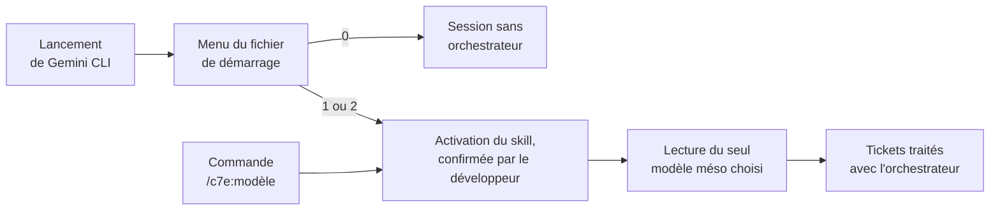

# Mode d'emploi : lancer l'orchestrateur C7E dans Gemini CLI

Ce mode d'emploi installe la spécification [`orchestrateur-c7e`](../../specs/orchestrateur-c7e/SKILL.md) 3.1.0 dans un projet et la fait appeler au lancement de l'IA locale, Gemini CLI. Il décrit deux modes :

| Mode | L'orchestrateur s'applique | Modèles méso | Contexte chargé au démarrage |
|---|---|---|---|
| **A, toujours actif** | à chaque session, sans choix | un seul | le skill entier et le fichier d'invariants, environ 65 Ko |
| **B, au choix** | seulement si le développeur le choisit au démarrage | un ou plusieurs | le nom et la description du skill, et le menu |

Le mode B convient dès qu'il y a plusieurs modèles méso, par exemple un par périmètre technique (`java-angular`, `python`).

Les deux modes respectent la version 3.1.0 : l'en-tête de la transmission laisse le développeur choisir l'emplacement du skill (étape 0), et le modèle méso choisi tient lieu, pour la session, du fichier d'invariants du projet (§ 11.2).

---

## 1. Prérequis

- Gemini CLI, lancé à la racine du projet.
- Pour le mode B, la prise en charge des skills : la commande `/skills list` doit répondre.
- La transmission [`transmissions/orchestrateur-c7e-3.1.0.md`](../../transmissions/orchestrateur-c7e-3.1.0.md).
- Pour vérifier l'intégrité des fichiers, `sha256sum`, fourni par Git Bash sous Windows.

## 2. Installer le skill

1. Choisir l'emplacement :

   | Mode et disposition | Emplacement du skill |
   |---|---|
   | mode A | `.skills/orchestrateur-c7e/` |
   | mode B, clone ordinaire | `.gemini/skills/orchestrateur-c7e/` |
   | mode B, kit `agents-paralleles-gitlab` | `~/.gemini/skills/orchestrateur-c7e/`, une seule installation pour tous les worktrees |

2. Coller la transmission dans Gemini CLI, en précisant l'emplacement choisi. L'IA crée les fichiers à l'identique (étape 0 de l'en-tête) et les vérifie avec la table d'intégrité.
3. Exclure le skill de Git, dans `.git/info/exclude` : `/.skills/` en mode A, `/.gemini/skills/` en mode B. Inutile au niveau utilisateur.
4. En mode B, vérifier que le dossier du skill porte le nom de son `name` : `orchestrateur-c7e`.

## 3. Préparer les fichiers du projet

| Fichier | Mode A | Mode B | Qui l'écrit |
|---|---|---|---|
| invariants du projet | `docs/c7e/meso-contrats.md` | un fichier par modèle : `docs/c7e/meso/<modèle>.md` | le développeur, à partir de `meso-contrats.md` du skill |
| registre des écarts | `docs/c7e/registre-ecarts.md` | le même, chaque entrée nommant son modèle | l'IA ajoute, le développeur décide |
| registre des concepts | `docs/c7e/concepts.json` | le même | l'IA propose, le développeur promeut |
| base de connaissances | `docs/c7e/connaissances.md` | le même | l'IA ajoute, le développeur relit |

Pour chaque modèle méso, copier `meso-contrats.md` du skill et remplir ses valeurs `ADAPTER`. L'IA liste celles qui restent ; elle ne les remplit pas. Ces fichiers sont versionnés avec le projet.

## 4. Mode A : toujours actif

1. Créer le fichier de démarrage à la racine du projet, `GEMINI.md` ou le nom de votre choix :

   ```markdown
   # IA locale du projet

   @./.skills/orchestrateur-c7e/SKILL.md
   @./docs/c7e/meso-contrats.md

   Pour chaque ticket confié, applique l'orchestrateur C7E : fiche de transformation,
   validation par le développeur, puis transformation par slot.
   ```

2. Si ce fichier ne s'appelle pas `GEMINI.md`, le déclarer dans `.gemini/settings.json` (voir § 6).
3. Lancer `gemini`, puis `/memory show` : le texte du skill doit apparaître, en commençant par « Orchestrateur fractal C7E, version 3.1.0 ».

Les lignes `@` ne sont développées que dans un fichier de contexte. Si le fichier est envoyé comme message, l'IA ne voit que le texte des lignes, sans le contenu des fichiers.

## 5. Mode B : au choix, au démarrage



### 5.1 Le fichier de démarrage

À la racine du projet, un menu et aucun import du skill :

```markdown
# IA locale du projet

À ton premier message, avant tout autre travail, propose ce choix et attends la réponse :

0. Sans orchestrateur.
1. Orchestrateur C7E, modèle méso java-angular : docs/c7e/meso/java-angular.md
2. Orchestrateur C7E, modèle méso python : docs/c7e/meso/python.md

- N'active jamais le skill orchestrateur-c7e sans ce choix.
- Choix 1 ou 2 : active le skill, puis lis le modèle choisi et lui seul ; c'est le fichier
  d'invariants du projet pour toute la session. Annonce le modèle actif.
- Choix 0 : n'applique aucune règle du skill.
- Un changement de modèle en cours de session s'annonce de la même façon.
```

Ajouter une ligne au menu pour chaque nouveau modèle.

### 5.2 Une commande par modèle

Les commandes rendent le choix déterministe, sans passer par le menu. Pour le modèle `java-angular`, créer `.gemini/commands/c7e/java-angular.toml` :

```toml
description = "Orchestrateur C7E, modèle méso java-angular"
prompt = """
Active le skill orchestrateur-c7e pour la suite de la session.
Modèle méso actif, seul fichier d'invariants du projet :
@{docs/c7e/meso/java-angular.md}
{{args}}
"""
```

- Le fichier `c7e/java-angular.toml` devient la commande `/c7e:java-angular`.
- Il faut un fichier par modèle : Gemini CLI insère le contenu des `@{…}` avant de remplacer `{{args}}`, donc une commande unique ne peut pas choisir son fichier d'après l'argument.
- Le skill passe par l'activation, jamais par `@{…}` : les commandes ignorent les fichiers exclus de Git, comme le dossier du skill.
- Avec le kit `agents-paralleles-gitlab`, les commandes peuvent aller dans `~/.gemini/commands/c7e/` : les chemins `docs/c7e/meso/…` se lisent alors dans le worktree où Gemini CLI est lancé.

### 5.3 Vérifier

| Commande | Résultat attendu |
|---|---|
| `/skills list` | `orchestrateur-c7e` figure dans la liste |
| `/memory show` | le menu du fichier de démarrage apparaît |
| `/commands list` | les commandes `c7e:…` apparaissent |

Après une modification : `/skills reload`, `/memory reload` ou `/commands reload`.

## 6. Déclarer le fichier de démarrage

Gemini CLI lit `GEMINI.md`. Pour un autre nom, `.gemini/settings.json` :

```json
{ "context": { "fileName": ["GEMINI.md", "README.md"] } }
```

- Le nom doit avoir la casse exacte du fichier : sous WSL2, `README.md` et `readme.md` sont deux fichiers différents.
- Gemini CLI lit aussi les fichiers de ce nom dans les dossiers que ses outils parcourent. Déclarer `README.md` ferait entrer dans le contexte les `README.md` des sous-dossiers. Un nom propre à l'IA locale, comme `IA.md`, évite ce mélange.

## 7. Au quotidien

1. Lancer `gemini` à la racine du projet, ou dans le worktree de la demande avec le kit.
2. Choisir : répondre au menu, ou taper directement `/c7e:java-angular ABCDE-3512` pour choisir et confier le ticket d'un seul geste.
3. Confirmer l'activation du skill quand Gemini CLI la demande.
4. Vérifier que l'IA annonce le bon modèle méso.
5. Suivre la méthode : l'IA rédige la fiche de transformation, vous la validez, puis elle transforme le système slot par slot et dépose ses preuves (§ 3 du skill).
6. Relire, pousser et fusionner vous-même : l'IA ne pousse pas, ne fusionne pas et ne pose aucun tag.

Pour changer de modèle en cours de session, le demander ou taper la commande de l'autre modèle : l'IA annonce le nouveau modèle actif et ne lit plus l'ancien.

## 8. Limites connues

- **Activation spontanée.** La description du skill 3.1.0 dit « à charger au lancement, pour chaque ticket » : Gemini CLI peut proposer de l'activer sans choix préalable. Refuser la confirmation ; la règle du menu l'interdit aussi.
- **Lancement sans interface.** Un outil qui relance Gemini CLI à chaque message, comme GeminiBoard, ferait réapparaître le menu à chaque appel, et la confirmation d'activation suppose une interface. Le choix doit alors être retenu par l'outil, avec un sélecteur, et rejoué à chaque appel.
- **Coût du mode A.** Le skill entier entre dans le contexte de chaque session, même sans ticket.

## 9. Dépannage

| Symptôme | Cause probable | Remède |
|---|---|---|
| `/skills list` ne montre pas le skill | dossier mal placé ou mal nommé | le dossier doit s'appeler `orchestrateur-c7e`, sous `.gemini/skills/` ou `~/.gemini/skills/`, puis `/skills reload` |
| le menu n'apparaît pas | fichier de démarrage non déclaré, ou casse différente | § 6, puis `/memory show` |
| `/memory show` montre les lignes `@` sans le contenu | chemin faux, ou fichier envoyé comme message | chemins relatifs au fichier de démarrage ; le charger comme fichier de contexte |
| la commande ne trouve pas le modèle méso | fichier absent ou exclu de Git | le modèle doit exister dans `docs/c7e/meso/` et être versionné |
| l'IA lit plusieurs modèles méso | menu ou commande ambigus | un seul chemin par entrée du menu et par commande |
| l'IA applique la méthode sans choix | activation acceptée par erreur | relancer la session et refuser la confirmation |
