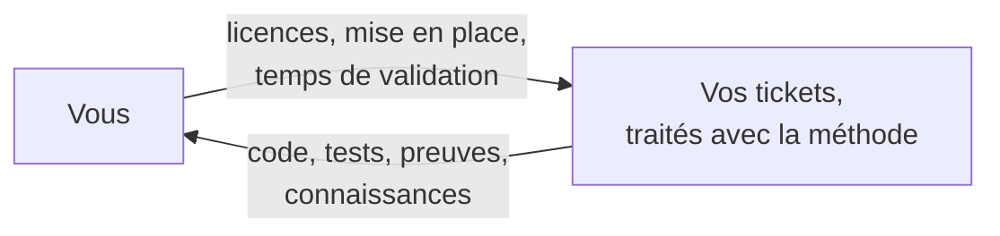
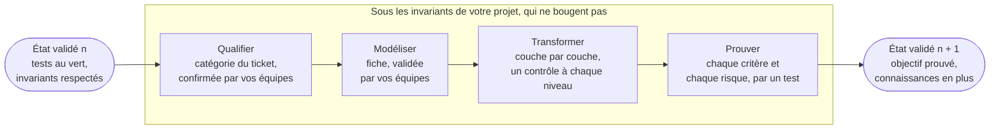
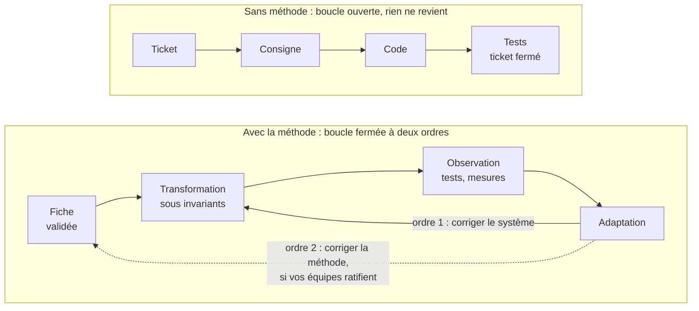
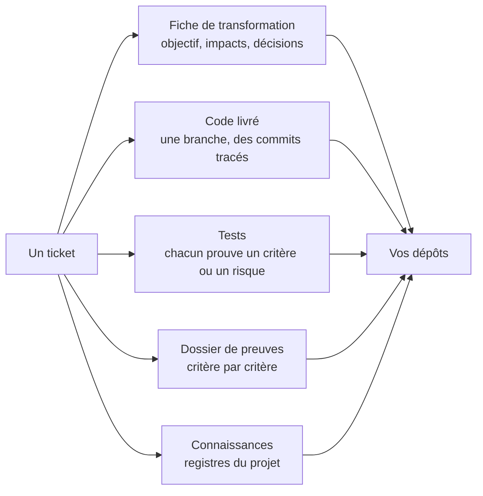
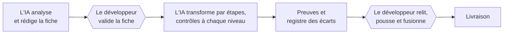
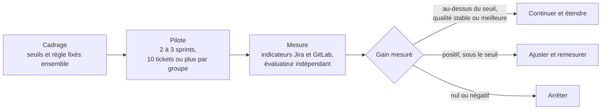

# L'IA, un investissement mesurable

**Ce que vous financez dans le développement de vos applications, ce que vous en retirez, et comment le vérifier**

> Ce document accompagne la présentation : ses sections suivent l'ordre des diapositives et en donnent les explications. Les schémas sont écrits en Mermaid, que GitLab, GitHub et la plupart des éditeurs affichent. Les chiffres publics sont sourcés en annexe B. Les chiffres du modèle de rentabilité sont des hypothèses, à remplacer par les vôtres.

---

## 1. Le message

**Ce que vous financez vous revient.**

1. **La contrepartie est directe.** Chaque ticket livre son code, ses tests et ses preuves.
2. **Elle se mesure.** Sur vos tickets, contre un groupe témoin, et non sur des promesses.
3. **Elle reste chez vous.** Tests, fiches, registres et connaissances sont versionnés dans vos dépôts.

Et vous gardez la décision : nous proposons un pilote mesuré, avec une règle d'arrêt fixée d'avance.



---

## 2. Votre prudence est fondée

| Constat | Source |
|---|---|
| 95 % des organisations ne tirent aucun retour mesurable de leurs projets d'IA générative, alors que les entreprises y ont consacré 30 à 40 milliards de dollars. | MIT NANDA, 2025 |
| Plus de 40 % des projets d'IA agentique seront abandonnés d'ici fin 2027, pour trois raisons : coûts croissants, valeur métier floue, maîtrise des risques insuffisante. | Gartner, 2025 |
| Seize développeurs chevronnés ont mis 19 % de temps en plus avec l'IA ; après coup, ils estimaient avoir gagné 20 %. | METR, 2025 |
| Sur une tâche bien bornée (écrire un serveur HTTP en JavaScript), des développeurs équipés d'un assistant ont fini 55,8 % plus vite. | Peng et al., 2023 |

Les effets mesurés vont d'un ralentissement à un gain de plus de moitié : ils dépendent du contexte et de la méthode. Et le ressenti des développeurs ne prédit pas le résultat. Une conclusion tient : **sans méthode, l'IA est un coût ; avec une méthode, son effet se mesure.**

> L'étude METR porte sur des développeurs qui connaissaient parfaitement leurs dépôts, avec les outils du début de 2025. En 2026, METR a jugé ses nouvelles données trop biaisées pour publier une estimation à jour : de plus en plus de développeurs refusaient de travailler sans IA. Le constat qui reste solide est l'écart entre le ressenti et la mesure.

---

## 3. Ce qui distingue ceux qui en tirent de la valeur

**L'apprentissage.** Selon le MIT, le premier obstacle n'est ni l'infrastructure, ni la réglementation, ni les compétences : la plupart des systèmes d'IA générative « ne retiennent pas les retours, ne s'adaptent pas au contexte et ne s'améliorent pas avec le temps ». Les rares projets qui créent de la valeur reposent sur des systèmes qui apprennent, intégrés au travail réel.

**L'amplification.** Selon DORA, le programme de recherche de Google Cloud, 90 % des professionnels du logiciel utilisent l'IA en 2025, et « l'IA ne répare pas une équipe : elle amplifie ce qui existe déjà ». Son adoption va de pair avec un débit de livraison plus élevé, mais aussi avec une stabilité moindre.

## 4. Les sept capacités qui amplifient l'IA

DORA identifie sept capacités qui amplifient l'effet positif de l'IA. Voici ce que notre méthode apporte à chacune.

| Capacité (DORA 2025) | Ce que notre méthode y apporte |
|---|---|
| Une position claire et communiquée sur l'IA | Ce que l'IA fait et ne fait pas est écrit : elle propose, vos équipes valident ; elle ne pousse ni ne fusionne jamais. |
| Des écosystèmes de données sains | Les registres du projet (concepts, écarts, connaissances) ont un format défini et sont versionnés. |
| Des données internes accessibles à l'IA | L'IA interroge une mémoire du code et des branches, lit les tickets du sprint et le fichier des invariants du projet, au lieu de deviner. |
| Une gestion de versions rigoureuse | Une branche par ticket, chaque commit préfixé par sa clé, des hooks qui refusent les écarts. |
| Le travail en petits lots | Un commit par couche, une porte de contrôle à chaque niveau. |
| Une orientation utilisateur | Chaque critère d'acceptation est numéroté et prouvé par un test ; l'accessibilité (WCAG 2.2 AA) fait partie du socle. |
| Des plateformes internes de qualité | Un socle commun au back et au front (contrat d'API, erreurs normalisées) et une méthode dont les règles sont vérifiées automatiquement. |

---

## 5. Un changement de paradigme

Le changement ne tient pas à un outil : il tient à la question que l'on pose à chaque ticket.

Sans méthode, il n'y en a qu'une : **« Quel code ferme ce ticket ? »** L'IA écrit du code, vos équipes relisent après coup, et le ticket se ferme quand les tests passent.

Avec la méthode, on en pose trois, avant d'écrire la moindre ligne :

| Question | Réponse |
|---|---|
| Vers quel état l'application doit-elle passer ? | l'objectif, fixé dans une fiche que vos équipes valident |
| Qu'est-ce qui ne doit pas bouger ? | les invariants de votre projet, que l'IA ne modifie jamais |
| Comment le prouver ? | chaque critère et chaque risque, par un test |

Les rôles changent avec ces questions : l'IA modélise, transforme et prouve ; vos équipes décident et ratifient.

> Le centre de gravité passe de l'écriture du code à la décision et à la preuve : c'est ce qui rend le résultat vérifiable, donc mesurable.

---

## 6. D'un état validé au suivant

Votre application est dans un état validé : les tests passent, les invariants sont respectés. Un ticket la fait passer à l'état suivant, en quatre pas.



1. **Qualifier.** L'IA range la demande dans une catégorie de ticket ; vos équipes la confirment.
2. **Modéliser.** L'IA rédige la fiche, objectif, impacts et décisions ; vos équipes la valident avant toute modification.
3. **Transformer.** Couche par couche, avec un contrôle à chaque niveau.
4. **Prouver.** Chaque critère d'acceptation et chaque risque a son test.

**Ce qui change** : ce que le ticket demande, et seulement cela.

**Ce qui ne bouge pas** : les invariants de votre projet, par exemple le contrat d'API et le format des erreurs, la pagination, la sécurité, l'accessibilité et les migrations réversibles. L'IA ne les modifie jamais ; tout écart s'inscrit au registre.

> On ne livre plus seulement du code : on livre un nouvel état de votre application, prouvé, avec ce que le projet a appris en chemin.

---

## 7. Ce qui change dans un ticket

Sans méthode, l'IA reçoit une consigne et rend du code ; le travail s'arrête quand les tests passent, et rien ne revient. Avec la méthode, deux retours referment la boucle : l'un corrige le système, l'autre corrige la méthode, et ce second retour passe par vos équipes.



> Un ticket n'est plus une modification à exécuter, c'est une transformation à piloter : faire passer le système d'un état validé à un autre sans toucher à ce qui le définit, en prouvant chaque pas.

**Exemple.** Un ticket demande de charger des données au clic plutôt qu'à l'ouverture de l'écran. Sans méthode, l'IA modifie le composant, les tests passent, le ticket se ferme. Avec la méthode, la fiche fixe l'état visé et ce qui ne bouge pas : contrat d'erreur, pagination, accessibilité. Les mesures révèlent une colonne filtrée sans index. Premier ordre : un commit ajoute l'index. Second ordre : l'IA propose de vérifier l'index de toute colonne filtrée ; si vos équipes ratifient la règle, les tickets suivants l'appliquent.

---

## 8. La contrepartie, ticket par ticket



La valeur se lit sur deux familles d'indicateurs :

| Famille | Ce qui s'améliore | Indicateur |
|---|---|---|
| Plus vite | délai de traitement, effort de développement et de relecture, prise en main d'une partie inconnue du code | heures et jours par ticket |
| Mieux | qualité : conventions respectées, cas limites couverts | indice Q |
| | maîtrise des risques : dépendances identifiées et couvertes | indice R |
| | traçabilité : décisions justifiées par une preuve | indice T |
| | capitalisation : connaissances réutilisées | indice C |
| | adaptabilité : pertinence de la configuration, jugée par le développeur | indice A |

Chaque fiche consigne les cinq indices, chacun entre 0 et 1, avec leur calcul. Leur somme pondérée donne un indice de valeur du ticket, comparable d'un ticket à l'autre.

---

## 9. Ce qui reste chez vous

```
votre dépôt
├── docs/c7e/
│   ├── meso-contrats.md        vos invariants, que seules vos équipes modifient
│   ├── concepts.json           les règles de méthode que vous avez ratifiées
│   ├── registre-ecarts.md      chaque écart à un invariant, avec sa justification
│   └── connaissances.md        ce que le projet a appris
├── docs/demandes/<CLÉ>/
│   └── fiche-transformation.md objectif, décisions et preuves du ticket
└── code et tests               une branche par ticket, aucun test supprimé sans accord
```

Si l'équipe change demain, tout cela reste : la connaissance du projet ne part plus avec les personnes. C'est un actif, versionné, qui s'enrichit à chaque ticket.

Ce qui est générique, la méthode et les outils, ne contient aucune donnée de votre projet. Ce qui est propre à votre projet est dans vos dépôts.

---

## 10. Les garde-fous : l'IA propose, vos équipes décident



Les règles qui ne se négocient pas :

- aucune modification du projet avant la validation de la fiche ;
- l'IA ne pousse pas, ne fusionne pas et ne pose aucun tag ;
- aucun test existant n'est supprimé ni affaibli sans l'accord du développeur ;
- l'IA ne modifie jamais les invariants du projet, et tout écart s'inscrit au registre ;
- toute valeur annoncée reste une hypothèse tant qu'elle n'est pas mesurée.

Le risque reste du côté de vos équipes, là où se trouve la responsabilité.

---

## 11. Le seuil de rentabilité

La question n'est pas « combien l'IA fait-elle gagner ? », mais « combien faut-il gagner pour que l'investissement soit remboursé ? ».

```
gain mensuel nécessaire par développeur, en heures
  = (licence + heures de supervision × coût horaire + mise en place amortie) ÷ coût horaire
```

Exemple chiffré, sur des hypothèses à remplacer par les vôtres :

| Hypothèse | Valeur |
|---|---|
| Coût horaire | 75 € (journée à 600 €, 8 heures) |
| Licence d'un assistant en offre entreprise | 50 € par développeur et par mois (Gemini Code Assist Enterprise : 45 $ avec engagement annuel, 54 $ sans) |
| Supervision supplémentaire | 2 heures par développeur et par mois |
| Mise en place | 15 jours, amortis sur 12 mois et 5 personnes, soit 150 € par développeur et par mois |
| Temps de travail mensuel | 160 heures |

Coût mensuel par développeur : 50 + 2 × 75 + 150 = **350 €**. Seuil : 350 ÷ 75 = **4 h 40 par mois**, soit **2,9 %** du temps de travail. Pour l'équipe de cinq : 1 750 € par mois, 21 000 € par an. L'annexe C reprend la formule, à remplir avec vos chiffres.

## 12. La valeur nette selon le gain mesuré

| Gain de temps mesuré | Heures par mois | Valeur nette par développeur et par mois |
|---|---|---|
| −10 % (ralentissement) | −16 h | −1 550 € |
| 0 % | 0 h | −350 € |
| 3 % (environ le seuil) | 4,8 h | +10 € |
| 5 % | 8 h | +250 € |
| 10 % | 16 h | +850 € |
| 20 % | 32 h | +2 050 € |

```
  gain     valeur             perte│ gain   (un bloc = 100 €)
 −10 %   −1 550 €  ▐███████████████│
   0 %     −350 €              ▐███│
   3 %      +10 €                  │
   5 %     +250 €                  │██▌
  10 %     +850 €                  │████████▌
  20 %   +2 050 €                  │████████████████████▌
```

Ce calcul ne compte que le temps : la qualité, la traçabilité et la capitalisation viennent en plus, et ne sont pas monétisées ici. Le seuil est bas, mais le résultat n'est pas acquis : les études montrent que le ralentissement existe. D'où la mesure.

---

## 13. Comment nous le mesurons

Votre sprint distingue déjà des tickets « IA » et des tickets « DEV » : la base de comparaison existe. Pour le pilote, des tickets comparables (même taille, même domaine) sont répartis par tirage au sort entre un groupe traité avec la méthode et un groupe témoin, au moins dix de chaque côté. Le tirage au sort évite de comparer des tickets choisis pour l'IA parce qu'ils semblaient plus simples.

| Indicateur | Source | Calcul |
|---|---|---|
| Délai de traitement | Jira | jours entre la prise en charge et la livraison, médiane par groupe |
| Effort | Jira ou déclaration | heures par ticket, médiane par groupe |
| Taux de reprise | Jira | tickets rouverts ou renvoyés ÷ tickets livrés |
| Anomalies après livraison | Jira | anomalies rattachées au ticket dans les quatre semaines |
| Critères prouvés | tests | critères couverts par un test qui passe ÷ critères |
| Indice de valeur | fiche | indices Q, R, T, C et A consignés dans chaque fiche |

Un évaluateur qui ne participe pas au pilote, par exemple le PO, valide les mesures. Aucun bénéfice n'est compté deux fois. Le ressenti ne compte pas : seules les mesures comptent.

---

## 14. Notre proposition : un pilote avec règle d'arrêt



- **Cadrage**, en une réunion : nous fixons ensemble les seuils, la liste des tickets et la règle de décision, avant le pilote.
- **Pilote** : deux à trois sprints, au moins dix tickets par groupe.
- **Restitution** : un rapport chiffré par indicateur, avec les données brutes.
- **Décision**, selon la règle fixée d'avance : continuer si le gain mesuré dépasse le seuil de rentabilité sans hausse des anomalies ni des reprises ; ajuster s'il est positif mais sous le seuil ; arrêter s'il est nul ou négatif.

---

## 15. En résumé

| | |
|---|---|
| **La contrepartie est directe** | chaque ticket livre code, tests et preuves |
| **Elle se mesure** | sur vos tickets, contre un groupe témoin |
| **Elle reste chez vous** | tests, fiches, registres et connaissances dans vos dépôts |
| **Vous gardez la décision** | un pilote, une règle d'arrêt fixée d'avance |

Nous ne promettons pas un pourcentage : nous promettons une mesure.

**La décision que nous vous proposons : lancer le pilote mesuré.**

---

## Annexe A. Les outils déjà construits

| Outil | Ce qu'il fait | Ce que vous y gagnez |
|---|---|---|
| Capture du sprint | récupère les tickets du sprint Jira, rangés en IA et DEV | aucune ressaisie, des tickets complets pour l'IA |
| Mémoire de l'application | indexe le code et les branches git, avec recherche plein texte | l'IA lit le code réel au lieu de le deviner |
| Orchestrateur de transformation | fiche validée, tests déduits, double boucle de rétroaction | chaque ticket justifié, prouvé et capitalisé |
| Agents en parallèle | une branche et un espace de travail par ticket, des hooks communs | plusieurs tickets à la fois, sans collision |
| Développement piloté par les tests | US et critères numérotés, scénarios, cycle rouge, vert, remanié | chaque critère tracé jusqu'à son test |
| Agent de test | joue avec Playwright les tests essentiels sur l'application lancée | un verdict prouvé par critère d'acceptation |
| Socle back-front | contrat d'API, erreurs normalisées, pagination, sécurité, accessibilité | des écrans et des API cohérents d'un ticket à l'autre |
| Analyse et qualité | cartographie du projet en lecture seule, analyse SonarQube | une feuille de route et une dette suivie |

La méthode est elle-même contrôlée : 13 spécifications versionnées et 489 invariants, vérifiés automatiquement à chaque modification.

## Annexe B. Sources

- MIT NANDA, *The GenAI Divide: State of AI in Business 2025*, présenté par [Virtualization Review](https://virtualizationreview.com/Articles/2025/08/19/MIT-Report-Finds-Most-AI-Business-Investments-Fail-Reveals-GenAI-Divide.aspx) (19 août 2025).
- Gartner, communiqué du 25 juin 2025 sur les projets d'IA agentique, repris par [BigDATAwire](https://www.hpcwire.com/bigdatawire/this-just-in/gartner-predicts-over-40-of-agentic-ai-projects-will-be-canceled-by-end-of-2027/).
- METR, [*Measuring the Impact of Early-2025 AI on Experienced Open-Source Developer Productivity*](https://metr.org/blog/2025-07-10-early-2025-ai-experienced-os-dev-study/) (10 juillet 2025), et la mise à jour de 2026 sur la fiabilité des nouvelles données, [*We are Changing our Developer Productivity Experiment Design*](https://conffab.com/?p=10163).
- Peng, Kalliamvakou, Cihon et Demirer, [*The Impact of AI on Developer Productivity: Evidence from GitHub Copilot*](https://arxiv.org/abs/2302.06590) (2023).
- DORA, [*2025 State of AI-assisted Software Development*](https://cloud.google.com/blog/products/ai-machine-learning/announcing-the-2025-dora-report), avec [l'article de Google](https://blog.google/technology/developers/dora-report-2025/) et la [synthèse de Splunk](https://www.splunk.com/en_us/blog/learn/state-of-devops.html), qui nomme les sept capacités.
- Google Cloud, [tarifs de Gemini pour Google Cloud](https://cloud.google.com/products/gemini/pricing) : prix horaires de Gemini Code Assist, ramenés au mois sur 730 heures.

## Annexe C. Le modèle de seuil, pour vos propres chiffres

| Variable | Exemple | Vos chiffres |
|---|---|---|
| Coût horaire h | 75 € | |
| Licence L, par développeur et par mois | 50 € | |
| Supervision s, en heures par développeur et par mois | 2 h | |
| Mise en place M, en jours | 15 j | |
| Durée d'amortissement n, en mois | 12 | |
| Taille de l'équipe N | 5 | |

Seuil, en heures par développeur et par mois : (L + s × h + M × coût d'une journée ÷ (n × N)) ÷ h.
