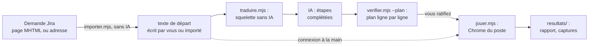

# Mode d'emploi : jouer un scénario côté utilisateur avec Playwright

Ce mode d'emploi installe [`scenario-playwright`](../../specs/scenario-playwright/SKILL.md) 1.1.1 : faire faire à Chrome, sur votre poste, les manipulations d'un utilisateur décrites par un scénario. Vous écrivez le scénario en français ou en anglais, dans un texte inspiré de Gherkin, ou vous l'importez, sans IA, d'une demande Jira ; l'IA le traduit en TOML exécutable ; vous ratifiez la traduction ; le skill joue le scénario, sans IA, et rend un rapport avec ses captures. Vous gardez la main : chaque connexion se fait par vous, dans la fenêtre, et aucune donnée n'est modifiée hors de votre poste sans votre accord pour l'exécution.



## 1. Prérequis

- Node 22 ou plus récent (`node --version`).
- Chrome installé sur le poste ; à défaut Edge, ou le Chromium de Playwright.
- Sous Windows avec WSL2 : installer et lancer le skill côté Windows, à côté de Chrome.
- Pour l'agent et les commandes : Gemini CLI 0.67.0.

## 2. Installer, avec l'IA

Avec un clone du dépôt Agent2Prompt, dans Gemini CLI :

```bash
git -C ~/dev/Agent2Prompt pull
node ~/dev/Agent2Prompt/installer.mjs
cd ~/.gemini/skills/scenario-playwright && npm ci && npm test
```

L'installateur pose le skill dans `~/.gemini/skills/scenario-playwright/`, avec l'agent `pilote-scenario` et les commandes `/scenario:importer`, `/scenario:traduire`, `/scenario:jouer` et `/scenario:designer`. Dans une session ouverte : `/skills reload`, `/agents reload`, `/commands reload`. Sous Linux sans écran, la recette se lance par `xvfb-run -a npm test`.

Sans clone, remettez à l'IA la transmission [`transmissions/scenario-playwright-1.1.1.md`](../../transmissions/scenario-playwright-1.1.1.md) : elle matérialise le skill, vérifie les empreintes, installe la dépendance et lance la recette.

## 3. Écrire le texte de départ

Un fichier `.scenario`, à côté de votre projet par exemple dans `scenarios/` :

```text
# language: fr
@ECR-77-S01 @ECR-77-CA01
Scénario: Créer un client
  Adresse : http://127.0.0.1:4200
  Origines : http://127.0.0.1:4200, http://127.0.0.1:8080
  Profil : crm
  Paramètre : ville = Lyon

  Étant donné que je me connecte (à la main)
  Quand je clique sur le lien « Nouveau client »
  Et je saisis « <nom> » dans le champ « Nom »
  Et je choisis « <ville> » dans la liste « Ville »
  Et je clique sur le bouton « Enregistrer » (création)
  Alors je vois le message « Client <nom> créé »

  Exemples:
    | nom    |
    | Dupuis |
    | Leroy  |
```

- **Étiquettes** : celles du scénario Gherkin de l'US, `@<CLÉ>-Snn` et `@<CLÉ>-CAnn` ; le rapport s'y rattache.
- **Adresse, Origines** : l'application, et les seules origines vers lesquelles le navigateur aura le droit d'aller (API, fournisseur d'identité, CDN).
- **Profil** : le profil du navigateur où vit la session de cette application.
- **Marques** : `(création)`, `(modification)`, `(suppression)` pour une étape qui touche aux données ; `(à la main)` pour ce que vous faites vous-même, comme vous connecter.
- **Variables et exemples** : `<nom>` prend chaque valeur du tableau ; le scénario est joué une fois par ligne.
- **Langue** : les mots-clés s'écrivent en français ou en anglais (`Given`, `When`, `Then`, `And`, `But`, `Scenario:`, `Examples:`) ; les réglages et les marques restent en français.

`node <skill>/scripts/verifier.mjs scenarios/creer-client.scenario` signale chaque erreur avec sa ligne. Les phrases conseillées, et leur traduction, sont au module [`texte`](../../specs/scenario-playwright/modules/texte/SKILL.md), § 9.

## 4. Importer les scénarios d'une demande Jira

Quand les scénarios de l'US sont écrits dans Jira, dans la description ou dans un champ de texte, importez-les au lieu de les recopier. Dans Gemini CLI : `/scenario:importer https://jira.exemple.fr/browse/ECR-77 --adresse http://127.0.0.1:4200`. Sans l'agent :

```bash
node ~/.gemini/skills/scenario-playwright/scripts/importer.mjs https://jira.exemple.fr/browse/ECR-77 --adresse http://127.0.0.1:4200 --dossier scenarios
```

- **Par l'adresse**, Chrome s'ouvre sur le profil `jira` : au message `À VOUS : connectez-vous à Jira…`, connectez-vous dans la fenêtre ; l'import reprend seul dès que la demande s'affiche, et le profil garde la session. Le skill ne clique et ne saisit rien dans Jira. La page est enregistrée dans `scenarios/jira/` : ajoutez `jira/` au `.gitignore` de votre projet.
- **Depuis une page enregistrée** (« Enregistrer sous… », « Page Web, un seul fichier », ou une capture de `capture-sprint-jira`) : `importer.mjs ECR-77.mhtml --adresse http://127.0.0.1:4200`, sans navigateur.
- **Un texte par scénario** : `scenarios/ECR-77-S01.scenario`, avec en tête sa provenance. Un scénario sans étiquette `@ECR-77-Snn` en reçoit une ; écrivez-la dans Jira pour la fixer.
- **Commentaires** : lus seulement avec `--commentaires`.
- **Refus** : un scénario que le texte ne sait pas dire (table de données ou texte multiligne d'étape, deux tableaux d'exemples) est refusé avec son motif ; corrigez-le dans Jira, puis réimportez.
- **Marques** : `(création)`, `(à la main)`… manquent souvent dans Jira ; ajoutez-les de préférence dans Jira, où le prochain import les retrouvera.

Plus tard, `--comparer` dit ce qui a changé dans Jira depuis l'import, sans rien écrire. `--remplacer` remplace les textes des scénarios modifiés ; un texte que vous aviez retouché est d'abord gardé à côté (`ECR-77-S01.scenario.avant-<horodatage>`). Un texte écrit à la main n'est jamais remplacé, et un texte dont le scénario a disparu de Jira reste, à supprimer par vous. Après un remplacement, la traduction est périmée : faites-la refaire et ratifiez.

## 5. Faire traduire, puis ratifier

Dans Gemini CLI : `/scenario:traduire scenarios/creer-client.scenario`. L'IA écrit `creer-client.toml` à côté du texte, sur le squelette de `traduire.mjs`, puis vous présente le plan :

```text
l.9  Quand je clique sur le lien « Nouveau client »
        → cliquer getByRole('link', { name: 'Nouveau client' })
l.12  Et je clique sur le bouton « Enregistrer » (création)
        → cliquer getByRole('button', { name: 'Enregistrer' })  [création]
```

Relisez chaque ligne : la cible désigne-t-elle le bon élément ? une étape touche-t-elle aux données sans marque ? Ratifiez, ou demandez une correction. Rien ne se joue avant. Si vous modifiez le texte ensuite, la traduction est périmée : le skill refuse de la jouer, et l'IA la refait.

## 6. Jouer

Dans Gemini CLI : `/scenario:jouer scenarios/creer-client.toml`. Sans l'agent :

```bash
node ~/.gemini/skills/scenario-playwright/scripts/jouer.mjs scenarios/creer-client.toml
```

- Chrome s'ouvre sur le profil du scénario. À l'étape à la main, le message `À VOUS : je me connecte` s'affiche : connectez-vous dans la fenêtre ; la suite reprend seule. Le profil garde la session pour les fois suivantes.
- Chaque étape s'affiche, `ok`, `KO` avec son message, ou `--` si elle n'a pas été jouée.
- Le rapport est dans `scenarios/resultats/<horodatage>-creer-client/` : `rapport.md`, `rapport.json`, les captures, l'instantané ARIA de chaque échec, les fichiers téléchargés. Ajoutez `resultats/` au `.gitignore` de votre projet.

Options utiles : `--param ville=Nice`, `--jeu 2`, `--ralenti 300` pour une démonstration, `--sans-tete` sans étape à la main, `--trace` pour la trace de Playwright (elle contient vos cookies : elle ne se partage pas).

## 7. Une cible qu'on ne sait pas nommer

`/scenario:designer http://127.0.0.1:4200/clients`, ou `node <skill>/scripts/designer.mjs <adresse>` : cliquez l'élément dans la fenêtre, le skill rend sa cible, par exemple `cible = { role = "button", nom = "Supprimer", dans = { role = "row", nom = "Martin" } }`. Le clic de désignation ne déclenche rien dans la page.

## 8. Ce qui ne se négocie pas

- Le skill ne voit aucun identifiant : vous vous connectez vous-même, dans la fenêtre, à l'application comme à Jira.
- Le skill n'écrit jamais dans Jira ; il n'en lit que la description, les champs de texte et, si vous le demandez, les commentaires.
- Rien ne se joue avant votre ratification de la traduction.
- Aucune requête ne part vers une origine que le texte ne déclare pas.
- Hors de votre poste, une étape qui modifie des données n'est jouée qu'avec `--autoriser-mutations`, que l'agent ne passe qu'avec votre accord, pour une exécution.
- Le skill ne rejoue aucune étape : un échec reste un échec, à examiner.
- Rapports, captures, téléchargements, pages Jira enregistrées et profils restent sur votre poste.

## 9. Avec les autres skills

- [`agent-tdd-jira`](../../specs/agent-tdd-jira/SKILL.md) : ses scénarios Gherkin donnent les étiquettes, et souvent les phrases, de vos textes de départ ; écrits dans la demande, ils s'importent, et la page MHTML qu'il lit s'importe aussi.
- [`capture-sprint-jira`](../../specs/capture-sprint-jira/SKILL.md) : ses captures MHTML des tickets d'un sprint s'importent telles quelles, sans rouvrir Jira.
- [`agent2test`](../../specs/agent2test/SKILL.md) : son navigateur partage le vocabulaire du scénario ; la remise d'un scénario ratifié à Agent2Test est réservée.
- [`generateur-skill-ticket`](../../specs/generateur-skill-ticket/SKILL.md) : le parcours de son kit démo, joué par ce skill, est réservé.

## 10. Dépannage

| Constat | Conduite |
|---|---|
| `navigateur chrome introuvable` | installer Chrome, ou `SCENARIO_PLAYWRIGHT_CANAL=msedge` ou `chromium` |
| `le profil … est déjà ouvert` | fermer l'autre fenêtre du même profil |
| `cible ambiguë, 3 éléments trouvés` | préciser la cible : nom exact, ou `dans` une ligne ou un dialogue ; le message cite les éléments |
| `délai de 10 s dépassé` | la cible n'existe pas encore, ou plus : vérifier la capture et l'instantané ARIA, ou désigner la cible |
| `origine bloquée : https://…` | si l'application en a besoin, l'ajouter à `Origines :` dans le texte, puis faire retraduire |
| `… a changé depuis la traduction` | le texte a été modifié : faire retraduire et ratifier |
| `AVERTISSEMENT navigateur 160 plus récent…` | rien à faire tant que tout passe ; un échec inattendu se signale |
| `--autoriser-mutations` demandé | le scénario modifie des données hors du poste : décider, pour cette exécution |
| la recette ou un scénario se bloque sous Node 24 | le signaler, puis rejouer sous Node 22 ou 26 ; la recette s'arrête d'elle-même au bout de dix minutes et dit où |
| `page non reconnue comme une demande de Jira…` | enregistrer la page de la demande elle-même, pas un tableau ni une recherche ; vérifier l'adresse |
| `la demande ne s'est pas affichée en 300 s` | se connecter dans la fenêtre, puis rouvrir la demande ; `--delai-connexion 600` pour attendre plus |
| `LIMITE … hors d'un titre « Scénario: »` | dans Jira, écrire `Scénario:` sans numéro avant les étapes, de préférence dans un bloc de code |
| `conflit` à l'import | un texte du même nom, écrit à la main, existe : le renommer, ou changer l'étiquette dans Jira |
| `modifié … --remplacer pour remplacer le texte` | `--comparer`, puis `--remplacer` si le changement de Jira doit l'emporter ; refaire la traduction |
