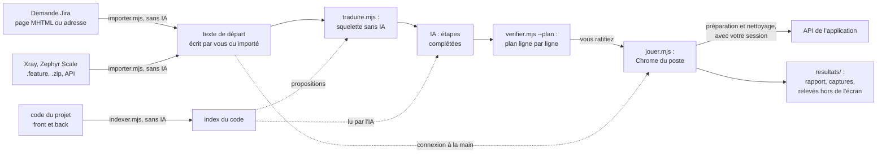

# Mode d'emploi : jouer un scénario côté utilisateur avec Playwright

Ce mode d'emploi installe [`scenario-playwright`](../../specs/scenario-playwright/SKILL.md) 1.4.0 : faire faire à Chrome, sur votre poste, les manipulations d'un utilisateur décrites par un scénario. Vous écrivez le scénario en français ou en anglais, dans un texte inspiré de Gherkin, ou vous l'importez, sans IA, d'une demande Jira, d'un fichier `.feature`, ou d'un cas de test de Xray ou de Zephyr Scale ; le skill indexe, sans IA, le code de votre projet ; l'IA traduit le scénario en TOML exécutable, en s'aidant de l'index ; vous ratifiez la traduction ; le skill joue le scénario, sans IA, prépare avant lui les données dont il a besoin et les nettoie après, vérifie ce qui s'affiche et ce qui se passe hors de l'écran, et rend un rapport avec ses captures. Vous gardez la main : chaque connexion se fait par vous, dans la fenêtre, et aucune donnée n'est modifiée hors de votre poste sans votre accord pour l'exécution.



## 1. Prérequis

- Node 22 ou plus récent (`node --version`).
- Chrome installé sur le poste ; à défaut Edge, ou le Chromium de Playwright.
- Sous Windows avec WSL2 : installer et lancer le skill côté Windows, à côté de Chrome.
- Pour l'agent et les commandes : Gemini CLI 0.67.0.

## 2. Installer, avec l'IA

Avec un clone du dépôt Agent2Prompt, dans Gemini CLI :

```bash
git -C ~/dev/Agent2Prompt pull
node ~/dev/Agent2Prompt/installer.mjs
cd ~/.gemini/skills/scenario-playwright && npm ci && npm test
```

L'installateur pose le skill dans `~/.gemini/skills/scenario-playwright/`, avec l'agent `pilote-scenario` et les commandes `/scenario:importer`, `/scenario:indexer`, `/scenario:traduire`, `/scenario:jouer` et `/scenario:designer`. Dans une session ouverte : `/skills reload`, `/agents reload`, `/commands reload`. Sous Linux sans écran, la recette se lance par `xvfb-run -a npm test`.

Sans clone, remettez à l'IA la transmission [`transmissions/scenario-playwright-1.4.0.md`](../../transmissions/scenario-playwright-1.4.0.md) : elle matérialise le skill, vérifie les empreintes, installe la dépendance et lance la recette.

## 3. Écrire le texte de départ

Un fichier `.scenario`, à côté de votre projet par exemple dans `scenarios/` :

```text
# language: fr
@ECR-77-S01 @ECR-77-CA01
Scénario: Créer un client
  Adresse : http://127.0.0.1:4200
  Origines : http://127.0.0.1:4200, http://127.0.0.1:8080
  Profil : crm
  Paramètre : ville = Lyon

  Étant donné que je me connecte (à la main)
  Quand je clique sur le lien « Nouveau client »
  Et je saisis « <nom> » dans le champ « Nom »
  Et je choisis « <ville> » dans la liste « Ville »
  Et je clique sur le bouton « Enregistrer » (création)
  Alors je vois le message « Client <nom> créé »

  Exemples:
    | nom    |
    | Dupuis |
    | Leroy  |
```

- **Étiquettes** : celles du scénario Gherkin de l'US, `@<CLÉ>-Snn` et `@<CLÉ>-CAnn` ; le rapport s'y rattache.
- **Adresse, Origines** : l'application, et les seules origines vers lesquelles le navigateur aura le droit d'aller (API, fournisseur d'identité, CDN).
- **Profil** : le profil du navigateur où vit la session de cette application.
- **Marques** : `(création)`, `(modification)`, `(suppression)` pour une étape qui touche aux données ; `(à la main)` pour ce que vous faites vous-même, comme vous connecter ; `(par l'API)` et `(nettoyage par l'API)` pour préparer et nettoyer les données (§ 9).
- **Variables et exemples** : `<nom>` prend chaque valeur du tableau ; le scénario est joué une fois par ligne.
- **Langue** : les mots-clés s'écrivent en français ou en anglais (`Given`, `When`, `Then`, `And`, `But`, `Scenario:`, `Examples:`) ; les réglages et les marques restent en français.

`node <skill>/scripts/verifier.mjs scenarios/creer-client.scenario` signale chaque erreur avec sa ligne. Les phrases conseillées, et leur traduction, sont au module [`texte`](../../specs/scenario-playwright/modules/texte/SKILL.md), § 9.

## 4. Importer les scénarios d'une demande Jira

Quand les scénarios de l'US sont écrits dans Jira, dans la description ou dans un champ de texte, importez-les au lieu de les recopier. Dans Gemini CLI : `/scenario:importer https://jira.exemple.fr/browse/ECR-77 --adresse http://127.0.0.1:4200`. Sans l'agent :

```bash
node ~/.gemini/skills/scenario-playwright/scripts/importer.mjs https://jira.exemple.fr/browse/ECR-77 --adresse http://127.0.0.1:4200 --dossier scenarios
```

- **Par l'adresse**, Chrome s'ouvre sur le profil `jira` : au message `À VOUS : connectez-vous à Jira…`, connectez-vous dans la fenêtre ; l'import reprend seul dès que la demande s'affiche, et le profil garde la session. Le skill ne clique et ne saisit rien dans Jira. La page est enregistrée dans `scenarios/jira/` : ajoutez `jira/` au `.gitignore` de votre projet.
- **Depuis une page enregistrée** (« Enregistrer sous… », « Page Web, un seul fichier », ou une capture de `capture-sprint-jira`) : `importer.mjs ECR-77.mhtml --adresse http://127.0.0.1:4200`, sans navigateur.
- **Un texte par scénario** : `scenarios/ECR-77-S01.scenario`, avec en tête sa provenance. Un scénario sans étiquette `@ECR-77-Snn` en reçoit une ; écrivez-la dans Jira pour la fixer.
- **Commentaires** : lus seulement avec `--commentaires`.
- **Refus** : un scénario que le texte ne sait pas dire (table de données ou texte multiligne d'étape, deux tableaux d'exemples) est refusé avec son motif ; corrigez-le dans Jira, puis réimportez.
- **Marques** : `(création)`, `(à la main)`… manquent souvent dans Jira ; ajoutez-les de préférence dans Jira, où le prochain import les retrouvera.

Plus tard, `--comparer` dit ce qui a changé dans Jira depuis l'import, sans rien écrire. `--remplacer` remplace les textes des scénarios modifiés ; un texte que vous aviez retouché est d'abord gardé à côté (`ECR-77-S01.scenario.avant-<horodatage>`). Un texte écrit à la main n'est jamais remplacé, et un texte dont le scénario a disparu de Jira reste, à supprimer par vous. Après un remplacement, la traduction est périmée : faites-la refaire et ratifiez.

## 5. Importer des tests de Xray ou de Zephyr Scale, ou un fichier .feature

Quand vos cas de test vivent dans Xray ou dans Zephyr Scale, ou dans des fichiers `.feature` de votre dépôt, importez-les : un texte de départ par test, nommé par sa clé, `scenarios/ECR-80.scenario`.

- **Un fichier `.feature`**, exporté de Xray ou de Zephyr Scale, ou pris dans le dépôt : `importer.mjs features/clients.feature --adresse http://127.0.0.1:4200 --dossier scenarios`.
- **Une archive d'export** (l'export Cucumber de Xray, l'export des fichiers .feature de Zephyr Scale) : `importer.mjs FeatureBundle.zip --adresse …` ; l'archive est lue en mémoire, rien n'en est extrait.
- **Par l'API, en lecture seule** : `xray:ECR-80,ECR-81` pour Xray Cloud, `xray-dc:ECR-80 --api https://jira.exemple.fr` pour Xray Data Center, `zephyr:ECR-T12` pour Zephyr Scale Cloud, `zephyr-dc:ECR-T12 --api https://jira.exemple.fr` pour Zephyr Scale Data Center. Dans Gemini CLI : `/scenario:importer xray:ECR-80 --adresse http://127.0.0.1:4200`.

Le jeton de l'API se donne par une variable d'environnement, que vous définissez vous-même, dans votre terminal, et seulement là : jamais dans la commande, jamais dans un fichier du dépôt, jamais dans la conversation avec l'IA.

```bash
read -rs ZEPHYR_TOKEN && export ZEPHYR_TOKEN              # Zephyr Scale Cloud
read -rs XRAY_CLIENT_ID && export XRAY_CLIENT_ID          # Xray Cloud : identifiant et secret d'une clé d'API
read -rs XRAY_CLIENT_SECRET && export XRAY_CLIENT_SECRET
read -rs JIRA_TOKEN && export JIRA_TOKEN                  # Data Center : jeton d'accès personnel de Jira
```

Sous PowerShell 7 : `$env:ZEPHYR_TOKEN = Read-Host -MaskInput 'Jeton'`. Le skill ne fait que lire : rien n'est écrit dans Jira, Xray ni Zephyr Scale ; le jeton ne part que vers l'API, en https, et aucune redirection n'est suivie.

- **Test Cucumber ou BDD** : recopié tel qu'écrit, sous le résumé du test.
- **Test manuel** : chaque pas devient `Quand <action>`, avec ses données, puis `Alors <résultat attendu>`. La conversion est mécanique : relisez le texte avant de le faire traduire.
- **Préconditions** : signalées en tête du texte, non reprises ; jouez-les avant, ou reportez-les dans le texte.
- **Refus** : un test Generic, en texte libre, ou qui appelle un autre cas, est refusé avec son motif ; écrivez-le en Cucumber, en BDD ou en pas à pas dans l'outil.
- **Le même test, d'un export puis de l'API** : il retrouve son texte par sa clé ; `--comparer` et `--remplacer` s'y appliquent comme pour Jira.

## 6. Indexer le code du projet

Si le code de l'application est sur votre poste, front, back ou les deux, faites-le indexer avant de traduire. Dans Gemini CLI : `/scenario:indexer ~/dev/boutique`. Sans l'agent, depuis le dossier du projet :

```bash
node ~/.gemini/skills/scenario-playwright/scripts/indexer.mjs . --dossier scenarios --langue fr
```

- Le skill lit le code sans rien exécuter, construire ni modifier, et écrit `scenarios/index/code.json` et `scenarios/index/code.md` : les routes, les boutons, liens et champs avec leurs noms tels qu'un lecteur d'écran les annonce, les libellés traduits dans la langue choisie, les identifiants de test, les endpoints du back et les appels du front, les contraintes de validation et leurs messages, chacun avec son fichier et sa ligne.
- Il ne lit ni `node_modules`, ni `dist` ou `target`, ni les fichiers de test, ni les fichiers cachés comme `.env` ; de `application.properties`, il ne retient que le chemin de contexte, jamais un mot de passe.
- Quand le code change, l'index est périmé : le skill le dit et ne l'emploie plus jusqu'à la prochaine indexation.

## 7. Faire traduire, puis ratifier

Dans Gemini CLI : `/scenario:traduire scenarios/creer-client.scenario`. L'IA écrit `creer-client.toml` à côté du texte, sur le squelette de `traduire.mjs`. Avec un index à jour, le squelette porte déjà, en commentaire sous chaque étape, les éléments du code dont le nom correspond aux libellés entre guillemets de votre phrase :

```toml
# index du code, pour « Enregistrer » (propositions à vérifier) :
#   cible = { role = "button", nom = "Enregistrer", exact = true }  # src/app/clients/client-form.component.ts:19
```

Ce ne sont que des propositions : l'IA les contrôle avant de les reprendre, et l'étape reste à compléter tant qu'elle ne l'a pas fait. Elle vous présente ensuite le plan :

```text
l.9  Quand je clique sur le lien « Nouveau client »
        → cliquer getByRole('link', { name: 'Nouveau client' })
l.12  Et je clique sur le bouton « Enregistrer » (création)
        → cliquer getByRole('button', { name: 'Enregistrer' })  [création]
```

Relisez chaque ligne : la cible désigne-t-elle le bon élément ? une étape touche-t-elle aux données sans marque ? Si `verifier.mjs` note une cible absente de l'index, regardez-la avec l'IA : un nom qui dépend des données, un composant d'une bibliothèque, ou une cible à revoir. Ratifiez, ou demandez une correction. Rien ne se joue avant. Si vous modifiez le texte ensuite, la traduction est périmée : le skill refuse de la jouer, et l'IA la refait.

## 8. Vérifier hors de l'écran

Comme un testeur qui ouvre l'onglet réseau, une phrase peut demander ce qui se passe hors de l'écran :

| Phrase du texte | Vérification |
|---|---|
| `Et la requête POST « /api/clients » répond 201` | `critere = "requete"` : la requête que votre dernier geste a fait partir, sa méthode, son statut, et les champs de son corps ou de sa réponse que vous attendez |
| `Et l'API « /api/clients/<nom> » donne la ville « Lyon »` | `critere = "api"` : un GET, avec la session que vous avez ouverte dans la fenêtre, sur une origine du texte ; aucune redirection n'est suivie |
| `Et le fichier téléchargé contient « Lyon » dans la colonne « ville »` | `critere = "fichier"` : le fichier d'une étape « télécharger » nommée ; texte, nombre de lignes, colonne d'un CSV |

Le skill ne garde aucun en-tête ni cookie, ne relève rien pendant votre connexion à la main, et masque dans les rapports les valeurs des paramètres et des champs qui ressemblent à un secret (`token`, `password`, `jeton`…). Une page qui change de document juste après sa requête ne laisse pas lire sa réponse : vérifiez alors son statut, ou ce qui s'affiche.

## 9. Préparer et nettoyer les données

Un scénario a souvent besoin d'une donnée qui existe avant lui : un client à modifier, une commande à valider. Comme un testeur, le skill la crée avant, par l'API ou par l'écran, et la supprime à la fin. Une ligne marquée du texte le demande :

```text
Scénario: Modifier la ville d'un client
  Adresse : http://127.0.0.1:4200
  Origines : http://127.0.0.1:4200, http://127.0.0.1:8080
  Profil : crm

  Étant donné que je me connecte (à la main)
  Et que le client « Client <unique> » existe (par l'API)
  Quand j'ouvre la fiche du client « Client <unique> »
  Et je choisis la ville « Lyon » (modification)
  Alors la fiche affiche « Lyon »
  Et le client est supprimé (nettoyage par l'API)
```

| Marque | Ce qui se passe |
|---|---|
| `(par l'API)` | un ou plusieurs appels `POST`, `PUT`, `PATCH` ou `DELETE`, joués à la place de la ligne, avant les étapes ordinaires |
| `(nettoyage par l'API)` | des appels joués après la dernière étape, même si une étape a échoué |
| `(préparation : creer-client)` | le scénario ratifié `creer-client.toml`, joué par l'écran, dans le même onglet |
| `(nettoyage : supprimer-client)` | le scénario `supprimer-client.toml`, joué à la fin |

- **Avec votre session** : un appel part avec la session que vous avez ouverte dans la fenêtre, et le jeton anti-CSRF que l'application a déposé dans un cookie (`XSRF-TOKEN`, ou `csrftoken` de Django), comme le ferait la page. Le skill n'ajoute aucun identifiant : la préparation se place après votre connexion à la main.
- **Une API à jeton**, qui attend un en-tête `Authorization`, répond 401 : préparez alors par l'écran, avec un scénario de préparation.
- **`<unique>`** donne à chaque exécution un suffixe propre : le client créé ne heurte pas celui de la fois précédente.
- **Une valeur de la réponse**, l'identifiant du client créé par exemple, se garde : `garder = { id_client = "id" }`, puis `${id_client}` dans les étapes et le nettoyage.
- **Le nettoyage** se joue une fois par appel, après les étapes, réussies ou non. Un nettoyage en échec est signalé (`AVERTISSEMENT nettoyage 1 en échec`) sans changer le résultat du scénario. Un nettoyage qui vise une donnée fixe, sans valeur gardée ni `<unique>`, est noté par `verifier.mjs` : regardez-le avant de ratifier, il pourrait supprimer une donnée qui existait avant.

L'IA écrit chaque appel dans le TOML. Avec un index du code à jour, le squelette lui propose, en commentaire, les endpoints d'écriture du back et les champs de leur corps, avec leurs contraintes :

```toml
[[preparation]]
ligne = 7
methode = "POST"
chemin = "http://127.0.0.1:8080/api/clients"
corps = { nom = "Client ${unique}", ville = "Paris" }
statut = 201
garder = { id_client = "id" }

[[nettoyage]]
ligne = 11
methode = "DELETE"
chemin = "http://127.0.0.1:8080/api/clients/${id_client}"
statut = [204, 404]
```

Le plan montre chaque appel à sa place, et vous le ratifiez comme les étapes. Sur votre poste, un appel part sans rien demander ; hors du poste, le scénario n'est joué qu'avec `--autoriser-mutations`, que l'agent ne passe qu'avec votre accord, pour une exécution. Le rapport a ses parties Préparation et Nettoyage : chaque appel, son statut, et les valeurs gardées, masquées si leur nom ressemble à un secret.

## 10. Jouer

Dans Gemini CLI : `/scenario:jouer scenarios/creer-client.toml`. Sans l'agent :

```bash
node ~/.gemini/skills/scenario-playwright/scripts/jouer.mjs scenarios/creer-client.toml
```

- Chrome s'ouvre sur le profil du scénario. À l'étape à la main, le message `À VOUS : je me connecte` s'affiche : connectez-vous dans la fenêtre ; la suite reprend seule. Le profil garde la session pour les fois suivantes.
- Chaque étape s'affiche, `ok`, `KO` avec son message, ou `--` si elle n'a pas été jouée ; chaque appel de préparation aussi, à sa place (`p1.`), et de nettoyage, à la fin (`n1.`).
- Le rapport est dans `scenarios/resultats/<horodatage>-creer-client/` : `rapport.md`, `rapport.json`, les captures, l'instantané ARIA de chaque échec, les fichiers téléchargés, et pour chaque vérification hors de l'écran son relevé (`requête POST …/api/clients → 201`). Ajoutez `resultats/` au `.gitignore` de votre projet.

Options utiles : `--param ville=Nice`, `--jeu 2`, `--ralenti 300` pour une démonstration, `--sans-tete` sans étape à la main, `--trace` pour la trace de Playwright (elle contient vos cookies : elle ne se partage pas).

## 11. Une cible qu'on ne sait pas nommer

`/scenario:designer http://127.0.0.1:4200/clients`, ou `node <skill>/scripts/designer.mjs <adresse>` : cliquez l'élément dans la fenêtre, le skill rend sa cible, par exemple `cible = { role = "button", nom = "Supprimer", dans = { role = "row", nom = "Martin" } }`. Le clic de désignation ne déclenche rien dans la page.

## 12. Ce qui ne se négocie pas

- Le skill ne voit aucun identifiant : vous vous connectez vous-même, dans la fenêtre, à l'application comme à Jira.
- Le skill n'écrit jamais dans Jira, Xray ni Zephyr Scale ; d'une demande, il ne lit que la description, les champs de texte et, si vous le demandez, les commentaires.
- Un jeton d'API ne passe que par la variable d'environnement que vous définissez : ni le skill ni l'agent ne le demandent, ne l'affichent ou ne l'écrivent.
- Rien ne se joue avant votre ratification de la traduction.
- Aucune requête ne part vers une origine que le texte ne déclare pas ; une vérification de l'API ne fait que des GET.
- Le code de votre projet n'est que lu : rien n'y est exécuté ni écrit ; seul le dossier `index/` de vos scénarios reçoit l'index.
- Une préparation ou un nettoyage ne vient que d'une ligne que vous avez marquée ; un appel ne part qu'avec votre session, vers une origine du texte, une seule fois, sans suivre de redirection.
- Hors de votre poste, une étape, un appel ou un scénario de préparation qui modifie des données n'est joué qu'avec `--autoriser-mutations`, que l'agent ne passe qu'avec votre accord, pour une exécution.
- Le skill ne rejoue aucune étape : un échec reste un échec, à examiner.
- Rapports, captures, téléchargements, pages Jira enregistrées et profils restent sur votre poste.

## 13. Avec les autres skills

- [`agent-tdd-jira`](../../specs/agent-tdd-jira/SKILL.md) : ses scénarios Gherkin donnent les étiquettes, et souvent les phrases, de vos textes de départ ; écrits dans la demande, ils s'importent, et la page MHTML qu'il lit s'importe aussi.
- [`capture-sprint-jira`](../../specs/capture-sprint-jira/SKILL.md) : ses captures MHTML des tickets d'un sprint s'importent telles quelles, sans rouvrir Jira.
- [`agent2test`](../../specs/agent2test/SKILL.md) : son navigateur partage le vocabulaire du scénario ; la remise d'un scénario ratifié à Agent2Test est réservée.
- [`generateur-skill-ticket`](../../specs/generateur-skill-ticket/SKILL.md) : le parcours de son kit démo, joué par ce skill, est réservé.

## 14. Dépannage

| Constat | Conduite |
|---|---|
| `navigateur chrome introuvable` | installer Chrome, ou `SCENARIO_PLAYWRIGHT_CANAL=msedge` ou `chromium` |
| `le profil … est déjà ouvert` | fermer l'autre fenêtre du même profil |
| `cible ambiguë, 3 éléments trouvés` | préciser la cible : nom exact, ou `dans` une ligne ou un dialogue ; le message cite les éléments |
| `délai de 10 s dépassé` | la cible n'existe pas encore, ou plus : vérifier la capture et l'instantané ARIA, ou désigner la cible |
| `origine bloquée : https://…` | si l'application en a besoin, l'ajouter à `Origines :` dans le texte, puis faire retraduire |
| `… a changé depuis la traduction` | le texte a été modifié : faire retraduire et ratifier |
| `AVERTISSEMENT navigateur 160 plus récent…` | rien à faire tant que tout passe ; un échec inattendu se signale |
| `--autoriser-mutations` demandé | le scénario modifie des données hors du poste : décider, pour cette exécution |
| la recette ou un scénario se bloque sous Node 24 | le signaler, puis rejouer sous Node 22 ou 26 ; la recette s'arrête d'elle-même au bout de dix minutes et dit où |
| `page non reconnue comme une demande de Jira…` | enregistrer la page de la demande elle-même, pas un tableau ni une recherche ; vérifier l'adresse |
| `la demande ne s'est pas affichée en 300 s` | se connecter dans la fenêtre, puis rouvrir la demande ; `--delai-connexion 600` pour attendre plus |
| `LIMITE … hors d'un titre « Scénario: »` | dans Jira, écrire `Scénario:` sans numéro avant les étapes, de préférence dans un bloc de code |
| `conflit` à l'import | un texte du même nom, écrit à la main, existe : le renommer, ou changer l'étiquette dans Jira |
| `modifié … --remplacer pour remplacer le texte` | `--comparer`, puis `--remplacer` si le changement de Jira doit l'emporter ; refaire la traduction |
| `variable d'environnement … absente` | la définir vous-même dans le terminal (§ 5), puis relancer |
| `accès refusé (401)` | jeton expiré, ou sans droit de lecture du projet : en créer un autre, et redéfinir la variable |
| `… injoignable` | derrière un proxy d'entreprise : `NODE_USE_ENV_PROXY=1`, avec Node 24 ou plus ; certificat d'entreprise : `NODE_EXTRA_CA_CERTS` |
| `redirection … refusée` | l'adresse donnée par `--api` n'est pas celle de l'API : donner celle de l'API elle-même, en https |
| `introuvable @ECR-80` | clé inexacte, ou test d'un projet que le jeton ne peut pas lire |
| un jeton collé par erreur dans une conversation ou une commande | le révoquer, en créer un autre, et le définir dans le terminal |
| `note : index du code périmé` | le code a changé depuis l'indexation : relancer `indexer.mjs` (§ 6) |
| `LIMITE fichier de plus de 1048576 octets, non lu` | un fichier de données volumineux : rien à faire ; sur un très grand dépôt, indexer le dossier du front ou du back seulement |
| `cibles absentes de l'index du code` | regarder chaque cible citée : nom variable, composant d'une bibliothèque, ou cible à corriger ; la note ne bloque rien |
| `aucune requête /api/… depuis l'étape …` | le message cite les requêtes vues depuis le dernier geste : comparer leur chemin et leur méthode à ceux du scénario |
| `réponse interrompue avant la fin de sa lecture` | la page a changé de document juste après la requête : vérifier son statut, ou l'effet à l'écran |
| `redirection vers … non suivie` | l'adresse de l'API renvoie ailleurs, souvent vers une connexion : se connecter à la main avant, ou vérifier l'adresse |
| `API GET … ; obtenu : statut 401` | l'API attend son jeton dans un en-tête, que le skill n'ajoute jamais : vérifier plutôt l'appel que fait la page, par une phrase sur la requête (`critere = "requete"`) |
| `appel à compléter` | l'IA n'a pas encore écrit l'appel d'une ligne de préparation : le lui faire compléter, puis ratifier |
| `POST … ; obtenu : statut 401 (l'API ne reconnaît pas la session…)` | placer la préparation après la connexion à la main ; une API à jeton se prépare par un scénario de préparation (§ 9) |
| `POST … ; obtenu : statut 403` | droits insuffisants, ou jeton anti-CSRF refusé : le skill recopie `XSRF-TOKEN` et `csrftoken`, pas un autre nom de cookie ; préparer alors par un scénario |
| `POST … ; obtenu : statut 415` | l'API n'accepte pas de corps JSON : préparer par un scénario |
| `non jouée : ${id_client} non obtenue` | la préparation qui gardait cette valeur a échoué : la corriger, son message dit l'attendu et l'obtenu |
| `AVERTISSEMENT nettoyage 1 en échec` | une donnée de l'exécution peut rester : la supprimer si besoin ; le résultat du scénario n'en dépend pas |
| `note : nettoyage d'une donnée fixe` | le nettoyage ne vise ni une valeur gardée ni `<unique>` : vérifier qu'il ne supprime pas une donnée d'avant l'exécution, avant de ratifier |
