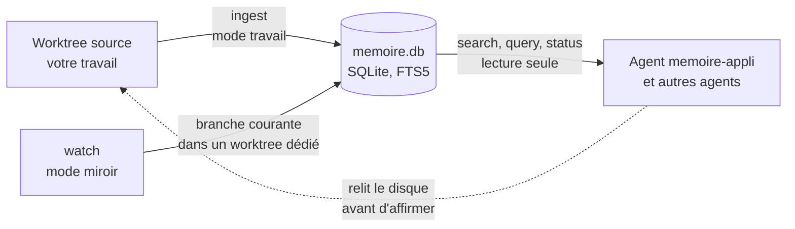

# Mode d'emploi : Skill4Appli, la mémoire SQLite d'une application

Ce mode d'emploi installe [`skill4appli`](../../specs/skill4appli/SKILL.md) 1.1.0 : une base SQLite qui indexe une application locale et ses branches git, pour qu'un agent y localise du code (`chemin:ligne`), l'état des branches ou des fichiers, **sans relire tout le dépôt**. Un script Node sans dépendance, une recette de 34 tests et un agent `memoire-appli` sont fournis dans la spécification.

La base localise, le disque fait foi : avant d'affirmer le contenu d'un fichier, l'agent le relit dans le worktree.



## 1. Prérequis

- Node 22.13 ou plus récent (`node:sqlite`), git 2.38 ou plus récent.
- Linux, WSL2 ou Windows natif.
- Une IA locale qui exécute des commandes : Gemini CLI, Claude Code ou équivalent.
- La transmission : [`transmissions/skill4appli-1.1.0.md`](../../transmissions/skill4appli-1.1.0.md).

**Où l'installer** : du côté du git qui possède le dépôt. Si le code et son git sont sous Windows, le skill tourne sous Windows, même si vous travaillez dans WSL ; depuis WSL, on l'appelle alors par `node.exe` avec des chemins Windows.

## 2. Installer, avec l'IA

Collez la transmission dans l'IA. Elle mène quatre étapes :

1. **Matérialiser** : `.skills/skill4appli/` à la racine du dépôt (ou `~/dev/<projet>/.skills/skill4appli/` dans la disposition du kit des agents parallèles, hors des worktrees). Dans un clone ordinaire, elle ajoute `/.skills/` à `.git/info/exclude`.
2. **Fichiers exécutables** : `scripts/app_db.mjs`, `tests/app_db.test.mjs` et `agent/memoire-appli.md`, tirés des modules par la commande d'extraction du module `execution`, § 9, qui vérifie leurs empreintes ; un `ECART` arrête l'installation. Puis la recette : `node --test tests/app_db.test.mjs`. Attendu : 34 tests passés sous Linux et WSL2 ; 33 passés et 1 sauté sous Windows.
3. **L'agent** : elle vous propose d'installer `agent/memoire-appli.md`, dans `.claude/agents/` pour Claude Code ou comme consigne système de votre outil, et rejoue avec vous les scénarios A1 à A6.
4. **Réglages et première indexation** : `config` montre les réglages effectifs et leur source ; vous choisissez ensuite le mode.

Dans Gemini CLI, `node <Agent2Prompt>/tools/installer.mjs skill4appli` fait l'étape 1 ; demandez ensuite à l'IA de suivre `CONSIGNE.md` à partir de l'étape 1.

## 3. Deux modes d'indexation

| Mode | Commande | Ce qui est indexé | Usage |
|---|---|---|---|
| `travail` | `ingest` | les fichiers tels qu'ils sont sur le disque, modifications non commitées comprises | indexation ponctuelle ; un agent qui veut voir son propre travail en cours |
| `miroir` | `watch` | l'état commité de la branche courante, chargé dans un worktree dédié et suivi | mémoire durable pendant une session ; plusieurs agents qui lisent un état cohérent |

`watch` crée un worktree : l'IA ne le lance qu'avec votre accord. Chaque réponse déclare le mode et le commit indexés.

## 4. Commandes

```bash
node .skills/skill4appli/scripts/app_db.mjs <commande> [options]
```

| Commande | Effet |
|---|---|
| `init` | crée ou migre la base |
| `ingest` | indexe le worktree tel qu'il est (mode `travail`) |
| `git-scan` | branches locales et distantes, fichiers modifiés par branche |
| `search <terme>` | emplacements `chemin:ligne` |
| `query "<sql>"` | requête SQL en lecture seule, réponse bornée |
| `schema` | tables et colonnes commentées |
| `status` | écart entre la base et le worktree : `a_jour`, ou ce qui a changé |
| `config` | réglages effectifs, leur source, emplacements |
| `watch`, `watch-stop`, `mirror-remove` | mode `miroir` : suivre, arrêter, retirer le worktree dédié |

Les réglages se fixent par l'environnement : `SKILL4APPLI_REPO`, `SKILL4APPLI_DB`, `SKILL4APPLI_BASE`, `SKILL4APPLI_INTERVAL`, `SKILL4APPLI_MAX_SIZE`, `SKILL4APPLI_FORMAT`, `SKILL4APPLI_GIT` (module `configuration`).

| Code de sortie | Sens |
|---|---|
| 0 | succès ; pour `status`, base à jour |
| 1 | usage invalide, ou commande lancée dans un miroir |
| 2 | base ou requête refusée |
| 3 | git absent ou en échec, hors worktree |
| 4 | un watcher actif est le seul écrivain de la base |
| 5 | Node trop ancien, `node:sqlite` indisponible |
| 6 | `status` : la base n'est pas à jour (une réponse, pas une erreur) |
| 7 | miroir modifié à la main : refus d'y toucher |

## 5. Ce qui ne se négocie pas

- L'IA n'adapte pas le script : un écart, une erreur ou un besoin nouveau vous est signalé.
- `query` est en lecture seule ; la base ne s'écrit que par `ingest` et `watch`.
- Le miroir n'est jamais modifié à la main ; un refus du script (code 4 ou 7) est rapporté, jamais contourné.
- Aucun watcher, ni `watch-stop`, ni `mirror-remove`, sans votre accord.

## 6. Mettre à jour, retirer

- **Mettre à jour** : coller la transmission de la nouvelle version ; l'IA réécrit le skill, réextrait les fichiers et relance la recette. La base se migre à la première commande (`init`).
- **Retirer** : `watch-stop`, puis `mirror-remove`, puis supprimer `.skills/skill4appli/`. La base vit dans le dossier commun git (`.git/` ou `.bare/`), sous `skill4appli/<id>/` ; `config` en donne l'emplacement exact.

## 7. Dépannage

| Symptôme | Cause probable | Remède |
|---|---|---|
| Code 5 | Node antérieur à 22.13 | mettre Node à jour |
| Avertissement `depot_windows_depuis_wsl` | dépôt Windows interrogé avec le Node de WSL | appeler `node.exe` avec des chemins Windows |
| `status` rend `modifs_locales` | mode `miroir`, modifications non commitées | normal : la réponse signale l'écart ; relire le disque |
| Code 4 | un watcher tourne déjà | `watch-stop` d'abord, avec votre accord |
| Code 7 | le miroir a été modifié à la main | examiner le miroir et récupérer ce qui doit l'être, puis `mirror-remove --force` ; le `watch` suivant le recrée et réindexe |
| Une ligne citée ne correspond plus | base en retard en mode `travail` | relancer `ingest` ; l'agent cite toujours la ligne relue sur le disque |

Les dimensions réservées, mode local sans git, index des symboles et service MCP, ne sont pas appliquées en 1.1.
