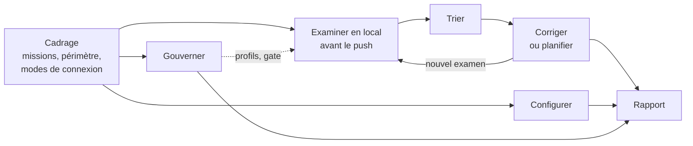

# Mode d'emploi : l'expert SonarQube

Ce mode d'emploi fait travailler l'IA du développeur comme l'expert [`sonarqube`](../../specs/sonarqube/SKILL.md) 1.1.0, sur SonarQube Server 2026.1 LTA ou 2026.5 LTA, édition Developer ou supérieure, pour des projets Java Spring Boot et Angular sur GitLab. Vous choisissez une ou plusieurs missions :

| Mission | L'expert | Il écrit |
|---|---|---|
| **Configurer** | met en place ou corrige l'analyse et la CI GitLab | build, `sonar-project.properties`, `.gitlab-ci.yml` |
| **Examiner en local** | examine le code avant le push, selon les règles du profil du projet | rien dans GitLab ; une branche de travail éphémère sur l'instance, supprimée après lecture |
| **Trier** | qualifie les constats et propose un traitement | transitions et commentaires dans SonarQube, après validation |
| **Corriger ou planifier** | corrige les constats simples, prépare un plan pour les autres | code du projet, ou plans pour les experts Java et Angular |
| **Gouverner** | propose les règles du jeu : quality gate, profils, nouveau code | configuration SonarQube après validation, journal de gouvernance |

Toute intervention se termine par un rapport, dont chaque chiffre vient d'une réponse de l'API.



## 1. Prérequis

- Une IA locale qui lit et écrit les fichiers du projet : Gemini CLI, Claude Code ou équivalent.
- Une instance SonarQube Server 2026.x, édition Developer ou supérieure, et un **jeton utilisateur**.
- Pour l'analyse éphémère : le scanner du projet (Maven pour le back, `@sonar/scan` avec Node.js 22 pour le front) et les permissions Execute Analysis et Administer sur le projet.
- Pour le moteur SonarLint : SonarQube for IDE en mode connecté, et Docker pour le serveur MCP de Sonar.
- Pour l'interface de pilotage : Node 20 ou plus récent.
- Pour l'installation automatique : un clone d'Agent2Prompt. À défaut, la transmission seule : [`transmissions/sonarqube-1.1.0.md`](../../transmissions/sonarqube-1.1.0.md).

## 2. Installer

```bash
node <Agent2Prompt>/tools/installer.mjs sonarqube
```

Puis, dans Gemini CLI : `/skills reload`, et « Active le skill sonarqube. L'étape 0 de sa consigne est faite. Lis `CONSIGNE.md` dans son dossier et suis-la à partir de l'étape 1. » Dans une autre IA, coller la transmission : l'IA crée `.skills/sonarqube/` et vérifie chaque fichier.

Le skill inclut le socle back-front et les points d'entrée des experts Java et Angular comme référentiels : une correction faite à partir de SonarQube respecte leurs invariants.

## 3. Le jeton et la connexion

Définissez l'accès dans votre environnement, jamais dans la conversation :

```bash
read -rs SONAR_TOKEN && export SONAR_TOKEN        # saisie masquée, rien dans l'historique
export SONAR_HOST_URL=https://sonar.exemple.org
```

Si le jeton apparaît dans la conversation, l'expert le signale et recommande de le révoquer. Au cadrage, vous retenez les modes de connexion ; chacun n'a que ses usages :

| Mode | Usages |
|---|---|
| API web, en-tête `Bearer` (défaut) | toutes les lectures, et les écritures validées |
| API web, jeton en nom d'utilisateur | idem, si l'instance refuse `Bearer` |
| Scanner Maven ou npm | CI, analyse éphémère |
| SonarQube for IDE par le serveur MCP | analyse locale sans envoi du code |
| Serveur MCP hébergé (`<instance>/mcp`) | relevé seulement en 1.1 |
| SonarQube CLI (`sonar`) | détection de secrets sur les modifications locales |

L'expert relève ensuite la version, l'édition et le mode de l'instance (MQR ou standard), puis les permissions du compte, et vous fait confirmer une fiche de cadrage.

## 4. Examiner le code avant le push

Le périmètre est le diff entre votre `HEAD` et la base de fusion avec la branche cible, lue sur le dépôt distant. Trois moteurs, à combiner :

| Moteur | Où part le code | Ce qu'il garantit |
|---|---|---|
| **Relecture par les règles** | nulle part | jugement de l'expert, guidé par les règles actives du profil ; jamais présenté comme un résultat Sonar |
| **Moteur SonarLint** | nulle part | analyseurs de Sonar, règles du profil ; pas de quality gate |
| **Analyse éphémère** | instance SonarQube | constats réels et quality gate, sous une branche `local-<login>-<HEAD>` supprimée après lecture |

Usage conseillé : relecture ou SonarLint pendant le développement, analyse éphémère juste avant le push. Avant l'analyse éphémère, les tests du projet tournent (JUnit et JaCoCo dans `mvn verify`, `ng test` avec couverture), pour que leurs résultats et la couverture remontent dans SonarQube. L'analyse et la suppression de la branche forment un lot d'écritures que vous validez.

### 4.1 Par l'interface de pilotage

```bash
node .skills/sonarqube/outils/pilote-sonar.mjs --racine . --port 8765
```

Le pilote se tire du module `pilotage`, § 5, par une commande qui vérifie ses empreintes ; lancez sa recette avant la première utilisation. Il affiche une adresse `http://127.0.0.1:8765/?cle=…`, seule à ouvrir l'interface. Sept écrans : connexion, projet et périmètre, règles du profil (avec export CSV), analyse éphémère, moteur SonarLint, constats, journal des appels. Le jeton reste dans le processus du pilote : le navigateur n'en connaît que la présence.

## 5. Trier, corriger, gouverner

- **Trier** : nouveau code d'abord, puis sécurité, fiabilité, maintenabilité, puis gravité décroissante. Chaque faux positif ou acceptation porte une justification écrite dans SonarQube ; une revue de sécurité n'est jamais close sans votre décision.
- **Corriger** : une correction directe ne vise qu'un constat localisé, à correction déterministe, couvert par un test ; sinon, l'expert produit un plan pour l'expert Java ou Angular. Aucun `NOSONAR` sans règle et raison citées.
- **Gouverner** : le quality gate et les profils intégrés (« Sonar way ») ne sont jamais modifiés ; les versions du projet en dérivent. Les conditions portent sur le nouveau code. Chaque changement est inscrit au journal de gouvernance du dépôt.

## 6. Ce qui ne se négocie pas

- Lecture libre ; toute écriture vers SonarQube est proposée avec l'appel exact et attend votre « oui ».
- Jamais de gravité, de statut ou de quality gate modifiés pour faire passer une analyse.
- Un scanner lancé en local tourne toujours sous une branche `local-…`, supprimée après lecture : sans cela, il écraserait l'analyse de la branche principale.
- Tout chiffre d'un rapport vient de l'API.

## 7. Règles appliquées

Les règles que SonarQube applique au Java et au JavaScript / TypeScript sont énumérées dans ce dossier : [`regles-java.csv`](regles-java.csv) et [`regles-javascript-typescript.csv`](regles-javascript-typescript.csv), avec leur synthèse dans le [README](README.md). Pour la liste exacte de vos projets, utilisez l'export CSV du pilote : il interroge votre instance et indique les règles actives dans le profil du projet.

## 8. Recettes du pilote

```bash
node --test tests/pilote-sonar.test.mjs        # 26 scénarios, faux SonarQube, toujours
node --test tests/pilote-sonar.reel.test.mjs   # 5 scénarios, contre votre instance
```

La recette réelle demande un projet réservé sur l'instance et trois variables : `RECETTE_SONAR_HOST_URL`, `RECETTE_SONAR_TOKEN`, `RECETTE_SONAR_PROJET` (module `pilotage`, § 6.2). La liste des scénarios par langage est dans [`tests-pilote.csv`](tests-pilote.csv).

## 9. Mettre à jour, retirer

- **Mettre à jour** : `git pull` dans Agent2Prompt, puis la même commande ; `--forcer` si des fichiers du skill ont été modifiés.
- **Retirer** : `node <Agent2Prompt>/tools/installer.mjs --retirer sonarqube`. Le dossier `.sonar-local/` du projet, cache et dossiers de relecture, se supprime à la main.

## 10. Dépannage

| Symptôme | Cause probable | Remède |
|---|---|---|
| HTTP 401 à la connexion | jeton invalide, ou `Bearer` refusé | vérifier le jeton ; essayer le mode « jeton en nom d'utilisateur » |
| Analyse éphémère impossible | édition Community, sans analyse de branches | passer par la relecture ou SonarLint |
| Couverture absente du rapport | tests non lancés, ou rapport JaCoCo / LCOV non déclaré | lancer les tests ; vérifier les chemins dans la configuration d'analyse |
| Branche `local-…` restante sur l'instance | suppression en échec | la supprimer (`POST /api/project_branches/delete`) ; le rapport donne son nom |
| `curl` n'atteint pas le pilote | proxy du poste | `curl --noproxy '*'` |
| Scanner du front refusé en 2026.5 | Node.js 20 | Node.js 22 ou plus récent |
