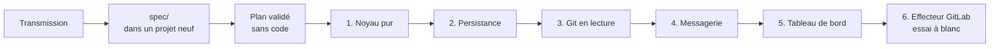

# Mode d'emploi : construire le tableau de bord des fichiers sous tension

[`tension-dashboard-gitlab-agent`](../../specs/tension-dashboard-gitlab-agent/SKILL.md) 2.2.0 n'est pas un skill qu'on installe : c'est la **spécification d'un système à construire**. Une IA la reçoit dans un projet neuf et l'implémente étape par étape, sous votre validation.

Le système surveille les **fichiers sous tension**, modifiés à la fois localement et à distance, mesure leur écart en caractères, suit leur état dans une machine d'états, échange des messages signés HMAC entre agents, affiche le tout dans un tableau de bord temps réel (Fastify et WebSocket), et propose un assistant GitLab à garde-fous, en essai à blanc par défaut.

## 1. Prérequis

- Une IA locale qui écrit et exécute du code : Gemini CLI, Claude Code ou équivalent.
- Node.js, selon la stack de `spec/SKILL.md`, et git 2.38 ou plus récent (`git merge-tree --write-tree`).
- Un dépôt de projet **vide**, dédié au système.
- La transmission : [`transmissions/tension-dashboard-gitlab-agent-2.2.0.md`](../../transmissions/tension-dashboard-gitlab-agent-2.2.0.md).

L'installateur d'Agent2Prompt refuse cette spécification : elle se matérialise dans `spec/` de son propre projet, pas dans `.gemini/skills/`.

## 2. Lancer la construction

1. Créer le dépôt vide, ouvrir l'IA à sa racine, coller la transmission.
2. **Étape 0** : l'IA crée `spec/` et y écrit chaque fichier, vérifié par la table d'intégrité. Les fichiers de code (`src/…`, `test/…`) iront à côté de `spec/`.
3. **Étape 1** : elle lit la spécification, sans écrire de code.
4. **Étape 2** : elle vous soumet un plan : l'arborescence à créer, les choix techniques que la spécification laisse ouverts, ses questions. **Rien ne s'écrit avant votre validation.**
5. **Étape 3** : implémentation en six étapes, chacune avec tous ses tests verts avant la suivante.

| Étape | Contenu | Ce qu'on vérifie |
|---|---|---|
| 1. Noyau pur | modèle, calcul de tension, bornes, états | aucune entrée-sortie ; premier livrable attendu |
| 2. Persistance | schéma (migration 1 à l'identique), journal, rejeu | le journal se rejoue |
| 3. Git en lecture | instantanés des branches | testés sur des dépôts temporaires |
| 4. Messagerie | enveloppes signées HMAC, messager, arbitrage en ligne de commande | signatures, rejets |
| 5. Tableau de bord | serveur et page temps réel | en lecture seule |
| 6. Effecteur GitLab | assistant à garde-fous | **essai à blanc par défaut** |

À la fin de chaque étape, l'IA remet un compte rendu : fichiers, invariants couverts et tests qui les vérifient, résultat de `npm test`, écarts avec la spécification.

## 3. Ce qui ne se négocie pas

- Chaque module et chaque test cite l'invariant qu'il vérifie (`// D2.INV-1`) ; un invariant sans test n'est pas implémenté.
- Aucun `--force` ni `--force-with-lease` ; aucun `shell: true` ; aucun secret dans les journaux, les messages ou les URL.
- Les tests n'accèdent à aucun réseau.
- Aucune dépendance hors de la stack de la spécification sans votre validation.
- L'IA n'invente ni champ, ni endpoint, ni comportement ; elle ne modifie jamais `spec/`.
- La régulation entre agents (`spec/regulation-inter-agents.md`) est réservée : lue pour les points d'extension E1 à E6, jamais implémentée.

## 4. À vérifier sur votre machine

- **Git** : `git merge-tree --write-tree --name-only` doit exister (Git 2.38) ; sinon l'IA documente une méthode de repli.
- **GitLab** : les appels de l'effecteur n'ont pas été éprouvés sur une instance réelle. Gardez l'essai à blanc tant que vous ne les avez pas confirmés sur la vôtre.

## 5. Faire évoluer

Une nouvelle version de la spécification arrive par une nouvelle transmission. Remplacez le contenu de `spec/` à l'identique, puis demandez à l'IA de lire le journal de révision de `spec/SKILL.md` et de proposer un plan pour l'écart, sans toucher au code avant votre validation. Les écarts qu'elle relève sur la spécification elle-même sont la matière de la version suivante, à ratifier dans Agent2Prompt (`EVOLUTION.md`, § 5).
