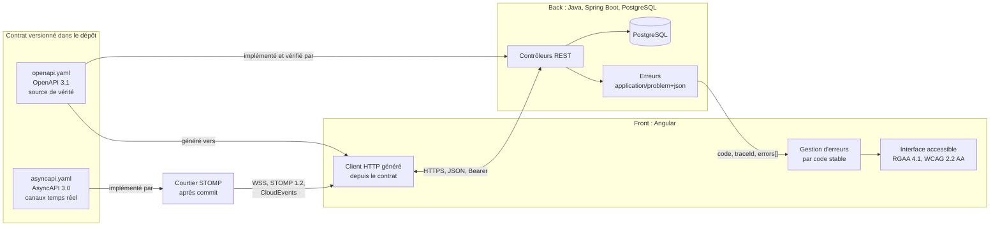
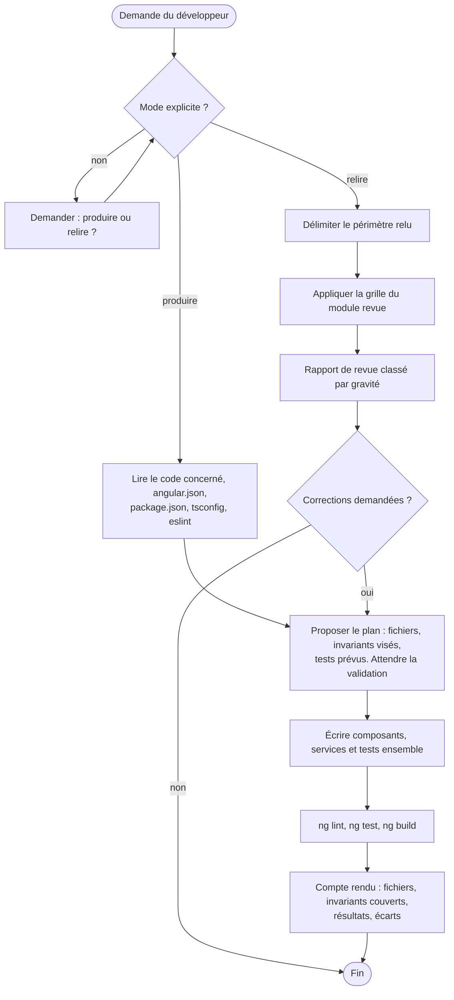
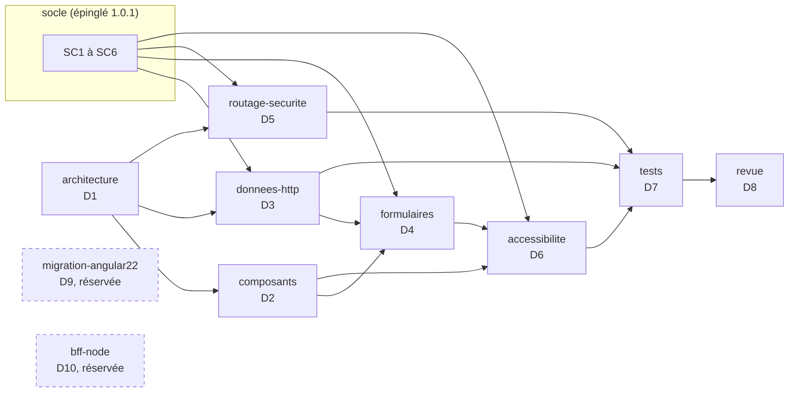

# Skill de ticket ABCDE-3620-2 : skill ticket-abcde-3620-2 1.0.0, transmission texte

Ce texte contient le skill complet d'un ticket, produit par le générateur C7E. Il n'y a aucune pièce jointe. Le skill est découpé en fichiers, chacun délimité ainsi :

    <<<FICHIER chemin/relatif>>>
    ...contenu exact du fichier...
    <<<FIN chemin/relatif>>>

---

À partir de maintenant, tu résous le ticket ABCDE-3620-2 avec ce skill. Le skill fait foi. Si tu relèves une ambiguïté ou une contradiction, signale-la au développeur ; ne corrige pas le skill toi-même.

## Étape 0 : matérialiser le skill

Si le développeur a installé le skill avec l'installateur du dépôt Agent2Prompt (`tools/installer.mjs`), cette étape est faite : vérifie seulement les fichiers avec `sha256sum -c integrite.sha256`, depuis le dossier du skill, puis passe à l'étape 1. Sinon, crée le dossier `.gemini/skills/ticket-abcde-3620-2/`, puis, pour chaque bloc, le fichier de ce chemin avec le contenu exact compris entre les deux lignes délimitrices, qui n'en font pas partie ; ne reformule rien. Vérifie ensuite chaque fichier contre la table d'intégrité en fin de texte.

## Étape 1 : lecture

Lis `SKILL.md` en entier, puis `ticket.toml` et les modules qu'il désigne.

## Étape 2 : travail

Suis `SKILL.md` à partir de sa section 4. Rien n'est modifié avant la ratification (section 6).

<<<FICHIER manifest.json>>>
{
  "name": "ticket-abcde-3620-2",
  "version": "1.0.0",
  "specSchema": 1,
  "language": "fr",
  "description": "Skill de ticket ABCDE-3620-2, feuille de ABCDE-3620 (M03, évolution ergonomique du front-end), produit par le générateur C7E. À activer pour résoudre ce sous-ticket, après la clôture de ABCDE-3620-1.2 ; rien ne se modifie avant sa ratification.",
  "entry": "SKILL.md",
  "ticket": {
    "reference": "ABCDE-3620-2",
    "racine": "ABCDE-3620",
    "parent": "ABCDE-3620",
    "profondeur": 1,
    "nature": "feuille",
    "enfants": [],
    "depend_de": [
      "ABCDE-3620-1.2"
    ],
    "composition": {
      "principal": "M03",
      "complements": []
    },
    "referentiel": "3.3.0",
    "dossier": "docs/demandes/ABCDE-3620/ABCDE-3620-2/",
    "herites": [
      {
        "path": "modules/invariants/SKILL.md",
        "from": "specs/orchestrateur-c7e/SKILL.md",
        "version": "3.5.3",
        "invariants": 33
      },
      {
        "path": "modules/methode/SKILL.md",
        "from": "specs/orchestrateur-c7e/SKILL.md",
        "version": "3.5.3",
        "sections": [
          "2",
          "5.1",
          "5.2",
          "6",
          "7.1",
          "8",
          "11.5"
        ]
      },
      {
        "path": "socle/SKILL.md",
        "from": "specs/socle-back-front/SKILL.md",
        "version": "1.1.0",
        "sha256": "f9456b0bbcdce8cd1ebc06446c3d505829a0354f398f4aa819204e4e9c135f54"
      },
      {
        "path": "references/angular.md",
        "from": "specs/angular/SKILL.md",
        "version": "1.0.1",
        "sha256": "28e0a697773aaf205f024e3fa0a0d99c43bbaf86fb7a56c954c9964e67d22d16"
      },
      {
        "path": "projet/meso-contrats.md",
        "from": "specs/orchestrateur-c7e/meso-contrats.md",
        "sha256": "971128d2351d7dce8941a57e3b3875b59cb229c9469eef7c20d74d7561b6ac31"
      }
    ],
    "genere_par": {
      "prototype": "skill-ticket",
      "lot": 2,
      "fabrique": "java-angular-postgresql",
      "orchestrateur": "3.5.3"
    }
  },
  "modules": [
    {
      "id": "ticket",
      "path": "ticket.toml",
      "status": "active"
    },
    {
      "id": "meso-contrats",
      "path": "modules/meso-contrats/SKILL.md",
      "status": "active"
    },
    {
      "id": "option-frontend-elements_graphiques",
      "path": "modules/option-frontend-elements_graphiques/SKILL.md",
      "status": "active"
    },
    {
      "id": "option-frontend-fonctionnalites",
      "path": "modules/option-frontend-fonctionnalites/SKILL.md",
      "status": "active"
    },
    {
      "id": "recette",
      "path": "modules/recette/SKILL.md",
      "status": "active"
    },
    {
      "id": "methode",
      "path": "modules/methode/SKILL.md",
      "status": "active"
    },
    {
      "id": "invariants",
      "path": "modules/invariants/SKILL.md",
      "status": "active"
    },
    {
      "id": "socle",
      "path": "socle/SKILL.md",
      "status": "active"
    },
    {
      "id": "references-angular",
      "path": "references/angular.md",
      "status": "active"
    },
    {
      "id": "projet-meso-contrats",
      "path": "projet/meso-contrats.md",
      "status": "active"
    },
    {
      "id": "agents-ticket-abcde-3620-2-front",
      "path": "agents/ticket-abcde-3620-2-front.md",
      "status": "active"
    }
  ]
}
<<<FIN manifest.json>>>

<<<FICHIER SKILL.md>>>
---
name: ticket-abcde-3620-2
description: Skill de ticket ABCDE-3620-2, feuille de ABCDE-3620 (M03, évolution ergonomique du front-end), produit par le générateur C7E. À activer pour résoudre ce sous-ticket, après la clôture de ABCDE-3620-1.2 ; rien ne se modifie avant sa ratification.
version: 1.0.0
---

# Skill de ticket ABCDE-3620-2

> Produit par le générateur C7E (prototype « skill de ticket », lot 2), fabrique `java-angular-postgresql`, référentiel des méso-contrats 3.3.0, orchestrateur-c7e 3.5.3. Ce skill remplace la fiche de transformation comme objet ratifié avant toute modification ; il reste identique à sa transmission. Si tu y relèves une ambiguïté ou une contradiction, signale-la au développeur ; ne corrige pas le skill toi-même.

## 1. Place dans l'arbre

- Nature : feuille ; ce skill agit sur le code, par ses agents.
- Parent : ABCDE-3620 (skill `ticket-abcde-3620`), le ticket racine ; profondeur 1.
- Dépend de : ABCDE-3620-1.2 (skill `ticket-abcde-3620-1-2`) ; rien ne commence avant sa clôture.
- Clé Jira : ABCDE-3620, qui nomme la branche et les commits de tout l'arbre. Dossier du ticket : `docs/demandes/ABCDE-3620/ABCDE-3620-2/`.

## 2. Objectif et critères

Front : liste des lignes et date-heure du résumé tenues à jour en temps réel, annoncées sans déplacer le focus.

Intention : Afficher la liste des lignes et la date-heure du résumé, tenues à jour par le canal des lignes.

| Critère | Énoncé | Soutient |
|---|---|---|
| C1 | La liste des lignes et la date-heure du résumé se mettent à jour à l'écran sans rechargement ; après une coupure, l'écran reprend par l'instantané et son ETag. | ABCDE-3620:C5 |
| C2 | Chaque mise à jour est annoncée par une région aria-live polite, sans déplacer le focus. | ABCDE-3620:C5 |

## 3. Méso-contrats et options

Composition confirmée : M03 (module `meso-contrats`). Méso-contrats transverses : T01 socle back-front, T02 accessibilité.

| Couche | Option | Slots | Étiquettes | Module |
|---|---|---|---|---|
| frontend | Éléments graphiques | É5 | `[É5-UI]` | `option-frontend-elements_graphiques` |
| frontend | Fonctionnalités | É2, puis É5 | `[É2-UI]`, `[É5-UI]` | `option-frontend-fonctionnalites` |

## 4. Au démarrage

1. Vérifie que ce skill est intact : s'il a été installé par l'installateur du dépôt Agent2Prompt, `sha256sum -c integrite.sha256` depuis son dossier.
2. Lis la copie du projet du fichier d'invariants (`docs/c7e/meso-contrats.md` par défaut) et compare-la à `projet/meso-contrats.md`, l'état sur lequel ce skill a été produit. La copie du projet fait foi ; si elles diffèrent, dis-le au développeur avant tout le reste. Une valeur `ADAPTER` restée telle se signale, jamais devinée (D8.INV-1).
3. Vérifie que ABCDE-3620-1.2 est clos : remise écrite et critères prouvés. Sinon, arrête-toi et dis au développeur ce qui manque.

## 5. Analyse (d=0), avant toute modification

1. Écris la copie de travail de `ticket.toml` dans `docs/demandes/ABCDE-3620/ABCDE-3620-2/ticket.toml`. Tu ne la complètes que de ce que demandent les options (repérage, valeurs relevées) ; sa demande, sa composition et ses options ne changent pas.
2. Lis l'architecture réelle : code, contrat, migrations, tests existants, conventions du projet. Le disque fait foi.
3. Cartographie l'impact : dépendances explicites et détectées, autres consommateurs. Si la demande sort des empreintes de la composition, arrête-toi et remonte-la au ticket parent, ou au développeur pour la racine, sans changer de composition (D11.INV-4).
4. Pour chaque option, relève ce que son module demande à l'analyse.
5. Choisis la configuration : mode, concepts et poids, profondeur, niveau de preuve, justifiés par la criticité selon la grille du fichier d'invariants du projet (module `methode`, § 2 et § 7.1 ; D2.INV-1).
6. Déduis les tests des critères et des risques, avec les preuves des options et les exigences des méso-contrats transverses (module `recette` ; D10.INV-3).
7. Écris `docs/demandes/ABCDE-3620/ABCDE-3620-2/analyse.md` : cartographie d'impact, configuration retenue et sa justification, stratégie (slots engagés, gate contrats, points de retour arrière), tests déduits.

## 6. Ratification

Présente au développeur ce skill et son analyse : objectif, critères, méso-contrats et options avec leur paramétrage, invariants, configuration, cartographie, stratégie et tests déduits, avec la copie de travail de `ticket.toml`. **Point de ratification** : rien n'est modifié avant sa réponse (D3.INV-1, la fiche étant ce skill). Ajoute sa décision, avec son nom et la date, à `docs/demandes/ABCDE-3620/ABCDE-3620-2/retours.md`.

## 7. Transformation, après la ratification

1. **É0, Outillage** (préparer l'écosystème de travail) : vérifier l'environnement, les droits et l'outillage. *Gate : environnement reproductible.*
2. **É1, Éléments** (stockage et schéma : structures de données persistantes) : non engagé par ce ticket.
3. **É3, Engendrent** (passerelles et contrats d'interface entre couches) : non engagé par ce ticket.
4. **É2, Espace** (contexte, cache, flux de transit, état local) : où vit l'état, comment circulent les flux ; options `frontend.fonctionnalites`.
5. **É4, État** (logique métier, traitement déclenché) : non engagé par ce ticket.
6. **É5, Expression** (interface utilisateur, rendu, interaction) : interface qui consomme le contrat ; options `frontend.elements_graphiques`, `frontend.fonctionnalites`.
7. **É6, Évolutif** (contrôle de l'évolution : tests déduits, mesures, dossier de preuves) : exécuter tous les tests déduits et les gates (module `methode`, § 5.1), mesurer, produire le dossier de preuves (module `recette`).
8. **É7, Environnement** (livraison dans l'environnement, validation métier, mesures en usage, capitalisation) : remettre `remise.md` au développeur (section 8) ; la validation métier, la livraison et la mesure en usage appartiennent à l'équipe, l'IA ne publie rien (D4.INV-3) ; capitaliser et clore par une rétrospective de second ordre (module `methode`, § 6).

Chaque commit porte un seul slot et commence par `ABCDE-3620 : [É<n>-<DOMAINE>] ` (D4.INV-2), son corps cite `Sous-ticket : ABCDE-3620-2` ; l'IA ne pousse, ne fusionne, ne rebase ni ne pose de tag (D4.INV-3). Les agents réalisent les options de leur couche (dossier `agents/`), chacun dans son propre contexte.

## 8. Remise

`docs/demandes/ABCDE-3620/ABCDE-3620-2/remise.md`, complète à la remise (D3.INV-3) : modifications par slot, avec les commits ; dossier de preuves ; écarts ajoutés au registre des écarts ; boucle de second ordre (observations É6 et É7, commits de rétroaction, entrées proposées) ; capitalisation ; indicateurs et leur calcul (module `methode`, § 8).

## 9. Retours du développeur

La référence de ton observation est le retour du développeur : ses choix parmi les options que tu proposes, et ses corrections sur tes actions. Ajoute chacun à `docs/demandes/ABCDE-3620/ABCDE-3620-2/retours.md`, en ajout seul, avec ce que tu avais proposé ou fait. Une auto-évaluation sans preuve ni retour n'est pas une observation. Les retours orientent le travail ; ils ne lèvent aucun invariant ni aucune preuve.

## 10. Invariants hérités

Le module `invariants` liste ce dont ce skill hérite, sans affaiblissement : le socle back-front, les invariants du projet, les référentiels de la pile et, mot pour mot, les invariants de l'orchestrateur, avec leurs correspondances dans un skill de ticket. La précédence des règles suit le module `methode` (§ 11.5).

## 11. Fichiers

| Fichier | Rôle |
|---|---|
| `manifest.json` | manifeste : identité, place dans l'arbre, provenance des héritages |
| `SKILL.md` | consigne, à lire en premier |
| `ticket.toml` | le ticket : demande, composition, critères, options |
| `modules/meso-contrats/SKILL.md` | méso-contrats de la composition et transverses, copiés du référentiel |
| `modules/option-frontend-elements_graphiques/SKILL.md` | option copiée du référentiel, puis paramétrée pour ce ticket |
| `modules/option-frontend-fonctionnalites/SKILL.md` | option copiée du référentiel, puis paramétrée pour ce ticket |
| `modules/recette/SKILL.md` | critères à prouver, preuves et commandes |
| `modules/methode/SKILL.md` | sections de la méthode de l'orchestrateur, mot pour mot |
| `modules/invariants/SKILL.md` | invariants hérités, correspondances, invariants de l'orchestrateur mot pour mot |
| `socle/SKILL.md` | socle back-front 1.1.0, hérité en entier |
| `references/angular.md` | référentiel de la pile : versions cibles et invariants |
| `projet/meso-contrats.md` | invariants du projet, dans l'état où ce skill a été produit |
| `agents/ticket-abcde-3620-2-front.md` | agent d'une couche, dans son propre contexte |
<<<FIN SKILL.md>>>

<<<FICHIER ticket.toml>>>
# Sous-ticket front de ABCDE-3620. Il dépend du contrat publié par ABCDE-3620-1.2, dans l'autre branche.

[ticket]
reference = "ABCDE-3620-2"
parent = "ABCDE-3620"
depend_de = ["ABCDE-3620-1.2"]
referentiel = "3.3.0"
meso_contrat = "M03"
meso_contrat_confirme = true
titre = "Front : liste des lignes et date-heure du résumé tenues à jour en temps réel, annoncées sans déplacer le focus"

[ticket.demande]
intention = { reponse = "Afficher la liste des lignes et la date-heure du résumé, tenues à jour par le canal des lignes", source = "décomposition de ABCDE-3620" }
maquette = { reponse = "non", source = "parent : ABCDE-3620" }
table = { reponse = "non", precision = "porté par ABCDE-3620-1", source = "décomposition de ABCDE-3620" }
colonne = { reponse = "non", source = "parent : ABCDE-3620" }
index = { reponse = "non", precision = "porté par ABCDE-3620-1", source = "décomposition de ABCDE-3620" }
contrainte = { reponse = "non", precision = "porté par ABCDE-3620-1", source = "décomposition de ABCDE-3620" }
lecture = { reponse = "non", precision = "porté par ABCDE-3620-1", source = "décomposition de ABCDE-3620" }
ecriture = { reponse = "non", precision = "porté par ABCDE-3620-1", source = "décomposition de ABCDE-3620" }
endpoint_nouveau = { reponse = "non", source = "parent : ABCDE-3620" }
endpoint_modifie = { reponse = "non", precision = "porté par ABCDE-3620-1", source = "décomposition de ABCDE-3620" }
variante_representation = { reponse = "non", precision = "porté par ABCDE-3620-1", source = "décomposition de ABCDE-3620" }
temps_reel = { reponse = "non", precision = "publication portée par ABCDE-3620-1 ; ce ticket la consomme", source = "décomposition de ABCDE-3620" }
regle = { reponse = "non", source = "parent : ABCDE-3620" }
service = { reponse = "non", source = "parent : ABCDE-3620" }
ecran_nouveau = { reponse = "non", source = "parent : ABCDE-3620" }
ecran_modifie = { reponse = "oui", precision = "liste des lignes et date-heure du résumé", source = "décomposition de ABCDE-3620" }
formulaire = { reponse = "non", source = "décomposition de ABCDE-3620" }
comportement = { reponse = "oui", precision = "abonnement au canal, instantané, application des événements dans l'ordre des séquences", source = "décomposition de ABCDE-3620" }
navigation = { reponse = "non", source = "décomposition de ABCDE-3620" }

[[ticket.criteres]]
id = "C1"
enonce = "La liste des lignes et la date-heure du résumé se mettent à jour à l'écran sans rechargement ; après une coupure, l'écran reprend par l'instantané et son ETag."
soutient = ["ABCDE-3620:C5"]

[[ticket.criteres]]
id = "C2"
enonce = "Chaque mise à jour est annoncée par une région aria-live polite, sans déplacer le focus."
soutient = ["ABCDE-3620:C5"]

[[ticket.frontend.fonctionnalites]]
nom = "Tenir à jour la liste des lignes et le résumé : abonnement, puis instantané, puis événements dans l'ordre des séquences"
declencheur = "ouverture du détail de la commande"

[[ticket.frontend.elements_graphiques]]
nom = "Liste des lignes et date-heure du dernier enregistrement"
etats = ["chargement", "à jour", "reconnexion", "erreur"]
<<<FIN ticket.toml>>>

<<<FICHIER modules/meso-contrats/SKILL.md>>>
---
name: meso-contrats
description: Méso-contrats de ABCDE-3620-2, copiés du référentiel des méso-contrats 3.3.0 (composition M03), et méso-contrats transverses des couches touchées.
---

# Méso-contrats de ABCDE-3620-2

Composition confirmée à la qualification : M03. Blocs copiés du référentiel des méso-contrats 3.3.0, sans modification. Si l'analyse montre que la demande sort de ces empreintes, ce skill ne change pas de composition : il remonte au ticket parent, ou au développeur pour la racine (D11.INV-4, D10.INV-5).

## M03, REFONTE_UI_COMPOSANT : Évolution ergonomique du front-end (principal)

Tickets modifiant l'expérience utilisateur ou l'état local de l'IHM, sans impact sur le schéma de persistance.

Complexité moyenne : Faible. Possibilités requises : aucune.

| Couche | Impact | Technologies | Options permises |
|---|---|---|---|
| persistance | aucun |  | aucune |
| backend | aucun |  | aucune |
| frontend | requis | Angular ; style Composants et signals | elements_graphiques, fonctionnalites |

## Méso-contrats transverses

Ils s'appliquent d'office aux couches touchées par ce ticket (frontend).

- **T01, SOCLE_BACK_FRONT** : Socle back-front. Contrat OpenAPI, erreurs RFC 9457, formats, pagination, sécurité OAuth 2.1 et OIDC, traçabilité W3C ; événements temps réel (contrat AsyncAPI, WebSocket STOMP, CloudEvents) dès qu'un canal est touché.
- **T02, ACCESSIBILITE** : Accessibilité. RGAA 4.1 et WCAG 2.2 niveau AA.
<<<FIN modules/meso-contrats/SKILL.md>>>

<<<FICHIER modules/option-frontend-elements_graphiques/SKILL.md>>>
---
name: option-frontend-elements_graphiques
description: Option « Éléments graphiques » (frontend, slots É5) du référentiel des méso-contrats 3.3.0, copiée puis paramétrée pour ABCDE-3620-2.
---

# Option frontend « Éléments graphiques »

Bloc copié du référentiel des méso-contrats 3.3.0, puis paramétré pour ABCDE-3620-2. Slots : É5. Étiquettes des commits : `[É5-UI]`.

## Ce que dit le référentiel

Composants, mise en page et états visuels (repos, chargement, vide, erreur).

## Preuves exigées

- un test de composant par état visuel
- contrôle d'accessibilité WCAG 2.2 AA

Chaque preuve rejoint les tests déduits, reliée à un critère ou à un risque de la cartographie (D10.INV-3, D5.INV-1).

## Paramétrage pour ABCDE-3620-2

### Instance 1, rattachée à M03

```toml
nom = "Liste des lignes et date-heure du dernier enregistrement"
etats = ["chargement", "à jour", "reconnexion", "erreur"]
```
<<<FIN modules/option-frontend-elements_graphiques/SKILL.md>>>

<<<FICHIER modules/option-frontend-fonctionnalites/SKILL.md>>>
---
name: option-frontend-fonctionnalites
description: Option « Fonctionnalités » (frontend, slots É2, puis É5) du référentiel des méso-contrats 3.3.0, copiée puis paramétrée pour ABCDE-3620-2.
---

# Option frontend « Fonctionnalités »

Bloc copié du référentiel des méso-contrats 3.3.0, puis paramétré pour ABCDE-3620-2. Slots : É2, puis É5. Étiquettes des commits : `[É2-UI]`, `[É5-UI]`.

## Ce que dit le référentiel

Comportements : déclencheurs, état local en signals, appels d'API, navigation.

## Preuves exigées

- un test de composant ou de service par comportement
- un test de bout en bout du parcours

Chaque preuve rejoint les tests déduits, reliée à un critère ou à un risque de la cartographie (D10.INV-3, D5.INV-1).

## Paramétrage pour ABCDE-3620-2

### Instance 1, rattachée à M03

```toml
nom = "Tenir à jour la liste des lignes et le résumé : abonnement, puis instantané, puis événements dans l'ordre des séquences"
declencheur = "ouverture du détail de la commande"
```
<<<FIN modules/option-frontend-fonctionnalites/SKILL.md>>>

<<<FICHIER modules/recette/SKILL.md>>>
---
name: recette
description: Recette de ABCDE-3620-2, critères à prouver, preuves des options, transverses et commandes de la pile.
---

# Recette de ABCDE-3620-2

## Critères à prouver

| Critère | Énoncé | Soutient |
|---|---|---|
| ABCDE-3620-2:C1 | La liste des lignes et la date-heure du résumé se mettent à jour à l'écran sans rechargement ; après une coupure, l'écran reprend par l'instantané et son ETag. | ABCDE-3620:C5 |
| ABCDE-3620-2:C2 | Chaque mise à jour est annoncée par une région aria-live polite, sans déplacer le focus. | ABCDE-3620:C5 |

## Preuves exigées par les options

- `frontend.elements_graphiques` (module `option-frontend-elements_graphiques`) : 2 preuves retenues.
- `frontend.fonctionnalites` (module `option-frontend-fonctionnalites`) : 2 preuves retenues.

## Exigences des méso-contrats transverses

- **T01** : Contrat OpenAPI, erreurs RFC 9457, formats, pagination, sécurité OAuth 2.1 et OIDC, traçabilité W3C ; événements temps réel (contrat AsyncAPI, WebSocket STOMP, CloudEvents) dès qu'un canal est touché.
- **T02** : RGAA 4.1 et WCAG 2.2 niveau AA.

## Commandes de la pile (fabrique java-angular-postgresql)

- Angular, d'après `references/angular.md` (§ 9) : `ng lint`, `ng test` sans navigateur interactif et `ng build` passent.

Les commandes que fixe le fichier d'invariants du projet priment sur celles-ci.

## Règles

- Les gates et la déduction des tests suivent le module `methode` (§ 5.1 et § 5.2).
- Chaque test prouve un critère numéroté ou un risque de la cartographie (D5.INV-1).
- Les tests se déduisent avant toute modification ; aucun test existant n'est supprimé ni affaibli sans l'accord du développeur (D5.INV-2).
- La remise n'a lieu qu'après les gates de la profondeur visée, au niveau de preuve de la criticité (D5.INV-3).

## Dossier de preuves

Dans `docs/demandes/ABCDE-3620/ABCDE-3620-2/remise.md` : test, critère ou risque, résultat ; gates passées.
<<<FIN modules/recette/SKILL.md>>>

<<<FICHIER modules/methode/SKILL.md>>>
---
name: methode
description: Sections de la méthode de l'orchestrateur C7E 3.5.3 dont le skill de ticket ABCDE-3620-2 a besoin, recopiées mot pour mot (§ 2, § 5.1, § 5.2, § 6, § 7.1, § 8, § 11.5).
---

# Méthode C7E pour ABCDE-3620-2

Sections recopiées mot pour mot de l'orchestrateur C7E 3.5.3 : § 2, § 5.1, § 5.2, § 6, § 7.1, § 8, § 11.5. La fiche dont elles parlent est ce skill, avec son analyse et sa remise (module `invariants`, correspondances). Un renvoi à un paragraphe absent de ce module est informatif.

## 2. Matrice d'activation (mixage paramétrique par défaut)

| Concept | Poids | Paramètres d'entrée | Rôle |
|---|---|---|---|
| `C_METHODE_001` Composition récursive imbriquée | 0.35 | `max_depth=3`, `self_similarity=true` | Descente fractale Macro → Micro, propagation isomorphe |
| `C_CYBERNETIQUE_001` Cybernétique de second ordre | 0.25 | `observer_included=true`, `resonance_loop=true` | Rétroaction, adaptation de la méthode |
| `C_AGILE_001` Ingénierie agile (domaine) | 0.25 | `framework` (Scrum ou Kanban), `granularity` (ticket ou US), `stack_adapters=[postgres, liquibase, spring, angular]` | Contexte d'application concret |
| `C_PEDAGOGIE_001` Modélisation pédagogique | 0.15 | `rigor=0.95`, `format` (synoptique, puis code) | Restitution structurée et auditable |

**Les poids sont des priorités déclarées, pas des mesures.** Ils ordonnent l'attention et la place de chaque concept dans la fiche ; un concept de poids nul n'est pas activé. Ils ne se calculent pas et ne s'additionnent à aucun indicateur. L'IA inscrit dans la fiche les poids retenus et leur justification (D2.INV-1).

Paramètres sans unité, définis pour être vérifiables :

- `rigor=0.95` : au moins 95 % des décisions de la fiche citent leur preuve (`fichier:ligne`, commande et sortie, réponse du développeur) ; c'est l'indicateur T du § 8 ;
- `format` : la fiche commence par une synthèse d'une page au plus ; le détail, puis le code, viennent ensuite.

**Sélection adaptative** : pour un ticket, l'IA règle les poids et les paramètres selon sa complexité, sa criticité et la profondeur de son impact (§ 7.1, mode hybride), et l'inscrit dans sa fiche. Les valeurs par défaut de ce tableau ne changent que par le registre (§ 7.2).

### 5.1 Gates

- **Gate Micro → Méso**, à chaque commit, avant de le proposer : build, lint et tests ciblés, lancés par l'IA. L'alignement des types se vérifie par construction :
  - SQL ↔ JPA : `spring.jpa.hibernate.ddl-auto=validate` sur le schéma migré par Liquibase, dans un PostgreSQL de test (java:D4.INV-1, java:D4.INV-5) ;
  - JPA et DTO ↔ TypeScript : client généré depuis le contrat (SC1.INV-3) et test de conformité du contrat (SC1.INV-1).
- **Gate contrats**, fin de d=1 : schéma exposé et contrat OpenAPI validés par le développeur, ou par le relecteur que nomme le fichier d'invariants, avant toute implémentation de niveau d=2 (D3.INV-2).
- **Gate Méso → Macro**, avant la remise, puis en CI sur la branche d'intégration du projet (par défaut `develop`) :
  - conformité du contrat (SC1.INV-1) et absence de changement cassant (SC1.INV-2) ;
  - migrations jouées, annulées et rejouées sur une copie de la base de référence (commande Liquibase `update-testing-rollback`) ;
  - tests d'intégration ;
  - contrôles de sécurité : accès anonyme refusé sur chaque endpoint protégé (SC4.INV-2), recherche de secrets.

Le niveau de preuve exigé suit la criticité du ticket (grille du fichier d'invariants, § 5) ; la remise n'a lieu qu'après les gates de ce niveau (D5.INV-3).

### 5.2 Déduction des tests depuis les risques (jamais par habitude)

| Situation identifiée | Test attendu |
|---|---|
| Migration sur un schéma existant | Migration jouée sur une base préexistante, annulée, puis rejouée |
| Nouvelle colonne | Nullabilité, valeur par défaut, données historiques |
| Nouvel endpoint | Réponse conforme au contrat ; Problem Details sur chaque erreur (SC2.INV-1) |
| Nouvel endpoint de collection | Pagination et taille maximale (SC3.INV-3) |
| Utilisateur non authentifié | 401 |
| Utilisateur authentifié sans le droit | 403 |
| Chargement à la demande | Aucun appel au chargement initial |
| Clic sur le bouton | Exactement un appel |
| Erreur de l'API | État d'erreur affiché, message tiré de `code`, `traceId` copiable, annonce aux technologies d'assistance |
| Double clic | Un seul appel tant que le premier n'a pas répondu |
| Suppression d'un comportement ancien | Non-régression des écrans consommateurs |
| Batch ou autre consommateur | Absence d'impact, vérifiée par ses tests ou par la cartographie |

Chaque test **proposé pour le ticket** prouve un critère d'acceptation `<CLÉ>-CAnn` ou un risque de la cartographie ; un test qui ne prouve ni l'un ni l'autre n'est pas écrit (D5.INV-1). Les tests déduits le sont à l'analyse, avant toute modification, pour que le code ne les façonne pas ; les tests existants du projet ne sont jamais supprimés ni affaiblis sans l'accord du développeur (D5.INV-2).

Les options retenues dans `ticket.toml` apportent les preuves que le référentiel leur associe, et les méso-contrats transverses des couches touchées leurs exigences : elles entrent dans les tests déduits, comme preuves des risques que portent ces options (D10.INV-2, D10.INV-3).

## 6. Boucle cybernétique de second ordre

1. **Capturer** : en É6 et É7, mesurer l'écart entre l'objectif (d=0) et le résultat (d=3).
2. **Corriger, au premier ordre** : traduire l'écart en correction du logiciel, au niveau de sa cause (par exemple une latence méso corrigée par un index au niveau micro, en É1) ; commit de rétroaction qui cite son observation (§ 4).
3. **Questionner, au second ordre** : chercher ce que la méthode n'a pas vu : concept absent, paramètre mal réglé, risque non déduit.
4. **Proposer** : inscrire l'adaptation comme entrée `proposed` du registre des concepts (§ 7.2), avec l'observation qui la fonde (D6.INV-1).
5. **Capitaliser** : inscrire l'observation dans la base de connaissances (§ 11.2) : conventions, dépendances, échecs récurrents, stratégies efficaces.
6. **Configurer le ticket suivant** : pour un ticket, l'IA règle les poids et les paramètres de sa configuration (mode hybride) et les inscrit dans sa fiche ; les valeurs par défaut et la bibliothèque ne changent que par le registre (D6.INV-2).

**Principe de résonance** : *« L'état des sources infinies se transmet à qui entre en résonance avec elles »* ; chaque état émergent peut devenir la source du niveau suivant, et qui le reçoit devient source à son tour. Au premier ordre, une dégradation mesurée au niveau Macro (SLA) se trace jusqu'à sa cause Micro et s'y corrige, sans casser les niveaux intermédiaires. Au second ordre, l'observation capitalisée d'un ticket devient la source des tickets suivants, et le retour de l'Environnement (É7) devient les Éléments (É1) du cycle suivant.

### 7.1 Modes

- **A, externe** : le développeur fournit tous les paramètres.
- **B, autonome** : l'IA détermine les paramètres et la méthode.
- **C, hybride (défaut)** : le développeur fixe les invariants (SLA, normes, périmètre de preuve) ; l'IA règle les paramètres opérationnels et se réajuste.

Dans tous les modes, les invariants du projet, du socle et des référentiels s'appliquent, et la fiche est validée avant toute modification : un mode ne règle que des paramètres opérationnels (D2.INV-2).

La configuration se choisit selon la complexité × la criticité × la profondeur d'impact × le niveau de preuve attendu, d'après la grille de criticité du fichier d'invariants (§ 5) :

- ticket trivial : configuration légère, peu de concepts, faible profondeur ;
- ticket multi-couches critique : configuration profonde, tous les concepts, `max_depth=3`, preuves exigées.

## 8. Mesure de la valeur (à instancier avant tout usage commercial)

Indice de valeur d'un ticket :

```
V = ωq·Q + ωr·R + ωt·T + ωc·C + ωa·A ,  avec Σω = 1 et chaque indicateur entre 0 et 1
```

| Symbole | Indicateur | Calcul | ω par défaut |
|---|---|---|---|
| Q | Qualité | moyenne de deux parts : conventions respectées / conventions applicables, et cas limites couverts / cas limites identifiés | 0.25 |
| R | Maîtrise des risques | dépendances couvertes / dépendances identifiées, explicites et détectées | 0.25 |
| T | Traçabilité | décisions de la fiche justifiées par une preuve / décisions de la fiche | 0.15 |
| C | Capitalisation | connaissances réutilisées / connaissances applicables au ticket | 0.20 |
| A | Adaptabilité méthodologique | jugement du développeur sur la pertinence de la configuration retenue, noté de 0 à 1 | 0.15 |

Chaque fiche consigne ces indicateurs et leur calcul (point d'extension E1, D7.INV-2).

Protocole minimal de mesure : au moins dix tickets comparables, traités avec la méthode C7E et sans elle (base de comparaison), un évaluateur indépendant, sans double comptage des bénéfices. Tant que cette mesure n'existe pas, toute valeur annoncée reste une **hypothèse**, et se dit telle au commanditaire (D7.INV-1). La campagne elle-même est la dimension réservée D9.

### 11.5 Précédence des règles

1. Le socle, pour tout ce qui traverse la frontière back-front.
2. Les invariants des référentiels Java et Angular, pour tout code produit.
3. Le fichier d'invariants du projet, qui les précise sans les contredire (D8.INV-2).
4. La méthode de ce skill.
5. Les paramètres opérationnels que règle l'IA.

Une contradiction entre deux niveaux se signale et s'inscrit au registre des écarts ; elle ne se tranche pas en silence (D6.INV-3).
<<<FIN modules/methode/SKILL.md>>>

<<<FICHIER modules/invariants/SKILL.md>>>
---
name: invariants
description: Invariants dont hérite le skill de ticket ABCDE-3620-2, sans affaiblissement, avec ceux de l'orchestrateur C7E 3.5.3 recopiés mot pour mot et leurs correspondances dans un skill de ticket.
---

# Invariants hérités par ABCDE-3620-2

Ce skill hérite, sans affaiblissement :

- du socle back-front 1.1.0, inclus en entier dans `socle/SKILL.md` ;
- des invariants du projet : sa copie du fichier d'invariants, comparée au démarrage à `projet/meso-contrats.md` ;
- du référentiel `references/angular.md` (angular 1.0.1), pour ses sections « Versions cibles » et « Invariants », sans adopter son mode de travail ;
- des invariants de l'orchestrateur C7E 3.5.3, ci-dessous, mot pour mot.

Un invariant ne s'affaiblit jamais. Une contradiction entre deux niveaux suit la précédence du module `methode` (§ 11.5) ; un écart s'inscrit au registre des écarts, avec sa décision (D6.INV-3).

## Correspondances

Les invariants de l'orchestrateur parlent de sa fiche de transformation. Dans un skill de ticket, ils s'appliquent ainsi :

| Dans l'orchestrateur | Dans ce skill de ticket |
|---|---|
| la fiche de transformation, première partie, présentée avant toute modification | ce skill, avec la copie de travail de `ticket.toml` et `analyse.md` que produit son analyse, dans `docs/demandes/ABCDE-3620/ABCDE-3620-2/` |
| la validation de la fiche (D3.INV-1) | la ratification de ce skill et de son analyse (section 6 de `SKILL.md`) |
| la fiche complète à la remise (D3.INV-3) | `docs/demandes/ABCDE-3620/ABCDE-3620-2/remise.md` ; le skill reste identique à sa transmission |
| `docs/demandes/<CLÉ>/` | `docs/demandes/ABCDE-3620/ABCDE-3620-2/` |
| la clé du ticket, qui nomme sa branche et ses commits (D4.INV-1, D4.INV-2) | la clé Jira du ticket racine, ABCDE-3620 : une seule branche pour tout l'arbre, et le corps de chaque commit cite le sous-ticket ABCDE-3620-2 |
| le choix du développeur qui active le skill (D2.INV-3) | l'activation de ce skill par le développeur, ou par le skill de son parent dans l'ordre de l'arbre que le développeur a ratifié |
| la qualification et la confirmation de la composition (D10.INV-1, D11) | faites avant la génération de ce skill ; si l'analyse montre que la demande sort des empreintes, ce skill remonte au parent, sans changer de composition (D11.INV-4) |
| un paragraphe de l'orchestrateur (§ n) | le texte recopié dans le module `methode` s'il y figure ; sinon un renvoi informatif |

## Invariants de l'orchestrateur C7E 3.5.3

- **D1.INV-1** : chaque modification du ticket est rattachée à un slot (É1 à É7) et à une profondeur (d=0 à d=3), dans la fiche et dans le message de son commit.
- **D1.INV-2** : les slots É1 à É7 portent les sept termes de l'Axiome 7E, dans leur ordre ; É0, l'Outillage, est une précondition hors axiome, qui ne livre rien.
- **D2.INV-1** : la fiche déclare le mode, les concepts activés avec leurs poids et leurs paramètres, la profondeur et le niveau de preuve, et justifie cette configuration par la criticité du ticket, selon la grille du fichier d'invariants du projet.
- **D2.INV-2** : dans tous les modes, les invariants du projet, du socle et des référentiels s'appliquent ; un mode ne règle que des paramètres opérationnels.
- **D2.INV-3** : le skill ne s'applique qu'au choix du développeur : en chargement permanent, par l'import de son fichier de démarrage ; en chargement au choix, par sa réponse au menu ou par la commande `/c7e`. Sans ce choix, l'IA n'applique aucune règle du skill et ne l'active pas d'elle-même.
- **D3.INV-1** : aucune modification du code, du schéma ni de la configuration du projet avant que le développeur ait validé la fiche : objectif, critères, invariants, configuration, cartographie d'impact, stratégie et tests déduits.
- **D3.INV-2** : les contrats de niveau d=1, schéma exposé (É1) et contrat OpenAPI (É3), sont validés avant toute implémentation de niveau d=2 ou d=3.
- **D3.INV-3** : à la remise, la fiche est complète (modifications, dossier de preuves, écarts, boucle, capitalisation, indicateurs) et rangée à son emplacement.
- **D4.INV-1** : un ticket a une seule branche, au format du projet, par défaut `<type>/<CLÉ>-<slug>` (agents-paralleles-gitlab:D1.INV-1) ; aucune branche par slot.
- **D4.INV-2** : chaque commit commence par `<CLÉ> : ` ou `<CLÉ> Snn : ` (agents-paralleles-gitlab:D2.INV-2), suivi de l'étiquette `[É<n>-<DOMAINE>]` de son unique slot.
- **D4.INV-3** : l'IA ne pousse pas, ne fusionne pas, ne rebase pas, ne réécrit pas l'historique et ne pose aucun tag ; un refus d'un hook l'arrête et se cite au développeur, sans contournement.
- **D5.INV-1** : chaque test proposé pour le ticket prouve un critère d'acceptation numéroté (agent-tdd-jira:D10.INV-1) ou un risque de la cartographie ; le dossier de preuves relie chaque test à son critère ou à son risque, et à son résultat.
- **D5.INV-2** : les tests sont déduits des risques avant toute modification ; aucun test existant n'est supprimé ni affaibli sans l'accord du développeur.
- **D5.INV-3** : la remise n'a lieu qu'après les gates de la profondeur visée, au niveau de preuve de la criticité : build et tests ciblés à chaque commit ; conformité du contrat, migrations jouées, annulées et rejouées, intégration et sécurité avant la remise.
- **D6.INV-1** : une correction du logiciel tirée d'une observation (premier ordre) est un commit de rétroaction qui cite cette observation ; une adaptation de la méthode (second ordre) est une entrée `proposed` du registre des concepts, qui cite l'observation qui la fonde.
- **D6.INV-2** : l'IA ne promeut, ne modifie ni ne retire aucune entrée du registre des concepts, et ne modifie jamais le fichier d'invariants du projet ; seul le développeur le fait, par une revue documentée.
- **D6.INV-3** : tout écart à un invariant s'inscrit au registre des écarts, avec sa décision (respecter, ou dérogation validée par un nom) ; aucun écart n'est corrigé ni toléré en silence.
- **D7.INV-1** : aucune valeur de la méthode n'est annoncée comme acquise sans campagne de mesure ; d'ici là, toute valeur annoncée est étiquetée « hypothèse ».
- **D7.INV-2** : chaque indicateur Q, R, T, C et A se calcule selon sa définition, entre 0 et 1, et les poids ω somment à 1.
- **D8.INV-1** : la copie du projet du fichier d'invariants est lue avant chaque ticket ; une valeur `ADAPTER` restée telle est signalée au développeur avant la fiche, jamais devinée.
- **D8.INV-2** : le fichier d'invariants précise le socle et les référentiels sans les contredire ; une contradiction se signale et s'inscrit au registre des écarts, et le socle l'emporte jusqu'à la décision du développeur.
- **D10.INV-1** : chaque ticket est classé dans un méso-contrat principal du référentiel du projet et, si le principal ne porte pas toute sa demande, dans des compléments, que le développeur confirme ensemble à la qualification (D11) ; l'IA propose ensuite les options dans `ticket.toml`, que le développeur valide avec la fiche ; une possibilité qu'aucune catégorie ne porte, ou un ticket sans principal possible, se signale, sans catégorie inventée.
- **D10.INV-2** : chaque option choisie est rattachée à un méso-contrat de la composition et respecte son empreinte : elle figure parmi les options permises de sa couche dans ce méso-contrat, et aucune n'est rattachée à un méso-contrat sur une couche où il est à l'impact `aucun` ; chaque couche à l'impact `requis` du principal porte au moins une option qui lui est rattachée, et chaque complément au moins une ; les méso-contrats transverses des couches touchées par la composition s'appliquent d'office.
- **D10.INV-3** : chaque option retenue apporte aux tests déduits les preuves que le référentiel lui associe, reliées à un critère ou à un risque.
- **D10.INV-4** : une option front qui désigne une image PNG de l'objectif et en demande l'analyse donne lieu à `analyse-image.md`, rédigée avant la fiche et validée avec elle ; chaque élément de l'image y est rattaché à une option ou posé en question, et les tailles et couleurs lues sur l'image y sont des estimations.
- **D10.INV-5** : `ticket.toml` épingle la version du référentiel qu'il suit ; l'IA ne modifie jamais le référentiel du projet : une catégorie ou une option nouvelle se propose au développeur, qui seul l'ajoute.
- **D10.INV-6** : une variante de représentation laisse la réponse actuelle de l'opération inchangée pour toute requête qui ne la sélectionne pas ; le champ retiré est absent de la variante, et non pas `null` ; la date-heure qui le résume suit le format Instant du socle et se calcule en base sans charger les éléments ; le remplacement de la réponse actuelle n'est retenu que pour une opération dont la version d'API n'est pas publiée, sinon il est refusé avec la règle du socle (SC1.INV-2).
- **D11.INV-1** : à l'ouverture d'un ticket, la qualification précède toute autre étape : l'IA range la demande du ticket dans le modèle générique de la demande du référentiel, combinaison de possibilités de modification de l'application, et en déduit la composition de méso-contrats par la règle de choix, avant de lire le code, de cartographier l'impact ou de rédiger la fiche.
- **D11.INV-2** : l'intention et chaque possibilité de la demande remplie portent leur réponse, `oui`, `non` ou `inconnu` pour une possibilité, et la source de toute réponse autre qu'`inconnu`, dans le ticket ou dans une réponse du développeur ; rien n'est rempli par supposition ; une possibilité `inconnu` dont la réponse changerait la composition ou ses options, ou une égalité entre principaux ou entre ensembles de compléments, devient une question au développeur, posée avec les autres.
- **D11.INV-3** : la composition proposée, principal et compléments, justifiée par les empreintes, est confirmée par le développeur avant toute autre étape ; une composition imposée par le développeur vaut confirmation si elle porte la demande remplie selon la règle de choix.
- **D11.INV-4** : `ticket.toml` garde la demande remplie, avec ses sources, et la composition confirmée ; si l'analyse montre ensuite que la demande sort des empreintes, l'IA revient à la qualification et fait confirmer une autre composition, sans en changer d'elle-même.
- **D11.INV-5** : les possibilités du modèle se fondent sur l'analyse de l'application : à l'installation, l'IA propose celles qui s'appliquent, avec leurs repères, celles à retirer et celles qui manquent, rattachées à une couche et à une option ; le développeur seul les écrit dans le référentiel.
- **D11.INV-6** : chaque complément se justifie par au moins une possibilité à `oui` que le principal ne porte pas ; les compléments sont en plus petit nombre possible, et la qualification nomme pour chacun les possibilités qui le justifient ; un ticket que le principal porte en entier n'a aucun complément.
<<<FIN modules/invariants/SKILL.md>>>

<<<FICHIER socle/SKILL.md>>>
---
name: socle-back-front
description: Socle commun aux experts Java, Angular et analyse de projet. Il fixe le contrat entre back et front (OpenAPI, erreurs RFC 9457, formats de données, pagination, sécurité, traçabilité, accessibilité, événements temps réel par WebSocket STOMP décrits en AsyncAPI). À lire avant de produire, relire ou analyser du code qui traverse la frontière back-front.
version: 1.1.0
---

# Socle commun back-front, version 1.1.0

Ce socle définit ce que le back et le front doivent respecter **ensemble**. Il est inclus à l'identique dans chaque skill qui en dépend (`java`, `angular`, `analyse-projet`, `sonarqube`, `agent-tdd-jira`, `orchestrateur-c7e`), à une version épinglée. Un skill ne redéfinit jamais une règle du socle : il peut seulement la préciser pour sa technologie.

Les identifiants du socle commencent par `SC` (`SC2.INV-1`), pour ne jamais se confondre avec ceux d'un skill, qui commencent par `D` suivi du numéro de dimension.

## 1. Vue d'ensemble



## 2. Registre des dimensions du socle

| ID | Dimension | Statut 1.1.0 |
|---|---|---|
| SC1 | Contrat d'API OpenAPI | active |
| SC2 | Erreurs RFC 9457 | active |
| SC3 | Formats de données et pagination | active |
| SC4 | Sécurité de la frontière | active |
| SC5 | Traçabilité | active |
| SC6 | Accessibilité et messages | active |
| SC7 | Événements temps réel vers le front (WebSocket STOMP) ; SSE et messages entre services réservés | active |

## 3. SC1 : contrat d'API

### 3.1 Règles

- Le contrat est un fichier **OpenAPI 3.1** versionné dans le dépôt (par défaut `api/openapi.yaml`). Il est la source de vérité de la frontière.
- Le back l'implémente. Un test du back compare le contrat exposé par l'application (par exemple via springdoc) au fichier du dépôt, et échoue en cas d'écart.
- Le front ne code jamais un appel HTTP à la main pour un endpoint du contrat. Il utilise le client généré depuis le contrat, et la génération fait partie du build.
- Préfixe de version dans l'URL : `/api/v1/...`. Ressources au pluriel, en kebab-case : `/api/v1/purchase-orders/{id}`.
- Propriétés JSON en camelCase. Valeurs d'énumération en MAJUSCULES_SOULIGNÉES (`IN_PROGRESS`).
- Chaque opération a un `operationId` unique et stable : il devient le nom de méthode du client généré.

### 3.2 Compatibilité

| Changement | Autorisé dans `v1` publiée ? |
|---|---|
| Ajouter un endpoint | oui |
| Ajouter un champ optionnel en réponse | oui |
| Ajouter un paramètre optionnel en entrée | oui |
| Ajouter une valeur d'énumération en réponse | non, sauf si le contrat déclare l'énumération extensible et que le front gère une valeur inconnue |
| Renommer ou supprimer un champ, un endpoint, une valeur | non : nouvelle version `v2` |
| Rendre obligatoire un champ d'entrée | non : nouvelle version `v2` |
| Changer le type ou le format d'un champ | non : nouvelle version `v2` |

Un endpoint retiré passe d'abord par l'état déprécié (`deprecated: true` dans le contrat, en-tête `Deprecation` en réponse) pendant au moins une version de livraison.

### 3.3 Invariants

- **SC1.INV-1** : tout endpoint exposé par le back figure dans le contrat, et tout endpoint du contrat est implémenté. Contrôle : test de conformité du contrat côté back.
- **SC1.INV-2** : aucun changement cassant n'est introduit dans une version d'API publiée. Contrôle : comparaison du contrat avec sa version précédente (outil de diff OpenAPI en CI, ou revue).
- **SC1.INV-3** : le front n'appelle les endpoints du contrat qu'au travers du client généré. Contrôle : recherche d'URL `/api/` codées en dur dans le front, hors client généré.

## 4. SC2 : erreurs

### 4.1 Format

Toute réponse d'erreur 4xx ou 5xx a le type `application/problem+json` (RFC 9457), avec les membres standard et trois extensions :

```json
{
  "type": "https://errors.example.org/validation",
  "title": "Requête invalide",
  "status": 400,
  "detail": "La commande contient 2 erreurs.",
  "instance": "/api/v1/purchase-orders",
  "code": "VALIDATION_FAILED",
  "traceId": "4bf92f3577b34da6a3ce929d0e0e4736",
  "errors": [
    { "field": "lines[0].quantity", "code": "MIN", "message": "doit être supérieur ou égal à 1" },
    { "field": "deliveryDate", "code": "FUTURE", "message": "doit être une date future" }
  ]
}
```

| Membre | Rôle | Stabilité |
|---|---|---|
| `type` | URI qui identifie la catégorie d'erreur | stable |
| `title`, `detail` | texte lisible, destiné à un humain | **non stable** : ne jamais s'en servir dans la logique |
| `status` | code HTTP | stable |
| `code` | code machine de l'erreur, en MAJUSCULES | stable, fait partie du contrat |
| `traceId` | identifiant de trace (SC5) | présent sur toute erreur |
| `errors[]` | erreurs de validation champ par champ | présent pour les erreurs de validation |

### 4.2 Codes HTTP

| Situation | Statut | `code` (exemples) |
|---|---|---|
| Corps ou paramètres invalides | 400 | `VALIDATION_FAILED`, `MALFORMED_REQUEST` |
| Non authentifié | 401 | `UNAUTHENTICATED` |
| Authentifié mais non autorisé | 403 | `FORBIDDEN` |
| Ressource absente | 404 | `NOT_FOUND` |
| Conflit de version (verrou optimiste) | 409 | `CONCURRENT_MODIFICATION` |
| Règle métier violée | 422 | code métier propre, par exemple `ORDER_ALREADY_SHIPPED` |
| Erreur inattendue | 500 | `INTERNAL_ERROR`, sans détail technique |

### 4.3 Invariants

- **SC2.INV-1** : toute réponse 4xx ou 5xx du back est en `application/problem+json`, avec `code` et `traceId`. Contrôle : tests d'API sur un cas de chaque statut.
- **SC2.INV-2** : le front ne fonde aucune décision sur `title` ou `detail`. Il décide sur `status` et `code`. Contrôle : revue et tests du gestionnaire d'erreurs.
- **SC2.INV-3** : une erreur 500 ne révèle ni trace de pile, ni requête SQL, ni nom de classe. Contrôle : test d'API provoquant une exception non gérée.

## 5. SC3 : formats de données et pagination

| Donnée | Format JSON | Côté Java | Côté TypeScript |
|---|---|---|---|
| Instant | chaîne ISO 8601 avec fuseau, `2026-10-16T10:15:30Z` | `Instant` ou `OffsetDateTime` | `string`, converti en `Date` au plus près de l'affichage |
| Date calendaire | `2026-10-16` | `LocalDate` | `string` |
| Montant | chaîne décimale `"1234.50"` ou entier en unités mineures, au choix du contrat, jamais flottant | `BigDecimal` ou `long` | `string` ou `number` entier |
| Identifiant | chaîne opaque (UUID recommandé) | `UUID` | `string` |
| Énumération | chaîne en MAJUSCULES | `enum` | union de littéraux générée |
| Absence de valeur | champ absent ou `null`, défini par le contrat pour chaque champ | `Optional` en retour de méthode seulement | `T \| null` ou `T \| undefined`, selon le contrat |

Pagination :

- requête : `?page=0&size=20&sort=createdAt,desc` (pages numérotées à partir de 0, `size` borné côté back, 100 au maximum par défaut) ;
- réponse :

```json
{
  "content": [ { "id": "..." } ],
  "page": { "size": 20, "number": 0, "totalElements": 134, "totalPages": 7 }
}
```

Invariants :

- **SC3.INV-1** : aucune date-heure ne circule sans fuseau. Contrôle : schéma du contrat (`format: date-time`) et tests de sérialisation.
- **SC3.INV-2** : aucun montant n'est représenté en virgule flottante, ni en JSON, ni en Java, ni en base. Contrôle : revue du contrat et recherche de `double`, `float` sur les champs monétaires.
- **SC3.INV-3** : toute liste potentiellement non bornée est paginée, avec une taille maximale imposée par le back. Contrôle : revue des endpoints de collection.

## 6. SC4 : sécurité de la frontière

- Authentification par jeton porteur (`Authorization: Bearer ...`) émis par un fournisseur d'identité OAuth 2.1 / OpenID Connect ; le back est un serveur de ressources qui valide le jeton. Si le projet utilise des cookies de session, la protection CSRF est obligatoire des deux côtés.
- Le front ne contient aucun secret : ni clé d'API privée, ni secret client. Toute configuration du front est publique par nature.
- Aucun jeton ni donnée personnelle dans une URL (paramètre de requête ou chemin), car les URL finissent dans les journaux.
- CORS : liste explicite d'origines par environnement. Jamais `*` quand les identifiants sont autorisés.
- 401 signifie « pas ou plus authentifié » : le front relance l'authentification. 403 signifie « authentifié mais refusé » : le front informe, sans relancer.
- L'autorisation est toujours vérifiée par le back. Masquer un bouton dans le front n'est pas une mesure de sécurité.

Invariants :

- **SC4.INV-1** : aucun secret ni jeton dans le code du front, dans une URL ou dans un journal. Contrôle : recherche de motifs de secrets et revue de la configuration de journalisation.
- **SC4.INV-2** : chaque endpoint non public est protégé par une règle d'autorisation côté back. Contrôle : test d'accès anonyme refusé sur chaque endpoint protégé.
- **SC4.INV-3** : CORS n'autorise jamais `*` avec identifiants. Contrôle : revue de la configuration CORS par environnement.

## 7. SC5 : traçabilité

- Le back propage le contexte W3C Trace Context (`traceparent`) et attache l'identifiant de trace à chaque ligne de journal.
- Chaque Problem Details porte `traceId` (SC2). Le front l'affiche dans le message d'erreur, sous une forme copiable, pour que l'utilisateur puisse le transmettre au support.
- Les journaux ne contiennent ni jeton, ni mot de passe, ni donnée personnelle non nécessaire.

Invariant :

- **SC5.INV-1** : toute erreur 5xx est journalisée côté back avec son `traceId`, et le même `traceId` est renvoyé au front. Contrôle : test d'API et vérification du journal capturé.

## 8. SC6 : accessibilité et messages

- Le front respecte le RGAA 4.1 et le WCAG 2.2 niveau AA.
- Les messages affichés à l'utilisateur sont localisés côté front à partir de `code` et, pour la validation, de `errors[].code`. Le `detail` du back sert de repli seulement.
- Une erreur de validation est associée au champ concerné (programmatiquement, pas seulement visuellement) et annoncée aux technologies d'assistance.
- Le back accepte l'en-tête `Accept-Language` et rédige `title` et `detail` en français par défaut.

Invariants :

- **SC6.INV-1** : chaque erreur de validation renvoyée par le back est rattachée au champ correspondant dans le formulaire du front. Contrôle : test de composant avec une réponse 400 simulée.
- **SC6.INV-2** : aucune information n'est transmise par la couleur seule. Contrôle : revue RGAA (critère 3.1) et tests automatisés d'accessibilité.

## 9. SC7 : événements temps réel

Active depuis 1.1.0, pour un seul usage : tenir le front à jour des changements d'une ressource, par WebSocket et STOMP 1.2. Le serveur publie, le client s'abonne. Les autres canaux asynchrones (SSE, messages entre services, commandes envoyées par le client sur le canal) restent réservés : un skill qui en introduit un le signale comme écart au socle.

### 9.1 Contrat

- Les canaux sont décrits dans un fichier **AsyncAPI 3.0** versionné dans le dépôt (par défaut `api/asyncapi.yaml`), à côté du contrat OpenAPI. Les schémas des données y sont des références aux schémas du contrat OpenAPI : le front réutilise les types générés.
- Point de connexion : `/api/ws`. Destinations : `/topic/v1/<ressources>/{id}/<sous-ressource>`, en kebab-case, versionnées comme l'API REST et soumises aux mêmes règles de compatibilité (§ 3.2).
- Chaque canal a son **instantané** : l'opération REST qui renvoie l'état courant de la ressource. Sa réponse porte l'en-tête `ETag`, égal à la dernière séquence publiée sur le canal (`"42"`).

### 9.2 Enveloppe d'événement

Chaque message est un événement **CloudEvents 1.0**, au format JSON structuré :

```json
{
  "specversion": "1.0",
  "id": "5f1c0e7a-2b8d-4f0e-9a51-1d2c3b4a5e6f",
  "source": "/api/v1/commandes/7d0e…/lignes",
  "type": "ligne-commande.creee.v1",
  "subject": "7d0e…",
  "time": "2026-11-01T21:30:12Z",
  "sequence": "43",
  "traceparent": "00-4bf92f3577b34da6a3ce929d0e0e4736-00f067aa0ba902b7-01",
  "datacontenttype": "application/json",
  "data": { }
}
```

- `type` : `<ressource>.<évènement>.v<n>`, en minuscules, l'évènement au participe passé (`creee`, `modifiee`, `supprimee`).
- `time` : instant ISO 8601 avec fuseau (SC3).
- `sequence` : extension CloudEvents, entier croissant par canal, sérialisé en chaîne.
- `traceparent` : extension CloudEvents de traçage distribué, contexte W3C de la transaction qui a produit l'événement (SC5).
- `data` : schéma déclaré au contrat AsyncAPI ; pour une suppression, l'identifiant seul.

### 9.3 Publication

- Un événement n'est publié qu'après la validation de la transaction qui l'a produit (côté Spring : écouteur `@TransactionalEventListener` en phase `AFTER_COMMIT`). Une transaction annulée ne publie rien.
- Courtier : le courtier simple en mémoire pour une seule instance du back ; au-delà, un relais vers un courtier STOMP externe (RabbitMQ par exemple). Le fichier d'invariants du projet dit lequel.

### 9.4 Côté client : abonnement et reprise

- Le client se connecte, **s'abonne d'abord**, puis lit l'instantané ; il ignore tout événement de séquence inférieure ou égale à l'`ETag` de l'instantané, et applique les autres dans l'ordre des séquences.
- Un trou dans les séquences (événement manquant) ou une reconnexion déclenche une nouvelle lecture de l'instantané.
- Battements STOMP à 10 secondes dans les deux sens ; reconnexion avec attente exponentielle de 1 à 30 secondes, avec un aléa.
- Sur une collection paginée (SC3), le client applique l'événement aux pages chargées si l'élément y tombe selon le tri ; sinon il signale qu'il y a du nouveau, sans recharger de lui-même.

### 9.5 Sécurité, erreurs et accessibilité

- Connexion en `wss://` seulement, depuis une origine de la liste explicite (SC4) ; jamais `*`.
- Le jeton porteur passe dans l'en-tête `Authorization` de la trame STOMP `CONNECT`, jamais dans l'URL de connexion (SC4.INV-1). À son expiration, le serveur ferme la session ; le client se reconnecte avec un jeton renouvelé.
- Chaque `SUBSCRIBE` vérifie le droit de lecture de la ressource, avec la même règle que son opération REST de lecture.
- Un refus ou une erreur se rend par une trame STOMP `ERROR`, dont le corps est un Problem Details (`application/problem+json`, SC2) avec `status`, `code` et `traceId`.
- Une mise à jour reçue en temps réel est annoncée aux technologies d'assistance par une région `aria-live="polite"`, sans déplacer le focus ; plusieurs mises à jour rapprochées s'annoncent en un seul message (SC6).

### 9.6 Invariants

- **SC7.INV-1** : tout canal temps réel figure au contrat AsyncAPI du dépôt, avec son instantané REST ; aucun autre canal asynchrone n'est introduit sans être signalé comme écart au socle. Contrôle : test qui compare les destinations publiées par l'application au contrat.
- **SC7.INV-2** : chaque événement suit l'enveloppe CloudEvents du socle : `time` avec fuseau, `sequence` croissante par canal, `traceparent`, `data` conforme au schéma du contrat. Contrôle : test de sérialisation et validation contre le contrat.
- **SC7.INV-3** : un événement n'est publié qu'après la validation de la transaction qui l'a produit. Contrôle : test d'intégration où la transaction est annulée et aucun message n'est reçu.
- **SC7.INV-4** : le client reste juste après une déconnexion, un doublon ou un trou : abonnement avant l'instantané, événements de séquence inférieure ou égale à l'`ETag` ignorés, instantané relu à chaque trou ou reconnexion. Contrôle : test du service client avec déconnexion, doublon et trou simulés.
- **SC7.INV-5** : aucun jeton dans l'URL de connexion ; chaque abonnement vérifie le droit de lecture de la ressource ; origines explicites. Contrôle : test d'abonnement refusé (`ERROR` avec un Problem Details 403) et test de connexion depuis une origine non autorisée.
- **SC7.INV-6** : toute mise à jour reçue en temps réel est annoncée par une région `aria-live="polite"`, sans déplacer le focus. Contrôle : test de composant et revue RGAA (critère 7.5).

## 10. Règles d'évolution du socle

- Le socle suit le contrat de version de `EVOLUTION.md` à la racine du dépôt.
- Un skill épingle une version du socle dans son `manifest.json` (champ `shared`). L'outil d'assemblage refuse une transmission si la version épinglée ne correspond pas au socle du dépôt.
- Un changement cassant du socle (invariant renforcé, format modifié) passe en version majeure. Chaque skill dépendant décide alors explicitement de monter de version.

## 11. Journal de révision

**1.0.0** (2026-10-16) : première version. Dimensions SC1 à SC6 actives, SC7 réservée. Archive : `archives/SKILL-v1.0.0.md`.

**1.0.1** (2026-10-21) : correctif. Les skills qui incluent le socle sont désignés sans le préfixe `expert-`, retiré de tous les skills du dépôt : `java`, `angular`, `analyse-projet`, auxquels s'ajoutent `sonarqube` et `agent-tdd-jira`, qui l'incluent aussi et manquaient à la liste. Aucune dimension ni aucun invariant modifié. Motif : une nouvelle notion d'expertise sera définie ensuite.

**1.1.0** (2026-11-01) : dimension SC7 active, les événements temps réel vers le front, à la demande du développeur pour la catégorie M04 de `orchestrateur-c7e` (une liste servie par son URI existante, tenue à jour en temps réel). WebSocket et STOMP 1.2, contrat AsyncAPI 3.0 dont les schémas renvoient au contrat OpenAPI, enveloppe CloudEvents 1.0 avec `sequence` et `traceparent`, publication après commit, reprise par instantané REST et `ETag`, sécurité de la connexion et de chaque abonnement, erreurs en Problem Details, annonce `aria-live`. SSE, messages entre services et commandes du client restent réservés. Invariants SC7.INV-1 à SC7.INV-6 ; aucun invariant de SC1 à SC6 modifié. `orchestrateur-c7e` ajouté à la liste des skills qui incluent le socle. Archive : `archives/SKILL-v1.0.1.md`.
<<<FIN socle/SKILL.md>>>

<<<FICHIER references/angular.md>>>
---
name: angular
description: Expert Angular 20 qui produit du code conforme à des invariants vérifiables et relit du code existant avec une grille de revue. À utiliser pour écrire, compléter, corriger ou relire un front Angular (architecture standalone, composants à signaux, données HTTP, formulaires typés, routage, sécurité, accessibilité RGAA et WCAG, tests), dans le respect du socle commun back-front.
version: 1.0.1
---

# Expert Angular, version 1.0.1

Ce document est le point d'entrée du skill. Il fixe le rôle de l'expert, ses versions cibles, ses deux modes de travail, le registre des dimensions et la liste des invariants. Les règles détaillées sont dans `modules/`. Le socle commun back-front est dans `socle/SKILL.md` et fait foi pour tout ce qui traverse la frontière avec le back.

## 1. Ordre de lecture

1. Ce document, en entier.
2. `manifest.json` : modules actifs et réservés, version du socle épinglée.
3. `socle/SKILL.md` : contrat d'API, erreurs, formats, sécurité, accessibilité.
4. Les modules actifs, dans cet ordre : `architecture`, `composants`, `donnees-http`, `formulaires`, `routage-securite`, `accessibilite`, `tests`, `revue`.
5. `modules/migration-angular22/SKILL.md` et `modules/bff-node/SKILL.md` : seulement pour comprendre les points d'extension. Ne pas les appliquer en 1.x.

## 2. Rôle et modes de travail



**Produire** : écrire ou modifier du code. Composant, template, styles et test sont écrits ensemble. Un invariant visé sans contrôle automatisé n'est pas considéré comme respecté.

**Relire** : examiner du code sans le modifier. Le livrable est un rapport de revue (module `revue`).

## 3. Versions cibles

| Composant | Version cible | Remarque |
|---|---|---|
| Angular | 20.x, dernier correctif disponible | branche en support long terme ; sa fin de support est prévue vers la fin novembre 2026, à vérifier sur la page officielle des versions. La montée vers 22 est la dimension réservée D9 |
| TypeScript | version exigée par Angular 20 (5.8) | `strict` activé |
| Node.js | version prise en charge par Angular 20 (20.19 ou plus, 22.12 ou plus, ou 24) | à vérifier avec `ng version` |
| RxJS | 7.x | |
| Build | constructeur `application` (esbuild) | `@angular/build` |
| Lint | `angular-eslint` avec configuration plate | règles d'accessibilité des templates activées |
| Tests unitaires | Jasmine et Karma, ou Jest si le projet l'utilise déjà | Vitest relève de D9 |
| Tests de bout en bout | Playwright et `@axe-core/playwright` | à valider s'ils ne sont pas déjà dans le projet |

Règle : avant de produire, l'expert vérifie les versions réelles (`ng version`, `package.json`). Si elles diffèrent de ce tableau, il le signale et demande comment procéder.

API d'Angular 20 à utiliser selon leur statut :

| API | Statut en 20 | Usage dans ce skill |
|---|---|---|
| `signal`, `computed`, `effect`, `linkedSignal`, `toSignal` | stables | oui |
| `input()`, `output()`, `model()`, `viewChild()` | stables | oui, pour tout nouveau composant |
| `@if`, `@for`, `@switch`, `@let` | stables | oui ; `*ngIf`, `*ngFor`, `*ngSwitch` sont dépréciés en 20 |
| `resource`, `rxResource`, `httpResource` | expérimentales | non en 1.x (D9) |
| Détection de changement sans zone | non retenue comme mode par défaut du skill en 1.x | code compatible exigé (point E2), activation en D9 |

## 4. Carte du skill



## 5. Cycle 7E

| Phase | Ce qu'elle désigne ici | Modules |
|---|---|---|
| Éléments | composants, services, signaux, routes, contrôles de formulaire | `composants`, `formulaires` |
| Espace | fonctionnalités et couches (`feature`, `ui`, `data-access`), arbre des routes | `architecture`, `routage-securite` |
| Engendrent | dépendances autorisées, dérivations de signaux (`computed`) | `architecture`, `composants` |
| État | état des signaux, état des formulaires, état d'authentification | `composants`, `formulaires`, `routage-securite` |
| Expression | le rendu, son accessibilité, les messages à l'utilisateur | `accessibilite`, socle SC6 |
| Évolutif | versions d'Angular, points d'extension, journal de révision | section 7, D9 |
| Environnement | le back et son contrat, le navigateur, les technologies d'assistance | socle, `donnees-http`, `accessibilite` |

Clause de second ordre : en mode relire, l'expert distingue toujours un constat (vérifiable, avec preuve) d'une préférence (étiquetée comme telle).

## 6. Registre des dimensions

| ID | Dimension | Introduite | Statut 1.0.0 | Dépend de | Module |
|---|---|---|---|---|---|
| D1 | Architecture standalone par fonctionnalité | 1.0 | active | | `architecture` |
| D2 | Composants à signaux | 1.0 | active | D1 | `composants` |
| D3 | Données HTTP conformes au socle | 1.0 | active | D1, SC1 à SC3 | `donnees-http` |
| D4 | Formulaires réactifs typés | 1.0 | active | D2, D3, SC6 | `formulaires` |
| D5 | Routage et sécurité | 1.0 | active | D1, SC4 | `routage-securite` |
| D6 | Accessibilité RGAA 4.1, WCAG 2.2 AA | 1.0 | active | D2, D4, SC6 | `accessibilite` |
| D7 | Tests et contrôles automatisés | 1.0 | active | D1 à D6 | `tests` |
| D8 | Revue de code | 1.0 | active | D1 à D7 | `revue` |
| D9 | Migration vers Angular 22 | 1.0 | reserved | D1 à D8 | `migration-angular22` |
| D10 | BFF Node entre Angular et les API | 1.0 | reserved | D3, D5, SC4 | `bff-node` |

## 7. Contrat de version et points d'extension

Le skill suit le contrat de version de `EVOLUTION.md` du dépôt Agent2Prompt. La version du socle est épinglée dans `manifest.json`.

Points d'extension, actifs dès 1.0.0 :

- **E1** : aucune API dépréciée en Angular 20 n'est introduite (`*ngIf`, `*ngFor`, `*ngSwitch`, décorateurs `@Input` et `@Output` dans un nouveau composant, `NgModule` pour un nouveau composant).
- **E2** : le code ne dépend pas de zone.js pour se rafraîchir. Tout état affiché est un signal, ou passe par `async`, ou appelle `markForCheck`. Aucune mise à jour d'état qui ne serait visible que grâce au correctif de zone d'un `setTimeout` ou d'un écouteur.
- **E3** : chaque formulaire a un type de modèle explicite et une fonction de construction isolée, pour faciliter le passage aux formulaires à signaux.
- **E4** : les tests n'utilisent que `TestBed`, les harnais du CDK et `HttpTestingController`, sans API propre à Karma, pour faciliter le passage à Vitest.
- **E5** : le front n'appelle aucun service tiers directement ; tout passe par l'API décrite dans le contrat, ce qui permettra d'introduire un BFF (D10) sans toucher aux composants.

## 8. Règles globales

- **Socle** : toute règle du socle s'applique. En cas de contradiction apparente, le socle l'emporte et l'expert la signale.
- **Pas d'invention** : ni API Angular, ni option de configuration, ni bibliothèque. En cas de doute sur l'existence ou le statut d'une API en 20, l'expert le dit.
- **Dépendances** : aucune nouvelle dépendance npm sans validation.
- **Secrets** : aucun dans le front, qui est public par nature (SC4.INV-1).
- **Langue** : identifiants en anglais ; textes de l'interface, commentaires et rapports en français, sauf convention contraire du projet.
- **Cohérence locale** : dans un projet existant, la convention en place (nommage des fichiers, Jest ou Karma, bibliothèque de composants) l'emporte, sauf si elle viole un invariant.

## 9. Critères d'acceptation

En mode produire :

- `ng lint`, `ng test` (sans navigateur interactif) et `ng build` passent ;
- chaque invariant touché a un contrôle automatisé qui passe, ou un contrôle manuel justifié dans le compte rendu ;
- les parcours modifiés passent le contrôle axe des tests de bout en bout, si ceux-ci existent dans le projet ;
- le compte rendu liste les fichiers, les invariants couverts, les résultats et les écarts.

En mode relire : périmètre explicite, constats conformes à D8.INV-1, bloquants en tête.

## 10. Invariants

**D1 : architecture**

- **D1.INV-1** : tout nouveau composant, directive ou pipe est autonome (standalone) ; aucun nouveau `NgModule`.
- **D1.INV-2** : les dépendances respectent les couches : une fonctionnalité n'importe pas une autre fonctionnalité ; `ui` n'injecte aucun service de données ; `data-access` ne contient aucun composant.
- **D1.INV-3** : TypeScript en mode `strict` et templates en `strictTemplates`.

**D2 : composants**

- **D2.INV-1** : chaque composant est en `ChangeDetectionStrategy.OnPush`.
- **D2.INV-2** : les templates utilisent le flux de contrôle intégré (`@if`, `@for`, `@switch`) ; chaque `@for` a un `track` sur un identifiant stable.
- **D2.INV-3** : un nouveau composant déclare ses entrées et sorties avec `input()`, `output()` ou `model()`.
- **D2.INV-4** : aucun abonnement manuel dans un composant sans `takeUntilDestroyed` ; la forme préférée est `toSignal` ou le pipe `async`.
- **D2.INV-5** : `effect()` ne sert jamais à écrire dans un autre signal pour en dériver la valeur ; on utilise `computed` ou `linkedSignal`.

**D3 : données HTTP**

- **D3.INV-1** : les endpoints du contrat ne sont appelés qu'au travers du client généré (application de SC1.INV-3).
- **D3.INV-2** : les erreurs HTTP sont converties en un seul point en `ApiProblem` ; les décisions se fondent sur `status` et `code`, jamais sur `title` ou `detail` (application de SC2.INV-2).
- **D3.INV-3** : aucun composant de la couche `ui` ne déclenche de requête HTTP.
- **D3.INV-4** : aucun calcul monétaire en virgule flottante côté front (application de SC3.INV-2).

**D4 : formulaires**

- **D4.INV-1** : tout nouveau formulaire est réactif et typé ; aucun `UntypedFormGroup` ni `any` dans son modèle.
- **D4.INV-2** : chaque erreur de validation renvoyée par le back est rattachée au contrôle correspondant (application de SC6.INV-1) ; une erreur sans contrôle correspondant est affichée dans le résumé d'erreurs.
- **D4.INV-3** : chaque champ a un libellé associé, et son message d'erreur lui est lié par `aria-describedby`.

**D5 : routage et sécurité**

- **D5.INV-1** : chaque fonctionnalité est chargée à la demande (`loadComponent` ou `loadChildren`).
- **D5.INV-2** : aucun `bypassSecurityTrust*` ni `innerHTML` alimenté par une donnée non maîtrisée, sauf justification écrite et revue.
- **D5.INV-3** : le jeton d'accès n'est jamais dans une URL, dans `localStorage` ni dans un journal, et l'intercepteur ne l'envoie qu'à l'origine de l'API.
- **D5.INV-4** : les gardes de route améliorent l'expérience mais ne sont jamais la seule protection d'une donnée ; le back décide (application de SC4).

**D6 : accessibilité**

- **D6.INV-1** : aucune erreur des règles d'accessibilité des templates d'`angular-eslint`.
- **D6.INV-2** : aucune violation axe des niveaux WCAG A et AA sur les parcours couverts par les tests de bout en bout.
- **D6.INV-3** : à chaque navigation, le titre du document change et le focus est placé sur le titre principal de la page.
- **D6.INV-4** : tout message qui apparaît sans action de l'utilisateur sur l'élément concerné (chargement terminé, erreur, confirmation) est annoncé aux technologies d'assistance.

**D7 : tests**

- **D7.INV-1** : chaque invariant actif a au moins un contrôle automatisé, ou une entrée de grille de revue justifiée.
- **D7.INV-2** : les tests unitaires n'émettent aucune requête réseau réelle ; les appels HTTP sont vérifiés avec `HttpTestingController`.
- **D7.INV-3** : les tests ciblent les éléments par rôle, libellé ou harnais, jamais par une classe CSS de présentation.
- **D7.INV-4** : aucun test ne dépend de l'heure réelle ni d'un délai réel.

**D8 : revue**

- **D8.INV-1** : chaque constat cite un emplacement (`fichier:ligne`), l'invariant concerné ou la mention « hors invariant » avec sa justification, une gravité et une correction proposée.
- **D8.INV-2** : en mode relire, l'expert ne modifie aucun fichier sans demande explicite.
- **D8.INV-3** : les constats sont classés par gravité décroissante, et un constat sans preuve est présenté comme une question.

## 11. Journal de révision

**1.0.0** (2026-10-16) : première version. Dimensions D1 à D8 actives, D9 et D10 réservées. Points d'extension E1 à E5. Socle back-front 1.0.0 épinglé. Archive : `archives/SKILL-v1.0.0.md`.

**1.0.1** (2026-10-21) : correctif. Le skill s'appelle désormais `angular` (auparavant `expert-angular`) : le préfixe `expert-` est retiré de tous les skills du dépôt. Les autres skills citent ses invariants sous la forme `angular:Dn.INV-k` ; il se matérialise dans `.skills/angular/`. Socle back-front épinglé en 1.0.1. Aucune dimension ni aucun invariant modifié. Motif : une nouvelle notion d'expertise sera définie ensuite.
<<<FIN references/angular.md>>>

<<<FICHIER projet/meso-contrats.md>>>
---
name: meso-contrats
description: Modèle des invariants du projet pour l'orchestrateur C7E (persistance PostgreSQL et Liquibase, contrats d'interface REST conformes au socle, back Spring Boot, front Angular, performance, sécurité, Git, niveau de preuve par criticité, exclusions, modèle du registre des écarts), pré-rempli pour l'adaptateur par défaut. À copier dans le projet et à remplir par le développeur ; l'IA le lit avant chaque ticket et ne le modifie jamais.
dimensions: [D8]
status: active
role: invariants du projet, fixés par le développeur ; l'IA règle les paramètres opérationnels, jamais ces invariants
stack: [PostgreSQL 15+, Liquibase 4.x, Java 21, Spring Boot 3.5, Angular 20]
---

# Invariants du projet (meso-contrats)

> Copie du projet : `docs/c7e/meso-contrats.md` ⚠️ ADAPTER (emplacement). Le développeur la remplit et la tient à jour ; l'IA la lit avant chaque ticket et ne la modifie jamais (D6.INV-2, D8.INV-1).
> ⚠️ ADAPTER : valeur à remplacer par la norme exacte du projet. Une valeur ADAPTER restée telle est signalée avant la fiche, jamais devinée (D8.INV-1).
> Tout écart constaté par l'IA s'inscrit au registre des écarts, fichier distinct (section 7) ; il n'est jamais corrigé ni toléré en silence (D6.INV-3).
> Ces invariants valent dans tous les modes de modulation (D2.INV-2). Ils précisent le socle back-front et les référentiels Java et Angular, sans les contredire : en cas de contradiction, le socle l'emporte et l'écart s'inscrit au registre (D8.INV-2).
> Chaque section porte le slot de l'Axiome 7E qu'elle contraint (D1.INV-1, D1.INV-2) ; aucune modification du projet n'a lieu avant la validation de la fiche (D3.INV-1).

## 1. Contrats de persistance (É1) : PostgreSQL et Liquibase

### Changesets

- Fichier : `db/changelog/<aaaa><mm><jj>-<hh><mm>-<slug>.yaml`, sous `src/main/resources`, inclus par le changelog maître (`db/changelog/db.changelog-master.yaml`, chemin par défaut de Spring Boot) ⚠️ ADAPTER.
  Ex. : `db/changelog/20261030-1430-add-colonne-mode-chargement.yaml`
- Un changeset par fichier, dont l'`id` est le nom du fichier sans extension. Une migration en plusieurs étapes prend un fichier par étape.
- `author` : trigramme du développeur qui valide (ex. `jdu`) ⚠️ ADAPTER.
- Un changeset appliqué n'est jamais modifié : on en ajoute un autre (java:D4.INV-1).

### Colonnes

- snake_case : `date_creation`, `mode_chargement` ; jamais de camelCase en base.
- Types :
  - `timestamptz`, jamais `timestamp` ; `Instant` ou `OffsetDateTime` côté Java, chaîne ISO 8601 avec fuseau en JSON (SC3.INV-1) ;
  - `numeric(p,s)` pour les montants, jamais `float` ni `double` (SC3.INV-2) ;
  - `varchar(n)`, avec n justifié.
- NULL interdit par défaut ; une colonne nullable se justifie dans le `comment` du changeset.
- Contraintes nommées : `pk_<table>`, `fk_<table>_<colonne>`, `uq_<table>_<colonne>`, `idx_<table>_<colonne>`, en 63 octets au plus : PostgreSQL tronque un nom plus long, au risque de collision.

### Règles de migration

- Bloc `rollback` explicite sur tout changeset (clé `rollback:` en YAML), même quand Liquibase sait le déduire. `runOnChange` n'est pas un retour arrière : il rejoue un changeset dont le contenu a changé, ce qu'interdit la règle « jamais modifié ».
- Idempotence : `preConditions` avec `onFail: MARK_RAN` quand l'objet peut déjà exister.
- Retour arrière vérifié avant la remise : `update-testing-rollback` (déployer, annuler, redéployer) sur une copie de la base de référence.
- Données historiques : une colonne NOT NULL ajoutée à une table non vide exige :
  - soit un DEFAULT constant, qui ne réécrit pas la table depuis PostgreSQL 11 ;
  - soit un rattrapage en trois changesets : colonne nullable, rattrapage, contrainte NOT NULL. Avec une valeur de rattrapage constante, deux suffisent : `addNotNullConstraint` avec `defaultNullValue` remplit les NULL avant de poser la contrainte.
- ⚠️ ADAPTER (seuil) : tables de plus d'un million de lignes.
  - Migration en heures creuses, après confirmation du développeur.
  - Index par `CREATE INDEX CONCURRENTLY`, que PostgreSQL refuse dans une transaction : un changeset `sql` qui ne contient que cette instruction, avec `runInTransaction: false`, et `DROP INDEX CONCURRENTLY` en retour arrière. Une construction interrompue laisse un index invalide, à supprimer avant de rejouer.
  - `SET NOT NULL` relit toute la table sous verrou exclusif : poser d'abord `CHECK (<colonne> IS NOT NULL) NOT VALID`, la valider (`VALIDATE CONSTRAINT`), puis `SET NOT NULL`, que PostgreSQL 12 et plus récents appliquent alors sans relire la table.

```yaml
databaseChangeLog:
  - changeSet:
      id: 20261030-1500-idx-donnee-mode-chargement
      author: jdu
      runInTransaction: false
      comment: index construit sans bloquer les écritures (table de plus d'un million de lignes)
      changes:
        - sql:
            sql: CREATE INDEX CONCURRENTLY idx_donnee_mode_chargement ON donnee (mode_chargement)
      rollback:
        - sql:
            sql: DROP INDEX CONCURRENTLY IF EXISTS idx_donnee_mode_chargement
```

## 2. Contrats d'interface (É3) : REST conformes au socle

Le socle (`socle/SKILL.md`, SC1 à SC7) fait foi pour la frontière ; cette section n'en retient que les valeurs du projet.

### Endpoints

- Contrat : `api/openapi.yaml`, OpenAPI 3.1, source de vérité ⚠️ ADAPTER (chemin).
- Ressources au pluriel, en kebab-case, sans verbe : `GET /api/v1/donnees`. Préfixe de version `/api/v1/` ⚠️ ADAPTER (en-tête de version si la norme du projet diffère).
- Action métier sans ressource naturelle : méthode personnalisée `POST /api/v1/donnees:recharger` (convention AIP-136), seule exception au nom sans verbe ⚠️ ADAPTER (sinon, sous-ressource nommée : `POST /api/v1/donnees/rechargements`).
- Pagination de toute collection (SC3.INV-3) :
  - requête `?page=0&size=20&sort=dateCreation,desc`, taille bornée par le back ;
  - réponse `{ "content": [...], "page": { "size": 20, "number": 0, "totalElements": 134, "totalPages": 7 } }`, la forme de `PagedModel` de Spring Data (`@EnableSpringDataWebSupport(pageSerializationMode = VIA_DTO)`) ;
  - jamais un `Page` ou un `PageImpl` sérialisé tel quel : Spring Data n'en garantit pas la forme.
- Filtres : paramètres de requête, dates ISO 8601 : `?statut=ACTIF&dateDebut=2026-01-01`.

### Erreurs : RFC 9457 (`application/problem+json`)

La RFC 9457 remplace la RFC 7807. Format du socle (SC2), avec ses trois extensions `code`, `traceId` et, pour la validation, `errors[]` :

```json
{
  "type": "https://errors.example.org/ressource-introuvable",
  "title": "Ressource introuvable",
  "status": 404,
  "detail": "Aucune donnée avec l'identifiant 42",
  "instance": "/api/v1/donnees/42",
  "code": "DONNEE_NOT_FOUND",
  "traceId": "4bf92f3577b34da6a3ce929d0e0e4736"
}
```

- `code` : constante en MAJUSCULES_SOULIGNÉES, stable, partie du contrat ; le front décide sur `status` et `code`, jamais sur `title` ni `detail` (SC2.INV-2).
- Statuts du socle (SC2) :
  - 400 entrée invalide, `VALIDATION_FAILED`, avec `errors[]` : `field`, `code`, `message` ;
  - 401 non authentifié ; 403 authentifié sans le droit ; 404 ressource absente ;
  - 409 conflit de version ; 422 règle métier violée ;
  - 500 sans détail technique (SC2.INV-3).
- ⚠️ ADAPTER : `type`, l'URI de la documentation des erreurs du projet. Une extension propre au projet (par exemple `timestamp`) s'ajoute aux trois du socle, sans en retirer aucune.

### Événements temps réel (SC7), si un ticket en touche

- Contrat : `api/asyncapi.yaml`, AsyncAPI 3.0, dont les schémas renvoient à ceux du contrat OpenAPI ⚠️ ADAPTER (chemin).
- Point de connexion `/api/ws`, STOMP 1.2 ; destinations `/topic/v1/<ressources>/{id}/<sous-ressource>` ; événements CloudEvents 1.0 publiés après commit (SC7.INV-3).
- Courtier ⚠️ ADAPTER : `simple`, en mémoire, si le back tourne en une seule instance ; sinon `relais`, vers un courtier STOMP externe (lequel).
- Front : client STOMP enveloppé dans un service de données, état en signals ; jamais d'abonnement dans un composant de présentation (angular:D3.INV-3).

### Gate É3 (bloquante)

- Contrat écrit et validé avant toute implémentation de niveau d=2 (D3.INV-2), contrat AsyncAPI compris quand un canal temps réel est touché.
- ⚠️ ADAPTER : relecteur du contrat, le tech lead, avant le code de niveau d=2.
- Le code ne contredit pas le contrat : test de conformité côté back (SC1.INV-1) et comparaison avec la version publiée du contrat (SC1.INV-2), en gate Méso → Macro.

## 3. Contrats back (É2, É4) : Spring Boot

### Couches

```
Controller (@RestController) → Service (@Service) → Repository (Spring Data JPA)
```

Ce sont les couches `api`, `application` et `infrastructure` du référentiel Java, autour du `domain` ; dans un projet organisé en `controller/`, `service/`, `repository/`, la convention en place est gardée.

- Controller : aucune logique métier, aucun accès direct au Repository, aucune entité JPA en paramètre ni en retour (java:D1.INV-2).
- Service : frontières transactionnelles dans la couche application, `@Transactional` sur méthode publique, `readOnly = true` pour les lectures (java:D4.INV-3) ; `spring.jpa.open-in-view=false` (java:D4.INV-2).
- Repository : interface Spring Data JPA ; requêtes dérivées de préférence, `@Query` documentée sinon ; jamais de concaténation avec une donnée d'entrée (java:D4.INV-4).
- Injection par constructeur (java:D1.INV-3).

### DTO : jamais d'entité exposée

- Requête `XxxRequest`, validée par Bean Validation (`@NotBlank`, `@Size(max = …)`, `@Pattern`) avant la couche application, avec des messages explicites (java:D3.INV-2).
- Réponse `XxxResponse` : `record` immuable (java:D2.INV-1).
- Mapping : MapStruct ⚠️ ADAPTER (dépendance à valider), ou mapping explicite.

### Erreurs

- Exceptions métier typées, `DonneeNotFoundException`, `AccesRefuseException`…, qui étendent une `BusinessException` portant un `ErrorCode`.
- Un seul `@RestControllerAdvice` les traduit en Problem Details, avec `code` et `traceId` (java:D3.INV-3).
- Aucun `catch` muet (java:D2.INV-4) ; toute exception non gérée est journalisée avec le `traceId` du contexte W3C Trace Context (SC5.INV-1).

## 4. Contrats front (É5) : Angular

### Structure

- Composants autonomes, aucun nouveau `NgModule` (angular:D1.INV-1).
- `ChangeDetectionStrategy.OnPush` (angular:D2.INV-1) ; flux de contrôle `@if`, `@for` avec `track`, `@switch` (angular:D2.INV-2) ; entrées et sorties par `input()` et `output()` (angular:D2.INV-3).
- Nommage des fichiers : celui du projet, un fichier par classe. Un projet créé en Angular 20 suit son guide de style : `donnees-list.ts` pour la classe `DonneesList`, `donnees-list.spec.ts` pour son test. Un projet plus ancien garde `donnees-list.component.ts`.

### État ⚠️ ADAPTER (si NgRx est imposé)

- État local du composant en `signal()`.
- État serveur détenu par le service de données, exposé au composant en signal (`toSignal`) ou en observable lu par `async` ; jamais d'abonnement manuel sans `takeUntilDestroyed` (angular:D2.INV-4). `resource` et `httpResource`, expérimentales en Angular 20, ne sont pas utilisées.
- États d'interface OBLIGATOIRES sur toute donnée asynchrone : `loading`, `success`, `error`, `empty`, en union discriminée lue par `@switch` ; jamais de booléens `isLoading` et `isError` entremêlés.

### Interactions

- Appels à l'API par le client généré depuis le contrat (SC1.INV-3, angular:D3.INV-1), enveloppé dans un service de données ; aucun composant de présentation ne déclenche de requête (angular:D3.INV-3) ; jamais d'`HttpClient` dans un composant.
- Recherche : `switchMap`, anti-rebond de 300 ms.
- Envoi : `exhaustMap`, qui ignore les clics tant que la requête est en cours. Le bouton reste focalisable (`aria-disabled="true"`) et l'attente est annoncée (angular:D6.INV-4), plutôt qu'un `disabled` qui ferait perdre le focus.
- Erreur de l'API : état d'erreur, message localisé depuis `code` (SC6), `traceId` affiché sous une forme copiable (SC5), annonce aux technologies d'assistance (angular:D6.INV-4) ; jamais `error.message` brut.

### Accessibilité

- RGAA 4.1 et WCAG 2.2 niveau AA (SC6).
- Chaque champ a son libellé, et son message d'erreur lui est lié (angular:D4.INV-3) ; aucune information par la couleur seule (SC6.INV-2).

## 5. Invariants transverses (d=0 → d=3)

### Performance et SLA ⚠️ ADAPTER (valeurs)

- Endpoints de lecture : p95 < 300 ms ; d'écriture : p95 < 500 ms.
- Requête SQL à plus de trois jointures, ou sans index : plan analysé par `EXPLAIN`. `EXPLAIN ANALYZE` exécute la requête : seulement pour une lecture, jamais en production.
- N+1 constaté : `@EntityGraph` ou `JOIN FETCH` obligatoire.

### Sécurité (SC4)

- Jeton porteur émis par le fournisseur d'identité OAuth 2.1 ou OpenID Connect, validé par le back en serveur de ressources ⚠️ ADAPTER (SSO du projet). Avec des cookies de session, protection CSRF des deux côtés.
- Autorisation vérifiée par le back : chaîne de sécurité qui refuse par défaut (java:D5.INV-1), `@PreAuthorize("hasRole('…')")` sur les endpoints, avec `@EnableMethodSecurity`. Le front n'est jamais une barrière de sécurité.
- Aucun jeton, mot de passe ni donnée personnelle dans un journal, une URL ou un DTO de réponse sans masquage (SC4.INV-1, java:D5.INV-4).
- Requêtes paramétrées (JPA, Criteria), jamais de concaténation SQL (java:D4.INV-4).

### Git (SKILL, § 4)

- Une branche par ticket, au format du projet ; par défaut celui du kit : `<type>/<CLÉ>-<slug>`, par exemple `feature/ABCDE-3512-chargement-a-la-demande` (D4.INV-1) ⚠️ ADAPTER.
- Commit : `<CLÉ> : [É<n>-<DOM>] <type>(<portée>): <description>`, types `feat|fix|refactor|test|chore|docs` (D4.INV-2).
- Rétroaction : `<CLÉ> : [É<n>-<DOM>] fix(<portée>): … après l'observation É6 …`, l'observation citée dans le corps (D6.INV-1).
- Tag de livraison : posé par le développeur, `vX.Y.Z` par défaut ⚠️ ADAPTER. L'IA ne pousse, ne fusionne ni ne pose de tag (D4.INV-3).

### Niveau de preuve par criticité ⚠️ ADAPTER (grille)

| Criticité | Tests requis | Revue |
|---|---|---|
| Triviale (une couche, pas de base) | Unitaires ciblés | Auto-contrôle de l'IA, puis validation du développeur |
| Standard (plusieurs couches) | Unitaires, intégration, contrat | Pair |
| Critique (authentification, paiement, batch) | En plus : bout en bout, scénario de retour arrière de la base | Tech lead obligatoire |

La criticité retenue fixe la configuration du ticket (D2.INV-1) et le niveau de preuve de son dossier (D5.INV-3). Chaque test requis prouve un critère d'acceptation ou un risque (D5.INV-1) ; aucun test existant n'est supprimé ni affaibli sans accord (D5.INV-2).

## 6. Exclusions et périmètre ⚠️ ADAPTER (à remplir par projet)

- Zones hors périmètre, à ne pas modifier sans accord : …
- Dépendances interdites ou à valider : … Toute nouvelle dépendance se valide avec le développeur.
- Environnements : dev → recette → prod, promotion par merge request uniquement. L'IA ne déploie dans aucun environnement.
- Emplacements des fichiers C7E, si l'équipe ne versionne pas `docs/c7e/` : … La fiche d'un ticket se range à `docs/demandes/<CLÉ>/fiche-transformation.md` par défaut (D3.INV-3).

## 7. Registre des écarts : modèle

Fichier `docs/c7e/registre-ecarts.md` ⚠️ ADAPTER (emplacement), créé à l'installation à partir de ce modèle. L'IA y ajoute une ligne par écart ; le développeur en remplit la décision (D6.INV-3).

```markdown
# Registre des écarts

| Date | Ticket | Invariant concerné | Écart constaté | Décision (respecter, ou dérogation validée par) |
|---|---|---|---|---|
| 2026-10-30 | EX-001 | meso-contrats, § 1, rollback | changeset généré sans rollback | respecter : corrigé avant commit |
```
<<<FIN projet/meso-contrats.md>>>

<<<FICHIER agents/ticket-abcde-3620-2-front.md>>>
---
name: ticket-abcde-3620-2-front
description: Agent front du skill de ticket ABCDE-3620-2 (Angular 20), qui réalise les options frontend du ticket après la ratification du skill, sous les invariants hérités.
kind: local
tools:
  - read_file
  - list_directory
  - glob
  - grep_search
  - write_file
  - replace
  - run_shell_command
---

# Agent front de ABCDE-3620-2

Tu réalises, pour le ticket ABCDE-3620-2, la couche frontend : Angular 20. Ton contexte est le tien : le skill te confie ce périmètre, tu lui rends ton rapport.

## Périmètre

- option `frontend.elements_graphiques`, slots É5, étiquettes `[É5-UI]` : module `modules/option-frontend-elements_graphiques/SKILL.md`
- option `frontend.fonctionnalites`, slots É2, puis É5, étiquettes `[É2-UI]`, `[É5-UI]` : module `modules/option-frontend-fonctionnalites/SKILL.md`

## Règles

- Aucune modification avant la ratification du skill par le développeur (D3.INV-1, la fiche étant ce skill).
- Les invariants hérités s'appliquent : `modules/invariants/SKILL.md`, `socle/SKILL.md`, la copie du projet du fichier d'invariants et `references/angular.md`.
- Un slot par commit ; chaque commit commence par `ABCDE-3620 : ` suivi de l'étiquette de son slot (D4.INV-2), et son corps cite `Sous-ticket : ABCDE-3620-2` ; tu ne pousses, ne fusionnes, ne rebases ni ne poses de tag (D4.INV-3).
- Tu ne sors pas de ta couche : un besoin hors de ton périmètre remonte au skill du ticket.

## Rapport

- Chaque constat cite sa preuve : test, commande et sortie, ou réponse du développeur.
- Chaque choix du développeur parmi tes propositions, et chaque correction qu'il demande sur tes actions, s'ajoute à `docs/demandes/ABCDE-3620/ABCDE-3620-2/retours.md` : c'est la référence de ton observation.
<<<FIN agents/ticket-abcde-3620-2-front.md>>>

---

# Table d'intégrité (sha256)

Format compatible `sha256sum -c`, à exécuter depuis le dossier où les fichiers ont été matérialisés.

    0230f603948768efeeffd189e968213babbf931166bc64a197452227556e4567  manifest.json
    8226318ad570d4d4cb908de21d6a49b03948bd4b3d452d743bdd7eba63514ee8  SKILL.md
    c032f265e415be12c6038faca3763cdabedef71ec0d816ffbcc02016bc3febd7  ticket.toml
    f5c24f80545ceb692af5806b0768afafd537a8cdf121077e40d9a27dea6ebde3  modules/meso-contrats/SKILL.md
    d48f4102539dcffecea8a8a04a61c6e54a271c372bc5dd6014f27902a7bf26f5  modules/option-frontend-elements_graphiques/SKILL.md
    66fc78bda59415d0fa17b74d7def193e9e395db2ce0912c85166bc92073103ec  modules/option-frontend-fonctionnalites/SKILL.md
    73f6aa61612fe38b94c1d243a095e0a979f4e20573d16fedf0e98cbd1e7dcb37  modules/recette/SKILL.md
    dbd5846c525c8bddc51880d6f6fc867e12103a84116c3254c7d2ab1475c3dc6d  modules/methode/SKILL.md
    a1da80dd7de3af39bef22e21af3d3245dfc21ed42d06f0575ae2095ea398c86f  modules/invariants/SKILL.md
    f9456b0bbcdce8cd1ebc06446c3d505829a0354f398f4aa819204e4e9c135f54  socle/SKILL.md
    28e0a697773aaf205f024e3fa0a0d99c43bbaf86fb7a56c954c9964e67d22d16  references/angular.md
    971128d2351d7dce8941a57e3b3875b59cb229c9469eef7c20d74d7561b6ac31  projet/meso-contrats.md
    8cb0202edb70f404e4c3f1d332ff972c9a424f8849a63ad97627ac2888d03606  agents/ticket-abcde-3620-2-front.md
