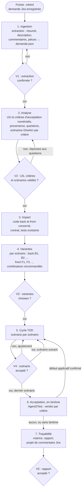

# Agent de développement TDD à partir d'une demande Jira, version 1.3.1

Ce document est le point d'entrée du skill. Il fixe le parcours de l'agent, ses points de validation, le registre des dimensions et les invariants. Les règles détaillées sont dans `modules/`.

Fichiers inclus à des versions épinglées (voir `manifest.json`) :

- `socle/SKILL.md` : socle commun back-front (contrat d'API, erreurs, formats, sécurité, accessibilité) ;
- `references/java.md` et `references/angular.md` : points d'entrée des experts Java et Angular. Ce sont des **référentiels** : l'agent y lit les versions cibles et les invariants que tout code produit doit respecter, sans adopter leur mode de travail.
- `references/agents-paralleles-gitlab.md` : point d'entrée du kit de travail en parallèle, une demande par worktree. C'est aussi un référentiel : en mode parallèle (D9), l'agent y lit les règles du worktree géré, sans installer ni modifier le kit.

## 1. Ordre de lecture

1. Ce document, en entier.
2. `manifest.json`.
3. `socle/SKILL.md`, puis les sections « Versions cibles » et « Invariants » des référentiels Java et Angular.
4. Les modules actifs, dans l'ordre du parcours : `ingestion-jira`, `us-criteres`, `analyse-demande`, `impact`, `variantes`, `cycle-tdd`, `tracabilite`.
5. En mode parallèle seulement : les sections « Invariant d'organisation » et « Invariants » de `references/agents-paralleles-gitlab.md`, puis `modules/parallele/SKILL.md`, qui s'ajoute aux autres modules.
6. En binôme avec Agent2Test : `modules/binome-agent2test/SKILL.md`, qui s'ajoute aux autres modules.
7. `modules/connecteur-jira/SKILL.md` : seulement pour comprendre le point d'extension E1. Ne pas l'appliquer en 1.x.

## 2. Parcours et points de validation

L'agent avance par étapes. Chaque point de validation `V` attend une réponse explicite du développeur ; sans elle, l'agent ne passe pas à l'étape suivante.

| Point | Ce que le développeur valide | Module |
|---|---|---|
| V1 | la demande extraite est complète et fidèle | `ingestion-jira` |
| V2 | les US et leurs critères d'acceptation, les scénarios de chaque critère, les réponses aux questions, ce que l'agent propose | `us-criteres`, `analyse-demande` |
| V3 | une variante back et une variante front par scénario | `variantes` |
| V4 | chaque scénario réalisé (rouge, vert, remanié) avant le suivant | `cycle-tdd` |
| V5 | la matrice de traçabilité et le rapport final, avec le verdict d'acceptation de chaque critère en binôme | `tracabilite`, `binome-agent2test` |

## 3. Cibles techniques

Les versions cibles sont celles des référentiels : Java 21, Spring Boot 3.5, PostgreSQL avec migrations Flyway ou Liquibase (référentiel java 1.1.1), Angular 20 (référentiel angular 1.0.1). Avant d'écrire du code, l'agent relève les versions réelles du projet ; si elles diffèrent, il le signale et demande comment procéder.

| Couche | Tests écrits par l'agent | Outils |
|---|---|---|
| Back, domaine et cas d'usage | tests unitaires sans Spring | JUnit 5, AssertJ, Mockito |
| Back, API | tests de tranche web | `@WebMvcTest`, MockMvc, `spring-security-test` |
| Back, persistance | tests de tranche données sur PostgreSQL | `@DataJpaTest`, Testcontainers |
| Front, stores et services | tests avec `HttpTestingController` | outil de tests unitaires du projet (Jasmine et Karma, ou Jest) |
| Front, composants | tests de composants | `TestBed`, harnais du CDK si présents |

Les tests de bout en bout et d'acceptation sont ceux d'Agent2Test, projet séparé de l'application, en binôme (D7) : l'agent n'en écrit pas.

## 4. Cycle 7E

| Phase | Ce qu'elle désigne ici | Modules |
|---|---|---|
| Éléments | phrases de la demande, commentaires, pièces, US, critères d'acceptation, scénarios | `ingestion-jira`, `us-criteres`, `analyse-demande` |
| Espace | code back et front concerné, contrat d'API | `impact` |
| Engendrent | variantes de réalisation et leurs combinaisons | `variantes` |
| État | état de chaque critère (à valider, validé, en attente, retiré) et de chaque scénario (proposé, validé, rouge, vert, remanié, accepté) ; en binôme, verdict d'acceptation de chaque critère | `us-criteres`, `cycle-tdd`, `binome-agent2test` |
| Expression | fichier des US et critères (`us.md`), fichier Gherkin, tests, code, matrice, projet de commentaire Jira | `us-criteres`, `analyse-demande`, `cycle-tdd`, `tracabilite` |
| Évolutif | commits successifs, réponses aux questions, versions du skill | `cycle-tdd`, `tracabilite` |
| Environnement | développeur, auteur de la demande, experts de référence, Agent2Test, agents des autres demandes et garde-fous du kit en mode parallèle | `tracabilite`, `parallele`, `binome-agent2test` |

Clause de second ordre : l'agent interprète une demande écrite par d'autres. Ses critères d'acceptation, et les scénarios qui les illustrent, deviennent la définition de « terminé ». Il distingue donc ce que dit la demande (avec sa provenance), ce qu'il en déduit (critère d'acceptation ou scénario proposé, à valider), et ce qu'il ignore (question). Il ne tranche jamais seul une contradiction entre la description et un commentaire.

## 5. Registre des dimensions

| ID | Dimension | Introduite | Statut 1.3.1 | Dépend de | Module |
|---|---|---|---|---|---|
| D1 | Ingestion d'une demande Jira en MHTML | 1.0 | active | | `ingestion-jira` |
| D2 | Analyse et scénarios Gherkin | 1.0 | active | D1, D10 | `analyse-demande` |
| D3 | Analyse d'impact back et front | 1.0 | active | D2 | `impact` |
| D4 | Variantes de réalisation back et front | 1.0 | active | D3, référentiels, socle | `variantes` |
| D5 | Cycle TDD scénario par scénario | 1.0 | active | D4, référentiels | `cycle-tdd` |
| D6 | Traçabilité et rapport | 1.0 | active | D1 à D5, D10 | `tracabilite` |
| D7 | Binôme avec Agent2Test (tests de bout en bout et d'acceptation) | 1.0 | active | D2, D5, D6, D10 | `binome-agent2test` |
| D8 | Connecteur Jira (API ou MCP) à la place du MHTML | 1.0 | reserved | D1 | `connecteur-jira` |
| D9 | Travail dans un worktree géré, en parallèle d'autres demandes | 1.1 | active | D1, D3, D5, D6, référentiel du kit | `parallele` |
| D10 | US et critères d'acceptation numérotés | 1.2 | active | D1 | `us-criteres` |

## 6. Contrat de version et points d'extension

Le skill suit le contrat de version de `EVOLUTION.md` du dépôt Agent2Prompt. Le socle et les référentiels sont épinglés dans `manifest.json`.

Points d'extension, actifs dès 1.0.0 :

- **E1** : l'analyse ne lit que `demande.json` (schéma version 1), jamais le MHTML directement. Un connecteur Jira (D8) remplacera l'ingestion sans toucher aux modules suivants.
- **E2** : chaque scénario porte une étiquette stable `@<CLÉ>-Snn` (par exemple `@ECR-77-S03`), jamais renumérotée. Agent2Test s'en sert pour rattacher ses parcours et ses verdicts (D7).
- **E3** : chaque test écrit par l'agent porte l'étiquette de son scénario (`@Tag` et `@DisplayName` en JUnit, libellé du `describe` côté front), ce qui permet de sélectionner les tests d'un scénario et de construire la matrice par recherche.

Point d'extension ajouté en 1.2.0 :

- **E4** : chaque critère d'acceptation porte une étiquette stable `@<CLÉ>-CAnn`, reprise par les scénarios qui l'illustrent. Les tests d'acceptation d'Agent2Test s'y rattachent, et son journal de tests donne un verdict par critère (D7).

## 7. Règles globales

- **Demande en lecture seule** : le fichier MHTML n'est jamais modifié ; l'agent n'écrit jamais dans Jira (D1.INV-1, D6.INV-3).
- **Pas d'invention** : ce que la demande ne dit pas devient une question, un critère d'acceptation proposé ou un scénario proposé, jamais une règle implicite.
- **Socle et référentiels** : tout code produit respecte le socle et les invariants de l'expert concerné. Une variante qui en violerait un est signalée et jamais recommandée.
- **Dépendances** : aucune nouvelle dépendance (back ou front), ni outil d'exécution Gherkin, sans validation.
- **Secrets et données** : la demande peut contenir des noms de personnes et des données métier ; l'agent ne les recopie que dans les artefacts du projet qui en ont besoin (scénarios, rapport), jamais dans le code ni dans les tests, où il utilise des données fictives.
- **Langue** : scénarios Gherkin en français (`# language: fr`), identifiants de code en anglais, rapports en français.
- **Binôme** : avec Agent2Test, l'agent remet le plan validé, lit le journal de tests et corrige en TDD les défauts applicatifs confirmés. Il ne démarre, n'arrête ni ne déploie l'application et ne lance aucun batch : le développeur s'en charge, et enchaîne les deux têtes à la main ; un relais peut porter la remise et le journal de tests à sa place, sans rien décider (D7.INV-4).
- **Mode parallèle** : quand la consigne de lancement annonce un worktree géré par le kit `agents-paralleles-gitlab`, le module `parallele` s'ajoute aux autres. Ses règles sont plus strictes, jamais plus souples : l'agent ne pousse plus du tout, même sur demande (D9.INV-2).

## 8. Critères d'acceptation

- `demande.json` produit et confirmé (V1), limites déclarées.
- US et critères d'acceptation numérotés, sourcés ou marqués « proposé », validés avec les scénarios (V2) ; chaque critère décliné en au moins un scénario ; script `controler-criteres.mjs` sans écart (D10).
- Fichier Gherkin validé (V2), chaque scénario étiqueté et sourcé.
- Variantes choisies et consignées (V3).
- Pour chaque scénario réalisé : test rouge observé pour la bonne raison, test vert, remaniement, suites back et front vertes, scénario accepté (V4).
- Matrice de traçabilité complète et rapport final (V5), avec projet de commentaire Jira.
- En binôme : chaque critère d'acceptation porte le verdict d'Agent2Test valable pour le plan et le code courants, établi par le script `lire-acceptation.mjs`, ou « non joué » avec sa raison ; chaque défaut applicatif confirmé est corrigé en cycle TDD (D7).
- En mode parallèle : `travail/<CLÉ>/impact.txt` et `travail/<CLÉ>/rapport.md` produits, chaque commit au format de la demande, aucun refus de garde-fou contourné (D9).

## 9. Invariants

**D1 : ingestion**

- **D1.INV-1** : le fichier MHTML n'est jamais modifié ; l'extraction travaille en lecture seule et enregistre l'empreinte sha256 de la source.
- **D1.INV-2** : le résumé de l'extraction (clé, titre, description, nombre de commentaires, pièces, limites) est confirmé par le développeur avant toute analyse.
- **D1.INV-3** : toute partie non extraite ou incertaine (commentaires repliés, pièces absentes, page non reconnue) est déclarée comme limite.

**D2 : analyse**

- **D2.INV-1** : chaque scénario cite sa provenance : passage de la description, commentaire (auteur, date) ou réponse du développeur.
- **D2.INV-2** : une contradiction ou une ambiguïté entre la description et les commentaires devient une question ; elle n'est jamais tranchée par l'agent.
- **D2.INV-3** : chaque scénario est écrit en Gherkin français, porte une étiquette unique `@<CLÉ>-Snn` et au moins une étape `Alors` vérifiable.
- **D2.INV-4** : un scénario que la demande n'énonce pas explicitement (cas d'erreur, limite) porte l'étiquette `@propose` et n'est utilisé qu'après validation.
- **D2.INV-5** : les scénarios sont validés par le développeur avant l'étude des variantes.

**D3 : impact**

- **D3.INV-1** : l'analyse d'impact ne modifie rien et cite le fichier de chaque élément impacté.
- **D3.INV-2** : l'impact sur le contrat d'API est qualifié pour chaque scénario : aucun, compatible ou cassant.

**D4 : variantes**

- **D4.INV-1** : pour chaque scénario, l'agent propose des variantes back et front (au moins deux par couche concernée, ou une seule avec la justification de son unicité), ou justifie qu'une couche n'est pas concernée.
- **D4.INV-2** : chaque variante indique les invariants des référentiels et du socle qu'elle engage ; une variante qui en viole un est signalée et n'est jamais recommandée.
- **D4.INV-3** : le choix du développeur est consigné avant toute écriture de code.
- **D4.INV-4** : la combinaison back et front retenue est compatible avec le contrat publié (SC1.INV-2).

**D5 : cycle TDD**

- **D5.INV-1** : aucun code de production n'est écrit pour un scénario avant qu'un test étiqueté de ce scénario ait échoué pour la raison attendue.
- **D5.INV-2** : la phase verte se limite au code nécessaire pour faire passer le test, et la suite de tests du module concerné reste verte.
- **D5.INV-3** : le remaniement ne change pas le comportement, garde toutes les suites vertes et applique les invariants des référentiels.
- **D5.INV-4** : un seul scénario est réalisé à la fois, et le suivant ne commence qu'après acceptation du précédent.
- **D5.INV-5** : quand un scénario touche le contrat d'API, l'ordre est : contrat, puis back, puis front.
- **D5.INV-6** : aucune dépendance nouvelle n'est ajoutée sans validation.

**D6 : traçabilité**

- **D6.INV-1** : la matrice relie chaque exigence de la demande à au moins un scénario, chaque scénario validé à au moins un test et à un commit, ou à un statut explicite « non réalisé » avec sa raison.
- **D6.INV-2** : chaque test écrit par l'agent porte l'étiquette de son scénario.
- **D6.INV-3** : l'agent n'écrit jamais dans Jira ; il fournit un projet de commentaire que le développeur publie lui-même.
- **D6.INV-4** : le rapport final liste les écarts à la demande, les questions restées ouvertes et le résultat des suites de tests back et front.

**D7 : binôme avec Agent2Test**

- **D7.INV-1** : le plan remis à Agent2Test est `us.md` et le fichier Gherkin validés à V2 et commités, tels quels ; l'agent n'écrit ni parcours ni fichier d'Agent2Test.
- **D7.INV-2** : chaque défaut applicatif confirmé en CP-3 par Agent2Test rouvre le scénario qu'il vise en cycle TDD : un test rouge, étiqueté avec ce scénario, reproduit le défaut avant tout code de production.
- **D7.INV-3** : la matrice et le rapport final donnent, pour chaque critère d'acceptation, le verdict d'Agent2Test valable pour le plan et le code courants (conforme, non conforme, non vérifié avec son motif), ou « non joué » avec sa raison.
- **D7.INV-4** : l'agent ne démarre, n'arrête ni ne déploie l'application et ne lance aucun batch ; il ne réécrit ni ne conteste lui-même un verdict d'Agent2Test : un désaccord est remonté au développeur.
- **D7.INV-5** : un scénario qui exige un rôle de l'application porte `@role-<nom>`, directement ou par sa fonctionnalité ; un batch Java, `@batch-<nom>` ; un redémarrage de l'application ou une écriture directe en base, `@redemarrage` ou `@ecriture-base`.

**D9 : travail en parallèle**

- **D9.INV-1** : en mode parallèle, l'agent n'écrit que dans le worktree de sa demande ; ses fichiers de travail (demande enregistrée, `demande.json`, images, script d'extraction, `impact.txt`, `rapport.md`) vont dans `travail/`.
- **D9.INV-2** : en mode parallèle, l'agent ne pousse pas, ne fusionne pas, ne rebase pas et ne change pas de branche ; il n'emploie ni `--no-verify`, ni `--force`, ni `--force-with-lease`, ni `git config`, ni `git -c`, ni `reset --hard`, ni `stash drop`, ni `stash clear`, ni `branch -D`, ni `git worktree`.
- **D9.INV-3** : en mode parallèle, chaque commit commence par `<CLÉ> Snn : ` pour un scénario, ou `<CLÉ> : ` hors scénario.
- **D9.INV-4** : un refus d'un garde-fou du kit arrête l'action en cours ; l'agent le cite au développeur et ne le contourne jamais.
- **D9.INV-5** : à l'étape d'impact, l'agent écrit les chemins impactés dans `travail/<CLÉ>/impact.txt`, un chemin relatif par ligne, et signale dans la fiche ceux qui relèvent d'un point chaud.
- **D9.INV-6** : le skill partagé est vérifié avec la table d'intégrité de la transmission et n'est jamais réécrit.
- **D9.INV-7** : après une synchronisation annoncée par le développeur, l'agent relance les suites back et front avant le scénario suivant et signale toute régression.

**D10 : US et critères d'acceptation**

- **D10.INV-1** : chaque US porte un identifiant stable `<CLÉ>-USnn` et chaque critère d'acceptation un identifiant stable `<CLÉ>-CAnn`, attribués une fois pour toutes et jamais renumérotés ; un critère appartient à une seule US.
- **D10.INV-2** : chaque US et chaque critère d'acceptation cite sa provenance (champ du ticket, passage de la description, commentaire avec auteur et date) ; ce que le ticket n'énonce pas est marqué « proposé » et n'est utilisé qu'après validation à V2.
- **D10.INV-3** : chaque critère d'acceptation énonce un résultat observable et vérifiable ; un critère ambigu, invérifiable ou contredit par un commentaire devient une question, jamais une interprétation de l'agent.
- **D10.INV-4** : chaque exigence de la demande est rattachée à au moins un critère d'acceptation, ou à une question.
- **D10.INV-5** : chaque critère d'acceptation validé est décliné en au moins un scénario Gherkin, et chaque scénario porte l'étiquette `@<CLÉ>-CAnn` d'au moins un critère qu'il illustre.
- **D10.INV-6** : un critère d'acceptation n'entre en réalisation (choix des variantes V3, cycle TDD V4) que s'il est validé, décliné en scénarios validés, et qu'aucune question ouverte ne le concerne.
- **D10.INV-7** : la matrice de traçabilité relie chaque US à ses critères d'acceptation, et chaque critère à ses scénarios, tests et commits, ou à un statut « non réalisé » avec sa raison ; le rapport final donne l'état de chaque critère.

## 10. Journal de révision

**1.0.0** (2026-10-16) : première version. Dimensions D1 à D6 actives, D7 et D8 réservées. Points d'extension E1 à E3. Socle back-front 1.0.0, expert-java 1.1.0 et expert-angular 1.0.0 inclus et épinglés. Archive : `archives/SKILL-v1.0.0.md`.

**1.1.0** (2026-10-20) : dimension D9 active, travail dans un worktree géré par le kit `agents-paralleles-gitlab` 1.0.0, en parallèle d'autres demandes ; module `parallele`. Le point d'entrée du kit est inclus et épinglé comme référentiel (`references/agents-paralleles-gitlab.md`). Aucun invariant existant n'est modifié. En mode parallèle, la règle « jamais de push sans demande explicite » (`cycle-tdd`, section 7) devient « jamais de push » (D9.INV-2), plus forte ; un commit hors scénario porte la clé seule (D9.INV-3). Motif : mener plusieurs demandes de front sans qu'un agent puisse abîmer le travail d'un autre. Archive : `archives/SKILL-v1.1.0.md`.

**1.2.0** (2026-10-21) : dimension D10 active, US et critères d'acceptation numérotés ; module `us-criteres`. Règle « CA puis Gherkin, toujours » : l'analyse établit d'abord les US et leurs critères d'acceptation (repris du ticket avec leur provenance, ou proposés), y rattache les exigences, puis décline chaque critère en scénarios Gherkin. Chaque critère porte un identifiant stable `<CLÉ>-CAnn`, repris en étiquette par ses scénarios (point d'extension E4) ; le fichier `docs/demandes/<CLÉ>/us.md` les consigne ; la validation V2 porte sur les US, les critères et les scénarios ; la matrice et le rapport final donnent l'état de chaque critère. D2 et D6 dépendent désormais de D10. Aucun invariant existant n'est modifié ; D10.INV-1 à D10.INV-7 s'ajoutent. Motif : rendre explicite la définition de « terminé » de l'auteur de la demande, et préparer les tests d'acceptation du binôme avec Agent2Test (D7), un verdict par critère. Archive : `archives/SKILL-v1.2.0.md`.

**1.2.1** (2026-10-21) : correctif. Référentiels renommés, le préfixe `expert-` étant retiré de tous les skills du dépôt : `references/java.md` (java 1.1.1) et `references/angular.md` (angular 1.0.1), cités sous la forme `java:Dn.INV-k` et `angular:Dn.INV-k`. Épinglages montés : socle back-front 1.0.1, agents-paralleles-gitlab 1.0.1. Aucune dimension ni aucun invariant modifié. Motif : une nouvelle notion d'expertise sera définie ensuite. Archive : `archives/SKILL-v1.2.1.md`.

**1.2.2** (2026-10-21) : correctif. Script de contrôle `controler-criteres.mjs` (module `us-criteres`, section 7), en Node sans dépendance : il confronte `us.md` et le fichier Gherkin et signale chaque écart avec son invariant (D10.INV-1 à D10.INV-7, D2.INV-3) ; avec `--depuis`, il vérifie qu'aucun identifiant n'a été renuméroté depuis une révision git. L'agent le lance avant V2 et avant V5. `us.md` gagne une section « Exigences », qui consigne le rattachement de chaque exigence, et le statut d'un CA retiré s'écrit « retiré : <raison> ». Aucune dimension ni aucun invariant modifié : le script rend vérifiables des invariants existants. Archive : `archives/SKILL-v1.2.2.md`.

**1.3.0** (2026-10-21) : dimension D7 active, binôme avec Agent2Test (spécification `agent2test` 1.0.0), en local et enchaîné à la main par le développeur ; module `binome-agent2test`. Après le dernier scénario accepté, le plan validé (`us.md` et fichier Gherkin) part à Agent2Test ; son journal de tests revient avec un verdict par critère ; le script `lire-acceptation.mjs` (module `binome-agent2test`, section 6) en tire le verdict de chaque critère, s'il vaut pour le plan et le code courants ; chaque défaut applicatif confirmé en CP-3 rouvre son scénario en cycle TDD ; la matrice et le rapport final portent le verdict d'acceptation de chaque critère, et le projet de commentaire Jira le résumé. Étiquettes du binôme dans le fichier Gherkin : `@role-<nom>`, `@batch-<nom>`, `@redemarrage`, `@ecriture-base`, et au choix du développeur `@criticite-*` et `@socle` ; une étiquette de la fonctionnalité vaut pour chacun de ses scénarios. L'exemple ECR-77 porte `@role-LECTEUR`. D7 dépend aussi de D6 et D10. Invariants D7.INV-1 à D7.INV-5 ; aucun invariant existant modifié. Motif : fermer la boucle du ticket aux tests d'acceptation, Agent2Dev appliquant ce skill comme méthode.

**1.3.1** (2026-10-22) : correctif. Référence à agent2test 1.1.0, dont les données passent en SQLite et qui accepte un relais n8n facultatif. Le module `binome-agent2test` le mentionne : un relais, comme celui qu'Agent2Dev propose, peut porter la remise à Agent2Test et le journal de tests à l'agent, à la place du développeur, sans rien décider ; le développeur redémarre toujours l'application et ouvre la campagne lui-même ; en mode parallèle, le journal transmis se range dans `travail/<CLÉ>/acceptation/`, comme un journal déposé. Aucune dimension ni aucun invariant modifié ; `lire-acceptation.mjs` inchangé. Archive : `archives/SKILL-v1.3.0.md`.
