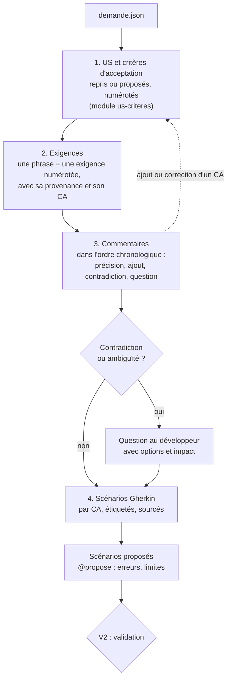

# Module `analyse-demande` (D2)

L'analyse transforme une demande écrite en scénarios vérifiables. Elle se fait en quatre temps : établir les US et leurs critères d'acceptation (module `us-criteres`), relever les exigences et les rattacher aux critères, confronter description et commentaires, écrire les scénarios de chaque critère.

## 1. Déroulé



## 2. Exigences (D2.INV-1)

Chaque phrase porteuse d'une règle devient une exigence numérotée, avec sa provenance exacte, et se rattache à au moins un critère d'acceptation, ou à une question (D10.INV-4) :

| ID | Exigence | Provenance | CA |
|---|---|---|---|
| EX-01 | un bouton exporte la liste filtrée en CSV | description, phrase 1 | ECR-77-CA01 |
| EX-02 | encodage UTF-8 avec BOM | description, phrase 2 | ECR-77-CA02 |
| EX-03 | séparateur point-virgule | description, phrase 2 | ECR-77-CA02 |
| EX-04 | export limité à 10 000 lignes | commentaire 50001, Jeanne Dupont, 2026-10-10 | ECR-77-CA03 |

Une capture d'écran qui porte une exigence (maquette, message attendu) est une provenance au même titre qu'une phrase : `pièce images/piece-002.png`.

## 3. Lire les commentaires

Les commentaires se lisent dans l'ordre chronologique. Chacun est classé :

| Nature | Effet | Exemple |
|---|---|---|
| Précision | affine une exigence existante | « le brouillon d'un autre module ne bloque pas celui-ci » |
| Ajout | crée une exigence | « limiter l'export à 10 000 lignes » |
| Contradiction | contredit la description ou un autre commentaire | description : « tous les rôles » ; commentaire : « réservé aux administrateurs » |
| Question non résolue | question posée dans Jira sans réponse visible | « et si le brouillon ne contient que des espaces ? » |
| Hors sujet | sans effet sur le besoin | échanges de planification |

Une contradiction n'est jamais tranchée par l'agent, même si le commentaire est plus récent ou que son auteur semble avoir autorité (D2.INV-2). Elle devient une question.

## 4. Questions

```markdown
### Q1 : comportement au-delà de 10 000 lignes (EX-04)
- **Constat** : le commentaire 50001 limite l'export à 10 000 lignes sans dire ce qui se passe au-delà.
- **Options** :
  - A. exporter les 10 000 premières lignes et prévenir l'utilisateur ;
  - B. refuser l'export et demander d'affiner le filtre ;
  - C. autre règle, à préciser.
- **Impact** : le scénario ECR-77-S03 reste en attente ; A et B n'ont pas les mêmes variantes back.
```

Une question non tranchée au moment de V2 laisse les scénarios qui en dépendent en attente ; les autres peuvent avancer.

## 5. Scénarios Gherkin (D2.INV-3)

Fichier par demande, en français, versionné dans le dépôt du projet (par exemple `docs/demandes/ECR-77/ECR-77.feature`) :

```gherkin
# language: fr
@ECR-77
Fonctionnalité: Export des retours d'expérience en CSV
  En tant qu'utilisateur de la liste des retours d'expérience
  Je veux exporter la liste filtrée en CSV
  Afin de l'exploiter dans un tableur

  Contexte:
    Étant donné que je suis connecté avec le rôle "LECTEUR"
    Et que la liste filtrée affiche 3 retours d'expérience

  # CA : ECR-77-CA01 ; source : EX-01 (description, phrase 1)
  @ECR-77-S01 @ECR-77-CA01 @back @front
  Scénario: Exporter la liste filtrée
    Quand je demande l'export CSV de la liste
    Alors je reçois un fichier "retours-experience.csv"
    Et il contient 1 ligne d'en-tête et 3 lignes de données

  # CA : ECR-77-CA02 ; source : EX-02, EX-03 (description, phrase 2)
  @ECR-77-S02 @ECR-77-CA02 @back
  Scénario: Encodage et séparateur du fichier
    Quand je demande l'export CSV de la liste
    Alors le fichier commence par la marque d'ordre des octets UTF-8
    Et les colonnes sont séparées par des points-virgules

  # CA : ECR-77-CA03 ; source : EX-04 (commentaire 50001, Jeanne Dupont, 2026-10-10) ; en attente de Q1
  @ECR-77-S03 @ECR-77-CA03 @back @front @en-attente
  Scénario: Liste au-delà de la limite d'export
    Étant donné que la liste filtrée compte 10 001 retours d'expérience
    Quand je demande l'export CSV de la liste
    Alors <comportement selon la réponse à Q1>

  # CA : ECR-77-CA04 ; proposé par l'agent : cas non énoncé par la demande
  @ECR-77-S04 @ECR-77-CA04 @back @front @propose
  Scénario: Liste filtrée vide
    Étant donné que la liste filtrée ne compte aucun retour d'expérience
    Quand je consulte la liste
    Alors le bouton d'export est désactivé et son motif est annoncé
```

Règles d'écriture :

- une étiquette `@<CLÉ>-Snn` par scénario, attribuée une fois pour toutes : un scénario supprimé laisse son numéro inutilisé (point E2) ;
- une ou plusieurs étiquettes `@<CLÉ>-CAnn` : les critères d'acceptation que le scénario illustre, rappelés dans le commentaire de provenance (D10.INV-5, point E4) ;
- étiquettes de couche `@back`, `@front` ; étiquettes d'état `@en-attente` (question ouverte) et `@propose` (scénario déduit par l'agent, D2.INV-4) ;
- la provenance en commentaire juste au-dessus des étiquettes (D2.INV-1) ;
- chaque `Alors` est vérifiable par un test : pas de « fonctionne correctement », pas de « est rapide » sans seuil ;
- les étapes décrivent le comportement observable, pas l'implémentation (« je demande l'export », pas « j'appelle GET /api/v1/… ») ;
- `Plan du scénario` et `Exemples` pour une même règle sur plusieurs valeurs (bornes, rôles).

Le fichier Gherkin est une spécification. L'agent n'introduit pas d'outil d'exécution Gherkin (Cucumber ou autre) sans validation : les tests sont des tests JUnit et front classiques, étiquetés avec le scénario (point E3).

## 6. Scénarios proposés (D2.INV-4)

L'agent propose les cas que la demande n'énonce pas mais que le code devra traiter : liste vide, droit insuffisant, erreur du serveur, bornes, concurrence. Chaque proposition :

- porte `@propose` et la mention « Proposé par l'agent » ;
- illustre un critère d'acceptation existant, ou un critère proposé avec elle et marqué « proposé » dans `us.md` : pas de scénario sans critère (D10.INV-2, D10.INV-5) ;
- est validée, modifiée ou écartée par le développeur à V2 ;
- une fois validée, perd `@propose` et prend « Source : réponse du développeur, V2 ».

## 7. Validation V2 (D2.INV-5)

L'agent présente : les US et les critères d'acceptation (`us.md`, module `us-criteres`, section 6), le tableau des exigences, les questions, le fichier Gherkin, et la couverture (chaque exigence a au moins un CA, chaque CA au moins un scénario). Il attend :

- une réponse à chaque question, ou l'accord pour laisser les scénarios concernés en attente ;
- l'acceptation, la modification ou le rejet de chaque critère d'acceptation et de chaque scénario proposés ;
- la validation de l'ensemble.

## 8. Pièges connus

- **Reformuler la demande en mieux** : l'agent écrit ce qui est demandé, pas ce qu'il aurait conçu. Une amélioration se propose en `@propose`.
- **Scénario technique** : « la table est indexée » n'est pas un scénario de demande. C'est un choix de variante (module `variantes`).
- **Commentaire ignoré parce que plus ancien** : un commentaire ancien reste valable tant qu'aucun autre ne le contredit.
- **Exigence sans scénario** : chaque exigence apparaît dans au moins un scénario, ou dans une question.

## 9. Contrôle de sortie

- Chaque scénario cite sa provenance (D2.INV-1).
- Chaque contradiction ou ambiguïté est une question (D2.INV-2).
- Chaque scénario est en Gherkin français, étiqueté, avec un `Alors` vérifiable (D2.INV-3).
- Les scénarios déduits portent `@propose` (D2.INV-4).
- Chaque exigence est rattachée à un CA ou à une question (D10.INV-4) ; chaque scénario porte l'étiquette d'au moins un CA (D10.INV-5).
- V2 obtenue avant l'étude des variantes (D2.INV-5).
