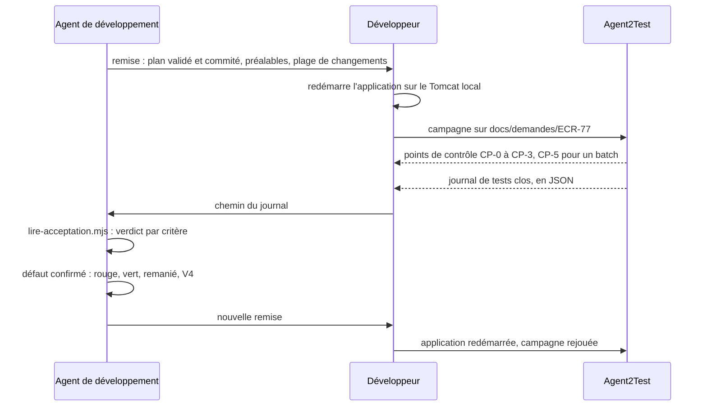

# Module `binome-agent2test` (D7)

Agent2Test (spécification `agent2test` 1.2.0) est la tête de test du binôme. Dans un projet séparé de l'application, il choisit les scénarios essentiels de la demande, les joue avec Playwright sur l'application lancée, et rend un verdict prouvé par critère d'acceptation. La tête de développement est cet agent, ou Agent2Dev quand il applique ce skill. Le développeur fait le lien : il lance l'application, conduit Agent2Test et transmet son journal. Tout se fait en local et à la main : aucune des deux têtes n'appelle l'autre.

## 1. Rôles

| Qui | Fait | Ne fait jamais |
|---|---|---|
| Agent de développement (ce skill, ou Agent2Dev) | pose les étiquettes du binôme (V2) ; remet le plan validé ; lit le journal de tests ; corrige en TDD les défauts applicatifs confirmés ; reporte les verdicts dans la matrice et le rapport | démarrer, arrêter ou déployer l'application ; lancer un batch ; écrire un parcours ou un fichier d'Agent2Test ; réécrire ou contester un verdict (D7.INV-1, D7.INV-4) |
| Développeur | redémarre l'application sur le Tomcat local ; ouvre la campagne ; lance les batchs en CP-5 ; tranche, ou fait trancher par le testeur, les points de contrôle d'Agent2Test ; transmet le journal ; arbitre les désaccords | — |
| Agent2Test | importe `us.md` et le fichier Gherkin ; sélectionne, prépare, joue ; rend le journal de tests | rédiger ou corriger une US, un critère ou un scénario (`agent2test:D3.INV-1`) ; démarrer, arrêter ou déployer l'application, lancer un batch (`agent2test:D9.INV-7`) |

## 2. Déroulé



1. Les étiquettes du binôme se posent pendant l'analyse et se valident à V2 (section 3).
2. Après V4 du dernier scénario prêt pour la réalisation, l'agent remet le plan (section 4).
3. Le développeur conduit la campagne (section 5).
4. L'agent lit le journal (section 6), corrige chaque défaut confirmé (section 7), puis remet de nouveau le plan, jusqu'à ce qu'aucun défaut confirmé ne reste.
5. La matrice et le rapport final portent le verdict d'acceptation de chaque critère (module `tracabilite`), puis V5.

Un échange peut porter la remise à Agent2Test et le journal de tests à l'agent, à la place du développeur, quand la tête de développement le prévoit : Agent2Dev le fait par des dossiers d'échange, facultatifs, où chaque tête écrit dans sa propre boîte de sortie et lit celle de l'autre, sans aucune connexion (spécification `agent2dev`, module `echange`). L'échange ne décide rien : le développeur redémarre toujours l'application et ouvre la campagne lui-même.

Sans binôme, il n'y a pas d'étape d'acceptation : chaque critère porte « non joué (pas de campagne Agent2Test) » dans la matrice et le rapport (D7.INV-3).

## 3. Étiquettes du binôme (D7.INV-5)

Elles s'ajoutent à celles du module `analyse-demande` (section 5). Une étiquette portée par la ligne `Fonctionnalité:` vaut pour chacun de ses scénarios.

| Étiquette | Quand | Effet dans Agent2Test |
|---|---|---|
| `@role-<nom>` | le scénario exige un rôle de l'application, nommé comme elle le nomme (`@role-LECTEUR`) ; sur la fonctionnalité quand le Contexte l'exige pour tous les scénarios | joué seulement si la session déclare ce rôle ; sinon non jouable, motif « rôle <nom> absent de la session » |
| `@batch-<nom>` | le scénario exige qu'un batch Java ait tourné avant lui | le développeur lance le batch et le déclare terminé en CP-5, puis le scénario est joué |
| `@redemarrage`, `@ecriture-base` | le scénario exige un redémarrage de l'application, ou une écriture directe en base | non automatisable, jamais joué : ses critères restent « non vérifiés » |
| `@criticite-haute`, `@criticite-moyenne`, `@criticite-basse` | criticité fixée par le développeur ; moyenne sans étiquette | pèse dans la non-régression des campagnes suivantes |
| `@socle` | parcours essentiel de l'application, décidé par le développeur | rejoué à chaque campagne (palier P3) |

- L'agent propose ces étiquettes, et le développeur les valide à V2 avec le reste du fichier Gherkin. Un rôle, un batch ou une écriture en base se lisent dans la demande, ou se demandent : l'agent ne les déduit pas du code.
- Dans l'exemple ECR-77 (module `analyse-demande`, section 5), le Contexte connecte l'utilisateur avec le rôle « LECTEUR » : la ligne `Fonctionnalité:` porte `@role-LECTEUR`.
- Un scénario `@back` sans `@front` n'a pas de parcours : Agent2Test le marque non jouable, et ses critères restent « non vérifiés » de son côté. Les tests back de l'agent les couvrent.
- Le fichier Gherkin reste une spécification du comportement : ni sélecteur, ni URL technique, ni identifiant de test. Agent2Test prépare ses parcours à partir des étapes, telles qu'elles sont écrites.

## 4. Remise du plan (D7.INV-1)

Après V4 du dernier scénario prêt pour la réalisation :

1. `node outils/controler-criteres.mjs docs/demandes/ECR-77` ne signale aucun écart (module `us-criteres`, section 7).
2. `git status --porcelain` ne liste aucun fichier suivi modifié : chaque scénario accepté est commité (module `cycle-tdd`, section 7), et le verdict d'Agent2Test se rattachera à ce commit.
3. L'agent rédige la remise pour le développeur ; il ne la transmet pas lui-même à Agent2Test :

```text
Remise à Agent2Test : ECR-77, commit b7c8d9e

Plan validé à V2 et commité, à prendre tel quel :
  docs/demandes/ECR-77/us.md
  docs/demandes/ECR-77/ECR-77.feature
Critères : CA01, CA02, CA04 validés ; CA03 en attente de Q1
Jouables, sous réserve d'Agent2Test : S01, S04 (rôle LECTEUR)
Non jouables : S02 (@back seul, couvert par les tests back), S03 (@en-attente, Q1)
Préalables : aucun batch ; aucun scénario @redemarrage ni @ecriture-base
Changements : origin/develop...HEAD

À faire : redémarrer l'application sur le Tomcat local, puis ouvrir la campagne
(adaptateur agent-tdd-jira, dossier docs/demandes/ECR-77). Une fois la campagne close,
me donner le chemin de son journal-de-tests.json.
```

- La liste des scénarios jouables est une prévision : Agent2Test en décide (`agent2test:D3.INV-5`).
- L'agent ne retouche ni `us.md` ni le fichier Gherkin pour Agent2Test. Toute modification du plan après V2 repasse par V2, puis appelle une nouvelle remise.

## 5. Campagne, côté développeur

C'est le développeur, jamais l'agent, qui :

- redémarre l'application sur le Tomcat local à partir du commit remis ; Liquibase applique les migrations au démarrage ;
- ouvre une campagne d'Agent2Test sur la demande : adaptateur `agent-tdd-jira`, dossier `docs/demandes/<CLÉ>`, plage de changements ;
- lance chaque batch demandé en CP-5, et le déclare terminé ;
- tranche, ou fait trancher par le testeur, les points de contrôle CP-0 à CP-3 : un défaut applicatif présumé n'est confirmé qu'en CP-3 ;
- donne à l'agent, une fois la campagne close, le chemin de son journal : `rapports/<campagne>/journal-de-tests.json` dans le projet Agent2Test.

L'agent ne lit rien d'autre du projet Agent2Test, et n'y écrit rien (D7.INV-1).

## 6. Lire le journal par script (D7.INV-3)

L'agent écrit ce script dans son dossier de travail (par exemple `outils/lire-acceptation.mjs`), à l'identique, et le lance depuis la racine du dépôt du projet, chaque fois qu'il reçoit un journal :

```bash
node outils/lire-acceptation.mjs docs/demandes/ECR-77 ../agent2test/rapports/C-20261021-001/journal-de-tests.json
```

Le script ne modifie aucun fichier. Il n'a besoin que de Node.js 20 ou plus récent, et de git.

```js
#!/usr/bin/env node
// Lecture du journal de tests d'Agent2Test pour une demande (dimension D7 du skill agent-tdd-jira).
// Usage : node lire-acceptation.mjs <dossier de la demande> <journal de tests JSON>
//   <dossier>  par exemple docs/demandes/ECR-77, qui contient us.md et ECR-77.feature ;
//   <journal>  journal-de-tests.json d'une campagne d'Agent2Test (format agent2test.journal-de-tests/1).
// À lancer depuis la racine du dépôt du projet. Node 20 ou plus récent, modules natifs, git.
// Le script ne modifie aucun fichier.
import { execFileSync } from 'node:child_process';
import { createHash } from 'node:crypto';
import { existsSync, readFileSync } from 'node:fs';
import { basename, join, relative, resolve, sep } from 'node:path';

const arreter = (message) => { console.error(message); process.exit(2); };
const [dossier, cheminJournal] = process.argv.slice(2);
if (!dossier || !cheminJournal) arreter('Usage : node lire-acceptation.mjs <dossier de la demande> <journal de tests JSON>');
const cle = basename(resolve(dossier));
if (!/^[A-Z][A-Z0-9_]+-\d+$/.test(cle)) arreter(`Le dossier doit porter la clé de la demande (par exemple docs/demandes/ECR-77) : ${cle}`);
const chemin = (p) => relative(process.cwd(), resolve(p)).split(sep).join('/');
const plan = [join(dossier, 'us.md'), join(dossier, `${cle}.feature`)].map(chemin);
for (const p of [...plan, cheminJournal]) if (!existsSync(p)) arreter(`Fichier absent : ${p}`);

let journal;
try { journal = JSON.parse(readFileSync(cheminJournal, 'utf8')); } catch (e) { arreter(`Journal illisible : ${e.message}`); }
if (journal.format !== 'agent2test.journal-de-tests/1') {
  arreter(`Format de journal non pris en charge : ${journal.format ?? 'absent'} (attendu agent2test.journal-de-tests/1)`);
}
if (journal.demande?.cle !== cle) arreter(`Ce journal est celui de la demande ${journal.demande?.cle ?? 'inconnue'}, pas de ${cle}`);
const campagne = journal.campagne ?? 'campagne sans identifiant';
const versions = journal.versions ?? {};
const ecarts = [];

// Critères de us.md : colonne « Statut » des tableaux « CA » des sections d'US.
const criteres = new Map();
const ID_CA = new RegExp(`^${cle}-CA\\d{2,}$`);
for (const section of readFileSync(plan[0], 'utf8').split(/^(?=## )/m)) {
  if (!new RegExp(`^## ${cle}-US\\d{2,} : `).test(section)) continue;
  let iStatut = -1;
  for (const ligne of section.split('\n')) {
    const c = ligne.split('|').slice(1, -1).map((x) => x.trim());
    if (c[0] === 'CA') iStatut = c.indexOf('Statut');
    else if (iStatut >= 0 && ID_CA.test(c[0] ?? '')) criteres.set(c[0], c[iStatut] ?? '');
  }
}

// Le verdict vaut-il pour le plan et le code courants ? Chaque raison contraire est retenue.
const raisons = [];
const details = [];
if (!journal.empreinteFin) raisons.push('journal provisoire');
for (const p of plan) {
  const source = (versions.sources ?? []).find((s) => s.chemin === p);
  const empreinte = createHash('sha256').update(readFileSync(p)).digest('hex');
  if (!source) raisons.push(`journal sans empreinte de ${p}`);
  else if (source.empreinte !== empreinte) raisons.push(`${p} modifié depuis la campagne`);
}
// --no-optional-locks : git status ne réécrit pas l'index ; git diff ne compare ici que deux commits.
const git = (...args) => execFileSync('git', ['--no-optional-locks', ...args], { encoding: 'utf8', stdio: ['ignore', 'pipe', 'ignore'] });
const horsDemandes = (fichiers) => fichiers.filter((f) => f && !f.startsWith('docs/demandes/'));
const commit = versions.application?.commit;
if (!commit) raisons.push('campagne sans commit');
else {
  let connu = true;
  try { git('cat-file', '-e', `${commit}^{commit}`); } catch { connu = false; }
  if (!connu) raisons.push(`commit ${commit.slice(0, 7)} de la campagne inconnu du dépôt`);
  const alors = horsDemandes(versions.application.fichiersModifies ?? []);
  if (alors.length) {
    raisons.push('code non commité pendant la campagne');
    details.push(`non commités pendant la campagne : ${alors.join(', ')}`);
  }
  if (connu) {
    const pathspec = ['--', '.', ':(exclude)docs/demandes'];
    const commites = git('diff', '--name-only', commit, 'HEAD', ...pathspec).split('\n');
    const enCours = git('status', '--porcelain', '--untracked-files=no', ...pathspec).split('\n').map((l) => l.slice(3).split(' -> ').pop());
    const depuis = [...new Set(horsDemandes([...commites, ...enCours]))].sort();
    if (depuis.length) {
      raisons.push('code modifié depuis la campagne');
      details.push(`modifiés depuis la campagne : ${depuis.join(', ')}`);
    }
  }
}
const valable = raisons.length === 0;

// Défauts applicatifs : confirmés en CP-3, contestés (désaccord) ou en attente de décision.
const scenarios = new Map((journal.scenarios ?? []).map((s) => [s.id, s]));
const decisions = journal.decisions ?? [];
const desaccords = journal.desaccords ?? [];
const etat = (id) => {
  if (desaccords.some((d) => d.cible === id)) return 'contesté en CP-3';
  if (decisions.some((d) => d.point === 'CP-3' && d.cible === id && d.decision === 'confirmer')) return 'confirmé';
  return 'non confirmé';
};
const VERDICTS = ['conforme', 'non conforme', 'non vérifié'];
const texte = (l) => {
  if (l.verdict === 'non vérifié') return `non vérifié (${l.motif ?? 'sans motif'})`;
  if (l.verdict !== 'non conforme') return l.verdict;
  const enDefaut = (l.scenarios ?? []).filter((id) => scenarios.get(id)?.cause === 'DEFAUT_APPLICATIF');
  return `non conforme (${enDefaut.map((id) => `${id} : défaut ${etat(id)}`).join(' ; ') || 'aucun scénario en défaut applicatif'})`;
};

const matrice = new Map();
for (const l of journal.matrice ?? []) {
  matrice.set(l.critere, l);
  if (!criteres.has(l.critere)) ecarts.push(`${campagne} juge ${l.critere}, absent de us.md`);
  if (!VERDICTS.includes(l.verdict)) ecarts.push(`${l.critere} : verdict « ${l.verdict} » inconnu`);
}

console.log(`${cle} : campagne ${campagne}, journal ${journal.empreinteFin ? 'clos' : 'provisoire'}, ` +
  `plan ${versions.plan ?? '?'}, commit ${commit ? commit.slice(0, 7) : '?'}`);
console.log(valable ? 'verdicts valables pour le plan et le code courants' : `verdicts non valables : ${raisons.join(' ; ')}`);
for (const d of details) console.log(`  ${d}`);
for (const [id, statut] of criteres) {
  if (statut.startsWith('retiré')) continue;
  const l = matrice.get(id);
  if (!l) {
    ecarts.push(`${id} absent de la matrice de ${campagne}`);
    console.log(`${id} | non joué (absent du journal)`);
    continue;
  }
  const acceptation = valable ? texte(l) : `non joué (${raisons[0]} ; ${campagne} : ${l.verdict})`;
  console.log(`${id} | ${acceptation}${l.scenarios?.length ? ` | ${l.scenarios.join(', ')}` : ''}`);
}

let aCorriger = 0;
for (const s of journal.scenarios ?? []) {
  if (s.cause !== 'DEFAUT_APPLICATIF') continue;
  const vises = (journal.matrice ?? []).filter((l) => (l.scenarios ?? []).includes(s.id)).map((l) => l.critere);
  const etape = (s.etapes ?? []).find((e) => e.statut === 'échouée')?.n;
  const lieu = [vises.join(', '), etape ? `étape ${etape}` : ''].filter(Boolean).join(', ');
  const precision = lieu ? ` (${lieu})` : '';
  if (!s.id?.startsWith(`${cle}-`)) {
    console.log(`RÉGRESSION  ${s.id}${precision} : défaut applicatif ${etat(s.id)} sur un scénario hors de la demande ; au développeur`);
  } else if (!valable) {
    console.log(`DÉFAUT  ${s.id}${precision} : défaut applicatif ${etat(s.id)} en ${campagne}, ${raisons[0]} ; à rejouer`);
  } else if (ecarts.length) {
    console.log(`DÉFAUT  ${s.id}${precision} : défaut applicatif ${etat(s.id)}, journal incohérent (écarts ci-dessous) ; au développeur`);
  } else if (etat(s.id) === 'confirmé') {
    aCorriger += 1;
    console.log(`DÉFAUT  ${s.id}${precision} : défaut applicatif confirmé en CP-3 ; cycle de correction (D7.INV-2)`);
  } else {
    console.log(`DÉFAUT  ${s.id}${precision} : défaut applicatif ${etat(s.id)} ; au développeur (D7.INV-4)`);
  }
}
for (const e of ecarts) console.log(`ÉCART  ${e}`);
const bilan = [`${aCorriger} défaut(s) à corriger`, `${ecarts.length} écart(s)`];
console.log(valable && ecarts.length === 0 ? bilan.join(', ') : `${bilan.join(', ')} ; verdicts à ne pas reporter tels quels`);
process.exit(valable && ecarts.length === 0 ? 0 : 1);
```

Sortie sur le journal d'exemple d'Agent2Test (module `journal` de sa spécification), après la remise de la section 4 :

```text
ECR-77 : campagne C-20261021-001, journal clos, plan P-14, commit b7c8d9e
verdicts valables pour le plan et le code courants
ECR-77-CA01 | conforme | ECR-77-S01
ECR-77-CA02 | non vérifié (non jouable : limité au back)
ECR-77-CA03 | non vérifié (non jouable : en attente de Q1)
ECR-77-CA04 | non conforme (ECR-77-S04 : défaut confirmé) | ECR-77-S04
DÉFAUT  ECR-77-S04 (ECR-77-CA04, étape 3) : défaut applicatif confirmé en CP-3 ; cycle de correction (D7.INV-2)
1 défaut(s) à corriger, 0 écart(s)
```

Le même journal, relu après le commit de la correction :

```text
ECR-77 : campagne C-20261021-001, journal clos, plan P-14, commit b7c8d9e
verdicts non valables : code modifié depuis la campagne
  modifiés depuis la campagne : src/app/features/feedback/feature/feedback-list.spec.ts, src/app/features/feedback/feature/feedback-list.ts
ECR-77-CA01 | non joué (code modifié depuis la campagne ; C-20261021-001 : conforme) | ECR-77-S01
ECR-77-CA02 | non joué (code modifié depuis la campagne ; C-20261021-001 : non vérifié)
ECR-77-CA03 | non joué (code modifié depuis la campagne ; C-20261021-001 : non vérifié)
ECR-77-CA04 | non joué (code modifié depuis la campagne ; C-20261021-001 : non conforme) | ECR-77-S04
DÉFAUT  ECR-77-S04 (ECR-77-CA04, étape 3) : défaut applicatif confirmé en C-20261021-001, code modifié depuis la campagne ; à rejouer
0 défaut(s) à corriger, 0 écart(s) ; verdicts à ne pas reporter tels quels
```

Ce que contrôle le script :

| Contrôle | Invariant |
|---|---|
| format `agent2test.journal-de-tests/1`, journal de la demande ; sinon arrêt, code 2 | D7.INV-3 |
| journal clos, avec son empreinte de fin | D7.INV-3 |
| plan courant : empreintes SHA-256 de `us.md` et du fichier Gherkin identiques à celles que le journal a relevées | D7.INV-1, D7.INV-3 |
| code courant : commit de la campagne connu du dépôt ; aucun fichier suivi modifié pendant la campagne, ni depuis, hors de `docs/demandes/` | D7.INV-3 |
| une ligne par critère non retiré de `us.md`, verdict pris dans la liste fermée (conforme, non conforme, non vérifié avec son motif), ou « non joué » avec sa raison quand le journal ne vaut pas pour le plan et le code courants | D7.INV-3 |
| défaut applicatif confirmé en CP-3, sans désaccord : cycle de correction ; contesté, non confirmé, ou journal incohérent : au développeur | D7.INV-2, D7.INV-4 |
| défaut applicatif sur un scénario hors de la demande : régression, au développeur | D7.INV-4 |

Code de sortie : 0 quand les verdicts valent pour le plan et le code courants ; 1 quand ils ne se reportent pas tels quels (journal provisoire, plan ou code modifié, écart) ; 2 pour une erreur d'usage ou de format. Les lignes de critère se reportent telles quelles dans la colonne « Acceptation » de la matrice (module `tracabilite`, section 3).

## 7. Corriger un défaut confirmé (D7.INV-2)

- Un défaut applicatif confirmé rouvre le scénario qu'il vise : rouge, vert, remanié, puis V4, comme au premier passage (module `cycle-tdd`). Le fichier Gherkin ne change pas : le scénario décrivait déjà le comportement attendu, c'est le code qui s'en écarte.
- Le test rouge reproduit le défaut à la couche où il se trouve, d'après les preuves du journal : étape échouée, attendu, signaux, et la capture ou la trace si le développeur les fournit. Il porte l'étiquette du scénario, comme tout test de l'agent (point E3).
- Si aucun test de couche ne reproduit le défaut, parce qu'il naît de l'assemblage (configuration, proxy, contrat divergent entre back et front), l'agent le dit au développeur et propose un test de contrat ou de tranche qui le reproduit. Il n'écrit pas de test de bout en bout.
- Le commit cite la campagne. Après V4, nouvelle remise (section 4) : le verdict de la campagne précédente ne vaut plus pour le code corrigé, et le script le dit.

```markdown
## @ECR-77-S04 : correction, campagne C-20261021-001

- **Défaut** : ECR-77-CA04 non conforme, étape 3 contredite : le bouton d'export reste actif quand un filtre vide la liste après son chargement
- **Rouge** : `feedback-list.spec.ts` › ECR-77-S04 › « désactive l'export quand un filtre vide la liste » en échec : `Expected false to be true`
- **Vert** : l'état du bouton suit le nombre de lignes filtrées, et non plus la liste chargée
- **Remanié** : signal calculé `aucuneLigne` partagé par le bouton et son motif ; suites vertes
- **Commit proposé** : « ECR-77 S04 : correction, bouton d'export actif sur liste filtrée vide (Agent2Test C-20261021-001) »
```

## 8. Ce qui ne se corrige pas dans l'application

- **Autres causes** : `DEFAUT_PARCOURS`, `ENVIRONNEMENT`, `INSTABILITE` et `INDETERMINE` ne sont pas des défauts de l'application. Le critère reste « non vérifié » avec son motif ; Agent2Test répare ses parcours, et le développeur rejoue la campagne. Une session expirée n'impute aucun échec : Agent2Test rejoue le scénario après CP-0.
- **Cible introuvable** : un parcours qui ne trouve pas sa cible ne justifie aucune retouche de l'application. Si la cible n'a pas de nom accessible, c'est un défaut d'accessibilité : l'agent le présente en question ou en critère proposé, à valider à V2, jamais en correction silencieuse.
- **Défaut contesté, non confirmé, ou jugé infondé** : l'agent expose au développeur ce qu'il constate (test vert, étape ambiguë, rôle de la session), sans contester le verdict lui-même. Le développeur tranche : correction, campagne rejouée, ou question sur le scénario, qui repasse par V2 (D7.INV-4).
- **Régression d'une autre demande** : un défaut applicatif sur un scénario d'une autre demande, rejoué par Agent2Test en non-régression, est signalé au développeur. Avec son accord, l'agent le corrige dans la demande en cours, en cycle TDD : le test rouge porte l'étiquette du scénario d'origine, et le commit, à clé seule, cite les deux demandes (`ECR-77 : régression ECR-12-S03, …`).

## 9. Mode parallèle

- Une campagne porte sur une seule demande : le développeur redémarre l'application depuis le worktree de cette demande, et donne ce worktree à Agent2Test comme racine du projet.
- Le développeur dépose le journal dans `travail/<CLÉ>/acceptation/`, où la tête de développement range aussi un journal relevé par l'échange ; l'agent ne lit rien hors de son worktree. Le script va dans `travail/outils/lire-acceptation.mjs`.
- Le binôme ne change rien aux règles du mode parallèle : l'agent ne pousse pas (D9.INV-2), et chaque commit porte la clé de la demande (D9.INV-3).

## 10. Pièges connus

- **Verdict d'un autre code** : un journal reçu après un commit de code ne vaut plus pour ce code ; le script l'établit, la mémoire de l'agent ne suffit pas.
- **Corriger un défaut présumé** : seul un défaut confirmé en CP-3, sans désaccord, ouvre un cycle de correction.
- **Retoucher le plan pour Agent2Test** : ajouter un sélecteur ou une URL au fichier Gherkin, ou reformuler une étape pour qu'un parcours passe, modifie la spécification sans V2.
- **Lancer l'application soi-même** : interdit, même pour « gagner du temps » ; le développeur la redémarre (D7.INV-4).

## 11. Contrôle de sortie

- Le plan remis est celui validé à V2 et commité ; aucun parcours ni fichier d'Agent2Test écrit par l'agent (D7.INV-1).
- Chaque défaut applicatif confirmé est corrigé par un cycle dont le test rouge, étiqueté avec son scénario, précède le code (D7.INV-2).
- Chaque critère porte, dans la matrice et le rapport, le verdict d'Agent2Test sur le plan et le code courants, ou « non joué » avec sa raison, d'après `lire-acceptation.mjs` (D7.INV-3).
- Aucune application démarrée, arrêtée ou déployée, aucun batch lancé par l'agent, aucun verdict réécrit ni contesté par lui (D7.INV-4).
- Chaque scénario qui exige un rôle, un batch, un redémarrage ou une écriture en base porte son étiquette (D7.INV-5).
