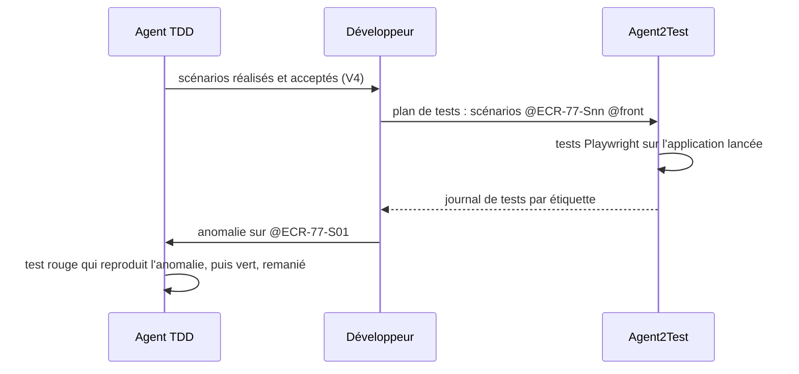

# Module `binome-agent2test` (D7, réservé)

Statut : `reserved`. En version 1.x, l'agent écrit des tests unitaires et de tranche, pas de tests de bout en bout.

## 1. Pourquoi cette dimension existe

Les tests du cycle TDD vérifient chaque couche isolément. Un scénario `@back @front` n'est pleinement vérifié que dans l'application assemblée. Agent2Test simule l'utilisateur avec Playwright à partir d'un plan de tests et produit un journal : c'est le complément naturel de cet agent, dans un binôme développement et test sous supervision humaine.

## 2. Principe prévu

## 3. Ce que préparent les points d'extension

| Point | Règle active en 1.x | Rôle dans le binôme |
|---|---|---|
| E2 | étiquettes de scénario stables `@<CLÉ>-Snn` | Agent2Test rattache chaque test de bout en bout et chaque anomalie à un scénario |
| E3 | tests unitaires et de tranche étiquetés | une anomalie de bout en bout se rapproche des tests de couche du même scénario |

## 4. Contenu prévu à l'activation

- format du plan de tests transmis à Agent2Test, compatible avec sa documentation ;
- lecture du journal de tests et conversion d'une anomalie en scénario de correction ;
- règle de notification à Agent2Test quand une correction est effective.

## 5. Test d'inertie en 1.x

Chaque scénario réalisé porte une étiquette stable, et chaque test écrit par l'agent porte cette étiquette (E2, E3).
