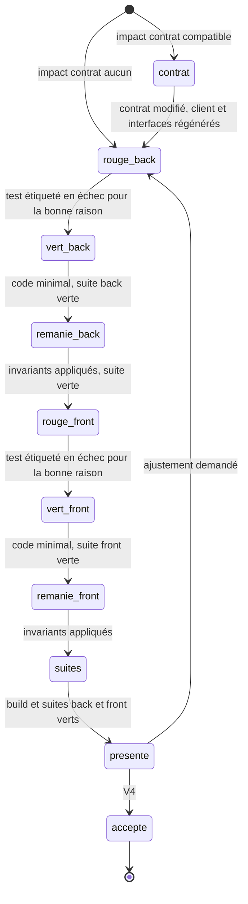

# Module `cycle-tdd` (D5)

Un scénario à la fois (D5.INV-4). Pour chaque scénario, et pour chaque couche concernée, l'agent écrit d'abord un test qui échoue pour la raison attendue, puis le code minimal qui le fait passer, puis il remanie. Le développeur accepte le scénario avant que le suivant commence.

## 1. Cycle d'un scénario



Un scénario `@back` seul s'arrête après `remanie_back` ; un scénario `@front` seul commence à `rouge_front`.

## 2. Ordre des couches (D5.INV-5)

Quand le scénario modifie le contrat : d'abord le contrat (`api/openapi.yaml`), puis la régénération des interfaces back et du client front, puis le back, puis le front. Le front teste contre le contrat (réponses simulées par `HttpTestingController`), jamais contre un back en cours d'écriture.

## 3. Rouge (D5.INV-1)

1. Écrire le test, étiqueté avec le scénario (D6.INV-2, point E3).
2. L'exécuter seul.
3. Vérifier qu'il échoue **pour la raison attendue** : une assertion du scénario, pas une erreur de configuration.

Une erreur de compilation (classe absente) est une étape, pas un rouge valable : l'agent crée la signature minimale (méthode qui renvoie une valeur vide), relance, et obtient l'échec d'assertion. Le rapport de la phase cite le message d'échec.

Back, test unitaire :

```java
@Test
@Tag("ECR-77-S02")
@DisplayName("ECR-77-S02 : le fichier commence par le BOM UTF-8 et sépare les colonnes par des points-virgules")
void exportCommenceParLeBomEtUtiliseLePointVirgule() {
    byte[] csv = FeedbackCsv.write(List.of(new FeedbackRow("REX-1", "Fuite vanne")));

    assertThat(csv).startsWith((byte) 0xEF, (byte) 0xBB, (byte) 0xBF);
    assertThat(new String(csv, StandardCharsets.UTF_8)).contains("REX-1;Fuite vanne");
}
```

```bash
./mvnw -q test -Dtest=FeedbackCsvTest          # rouge attendu : « Expecting actual … to start with … »
./mvnw -q test -Dgroups=ECR-77-S02             # tous les tests du scénario (étiquette JUnit)
```

Front, test du store :

```ts
describe('ECR-77-S01 : exporter la liste filtrée', () => {
  it("transmet le fichier reçu au service de téléchargement", () => {
    store.exportCsv();
    const req = http.expectOne(r => r.url.endsWith('/api/v1/feedbacks/export'));
    expect(req.request.method).toBe('GET');
    req.flush(new Blob(['id;titre\n'], { type: 'text/csv' }));
    expect(download.save).toHaveBeenCalledWith(jasmine.any(Blob), 'retours-experience.csv');
  });
});
```

```bash
npx ng test --no-watch --include='**/feedback.store.spec.ts'
```

## 4. Vert (D5.INV-2)

- Le code minimal qui fait passer le test, rien de plus : pas de cas non demandé par un scénario, pas d'abstraction anticipée.
- Puis la suite complète du module (back : `./mvnw verify` ; front : `npx ng test --no-watch` et `npx ng lint`). Une régression ailleurs n'est pas « hors sujet » : l'agent la traite ou la signale avant d'aller plus loin.

## 5. Remanié (D5.INV-3)

C'est à cette phase que le code rejoint les référentiels :

| Côté | Exemples de remaniement attendus |
|---|---|
| Back | DTO en `record` (`expert-java:D2.INV-1`), injection par constructeur (`expert-java:D1.INV-3`), transaction `readOnly` dans la couche application (`expert-java:D4.INV-3`), erreurs par le gestionnaire unique (`expert-java:D3.INV-3`) |
| Front | `OnPush` (`expert-angular:D2.INV-1`), état en signaux, client généré (`expert-angular:D3.INV-1`), annonce accessible (`expert-angular:D6.INV-4`) |

Règles : comportement inchangé ; suites vertes après chaque modification ; pas de remaniement d'un code qui n'est pas touché par le scénario, sauf demande.

## 6. Présenter le scénario (V4)

```markdown
## @ECR-77-S02 : encodage et séparateur du fichier

- **Critère d'acceptation** : ECR-77-CA02
- **Variante** : B1 (front non concerné)
- **Rouge** : `FeedbackCsvTest.exportCommenceParLeBomEtUtiliseLePointVirgule` en échec :
  « Expecting actual: [] to start with: [-17, -69, -65] »
- **Vert** : `FeedbackCsv.write` écrit le BOM puis les lignes séparées par « ; »
- **Remanié** : constantes extraites, `FeedbackRow` en record ; suite verte
- **Suites** : back `./mvnw verify` vert (412 tests) ; front non concerné
- **Fichiers** : FeedbackCsv.java, FeedbackRow.java, FeedbackCsvTest.java
- **Commit proposé** : « ECR-77 S02 : BOM UTF-8 et séparateur point-virgule »

Accepter ce scénario et passer au suivant ?
```

## 7. Commits

- Au moins un commit par scénario accepté, dont le message commence par la clé et le numéro du scénario (`ECR-77 S02 : …`). Si le développeur préfère un commit par phase (rouge, vert, remanié), l'agent suit sa préférence.
- L'agent commite localement après V4 si le développeur l'accepte ; il ne pousse jamais sans demande explicite.
- Les fichiers de la demande (`us.md`, `.feature`, `suivi.md`) sont commités avec le premier scénario.

## 8. Pièges connus

- **Test écrit après le code** : interdit (D5.INV-1). Si du code existe déjà pour le scénario, l'agent écrit le test, le voit passer, puis le casse volontairement (en commentant une ligne du code) pour vérifier qu'il échouerait : ce contrôle remplace le rouge, et il est mentionné tel quel dans le rapport.
- **Test qui passe du premier coup** : soit le comportement existe déjà, soit le test ne teste rien. L'agent l'analyse et le dit.
- **`fit`, `fdescribe`, `@Disabled` oubliés** : jamais dans un commit.
- **Gros pas** : si le vert demande plus de quelques dizaines de lignes, le scénario est trop gros ou le test trop large ; l'agent propose de le découper.
- **Données réelles dans les tests** : noms et données de la demande remplacés par des données fictives.

## 9. Contrôle de sortie

- Un test étiqueté a échoué pour la bonne raison avant tout code de production (D5.INV-1).
- Code minimal et suite du module verte (D5.INV-2).
- Remaniement sans changement de comportement, invariants appliqués, suites vertes (D5.INV-3).
- Scénario accepté avant le suivant (D5.INV-4).
- Ordre contrat, back, front respecté si le contrat change (D5.INV-5).
- Aucune dépendance nouvelle sans validation (D5.INV-6).
