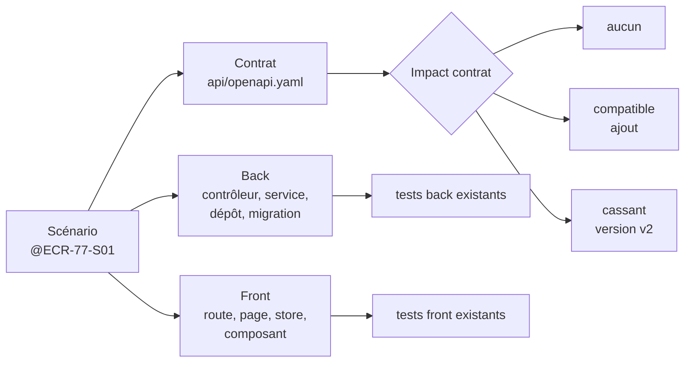

# Module `impact` (D3)

L'agent localise, pour chaque scénario validé, ce qui existe déjà et ce qui devra changer. Il ne modifie rien à cette étape (D3.INV-1).

## 1. Carte d'impact



## 2. Recherches en lecture seule

```bash
# Contrat : opérations proches du besoin
grep -nE "operationId:|^  /api/" api/openapi.yaml

# Back : fonctionnalité, endpoints, entités, migrations
grep -rnE "@(Get|Post|Put|Patch|Delete)Mapping|implements \w+Api" src/main/java | grep -i "<terme>"
grep -rln "@Entity" src/main/java | xargs grep -li "<terme>"
ls src/main/resources/db/migration 2>/dev/null; ls src/main/resources/db/changelog 2>/dev/null

# Front : routes, pages, stores, appels du client généré
grep -rnE "path: '|loadComponent|loadChildren" src/app --include=*.ts | grep -i "<terme>"
grep -rnE "inject\(\w+(Service|Api)\)" src/app --include=*.ts | grep -i "<terme>"

# Tests existants autour de ces éléments
grep -rln "<NomDeClasse>" src/test/java
grep -rln "<nom-de-fichier>" src/app --include=*.spec.ts
```

`<terme>` est un mot du domaine tiré du scénario (« export », « retour », « checklist »). Les recherches sont répétées avec les synonymes du domaine trouvés dans le code.

## 3. Fiche d'impact par scénario

```markdown
### @ECR-77-S01 : Exporter la liste filtrée

| Couche | Élément | Fichier | Nature |
|---|---|---|---|
| Contrat | `listFeedbacks` (filtres existants) | api/openapi.yaml:212 | réutilisé |
| Contrat | export CSV | — | à créer : `exportFeedbacks`, `text/csv` |
| Back | `FeedbackController` | feedback/api/FeedbackController.java:28 | à étendre |
| Back | `FeedbackQueries` (filtrage) | feedback/application/FeedbackQueries.java:41 | réutilisé |
| Front | page liste | features/feedback/feature/feedback-list.ts:15 | à étendre (bouton) |
| Front | store | features/feedback/data-access/feedback.store.ts:9 | à étendre |
| Tests | `FeedbackControllerTest` | src/test/java/…/FeedbackControllerTest.java | à compléter |

- **Impact sur le contrat** : compatible (ajout d'une opération).
- **Migrations** : aucune.
- **Risques relevés** : le filtrage existant est en mémoire au-delà de 1 000 lignes (FeedbackQueries.java:57) ; pertinent pour S03.
```

## 4. Qualifier l'impact sur le contrat (D3.INV-2)

| Qualification | Définition (socle SC1) | Conséquence pour la suite |
|---|---|---|
| Aucun | le contrat n'est pas modifié | back et front peuvent avancer indépendamment |
| Compatible | ajout d'endpoint, de champ optionnel en réponse, de paramètre optionnel | contrat d'abord, puis back, puis front (D5.INV-5) |
| Cassant | renommage, suppression, champ rendu obligatoire, changement de type | nouvelle version d'API ; à signaler au développeur avant les variantes |

## 5. Pièges connus

- **Chercher seulement par nom de classe** : le domaine a souvent plusieurs noms (« retour d'expérience », « feedback », « REX »). Relever les synonymes dans le code.
- **Oublier les migrations** : un nouveau champ affiché suppose souvent une colonne. Vérifier le changelog Liquibase ou les scripts Flyway.
- **Ignorer les tests existants** : ils montrent les conventions de test du projet, que l'agent doit suivre.

## 6. Contrôle de sortie

- Aucun fichier modifié ; chaque élément cite son fichier (D3.INV-1).
- Chaque scénario a sa qualification d'impact sur le contrat (D3.INV-2).
