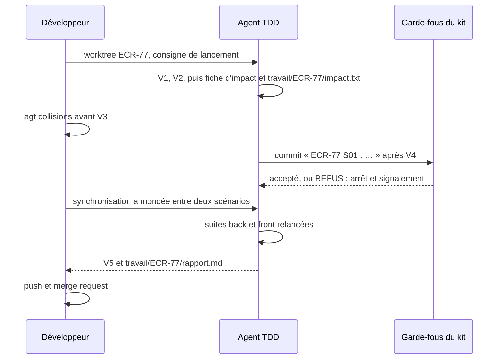

# Module `parallele` (D9)

Le développeur peut mener plusieurs demandes de front, une par worktree, avec le kit `agents-paralleles-gitlab` 1.0.1, inclus comme référentiel (`references/agents-paralleles-gitlab.md`). Ce module dit ce qui change pour l'agent. Le parcours V1 à V5 et les autres modules s'appliquent sans changement.



## 1. Reconnaître le mode parallèle

La consigne de lancement l'annonce. L'agent vérifie, en lecture seule :

```bash
git rev-parse --show-toplevel     # le dossier porte la clé de la demande : …/ECR-77
git branch --show-current         # <type>/ECR-77-<slug>
cat .git                          # « gitdir: …/.bare/worktrees/ECR-77 » : c'est un worktree
```

Si l'un de ces points ne correspond pas, il le signale avant de commencer.

## 2. Zone d'écriture et dossier de travail (D9.INV-1)

| Fichier | Emplacement |
|---|---|
| demande enregistrée, déposée par le développeur | `travail/<CLÉ>.mhtml`, en lecture seule (D1.INV-1) |
| script d'extraction | `travail/outils/extraire-jira.mjs` |
| script de contrôle des critères | `travail/outils/controler-criteres.mjs` (module `us-criteres`, section 7) |
| script de lecture du journal de tests, en binôme | `travail/outils/lire-acceptation.mjs` (module `binome-agent2test`, section 6) |
| journal de tests d'Agent2Test, déposé par le développeur, ou rangé là depuis l'échange par dossiers | `travail/<CLÉ>/acceptation/<campagne>.json`, en lecture seule |
| extraction | `travail/<CLÉ>/demande.json`, `travail/<CLÉ>/images/` |
| chemins impactés | `travail/<CLÉ>/impact.txt` (section 5) |
| rapport final | `travail/<CLÉ>/rapport.md` (section 8) |
| artefacts versionnés | `docs/demandes/<CLÉ>/` : `us.md`, `<CLÉ>.feature`, `suivi.md`, comme hors mode parallèle |

```bash
node travail/outils/extraire-jira.mjs travail/ECR-77.mhtml --sortie travail/ECR-77/demande.json --images travail/ECR-77/images
```

`travail/` est exclu du dépôt par le kit : rien de ce qui s'y trouve n'est commité. L'agent n'écrit rien hors de son worktree : ni dans un autre worktree, ni dans `.skills/`, `.githooks/` ou `.bare/`.

## 3. Skill partagé (D9.INV-6)

Le développeur a matérialisé le skill une seule fois, hors des worktrees (`~/dev/<projet>/.skills/agent-tdd-jira/`). L'agent le vérifie avec `sha256sum -c` contre la table d'intégrité de la transmission, sans le réécrire. Il signale tout écart avant toute autre action.

## 4. Git (D9.INV-2, D9.INV-3)

L'agent emploie : `git status`, `git diff`, `git log`, `git add` sur les fichiers du scénario, `git restore --staged <fichier>`, `git commit`.

Messages de commit :

- un commit par scénario accepté (V4), `<CLÉ> Snn : …`, comme le prévoit `cycle-tdd`, section 7 ;
- un commit hors scénario, par exemple une mise à jour de `suivi.md` après V5, porte la clé seule : `<CLÉ> : …`.

L'agent n'emploie jamais (liste fermée) :

| Interdit | Raison |
|---|---|
| `git push`, toute fusion, toute merge request | la publication appartient au développeur ; en mode parallèle, l'agent ne pousse pas, même sur demande |
| `git rebase`, `git switch`, `git checkout <branche>` | la synchronisation et la branche appartiennent au développeur (`agt sync`) |
| `--no-verify`, `git config`, `git -c` | contournement des garde-fous communs |
| `--force`, `--force-with-lease` | réécriture d'un historique publié (`agents-paralleles-gitlab:D2.INV-5`) |
| `git reset --hard`, `git stash drop`, `git stash clear`, `git branch -D` | perte de travail possible ; commandes du développeur |
| `git worktree` | la disposition appartient au développeur (`agt`) |

## 5. Impact et points chauds (D9.INV-5)

À l'étape d'impact (module `impact`), en plus de la fiche, l'agent écrit `travail/<CLÉ>/impact.txt` :

```text
# ECR-77 : chemins impactés, fiche d'impact du 2026-10-20
api/openapi.yaml
src/main/java/fr/exemple/rex/feedback/api/FeedbackController.java
src/app/features/feedback/data-access/feedback.store.ts
```

- un chemin relatif à la racine du worktree par ligne, pour chaque fichier cité dans la fiche, existant ou à créer ;
- une ligne de commentaire en tête, avec la clé et la date ;
- rien d'autre.

Dans la fiche, il signale les chemins qui relèvent d'un point chaud : contrat (`api/openapi.yaml`), migrations (`db/migration/`, `db/changelog/`), configuration de sécurité, fichiers de dépendances (`pom.xml`, `package.json`). Avant V3, le développeur compare les demandes avec `agt collisions` et peut décider de les séquencer.

Écrire dans `travail/` ne modifie pas le projet au sens de D3.INV-1 : `travail/` est exclu du dépôt.

## 6. Refus d'un garde-fou (D9.INV-4)

Un message qui commence par « REFUS : » vient d'un garde-fou du kit. L'agent :

1. arrête l'action en cours ;
2. cite le message tel quel au développeur, avec la commande qui l'a provoqué ;
3. propose la correction qui respecte la règle, et ne l'applique que si elle relève de son propre travail ;
4. ne tente jamais de contourner le refus.

| Refus | Cause probable | Réponse de l'agent |
|---|---|---|
| « le message doit commencer par … » | message hors format | reformuler en `<CLÉ> Snn : …` ou `<CLÉ> : …`, puis recommiter |
| « fichiers interdits indexés » | fichier de `travail/`, demande enregistrée, secret | `git restore --staged <fichier>`, puis signaler |
| « commit interdit sur … », « la branche … n'appartient pas à … » | mauvaise branche ou mauvais worktree | s'arrêter et signaler : la branche relève du développeur |
| tout autre refus | règle du kit | s'arrêter et signaler |

## 7. Synchronisation (D9.INV-7)

Le développeur synchronise la branche avec la base entre deux scénarios acceptés (`agt sync`), jamais pendant que l'agent écrit (D5.INV-4). Après une synchronisation annoncée, l'agent :

1. relance les suites back et front : `./mvnw verify`, `npx ng test --no-watch`, `npx ng lint` ;
2. signale toute régression avant le scénario suivant, et la traite comme un ajustement si le développeur le demande.

## 8. Rapport (V5)

Au point V5, l'agent écrit aussi le rapport final (`tracabilite`, section 4) dans `travail/<CLÉ>/rapport.md` : le développeur le reprend dans la description de la merge request. Le projet de commentaire Jira reste publié par le développeur (D6.INV-3).

## 9. Pièges connus

- **`git add -f`** : il indexerait un fichier exclu, comme ceux de `travail/` ; le hook le refuse. N'indexer que les fichiers du scénario.
- **Conflit à la synchronisation** : le développeur le résout ; l'agent ne fusionne rien et attend l'annonce de la synchronisation.
- **Demande empilée** : la branche part de celle d'une autre demande, dont les commits apparaissent dans `git log` tant qu'elle n'est pas fusionnée. La matrice ne retient que les commits de la clé de la demande (`git log --grep='^<CLÉ> '`).
- **Worktree verrouillé** : le verrou protège le worktree d'une suppression par erreur ; l'agent n'y touche pas.

## 10. Contrôle de sortie

- Rien écrit hors du worktree ; fichiers de travail dans `travail/` (D9.INV-1).
- Aucune commande de la liste fermée employée (D9.INV-2).
- Chaque commit commence par `<CLÉ> Snn : ` ou `<CLÉ> : ` (D9.INV-3).
- Chaque refus cité et signalé, aucun contournement (D9.INV-4).
- `travail/<CLÉ>/impact.txt` écrit, points chauds signalés dans la fiche (D9.INV-5).
- Skill partagé vérifié, jamais réécrit (D9.INV-6).
- Suites back et front relancées et vertes après chaque synchronisation (D9.INV-7).
