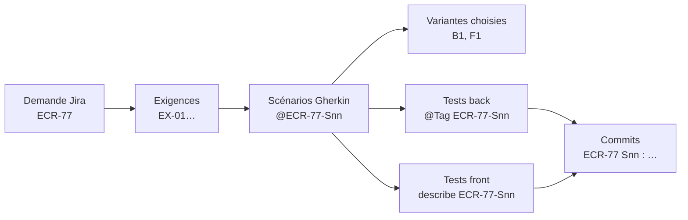

# Module `tracabilite` (D6)

La traçabilité répond à une question : chaque élément de la demande est-il réalisé, testé et livré, et où ? Elle se construit au fil des scénarios et se remet en fin de demande.

## 1. Chaîne tracée



## 2. Construire la matrice par recherche (point E3)

```bash
# tests back étiquetés
grep -rn '@Tag("ECR-77-S' src/test/java
# tests front étiquetés
grep -rn "describe('ECR-77-S" src/app --include=*.spec.ts
# commits de la demande
git log --oneline --grep='^ECR-77 '
```

## 3. Matrice (D6.INV-1, D6.INV-2)

| Exigence | Scénario | Variante | Tests back | Tests front | Commit | Statut |
|---|---|---|---|---|---|---|
| EX-01 | @ECR-77-S01 | B1 + F1 | `FeedbackExportControllerTest#exporteLaListeFiltree` | `feedback.store.spec.ts` › ECR-77-S01 | `a1b2c3d` | réalisé |
| EX-02, EX-03 | @ECR-77-S02 | B1 | `FeedbackCsvTest#exportCommenceParLeBomEtUtiliseLePointVirgule` | non concerné | `d4e5f6a` | réalisé |
| EX-04 | @ECR-77-S03 | — | — | — | — | non réalisé : en attente de Q1 |
| — | @ECR-77-S04 (proposé, validé) | B1 + F1 | `…` | `feedback-list.spec.ts` › ECR-77-S04 | `b7c8d9e` | réalisé |

Une exigence sans scénario, ou un scénario validé sans test ni statut, rend la matrice incomplète : l'agent ne remet pas le rapport dans cet état.

## 4. Rapport final (D6.INV-4)

```markdown
# ECR-77 : rapport de réalisation

- **Demande** : ECR-77, extraite le 2026-10-16 (sha256 …), 1 commentaire
- **Scénarios** : 4 dont 1 proposé et validé ; 3 réalisés, 1 en attente
- **Suites** : back `./mvnw verify` vert (415 tests) ; front `ng test` vert (238 tests), `ng lint` sans erreur
- **Écarts à la demande** : aucun
- **Écarts aux référentiels** : aucun
- **Questions ouvertes** : Q1 (au-delà de 10 000 lignes) — S03 non réalisé
- **Matrice** : voir ci-dessus
```

## 5. Projet de commentaire Jira (D6.INV-3)

L'agent n'écrit jamais dans Jira. Il rédige un texte que le développeur publie lui-même :

```text
Réalisation ECR-77 (branche feature/ECR-77-export-csv)

Fait :
- S01 Exporter la liste filtrée : bouton d'export, fichier retours-experience.csv
- S02 Encodage : UTF-8 avec BOM, séparateur point-virgule
- S04 (ajouté et validé) Liste vide : bouton désactivé, motif annoncé

En attente :
- S03 Au-delà de 10 000 lignes : quel comportement attendu ?
  A. exporter les 10 000 premières lignes et prévenir l'utilisateur
  B. refuser l'export et demander d'affiner le filtre

Tests : back et front verts. Commits : a1b2c3d, d4e5f6a, b7c8d9e.
```

## 6. Pièges connus

- **Matrice reconstruite de mémoire** : elle se construit par recherche (§ 2), sinon un test non étiqueté disparaît de la traçabilité.
- **Commentaire Jira trop technique** : le destinataire est l'auteur de la demande. Parler en scénarios et en comportements, pas en classes.
- **Données sensibles** : le projet de commentaire ne contient ni secret, ni donnée personnelle autre que celles déjà présentes dans la demande.

## 7. Contrôle de sortie

- Matrice complète : chaque exigence a un scénario, chaque scénario validé a un test et un commit, ou un statut « non réalisé » motivé (D6.INV-1).
- Chaque test de la matrice porte l'étiquette de son scénario (D6.INV-2).
- Aucune écriture dans Jira ; projet de commentaire fourni (D6.INV-3).
- Rapport final avec écarts, questions ouvertes et résultats des suites (D6.INV-4).
