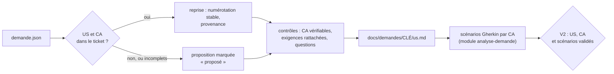

# Module `us-criteres` (D10)

Les critères d'acceptation (CA) sont la définition de « terminé » vue par l'auteur de la demande. L'agent les établit avant les scénarios : chaque scénario Gherkin illustre un ou plusieurs CA, et un test d'acceptation vérifiera un CA (point E4).

Chaîne tracée : demande → US → CA → scénarios Gherkin → tests → commits.



## 1. Trouver les US et les CA dans la demande

Sources dans `demande.json` :

| Source | Indices |
|---|---|
| champs complémentaires (`champsComplementaires`) | libellés « Critères d'acceptation », « Acceptance criteria », « User story » |
| description | « En tant que … je veux … afin de … » ; titres « Critères d'acceptation », « CA », « AC » et listes numérotées sous ces titres ; « Étant donné, Quand, Alors » ou « Given, When, Then » |
| commentaires | ajout ou correction d'un CA par l'auteur ou par le PO, lus dans l'ordre chronologique (module `analyse-demande`, section 3) |

Un CA repris garde sa formulation. Sa numérotation d'origine (« US2, CA1 ») est conservée comme provenance.

Si le ticket ne contient ni US ni CA, l'agent propose une US à partir de la description et des CA à partir des exigences, tous marqués « proposé » (D10.INV-2).

## 2. Identifiants (D10.INV-1)

- US : `<CLÉ>-USnn` ; CA : `<CLÉ>-CAnn`. L'agent les numérote dans l'ordre d'apparition, sur toute la demande.
- Un CA appartient à une seule US.
- Jamais renumérotés : un CA retiré garde son numéro, avec le statut « retiré : <raison> » ; un CA ajouté prend le numéro suivant.
- Les scénarios reprennent l'identifiant en étiquette : `@ECR-77-CA02`.

## 3. Fichier `docs/demandes/<CLÉ>/us.md`

Versionné avec les autres fichiers de la demande, et commité avec le premier scénario (module `cycle-tdd`, section 7). Exemple, après la validation V2 :

```markdown
# ECR-77 : US et critères d'acceptation

## ECR-77-US01 : exporter la liste des retours d'expérience

En tant qu'utilisateur de la liste des retours d'expérience, je veux exporter la liste filtrée en CSV, afin de l'exploiter dans un tableur.
Provenance : description.

| CA | Énoncé | Origine | Provenance | Statut | Scénarios |
|---|---|---|---|---|---|
| ECR-77-CA01 | le fichier contient la ligne d'en-tête et exactement les lignes de la liste filtrée | repris | description, phrase 1 | validé | S01 |
| ECR-77-CA02 | le fichier est encodé en UTF-8 avec BOM, colonnes séparées par des points-virgules | repris | description, phrase 2 | validé | S02 |
| ECR-77-CA03 | l'export est limité à 10 000 lignes | repris | commentaire 50001, Jeanne Dupont, 2026-10-10 | en attente de Q1 | S03 |
| ECR-77-CA04 | quand la liste filtrée est vide, le bouton d'export est désactivé et son motif est annoncé | proposé | réponse du développeur, V2 | validé | S04 |

## Exigences

| ID | Exigence | Provenance | CA |
|---|---|---|---|
| EX-01 | un bouton exporte la liste filtrée en CSV | description, phrase 1 | ECR-77-CA01 |
| EX-02 | encodage UTF-8 avec BOM | description, phrase 2 | ECR-77-CA02 |
| EX-03 | séparateur point-virgule | description, phrase 2 | ECR-77-CA02 |
| EX-04 | export limité à 10 000 lignes | commentaire 50001, Jeanne Dupont, 2026-10-10 | ECR-77-CA03 |
```

Statuts d'un CA : `à valider`, `validé`, `en attente de Qn`, `retiré : <raison>`. La colonne « Scénarios » liste les scénarios qui portent l'étiquette du CA.

La section « Exigences » consigne le tableau des exigences de l'analyse (module `analyse-demande`, section 2) et leur rattachement : un ou plusieurs CA, ou une question `Qn` (D10.INV-4).

## 4. Contrôles avant V2 (D10.INV-2 à D10.INV-4)

Le script de la section 7 automatise la plupart de ces contrôles ; la reformulation d'un CA et les questions restent du ressort de l'agent.

| Contrôle | Si le contrôle échoue |
|---|---|
| chaque CA énonce un résultat observable : un état, une valeur, un message, un fichier | reformulation proposée, ou question |
| aucun CA n'est contredit par un commentaire | question (D2.INV-2) |
| chaque exigence `EX-nn` est rattachée à au moins un CA | CA proposé, ou question |
| chaque US a au moins un CA | CA proposé |
| chaque US ou CA absent du ticket est marqué « proposé » | correction avant V2 |

## 5. Déclinaison en scénarios (D10.INV-5)

Chaque CA validé est illustré par au moins un scénario Gherkin, écrit selon le module `analyse-demande`, section 5. Chaque scénario porte, en plus de sa propre étiquette, celle du ou des CA qu'il illustre :

```gherkin
  # CA : ECR-77-CA02 ; source : EX-02, EX-03 (description, phrase 2)
  @ECR-77-S02 @ECR-77-CA02 @back
  Scénario: Encodage et séparateur du fichier
    Quand je demande l'export CSV de la liste
    Alors le fichier commence par la marque d'ordre des octets UTF-8
    Et les colonnes sont séparées par des points-virgules
```

Les tests restent étiquetés avec leur scénario (point E3) : le lien vers le CA passe par le fichier Gherkin.

## 6. Prêt pour la réalisation (D10.INV-6)

Un CA entre en réalisation (V3, puis V4) quand il est validé, qu'il est décliné en scénarios validés et qu'aucune question ouverte ne le concerne. Sinon, ses scénarios restent « non réalisé : en attente de Qn » dans la matrice (module `tracabilite`), et les autres CA avancent.

Présentation au point V2, avec le tableau des exigences, les questions et le fichier Gherkin (module `analyse-demande`, section 7) :

```markdown
## V2 : US, critères d'acceptation et scénarios

- **US** : 1 (ECR-77-US01)
- **CA** : 4, dont 1 proposé (CA04)
- **Exigences** : EX-01 à EX-04, toutes rattachées à un CA
- **Questions** : Q1, qui concerne CA03
- **Prêts pour la réalisation** : CA01, CA02, CA04 ; CA03 en attente de Q1

Valider les US, les critères d'acceptation et les scénarios ?
```

## 7. Contrôler par script

L'agent écrit ce script dans son dossier de travail (par exemple `outils/controler-criteres.mjs`), à l'identique, et le lance :

- avant de présenter V2, puis après chaque modification de `us.md` ou du fichier Gherkin ; la deuxième ligne de sa sortie donne les CA prêts pour la réalisation (section 6) ;
- avant V5, avec `--depuis` sur le commit qui a ajouté `us.md`, pour vérifier qu'aucun identifiant n'a été renuméroté depuis.

Un écart se corrige avant de continuer, ou devient une question au développeur. Le script ne modifie aucun fichier. Il n'a besoin que de Node.js 20 ou plus récent, et de git pour `--depuis`.

```bash
node outils/controler-criteres.mjs docs/demandes/ECR-77
node outils/controler-criteres.mjs docs/demandes/ECR-77 --depuis "$(git log --diff-filter=A --format=%h -- docs/demandes/ECR-77/us.md | tail -n 1)"
```

```js
#!/usr/bin/env node
// Contrôle des US et des critères d'acceptation d'une demande (dimension D10 du skill agent-tdd-jira).
// Usage : node controler-criteres.mjs <dossier de la demande> [--depuis <révision git>]
//   <dossier>  par exemple docs/demandes/ECR-77, qui contient us.md et ECR-77.feature ;
//   --depuis   compare aussi les identifiants à ceux de us.md dans une révision git antérieure.
// Node 20 ou plus récent, modules natifs uniquement. Le script ne modifie aucun fichier.
import { execFileSync } from 'node:child_process';
import { existsSync, readFileSync } from 'node:fs';
import { basename, join, relative, resolve, sep } from 'node:path';

const args = process.argv.slice(2);
const option = (nom) => { const i = args.indexOf(nom); return i >= 0 ? args[i + 1] : undefined; };
const dossier = args[0];
if (!dossier || dossier.startsWith('--')) {
  console.error('Usage : node controler-criteres.mjs <dossier de la demande> [--depuis <révision git>]');
  process.exit(2);
}
const cle = basename(resolve(dossier));
if (!/^[A-Z][A-Z0-9_]+-\d+$/.test(cle)) {
  console.error(`Le dossier doit porter la clé de la demande (par exemple docs/demandes/ECR-77) : ${cle}`);
  process.exit(2);
}
const cheminUs = join(dossier, 'us.md');
const cheminFeature = join(dossier, `${cle}.feature`);
for (const chemin of [cheminUs, cheminFeature]) {
  if (!existsSync(chemin)) { console.error(`Fichier absent : ${chemin}`); process.exit(2); }
}

const ecarts = [];
const ecart = (invariant, message) => ecarts.push(`${invariant} : ${message}`);
const numero = (id) => Number(/(\d+)$/.exec(id)[1]);
const court = (id) => id.slice(cle.length + 1);
const liste = (valeur) => valeur.split(/[,;]\s*/).map((v) => v.trim()).filter((v) => v && v !== '—');
const ID_US = new RegExp(`^${cle}-US\\d{2,}$`);
const ID_CA = new RegExp(`^${cle}-CA\\d{2,}$`);
const ETIQUETTE_S = new RegExp(`^@${cle}-S\\d{2,}$`);
const ETIQUETTE_CA = new RegExp(`^@${cle}-CA\\d{2,}$`);
const STATUT = /^(à valider|validé|en attente de Q\d+(, Q\d+)*|retiré : \S.*)$/;
const VAGUE = /\b(fonctionne(nt)? correctement|correctement|rapidement|facilement|intuiti(f|ve)s?|conviviale?s?|ergonomiques?|optimale?s?|optimaux)\b/i;
const vague = (texte) => VAGUE.test(texte) || (/\brapides?\b/i.test(texte) && !/\d/.test(texte));

// Tableaux Markdown d'un texte : en-têtes et lignes, indexées par en-tête.
function tableaux(texte) {
  const resultat = [];
  const lignes = texte.split('\n');
  const cellules = (ligne) => ligne.split('|').slice(1, -1).map((c) => c.trim());
  for (let i = 0; i < lignes.length; i++) {
    if (!lignes[i].startsWith('|') || !/^\|[\s|:-]+\|$/.test(lignes[i + 1] ?? '')) continue;
    const entetes = cellules(lignes[i]);
    const rangs = [];
    let j = i + 2;
    for (; j < lignes.length && lignes[j].startsWith('|'); j++) {
      const c = cellules(lignes[j]);
      rangs.push(Object.fromEntries(entetes.map((e, k) => [e, c[k] ?? ''])));
    }
    resultat.push({ entetes, rangs });
    i = j - 1;
  }
  return resultat;
}

// us.md : une section « ## <CLÉ>-USnn : titre » par US, avec sa ligne « Provenance : » et son
// tableau de critères ; une section « ## Exigences » avec le rattachement de chaque exigence.
function lireUs(texte) {
  const us = new Map();
  const criteres = new Map();
  const doublons = [];
  const exigences = [];
  for (const section of texte.split(/^(?=## )/m)) {
    const titre = /^## (.+?)\s*$/m.exec(section)?.[1] ?? '';
    const idUs = /^(\S+) : /.exec(titre)?.[1];
    if (idUs && ID_US.test(idUs)) {
      if (us.has(idUs)) doublons.push(idUs);
      us.set(idUs, { provenance: /^Provenance\s*:\s*(.*)$/m.exec(section)?.[1].trim() ?? '' });
      for (const tableau of tableaux(section)) {
        if (tableau.entetes[0] !== 'CA') continue;
        for (const r of tableau.rangs) {
          if (criteres.has(r.CA)) doublons.push(r.CA);
          criteres.set(r.CA, {
            us: idUs, enonce: r['Énoncé'] ?? '', origine: r.Origine ?? '', provenance: r.Provenance ?? '',
            statut: r.Statut ?? '', scenarios: r['Scénarios'] ?? '',
          });
        }
      }
    } else if (/^Exigences\b/.test(titre)) {
      for (const tableau of tableaux(section)) exigences.push(...tableau.rangs);
    }
  }
  return { us, criteres, doublons, exigences };
}

// Fichier Gherkin : chaque scénario avec ses étiquettes et ses étapes.
function lireFeature(texte) {
  const scenarios = [];
  let etiquettes = [];
  let courant = null;
  texte.split('\n').forEach((brute, i) => {
    const ligne = brute.trim();
    if (ligne.startsWith('@')) { etiquettes.push(...ligne.split(/\s+/).filter((e) => e.startsWith('@'))); return; }
    if (ligne === '' || ligne.startsWith('#')) return;
    const m = /^(Scénario|Exemple|Plan du [sS]cénario)\s*:\s*(.*)$/.exec(ligne);
    if (m) {
      courant = { ligne: i + 1, titre: m[2], etiquettes, alors: [] };
      scenarios.push(courant);
    } else if (/^(Fonctionnalité|Règle|Contexte|Exemples)\s*:/.test(ligne)) {
      courant = null;
    } else if (courant && /^Alors\b/.test(ligne)) {
      courant.alors.push(ligne);
    }
    etiquettes = [];
  });
  return scenarios;
}

const { us, criteres, doublons, exigences } = lireUs(readFileSync(cheminUs, 'utf8'));
const scenarios = lireFeature(readFileSync(cheminFeature, 'utf8'));

// D10.INV-1 : identifiants.
if (us.size === 0) ecart('D10.INV-1', `aucune US ${cle}-USnn dans us.md`);
for (const id of new Set(doublons)) ecart('D10.INV-1', `${id} est défini plusieurs fois dans us.md`);
for (const id of criteres.keys()) if (!ID_CA.test(id)) ecart('D10.INV-1', `identifiant de critère mal formé : ${id} (attendu ${cle}-CAnn)`);

// D10.INV-2, D10.INV-3 : provenance, origine, énoncé vérifiable ; statuts connus.
for (const [id, u] of us) if (!u.provenance) ecart('D10.INV-2', `${id} sans ligne « Provenance : »`);
for (const [id, c] of criteres) {
  if (!['repris', 'proposé'].includes(c.origine)) ecart('D10.INV-2', `${id} : origine « ${c.origine} », attendu « repris » ou « proposé »`);
  if (!c.provenance || c.provenance === '—') ecart('D10.INV-2', `${id} sans provenance`);
  if (!c.enonce) ecart('D10.INV-3', `${id} sans énoncé`);
  else if (vague(c.enonce)) ecart('D10.INV-3', `${id} : énoncé non vérifiable (« ${c.enonce} ») ; le reformuler en résultat observable, ou poser une question`);
  if (!STATUT.test(c.statut)) ecart('D10.INV-6', `${id} : statut « ${c.statut} » inconnu (à valider, validé, en attente de Qn, retiré : raison)`);
}

// D10.INV-4 : chaque exigence est rattachée à un critère de us.md ou à une question.
if (exigences.length === 0) ecart('D10.INV-4', 'section « Exigences » absente ou vide dans us.md');
for (const e of exigences) {
  const liens = liste(e.CA ?? '');
  if (liens.length === 0) ecart('D10.INV-4', `${e.ID} n'est rattachée à aucun critère ni à aucune question`);
  for (const l of liens) if (!criteres.has(l) && !/^Q\d+$/.test(l)) ecart('D10.INV-4', `${e.ID} cite ${l}, absent de us.md`);
}

// D2.INV-3 et D10.INV-5 : une étiquette de scénario, au moins une étiquette de critère, une étape Alors.
const parId = new Map();
const parCritere = new Map();
for (const s of scenarios) {
  const ids = s.etiquettes.filter((e) => ETIQUETTE_S.test(e)).map((e) => e.slice(1));
  s.id = ids[0];
  const nom = s.id ?? `scénario ligne ${s.ligne} (« ${s.titre} »)`;
  if (ids.length !== 1) ecart('D2.INV-3', `${nom} : ${ids.length} étiquette(s) @${cle}-Snn, une seule attendue`);
  if (s.id && parId.has(s.id)) ecart('D2.INV-3', `${s.id} étiquette deux scénarios (lignes ${parId.get(s.id).ligne} et ${s.ligne})`);
  if (s.id) parId.set(s.id, s);
  if (s.alors.length === 0) ecart('D2.INV-3', `${nom} sans étape Alors`);
  for (const a of s.alors) if (vague(a)) ecart('D2.INV-3', `${nom} : étape non vérifiable (« ${a} »)`);
  const cas = s.etiquettes.filter((e) => ETIQUETTE_CA.test(e)).map((e) => e.slice(1));
  if (cas.length === 0) ecart('D10.INV-5', `${nom} n'illustre aucun critère : étiquette @${cle}-CAnn absente`);
  for (const c of cas) {
    if (!criteres.has(c)) ecart('D10.INV-5', `${nom} cite ${c}, absent de us.md`);
    else if (criteres.get(c).statut.startsWith('retiré')) ecart('D10.INV-5', `${nom} illustre ${c}, retiré`);
    if (!parCritere.has(c)) parCritere.set(c, []);
    parCritere.get(c).push(s);
  }
}

// D10.INV-5 à D10.INV-7 : couverture, colonne « Scénarios » de us.md, critères en attente, critères prêts.
const prets = [];
const enAttente = [];
for (const [id, c] of criteres) {
  const lies = parCritere.get(id) ?? [];
  if (c.statut === 'validé' && lies.length === 0) ecart('D10.INV-5', `${id} est validé mais aucun scénario ne l'illustre`);
  if (!c.statut.startsWith('retiré')) {
    const annonces = liste(c.scenarios).map((s) => (s.startsWith(`${cle}-`) ? s : `${cle}-${s}`)).sort();
    const trouves = lies.map((s) => s.id).filter(Boolean).sort();
    if (annonces.join(',') !== trouves.join(',')) {
      const annonce = annonces.length ? `us.md annonce ${annonces.map(court).join(', ')}` : "us.md n'annonce aucun scénario";
      const donne = trouves.length ? `le fichier Gherkin donne ${trouves.map(court).join(', ')}` : "le fichier Gherkin n'en donne aucun";
      ecart('D10.INV-7', `${id} : ${annonce}, ${donne}`);
    }
  }
  if (c.statut.startsWith('en attente')) {
    enAttente.push(`${court(id)} (${c.statut.slice('en attente de '.length)})`);
    for (const s of lies) if (!s.etiquettes.includes('@en-attente')) ecart('D10.INV-6', `${s.id ?? `ligne ${s.ligne}`} illustre ${id}, ${c.statut}, sans l'étiquette @en-attente`);
  }
  if (c.statut === 'validé' && lies.length > 0 && lies.every((s) => !s.etiquettes.includes('@en-attente') && !s.etiquettes.includes('@propose'))) {
    prets.push(court(id));
  }
}

// D10.INV-1, avec --depuis : aucun identifiant disparu ni déplacé, un nouveau critère prend le numéro suivant.
const depuis = option('--depuis');
if (depuis) {
  let ancien = null;
  try {
    const chemin = relative(process.cwd(), resolve(cheminUs)).split(sep).join('/');
    ancien = execFileSync('git', ['show', `${depuis}:./${chemin}`], { encoding: 'utf8', stdio: ['ignore', 'pipe', 'ignore'] });
  } catch {
    ancien = null;
  }
  if (ancien === null) {
    console.log(`info  us.md absent de la révision ${depuis} : pas de comparaison`);
  } else {
    const avant = lireUs(ancien);
    for (const id of avant.us.keys()) if (!us.has(id)) ecart('D10.INV-1', `${id} existait dans ${depuis} et a disparu`);
    for (const [id, c] of avant.criteres) {
      if (!criteres.has(id)) ecart('D10.INV-1', `${id} existait dans ${depuis} et a disparu : un critère retiré garde son numéro, au statut « retiré : raison »`);
      else if (criteres.get(id).us !== c.us) ecart('D10.INV-1', `${id} est passé de ${c.us} à ${criteres.get(id).us}`);
    }
    const dernier = Math.max(0, ...[...avant.criteres.keys()].filter((id) => ID_CA.test(id)).map(numero));
    for (const id of criteres.keys()) {
      if (!avant.criteres.has(id) && ID_CA.test(id) && numero(id) <= dernier) {
        ecart('D10.INV-1', `${id} est nouveau mais ne prend pas le numéro suivant (dernier numéro dans ${depuis} : CA${String(dernier).padStart(2, '0')})`);
      }
    }
  }
}

const compte = (filtre) => [...criteres.values()].filter(filtre).length;
console.log(`${cle} : ${us.size} US, ${criteres.size} critères (${compte((c) => c.statut === 'validé')} validés, ` +
  `${compte((c) => c.statut.startsWith('en attente'))} en attente, ${compte((c) => c.statut === 'à valider')} à valider, ` +
  `${compte((c) => c.statut.startsWith('retiré'))} retirés), ${scenarios.length} scénarios, ${exigences.length} exigences`);
console.log(`prêts pour la réalisation : ${prets.join(', ') || 'aucun'}${enAttente.length ? ` ; en attente : ${enAttente.join(', ')}` : ''}`);
for (const e of ecarts) console.log(`ÉCART  ${e}`);
console.log(ecarts.length ? `${ecarts.length} écart(s)` : 'aucun écart');
process.exit(ecarts.length ? 1 : 0);
```

Sortie sur l'exemple de la section 3 :

```text
ECR-77 : 1 US, 4 critères (3 validés, 1 en attente, 0 à valider, 0 retirés), 4 scénarios, 4 exigences
prêts pour la réalisation : CA01, CA02, CA04 ; en attente : CA03 (Q1)
aucun écart
```

Ce que contrôle le script :

| Contrôle | Invariant |
|---|---|
| identifiants `<CLÉ>-USnn` et `<CLÉ>-CAnn` bien formés et uniques, chaque CA dans une seule US ; avec `--depuis`, aucun identifiant disparu ni changé d'US, et un CA nouveau prend le numéro suivant | D10.INV-1 |
| provenance de chaque US et de chaque CA ; origine `repris` ou `proposé` | D10.INV-2 |
| énoncé présent, sans formulation invérifiable (« correctement », « facilement », « rapide » sans seuil…) | D10.INV-3 |
| chaque exigence rattachée à un CA de `us.md` ou à une question `Qn` | D10.INV-4 |
| chaque CA validé illustré par au moins un scénario ; chaque scénario étiqueté d'au moins un CA existant et non retiré | D10.INV-5 |
| statut connu ; scénarios d'un CA en attente étiquetés `@en-attente` ; CA prêts : validés, illustrés par des scénarios sans `@en-attente` ni `@propose` | D10.INV-6 |
| colonne « Scénarios » de `us.md` identique aux étiquettes du fichier Gherkin | D10.INV-7 |
| une étiquette `@<CLÉ>-Snn` par scénario, unique dans le fichier ; au moins une étape `Alors`, sans formulation invérifiable | D2.INV-3 |

## 8. Pièges connus

- **CA technique** : « l'API renvoie 200 » n'est pas un CA de l'auteur de la demande. Le reformuler en résultat observable ; la règle technique relève de la variante (module `variantes`).
- **Scénario déguisé en CA** : un « Étant donné, Quand, Alors » dans le ticket est déjà un exemple. En tirer le CA, c'est-à-dire la règle, et garder l'exemple comme scénario, avec la même provenance.
- **Renumérotation** : jamais, même après un retrait (D10.INV-1).
- **US sans bénéfice** : si le « afin de » manque, l'agent pose la question au lieu de l'inventer.

## 9. Contrôle de sortie

- Identifiants d'US et de CA stables, chaque CA dans une seule US (D10.INV-1).
- Provenance, ou marque « proposé », pour chaque US et chaque CA (D10.INV-2).
- CA vérifiables ; ambiguïtés et contradictions transformées en questions (D10.INV-3).
- Chaque exigence rattachée à un CA ou à une question (D10.INV-4).
- Chaque CA validé décliné en scénarios ; chaque scénario étiqueté d'au moins un CA (D10.INV-5).
- CA prêts pour la réalisation identifiés à V2 (D10.INV-6).
- Matrice et rapport final par CA, construits dans le module `tracabilite` (D10.INV-7).
- `controler-criteres.mjs` sans écart avant V2, puis avant V5 avec `--depuis` (section 7).
