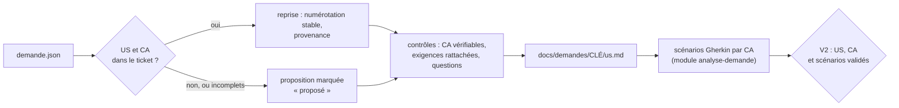

# Module `us-criteres` (D10)

Les critères d'acceptation (CA) sont la définition de « terminé » vue par l'auteur de la demande. L'agent les établit avant les scénarios : chaque scénario Gherkin illustre un ou plusieurs CA, et un test d'acceptation vérifiera un CA (point E4).

Chaîne tracée : demande → US → CA → scénarios Gherkin → tests → commits.



## 1. Trouver les US et les CA dans la demande

Sources dans `demande.json` :

| Source | Indices |
|---|---|
| champs complémentaires (`champsComplementaires`) | libellés « Critères d'acceptation », « Acceptance criteria », « User story » |
| description | « En tant que … je veux … afin de … » ; titres « Critères d'acceptation », « CA », « AC » et listes numérotées sous ces titres ; « Étant donné, Quand, Alors » ou « Given, When, Then » |
| commentaires | ajout ou correction d'un CA par l'auteur ou par le PO, lus dans l'ordre chronologique (module `analyse-demande`, section 3) |

Un CA repris garde sa formulation. Sa numérotation d'origine (« US2, CA1 ») est conservée comme provenance.

Si le ticket ne contient ni US ni CA, l'agent propose une US à partir de la description et des CA à partir des exigences, tous marqués « proposé » (D10.INV-2).

## 2. Identifiants (D10.INV-1)

- US : `<CLÉ>-USnn` ; CA : `<CLÉ>-CAnn`. L'agent les numérote dans l'ordre d'apparition, sur toute la demande.
- Un CA appartient à une seule US.
- Jamais renumérotés : un CA retiré garde son numéro, avec le statut « retiré » et sa raison ; un CA ajouté prend le numéro suivant.
- Les scénarios reprennent l'identifiant en étiquette : `@ECR-77-CA02`.

## 3. Fichier `docs/demandes/<CLÉ>/us.md`

Versionné avec les autres fichiers de la demande, et commité avec le premier scénario (module `cycle-tdd`, section 7). Exemple, après la validation V2 :

```markdown
# ECR-77 : US et critères d'acceptation

## ECR-77-US01 : exporter la liste des retours d'expérience

En tant qu'utilisateur de la liste des retours d'expérience, je veux exporter la liste filtrée en CSV, afin de l'exploiter dans un tableur.
Provenance : description.

| CA | Énoncé | Origine | Provenance | Statut | Scénarios |
|---|---|---|---|---|---|
| ECR-77-CA01 | le fichier contient la ligne d'en-tête et exactement les lignes de la liste filtrée | repris | description, phrase 1 | validé | S01 |
| ECR-77-CA02 | le fichier est encodé en UTF-8 avec BOM, colonnes séparées par des points-virgules | repris | description, phrase 2 | validé | S02 |
| ECR-77-CA03 | l'export est limité à 10 000 lignes | repris | commentaire 50001, Jeanne Dupont, 2026-10-10 | en attente de Q1 | S03 |
| ECR-77-CA04 | quand la liste filtrée est vide, le bouton d'export est désactivé et son motif est annoncé | proposé | réponse du développeur, V2 | validé | S04 |
```

Statuts d'un CA : `à valider`, `validé`, `en attente de Qn`, `retiré`.

## 4. Contrôles avant V2 (D10.INV-2 à D10.INV-4)

| Contrôle | Si le contrôle échoue |
|---|---|
| chaque CA énonce un résultat observable : un état, une valeur, un message, un fichier | reformulation proposée, ou question |
| aucun CA n'est contredit par un commentaire | question (D2.INV-2) |
| chaque exigence `EX-nn` est rattachée à au moins un CA | CA proposé, ou question |
| chaque US a au moins un CA | CA proposé |
| chaque US ou CA absent du ticket est marqué « proposé » | correction avant V2 |

## 5. Déclinaison en scénarios (D10.INV-5)

Chaque CA validé est illustré par au moins un scénario Gherkin, écrit selon le module `analyse-demande`, section 5. Chaque scénario porte, en plus de sa propre étiquette, celle du ou des CA qu'il illustre :

```gherkin
  # CA : ECR-77-CA02 ; source : EX-02, EX-03 (description, phrase 2)
  @ECR-77-S02 @ECR-77-CA02 @back
  Scénario: Encodage et séparateur du fichier
    Quand je demande l'export CSV de la liste
    Alors le fichier commence par la marque d'ordre des octets UTF-8
    Et les colonnes sont séparées par des points-virgules
```

Les tests restent étiquetés avec leur scénario (point E3) : le lien vers le CA passe par le fichier Gherkin.

## 6. Prêt pour la réalisation (D10.INV-6)

Un CA entre en réalisation (V3, puis V4) quand il est validé, qu'il est décliné en scénarios validés et qu'aucune question ouverte ne le concerne. Sinon, ses scénarios restent « non réalisé : en attente de Qn » dans la matrice (module `tracabilite`), et les autres CA avancent.

Présentation au point V2, avec le tableau des exigences, les questions et le fichier Gherkin (module `analyse-demande`, section 7) :

```markdown
## V2 : US, critères d'acceptation et scénarios

- **US** : 1 (ECR-77-US01)
- **CA** : 4, dont 1 proposé (CA04)
- **Exigences** : EX-01 à EX-04, toutes rattachées à un CA
- **Questions** : Q1, qui concerne CA03
- **Prêts pour la réalisation** : CA01, CA02, CA04 ; CA03 en attente de Q1

Valider les US, les critères d'acceptation et les scénarios ?
```

## 7. Pièges connus

- **CA technique** : « l'API renvoie 200 » n'est pas un CA de l'auteur de la demande. Le reformuler en résultat observable ; la règle technique relève de la variante (module `variantes`).
- **Scénario déguisé en CA** : un « Étant donné, Quand, Alors » dans le ticket est déjà un exemple. En tirer le CA, c'est-à-dire la règle, et garder l'exemple comme scénario, avec la même provenance.
- **Renumérotation** : jamais, même après un retrait (D10.INV-1).
- **US sans bénéfice** : si le « afin de » manque, l'agent pose la question au lieu de l'inventer.

## 8. Contrôle de sortie

- Identifiants d'US et de CA stables, chaque CA dans une seule US (D10.INV-1).
- Provenance, ou marque « proposé », pour chaque US et chaque CA (D10.INV-2).
- CA vérifiables ; ambiguïtés et contradictions transformées en questions (D10.INV-3).
- Chaque exigence rattachée à un CA ou à une question (D10.INV-4).
- Chaque CA validé décliné en scénarios ; chaque scénario étiqueté d'au moins un CA (D10.INV-5).
- CA prêts pour la réalisation identifiés à V2 (D10.INV-6).
- Matrice et rapport final par CA, construits dans le module `tracabilite` (D10.INV-7).
