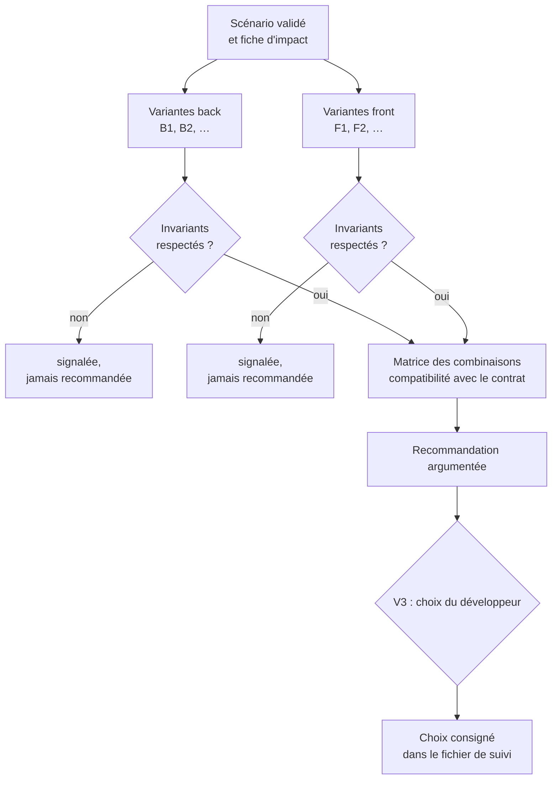

# Module `variantes` (D4)

Pour chaque scénario validé, l'agent propose plusieurs façons de le réaliser, côté back et côté front, et laisse le développeur choisir. Le choix est consigné avant toute écriture de code (D4.INV-3).

## 1. Déroulé par scénario



## 2. Fiche de variante

Chaque variante est décrite avec les mêmes rubriques, pour que la comparaison soit directe :

| Rubrique | Contenu |
|---|---|
| Principe | en deux ou trois phrases |
| Éléments touchés | fichiers et classes, d'après la fiche d'impact |
| Contrat | aucun changement, ajout compatible, ou changement cassant |
| Invariants engagés | identifiants des référentiels et du socle (`expert-java:D3.INV-4`, `SC4.INV-1`) ; violation éventuelle en clair |
| Tests prévus | niveaux de test (unitaire, tranche web, tranche données, store, composant) |
| Effort | `S`, `M`, `L` |
| Risques | techniques et fonctionnels |
| Réversibilité | facile, moyenne, difficile |

## 3. Exemple : `@ECR-77-S01`, exporter la liste filtrée

### Back

**B1 : endpoint d'export qui produit le CSV en flux**
- Principe : nouvelle opération `exportFeedbacks` (réponse `text/csv`), mêmes filtres que la liste ; le contrôleur écrit le CSV en flux.
- Contrat : ajout compatible.
- Invariants : `expert-java:D3.INV-1` (opération ajoutée au contrat), `expert-java:D3.INV-2` (filtres validés), `expert-java:D4.INV-3` (lecture `readOnly` dans la couche application), `SC4.INV-2` (endpoint protégé).
- Tests : unitaire sur l'écriture CSV ; tranche web sur l'opération (type de contenu, en-tête de téléchargement, 401 anonyme).
- Effort : M. Risques : volume (voir S03). Réversibilité : facile.

**B2 : renvoyer toute la liste en JSON, le front fabrique le CSV**
- Principe : nouvelle opération qui renvoie toutes les lignes filtrées, sans pagination.
- Contrat : ajout compatible.
- Invariants : **viole** `expert-java:D3.INV-4` et `SC3.INV-3` (collection non paginée, sans taille maximale).
- **Non recommandée** : signalée pour information (D4.INV-2).

**B3 : génération asynchrone et lien de téléchargement**
- Principe : une tâche produit le fichier, le front interroge son état puis télécharge.
- Contrat : ajout compatible (deux opérations).
- Invariants : respectés.
- Effort : L. Risques : complexité disproportionnée pour 10 000 lignes au plus (EX-04). Réversibilité : moyenne.

### Front

**F1 : bouton qui appelle le client généré et déclenche le téléchargement**
- Principe : le contrat déclare la réponse `text/csv` en `format: binary` ; le client généré renvoie un `Blob` ; le store le transmet à un service de téléchargement.
- Invariants : `expert-angular:D3.INV-1` (client généré), `expert-angular:D3.INV-2` (erreurs converties en un point), `expert-angular:D6.INV-4` (fin de l'export annoncée), `expert-angular:D2.INV-1` (OnPush).
- Tests : store avec `HttpTestingController` ; composant (bouton, état désactivé, annonce).
- Effort : S. Réversibilité : facile.

**F2 : simple lien `<a href download>` vers l'endpoint**
- Principe : le navigateur suit le lien.
- Invariants : avec une authentification par jeton porteur, le navigateur n'envoie pas l'en-tête `Authorization` sur un lien : l'appel serait refusé (401). Contournement par jeton dans l'URL : **viole** `SC4.INV-1` et `expert-angular:D5.INV-3`.
- **Non recommandée** avec un jeton porteur ; envisageable seulement si le projet authentifie par cookie de session.

### Combinaisons

| | F1 | F2 |
|---|---|---|
| **B1** | **recommandée** : contrat compatible, invariants respectés, effort M + S | incompatible avec un jeton porteur |
| **B2** | non recommandée (B2 viole `expert-java:D3.INV-4`) | non recommandée |
| **B3** | possible : F1 à adapter au suivi de tâche ; effort L + M | incompatible |

**Recommandation** : B1 + F1. Raison : seule combinaison qui respecte tous les invariants avec l'effort le plus faible ; B3 reste à considérer si la réponse à Q1 relève fortement la limite de volume.

## 4. Règles

- Au moins deux variantes par couche concernée. Une variante unique est admise si l'alternative serait artificielle ; l'agent l'écrit (« variante unique : le scénario ne touche qu'un libellé de l'interface »).
- Une couche non concernée est écrite comme telle, avec sa raison (« S02 : front non concerné, l'encodage est entièrement côté back »).
- Une variante qui viole un invariant reste visible, marquée **non recommandée** (D4.INV-2) : le développeur peut la choisir en connaissance de cause, et ce choix est consigné comme écart au référentiel.
- La combinaison retenue doit respecter le contrat publié : pas de changement cassant dans une version d'API en service (D4.INV-4).
- Plusieurs scénarios qui partagent une variante (même endpoint pour S01 et S03) sont regroupés : le choix vaut pour le groupe.
- Seuls les scénarios d'un critère d'acceptation prêt pour la réalisation reçoivent un choix de variantes ; les autres restent « en attente de Qn » dans le fichier de suivi (D10.INV-6, module `us-criteres`, section 6). L'agent peut toutefois esquisser les variantes de chaque option d'une question, pour éclairer la réponse.

## 5. Consigner le choix (D4.INV-3)

Fichier de suivi de la demande, dans le dépôt du projet (par exemple `docs/demandes/ECR-77/suivi.md`) :

```markdown
## Choix de variantes (V3, 2026-10-16)

| Scénario | Back | Front | Écart au référentiel | Validé par |
|---|---|---|---|---|
| @ECR-77-S01 | B1 | F1 | aucun | <développeur> |
| @ECR-77-S02 | B1 (même endpoint) | non concerné | aucun | <développeur> |
| @ECR-77-S03 | en attente de Q1 | en attente de Q1 | — | — |
```

## 6. Pièges connus

- **Variantes de façade** : deux variantes qui ne diffèrent que par un nom de classe ne sont pas des variantes.
- **Effort chiffré en jours** : l'agent ne connaît pas l'équipe. Tailles relatives seulement.
- **Oublier l'authentification** : une variante front qui ne tient pas compte du mode d'authentification (jeton porteur ou cookie) peut sembler fonctionner en local et échouer en recette.

## 7. Contrôle de sortie

- Variantes back et front pour chaque scénario, ou justification (D4.INV-1).
- Invariants engagés listés, violations signalées, aucune variante non conforme recommandée (D4.INV-2).
- Choix consigné avant le code (D4.INV-3).
- Combinaison retenue compatible avec le contrat (D4.INV-4).
