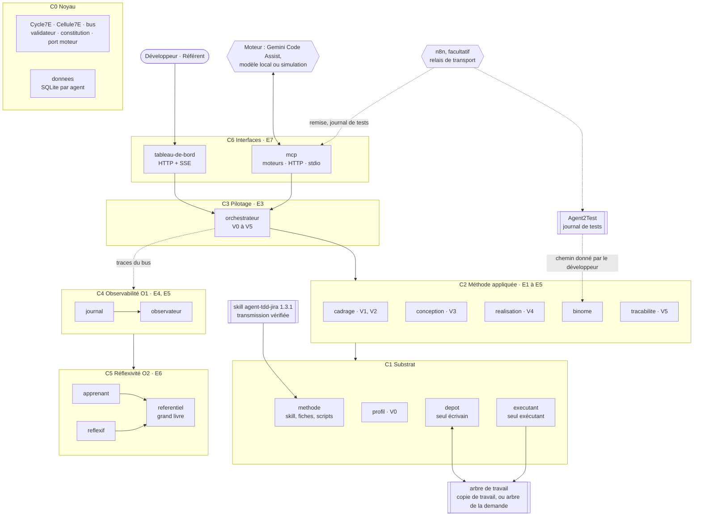

# Agent2Dev, spécification 1.0.0

Ce document est le point d'entrée du package. Il donne le principe, la carte du système, les points de validation, le registre des dimensions, les règles communes et les invariants. Les détails techniques sont dans `modules/`. Le fichier `manifest.json` déclare quels modules sont actifs.

La spécification reprend la conception d'Agent2Dev de l'étape 1 (cadrage et architecture, version 0.3.0 ratifiée le 4 octobre 2026) et sa lignée `agents-modif`, adaptées aux décisions du 21 octobre 2026 : le skill agent-tdd-jira devient la méthode d'Agent2Dev, tout reste local et s'enchaîne à la main, le développeur lance lui-même l'application. La section 11 en donne la filiation.

## 1. Ordre de lecture

1. Ce document, sections 2 à 12.
2. `manifest.json` : modules actifs et réservés.
3. Les modules actifs, dans cet ordre :
   1. `noyau` : cycle 7E, bus, contrats, validateur, constitution, port moteur.
   2. `donnees` : un fichier SQLite par agent.
   3. `journal` : journal chaîné, livrable de demande.
   4. `referentiel` : fiches, règles, épinglage, grand livre.
   5. `methode` : le skill, ses fiches et ses scripts.
   6. `profil` : profil du projet, point V0.
   7. `depot` : seul écrivain du projet.
   8. `executant` : seul exécutant de commandes.
   9. `cadrage` : extraction et analyse, points V1 et V2.
   10. `conception` : impact et variantes, point V3.
   11. `realisation` : cycle TDD par scénario, point V4.
   12. `binome` : remise à Agent2Test, lecture du journal de tests, corrections.
   13. `tracabilite` : matrice, rapport, projet de commentaire Jira, point V5.
   14. `orchestrateur` : parcours d'une demande, file, arrêt d'urgence.
   15. `observateur` : mesures et alertes.
   16. `apprenant`, `reflexif` : leçons candidates, mesures de second ordre.
   17. `mcp` : moteurs et serveur MCP.
   18. `relais` : relais du binôme par n8n, facultatif.
   19. `tableau-de-bord` : IHM par rôle.
   20. `exploitation` : installation et lancement sur le poste.
4. `modules/memoire/SKILL.md` et `modules/autonomie/SKILL.md` : seulement pour comprendre les points d'extension E3 et E4. Ne pas les implémenter en 1.x.

## 2. Mode de travail pour l'IA qui produit le code

1. Lisez tous les modules actifs avant d'écrire la moindre ligne de code.
2. Proposez le plan de fichiers, en reprenant la section « Fichiers à produire » de chaque module, et listez les choix que la spécification ne couvre pas. Attendez la validation du développeur.
3. Implémentez par lots, dans l'ordre de l'en-tête de transmission. Chaque lot doit passer ses tests, en simulation, avant le suivant.
4. En cas d'ambiguïté, posez une question. N'inventez ni action, ni champ, ni schéma, ni comportement absent de la spécification.
5. Les identifiants de code sont sans accents. Les commentaires, les textes de l'IHM, les messages et les journaux sont en français.
6. Chaque test cite l'invariant ou le scénario qu'il vérifie, par exemple `// D9.INV-2, RE3`. Un invariant sans test n'est pas implémenté.
7. N'implémentez aucun module au statut `reserved` dans `manifest.json`, sauf les tests d'inertie de ses points d'extension.
8. La méthode n'est pas recopiée dans le code : Agent2Dev la lit dans la transmission du skill agent-tdd-jira 1.3.1 (module `methode`). Ce que dit le skill, le code ne le redit pas.

## 3. Objectif et principe

Pour une demande Jira, Agent2Dev applique la méthode du skill agent-tdd-jira : extraction, US et critères d'acceptation, scénarios Gherkin, impact, variantes, cycle TDD scénario par scénario, acceptation en binôme avec Agent2Test, traçabilité. Le développeur valide chaque étape. Agent2Dev rend la méthode reproductible, observable et perfectible : chaque pas est journalisé, chaque correction du développeur peut devenir une leçon, et aucune leçon n'agit sans ratification.

**Le skill fixe la méthode, le moteur rédige, les agents déterministes agissent, le développeur valide.**

- Le skill agent-tdd-jira 1.3.1 est lu depuis sa transmission, vérifiée par sa table d'intégrité. Agent2Dev ne le réécrit jamais : les consignes de ses fiches en citent les sections telles quelles.
- Le moteur (Gemini Code Assist par défaut, tout LLM par le port moteur) ne produit que des données : le contenu de `us.md` et du fichier Gherkin, la fiche d'impact, les variantes, les modifications de tests et de code, le rapport et le projet de commentaire Jira. Chaque sortie est validée contre un schéma fermé et des contrôles nommés. Le moteur n'écrit aucun fichier et n'exécute rien.
- Trois agents déterministes agissent, chacun seul dans son domaine : `depot` écrit et tient git dans l'arbre de travail de la demande, `executant` y exécute les commandes du profil ratifié et les scripts du skill, `methode` fournit le skill.
- L'écriture du code se règle dans la configuration humaine. Sans autorisation, ce qui est le défaut, l'arbre de travail est une copie de travail du dépôt, dans les données d'Agent2Dev : il y écrit, y teste, et remet au développeur un patch par scénario accepté, que celui-ci applique lui-même. Avec l'autorisation, l'arbre de travail est l'arbre de la demande : la branche du développeur, ou le worktree du kit en mode parallèle.
- Le développeur valide aux points V0 à V5 (section 5). Rien ne passe un point sans sa réponse explicite.
- Agent2Test juge l'acceptation, dans son propre projet, sur une campagne que le développeur ouvre à la main. Agent2Dev ne se note pas lui-même : il lit le journal de tests avec le script du skill.
- n8n est facultatif : activé, il porte la remise vers Agent2Test et le journal de tests vers Agent2Dev, par leurs serveurs MCP, et rien d'autre. Sans lui, le développeur porte ces fichiers à la main.

Chaîne de traçabilité, celle du skill :

`demande Jira → US → critères d'acceptation → scénarios Gherkin → variantes → tests → code → commits → verdicts d'Agent2Test par critère → rapport`

Toutes les flèches passent par le bus ; aucun agent n'importe un autre agent.

Une responsabilité, un seul lieu :

| Responsabilité | Lieu unique |
|---|---|
| lire le skill, composer une fiche, fournir un script du skill | `methode` |
| proposer et tenir le profil du projet | `profil` |
| écrire dans l'arbre de travail et dans le dossier de travail de la demande, chercher, lire l'état git, commiter, former les patchs | `depot` |
| exécuter une commande du profil ou un script du skill | `executant` |
| appeler un LLM | port moteur du noyau, par les fiches |
| valider une sortie | validateur du noyau |
| dérouler un cycle | `Cycle7E` du noyau |
| décider de la suite d'une demande | `orchestrateur` |
| lire un journal de tests d'Agent2Test | `binome`, par le script du skill |
| porter la remise et le journal de tests entre les têtes | le développeur, ou n8n en relais (`relais`) |
| écrire le journal | `journal` |
| versionner une fiche ou une règle | `referentiel` |

## 4. Cycle 7E

L'énoncé de l'Axiome 7E : « Les Éléments dans l'Espace Engendrent un État d'Expression Évolutif de l'Environnement ». Agent2Dev l'applique à quatre échelles, avec une seule classe de cycle, `Cycle7E`, récursive (D1.INV-1).

| Phase | Opération | Pas | Scénario | Demande | Système |
|---|---|---|---|---|---|
| E1 Éléments | recenser | consigne du pas, fichiers visés, sortie attendue | scénario, critères, variante choisie | fichier MHTML, arbre de la demande, profil du projet | fiches, règles, constitution, skill |
| E2 Espace | situer | contenu courant des fichiers, fiche composée, leçons épinglées | tests existants, ligne de base, copie mise à jour | arbre de la demande, arbre de travail, référentiel épinglé | file des demandes |
| E3 Engendrer | produire | rédaction, validation, écriture, commande | pas : contrat, rouge, vert, remanié, suites | V0, cadrage, conception, cycles de scénarios, acceptation en binôme, traçabilité et V5 | cycles de demandes |
| E4 État | constater | résultat de la commande contre l'attendu | suites vertes, présentation V4 | matrice des critères | métriques de fonctionnement (O1) |
| E5 Expression | exprimer | ligne de journal, diff | présentation V4, commit, patch | rapport, livrable de demande | tableau de bord |
| E6 Évolutif | ajuster | nouvel essai dans le budget | ajustement demandé à V4, correction d'un défaut | réponses aux questions, leçons candidates | réflexivité (O2) |
| E7 Environnement | coupler | résultat remonté au scénario | résultat remonté à la demande | rapport, patchs et projet de commentaire Jira remis au développeur ; clôture versée au système | gouvernance humaine |

Règle de récursion : l'E3 d'une échelle est la suite des cycles complets de l'échelle inférieure, et l'E7 de chaque cycle inférieur alimente l'E4 de l'échelle supérieure.

Chaque agent traite chaque message comme un cycle 7E, par sa classe de base `Cellule7E` : valider l'entrée (E1), charger fiche et règles épinglées (E2), agir (E3), valider la sortie (E4), répondre (E5), corriger dans son budget de premier ordre (E6), remettre la trace au bus (E7). Un agent déterministe laisse vides les phases sans objet.

Clause de second ordre : Agent2Dev applique une méthode écrite par d'autres, et s'observe en l'appliquant. Le premier ordre (O1, `journal`, `observateur`) constate son fonctionnement ; le second ordre (O2, `apprenant`, `reflexif`, `referentiel`) juge ses manières de rédiger et d'apprendre, propose, et ne décide jamais seul. Agent2Test, qui lui est extérieur, constate ce que le code fait ; le développeur arbitre. La régression s'arrête à la constitution, au skill et à la gouvernance humaine : ce que le système ne peut pas changer de lui-même rend ses observations comparables dans le temps.

## 5. Points de validation

Les points V1 à V5 sont ceux du skill, appliqués tels quels. Agent2Dev ajoute V0, qui formalise le démarrage du skill (profil du projet, versions réelles, mode d'authentification), et CP-4, la gouvernance de ses propres règles, numérotée comme dans Agent2Test.

| Point | Moment | Qui décide | Décisions | Ce qui attend |
|---|---|---|---|---|
| V0 Profil | premier usage d'un projet ; fichier de construction modifié depuis la ratification | développeur | valider · corriger, commentaire obligatoire · rejeter | toute commande dans le projet |
| V1 Extraction | après l'extraction du MHTML | développeur | confirmer · corriger, avec les compléments | l'analyse |
| V2 US, critères, scénarios | après l'analyse et le script de contrôle des critères | développeur | valider · répondre aux questions · corriger, commentaire obligatoire · rejeter la demande | l'impact |
| V3 Variantes | après l'impact et les variantes | développeur | choisir une variante back et une variante front par scénario · corriger, commentaire obligatoire | la réalisation |
| V4 Scénario | après le cycle d'un scénario, suites vertes | développeur | accepter : patch remis, ou commit dans l'arbre de la demande si l'écriture est autorisée et que le développeur le veut · ajuster, commentaire obligatoire | le scénario suivant |
| V5 Rapport | après la traçabilité | développeur | accepter · corriger, commentaire obligatoire · recalculer, après un patch appliqué | la clôture de la demande |
| CP-4 Gouvernance | proposition de leçon ou de règle | référent, depuis le tableau de bord seulement | ratifier · amender · refuser | rien : asynchrone, effet à la demande suivante |

Entre V4 et V5, l'acceptation en binôme n'est pas un point de validation : le développeur ouvre la campagne d'Agent2Test, puis donne à Agent2Dev le chemin du journal, ou déclare la demande sans binôme (module `binome`). Avec le relais n8n, la remise et le journal circulent sans lui ; il ouvre toujours la campagne lui-même (module `relais`). Chaque point attend une décision explicite ; aucun n'est décidé par le système (D12.INV-1).

## 6. Registre des dimensions

| ID | Dimension | Introduite | Statut 1.0.0 | Dépend de | Module |
|---|---|---|---|---|---|
| D1 | Noyau 7E, bus et constitution | 1.0 | active | | `noyau` |
| D2 | Données par agent, en SQLite | 1.0 | active | D1 | `donnees` |
| D3 | Méthode : skill agent-tdd-jira, fiches et scripts | 1.0 | active | D1, D2 | `methode` |
| D4 | Profil du projet | 1.0 | active | D1, D3 | `profil` |
| D5 | Écriture dans le projet | 1.0 | active | D1, D4 | `depot` |
| D6 | Exécution des commandes | 1.0 | active | D1, D4 | `executant` |
| D7 | Cadrage : extraction et analyse | 1.0 | active | D3, D5, D6 | `cadrage` |
| D8 | Conception : impact et variantes | 1.0 | active | D3, D5, D7 | `conception` |
| D9 | Réalisation en cycle TDD | 1.0 | active | D3, D5, D6, D8 | `realisation` |
| D10 | Binôme avec Agent2Test | 1.0 | active | D3, D5, D6, D9 | `binome` |
| D11 | Traçabilité et rapport | 1.0 | active | D3, D5, D6, D9, D10 | `tracabilite` |
| D12 | Orchestration et points de validation | 1.0 | active | D1, D7 à D11, D13, D17 | `orchestrateur` |
| D13 | Journal et livrable de demande | 1.0 | active | D1, D2 | `journal` |
| D14 | Observabilité de premier ordre | 1.0 | active | D13 | `observateur` |
| D15 | Apprentissage | 1.0 | active | D12, D13, D17 | `apprenant` |
| D16 | Réflexivité de second ordre | 1.0 | active | D14, D15, D17 | `reflexif` |
| D17 | Référentiel, versions et grand livre | 1.0 | active | D1, D2, D3 | `referentiel` |
| D18 | Moteurs et serveur MCP | 1.0 | active | D1, D12 | `mcp` |
| D19 | Tableau de bord par rôle | 1.0 | active | D12, D13, D14, D17 | `tableau-de-bord` |
| D20 | Exploitation locale | 1.0 | active | D2, D3, D4 | `exploitation` |
| D21 | Mémoire et recherche sur le code et les demandes passées | 1.0 | reserved | D2, D3, D8 | `memoire` |
| D22 | Autonomie par point de validation | 1.0 | reserved | D12 | `autonomie` |
| D23 | Relais du binôme par n8n, facultatif | 1.0 | active | D10, D18 | `relais` |

Statuts : `active` (implémentée et testée), `reserved` (points d'extension posés, fonctionnalité absente), `superseded` (remplacée ; la version de remplacement est indiquée).

## 7. Contrat de version et points d'extension

### 7.1 Contrat

1. Chaque version déclare son numéro dans le frontmatter de ce document et dans `manifest.json`, et ajoute une entrée à la section 12.
2. Une version mineure ajoute au moins une dimension ou un point d'extension. Sinon, c'est un correctif : seul le numéro de patch change.
3. Une dimension `reserved` ne passe à `active` que si ses invariants ont des tests dans la suite de la version.
4. Une dimension `active` ne sort du registre qu'en passant à `superseded`, avec la version de remplacement et une section de migration.
5. Un invariant ne s'affaiblit jamais. Il peut être remplacé par un invariant plus fort, signalé dans la section 12.
6. La version du skill appliqué est épinglée dans `manifest.json` (références) et dans la configuration humaine. Une nouvelle version du skill appelle une nouvelle version d'Agent2Dev, qui en revoit la table de correspondance (module `methode`).
7. Chaque ligne du journal porte la version de spécification qui l'a produite. Un journal écrit dans une version reste lisible dans toute version de la même famille majeure.
8. Avant de publier une nouvelle version, la précédente est archivée dans `archives/SKILL-vX.Y.Z.md`. Une archive n'est jamais éditée.

### 7.2 Points d'extension

Un point d'extension n'est pas une fonctionnalité. En 1.x, il n'a qu'un test qui prouve qu'il est inerte.

- **E1** : le port moteur accepte de nouveaux adaptateurs par version ; en 1.0.0 : `simulation`, `externe` (Gemini Code Assist par MCP) et `compatible-openai`. Un adaptateur inconnu est refusé au démarrage.
- **E2** : la méthode est désignée par le nom, la version et la transmission d'un skill dans la configuration humaine. En 1.0.0, seul agent-tdd-jira 1.3.1 est pris en charge ; un autre skill ou une autre version est refusé au démarrage avec le motif « méthode non prise en charge ».
- **E3** : l'action `memoire.rechercher` existe et rend une liste vide ; chaque fiche a un emplacement « fragments », vide en 1.0.0. La mémoire sur le code et les demandes passées est réservée à D21.
- **E4** : chaque point de validation V0 à V5 porte, dans la configuration humaine, un champ `regime`, qui vaut `presenter` ; toute autre valeur est refusée au démarrage. L'autonomie par point est réservée à D22, et suppose une version du skill qui la permette ; CP-4 n'a pas de régime, et reste toujours une décision humaine.

## 8. Règles globales

- **Périmètre** : Agent2Dev traite une demande Jira déjà rédigée, exportée en MHTML, pour un projet dont le profil est ratifié. Il ne rédige pas la demande, ne démarre, n'arrête ni ne déploie l'application, ne lance aucun batch, n'écrit ni en base ni dans Jira.
- **Méthode** : le skill agent-tdd-jira 1.3.1 fait foi pour la méthode. Agent2Dev le lit depuis sa transmission, vérifiée, et n'en change rien.
- **Projet séparé** : Agent2Dev est un projet à part. L'arbre de la demande est la branche de travail du développeur, ou le worktree que le kit `agents-paralleles-gitlab` a créé en mode parallèle.
- **Écriture du code** : sans l'autorisation de la configuration humaine, Agent2Dev n'écrit rien dans l'arbre de la demande, hors des fichiers de travail que le kit exclut du dépôt ; il écrit et teste dans une copie de travail, et remet un patch par scénario accepté. Avec l'autorisation, le seul `depot` écrit dans l'arbre de la demande.
- **Git** : dans l'arbre de la demande, Agent2Dev commite après V4 si l'écriture est autorisée et que le développeur l'accepte, au format du skill ; il ne fusionne pas, ne rebase pas, ne change pas de branche. Dans la copie de travail, chaque scénario accepté est commité pour former son patch. Agent2Dev ne pousse jamais.
- **Local** : en 1.0.0, tout s'exécute sur le poste du développeur. Les interfaces n'écoutent que sur `127.0.0.1`.
- **Relais n8n** : facultatif et désactivé par défaut. n8n ne porte que la remise et le journal de tests, par les serveurs MCP des deux têtes ; il ne décide rien, n'ouvre aucune campagne et n'écrit aucun fichier. Agent2Dev n'en dépend jamais.
- **Secrets** : les jetons des interfaces et la configuration des moteurs viennent de fichiers hors dépôt, en mode 0600, ou de l'environnement. Les fichiers de secrets du projet sont exclus de toute lecture. Aucun secret n'apparaît dans le journal, les messages, les commits ni le contexte transmis au moteur.
- **Configuration humaine** : un fichier `humaine.json`, lu au démarrage et jamais écrit par le système, fixe la transmission du skill et sa version, l'autorisation d'écrire le code, le moteur et son autorisation, le régime des points, les utilisateurs et leurs rôles, les instances et leurs ports, les seuils d'alerte et l'activation du relais n8n (module `exploitation`, section 4).
- **Langue** : identifiants de code sans accents ; textes de l'IHM, messages, journal et livrables en français.
- **Node** : Node 24 recommandé, Node 22.13 au minimum, pour `node:sqlite` ; aucune dépendance d'exécution.

## 9. Critères d'acceptation globaux

- `npm test` passe sans accès réseau, en simulation : moteur `simulation`, projet de démonstration dont les commandes de construction et de test sont simulées, journal de tests d'Agent2Test simulé.
- Chaque invariant de la section 10 apparaît dans au moins un test. Un script vérifie cette correspondance.
- Sur l'exemple ECR-77 du skill, une demande simulée va du fichier MHTML au point V5, et s'arrête à chaque point de validation. Elle produit ce que le skill attend : `demande.json`, `us.md` et le fichier Gherkin sans écart au script de contrôle, `suivi.md`, des tests étiquetés, un commit par scénario accepté, et son patch en copie de travail, la matrice, le rapport et le projet de commentaire Jira.
- Un journal de tests simulé qui porte un défaut applicatif confirmé rouvre son scénario ; un second journal, sur le code corrigé, donne « conforme ».
- Sans autorisation d'écrire le code, une demande simulée ne modifie aucun fichier de l'arbre du développeur et remet, pour chaque scénario accepté, un patch qui s'y applique par `git am` ; avec l'autorisation, elle écrit dans l'arbre de la demande.
- Avec le relais activé, un client MCP simulé au rôle `relais` porte la remise et le journal de tests : la demande suit le même parcours qu'à la main, chaque décision reste au développeur, et Agent2Dev n'ouvre aucune connexion sortante. Relais désactivé, rien ne change.
- Une écriture dans l'arbre de travail faite hors du `depot` est détectée, et la demande s'arrête.
- Une commande absente du profil, une commande de démarrage de l'application et un batch sont refusés.
- Une altération du journal est détectée, et la première ligne rompue est nommée.
- Aucun module `reserved` n'est chargé ; chaque point d'extension a son test d'inertie.
- Le guide de démarrage suffit, seul, à installer et lancer Agent2Dev sur le poste du développeur.

## 10. Invariants

Chaque invariant est vérifié par au moins un test. Les invariants du skill, cités avec le préfixe `agent-tdd-jira:`, s'appliquent en plus : Agent2Dev les rend vérifiables, il ne les remplace pas.

**D1 : noyau**

- **D1.INV-1** : le cycle 7E se déroule en sept phases, dans l'ordre, aux quatre échelles Système, Demande, Scénario et Pas ; l'E3 d'une échelle est la suite des cycles de l'échelle inférieure, et l'E7 d'un cycle enfant est versé à l'E4 de son parent.
- **D1.INV-2** : tout appel ou événement que son contrat ne déclare pas est refusé par le bus ; aucun agent n'importe le code d'un autre agent.
- **D1.INV-3** : le moteur ne produit que des données ; une sortie qui s'écarte de son schéma fermé ou échoue à un contrôle nommé n'est jamais consommée.
- **D1.INV-4** : la constitution est vérifiée par son empreinte au démarrage ; modifiée ou non publiée, Agent2Dev ne démarre pas ; sa publication est une commande humaine.
- **D1.INV-5** : Agent2Dev ne traite qu'une demande Jira exportée en MHTML, pour le projet d'un profil ratifié ; toute intention de démarrer, d'arrêter ou de déployer l'application, de lancer un batch, d'administrer un environnement, d'écrire en base ou dans Jira est refusée avec le motif « hors périmètre ».
- **D1.INV-6** : aucun agent n'écrit la constitution, le code ou les schémas d'Agent2Dev, la configuration humaine ni la transmission du skill, et aucun ne réécrit un profil ratifié : le `profil` en crée seulement une version nouvelle, à la décision V0.

**D2 : données**

- **D2.INV-1** : chaque fichier de données a un seul agent propriétaire ; un agent lit les données d'un autre par une action du bus, jamais par le fichier.
- **D2.INV-2** : les données d'un agent sont dans son seul fichier SQLite, ouvert par `node:sqlite` dès le premier enregistrement ; chaque écriture est une transaction, et un arrêt du processus, même brutal, ne laisse aucun enregistrement partiel.
- **D2.INV-3** : le journal et le grand livre sont en ajout seul : aucune action ne modifie ni ne supprime un enregistrement, et toute purge est une commande humaine, journalisée.

**D3 : méthode**

- **D3.INV-1** : le skill n'est lu que depuis sa transmission, à la version épinglée par la configuration humaine, chaque fichier conforme à sa table d'intégrité ; à défaut, Agent2Dev ne démarre pas (`agent-tdd-jira:D9.INV-6`).
- **D3.INV-2** : les consignes d'une fiche reprennent les sections du skill telles quelles : rien n'y est réécrit, résumé, traduit ni complété, hors des leçons ratifiées, ajoutées à part.
- **D3.INV-3** : les trois scripts du skill sont extraits tels quels de leur module et exécutés par l'`executant` ; ni Agent2Dev ni le moteur n'en écrivent d'autre version.
- **D3.INV-4** : chaque module actif du skill est appliqué par au moins une étape d'Agent2Dev, selon la table de correspondance, vérifiée au démarrage contre le manifeste du skill.
- **D3.INV-5** : un prompt composé qui dépasse le plafond de contexte n'est jamais tronqué : le pas s'arrête et se présente au développeur.

**D4 : profil**

- **D4.INV-1** : aucune commande ne s'exécute dans un projet sans profil ratifié en V0 ; un fichier de construction modifié depuis la ratification rouvre V0.
- **D4.INV-2** : chaque valeur du profil cite le fichier du projet dont elle vient, ou porte la marque « à renseigner », qui empêche la ratification.
- **D4.INV-3** : les versions réelles du projet sont comparées aux cibles du skill (Java 21, Spring Boot 3.5, Angular 20) ; chaque écart est présenté en V0, avec la question de la suite à donner.
- **D4.INV-4** : un profil qui contient une commande de démarrage, d'arrêt ou de déploiement de l'application, ou de lancement d'un batch, est refusé, à la proposition comme à la ratification.

**D5 : dépôt**

- **D5.INV-1** : seul le `depot` écrit dans un arbre du projet, et seulement dans l'arbre de travail de la demande et, en mode parallèle, dans le dossier `travail/` de son worktree, sous leur racine, hors des fichiers protégés (`.git`, secrets, CI, fichiers du kit) ; un chemin qui sort de la racine, y compris par lien symbolique, est refusé.
- **D5.INV-2** : une modification ne s'applique que si chaque bloc « avant » apparaît exactement une fois dans le fichier courant ; sinon rien n'est appliqué, et l'écart revient au moteur dans son budget.
- **D5.INV-3** : toute écriture dans l'arbre de travail qui ne vient pas du `depot`, par l'IDE ou par un autre outil, est détectée avant le pas suivant et arrête la demande jusqu'à la décision du développeur.
- **D5.INV-4** : dans l'arbre de la demande, un commit n'est fait qu'après l'acceptation du scénario à V4, si le développeur l'accepte, avec le message `<CLÉ> Snn : …`, ou `<CLÉ> : …` hors scénario, et le `depot` ne fusionne pas, ne rebase pas, ne change pas de branche et ne réécrit aucun historique (`agent-tdd-jira:D9.INV-2`) ; dans la copie de travail, chaque scénario accepté est commité avec ce message pour former son patch ; le `depot` ne pousse jamais.
- **D5.INV-5** : une dépendance nouvelle, une modification de la chaîne de construction, la modification d'un test existant ou la suppression d'un fichier attend une validation explicite du développeur avant d'être appliquée (`agent-tdd-jira:D5.INV-6`).
- **D5.INV-6** : un changeset de migration existant n'est jamais modifié ni supprimé ; un schéma évolue par un changeset nouveau.
- **D5.INV-7** : sans l'autorisation d'écrire le code, donnée dans la configuration humaine, l'arbre de travail est une copie de travail : Agent2Dev n'écrit rien dans l'arbre de la demande, hors des fichiers de travail que le kit exclut du dépôt, et remet pour chaque scénario accepté un patch que le développeur applique lui-même.

**D6 : exécution**

- **D6.INV-1** : seules s'exécutent les commandes nommées du profil ratifié, les trois scripts du skill et les commandes git de la liste fermée du `depot`, en vecteur d'arguments, sans shell, avec leur répertoire et leur délai, dans l'arbre de travail ; dans l'arbre de la demande, sans autorisation d'écrire le code, seuls s'exécutent les scripts du skill qui lisent, `controler-criteres` et `lire-acceptation` ; les seuls paramètres substitués sont un identifiant de scénario validé par motif et des chemins sous la racine de l'arbre ou sous les données d'Agent2Dev.
- **D6.INV-2** : aucune commande ne démarre, n'arrête ni ne déploie l'application, ni ne lance un batch (`agent-tdd-jira:D7.INV-4`).
- **D6.INV-3** : la sortie d'une commande est masquée et bornée avant d'être journalisée ou transmise au moteur ; les échecs de compilation et de test reviennent structurés : fichier, ligne, test, message.
- **D6.INV-4** : les échecs présents avant le premier scénario forment la ligne de base de la demande ; ils ne sont imputés à aucun scénario et figurent au rapport.

**D7 : cadrage**

- **D7.INV-1** : la demande est extraite par le script du skill, jamais par le moteur ; le fichier MHTML n'est jamais modifié, et l'extraction est confirmée à V1 avant toute analyse (`agent-tdd-jira:D1.INV-1`, `agent-tdd-jira:D1.INV-2`).
- **D7.INV-2** : `us.md` et le fichier Gherkin ne sont présentés à V2 qu'après `controler-criteres.mjs` ; chaque écart du script est corrigé dans le budget du moteur, ou présenté comme écart.
- **D7.INV-3** : une question soulevée par l'analyse n'est jamais tranchée par le système : elle attend la réponse du développeur à V2 (`agent-tdd-jira:D2.INV-2`).
- **D7.INV-4** : après V2, `us.md` et le fichier Gherkin ne changent que par une nouvelle validation V2.

**D8 : conception**

- **D8.INV-1** : chaque élément de la fiche d'impact cite un fichier et une ligne trouvés par une recherche du `depot` ; un élément sans résultat de recherche est un écart (`agent-tdd-jira:D3.INV-1`).
- **D8.INV-2** : aucune réalisation ne commence avant que le développeur ait choisi à V3 une variante back et une variante front par scénario, et que le `depot` ait consigné ce choix dans `suivi.md` (`agent-tdd-jira:D4.INV-3`).
- **D8.INV-3** : une variante qui viole un invariant d'un référentiel ou du socle n'est jamais présentée comme recommandée ; un contrôle nommé le vérifie sur la sortie de la fiche (`agent-tdd-jira:D4.INV-2`).

**D9 : réalisation**

- **D9.INV-1** : un seul scénario est réalisé à la fois, et le suivant attend l'acceptation du précédent à V4 (`agent-tdd-jira:D5.INV-4`).
- **D9.INV-2** : aucun code de production n'est appliqué pour un scénario avant que l'`executant` ait constaté l'échec d'un test étiqueté de ce scénario pour la raison attendue : une assertion, pas une erreur de compilation ni de configuration ; seule une signature minimale, sans logique, peut précéder ce constat quand le test ne compile pas (`agent-tdd-jira:D5.INV-1`).
- **D9.INV-3** : un scénario n'est présenté à V4 qu'après les suites complètes back et front vertes, ligne de base exclue, constatées par l'`executant`.
- **D9.INV-4** : aucun pas n'affaiblit les tests : retirer un test ou une assertion, ajouter `@Disabled`, `fit`, `fdescribe` ou `xit` est refusé par contrôle nommé.
- **D9.INV-5** : quand un scénario touche le contrat d'API, le pas `contrat` précède les tests du back, puis ceux du front (`agent-tdd-jira:D5.INV-5`).
- **D9.INV-6** : la présentation V4 est rendue depuis le journal, au format du skill : rouge avec son message d'échec, vert, remanié, suites, fichiers, commit proposé.

**D10 : binôme**

- **D10.INV-1** : la remise n'a lieu qu'arbre de la demande propre, `controler-criteres.mjs` sans écart et, sans autorisation d'écrire le code, chaque patch remis présent dans l'arbre de la demande ; elle cite le commit et le plan tels quels (`agent-tdd-jira:D7.INV-1`).
- **D10.INV-2** : le verdict de chaque critère est celui que rend `lire-acceptation.mjs` sur le journal de tests, jamais une lecture du moteur (`agent-tdd-jira:D7.INV-3`).
- **D10.INV-3** : seul un défaut que le script déclare confirmé, avec un cycle de correction, rouvre un scénario, dans le budget de corrections par scénario ; tout autre défaut est présenté au développeur (`agent-tdd-jira:D7.INV-2`).
- **D10.INV-4** : Agent2Dev n'écrit rien dans le projet Agent2Test, ne conteste ni ne réécrit un verdict, et n'ouvre aucune campagne : le développeur ouvre chaque campagne à la main (`agent-tdd-jira:D7.INV-4`).

**D11 : traçabilité**

- **D11.INV-1** : la matrice est construite par les recherches du `depot` et par les scripts du skill, jamais de mémoire (`agent-tdd-jira:D6.INV-1`, `agent-tdd-jira:D10.INV-7`).
- **D11.INV-2** : Agent2Dev n'écrit jamais dans Jira : le projet de commentaire est remis au développeur (`agent-tdd-jira:D6.INV-3`).
- **D11.INV-3** : V5 n'est présentée qu'avec chaque critère dans la matrice, son état de réalisation et son verdict d'acceptation, ou « non joué » avec sa raison (`agent-tdd-jira:D7.INV-3`).

**D12 : orchestration**

- **D12.INV-1** : aucun point de validation n'est sauté, supprimé ni décidé par le système ; aucune étape ne consomme une sortie qui attend une décision.
- **D12.INV-2** : une instance d'Agent2Dev porte une demande à la fois ; les suivantes attendent en file.
- **D12.INV-3** : un pas qui épuise son budget s'arrête et se présente au développeur ; aucune boucle ne se relance sans budget.
- **D12.INV-4** : l'arrêt d'urgence est lu entre deux pas ; la reprise est une décision humaine ; après un redémarrage du processus, la demande reprend au début du pas interrompu.
- **D12.INV-5** : chaque décision enregistre sa cible, son auteur, son canal, sa date et son commentaire ; une correction ou un ajustement exige un commentaire.

**D13 : journal**

- **D13.INV-1** : le journal est en ajout seul et chaîné par empreintes SHA-256 ; `verifierChaine` nomme la première ligne rompue ou manquante.
- **D13.INV-2** : chaque ligne porte son échelle et sa phase : une demande se relit comme un arbre 7E, de la demande au pas.
- **D13.INV-3** : le livrable de demande est une projection du journal, en Markdown et en JSON, depuis la même source.
- **D13.INV-4** : toute production du moteur porte l'adaptateur et le nom du moteur, la fiche et sa version composée, l'empreinte du prompt et la décision qui l'a validée.

**D14 : observabilité**

- **D14.INV-1** : l'observateur ne produit que des mesures et des alertes ; il n'agit sur aucun cycle.
- **D14.INV-2** : chaque mesure se recalcule depuis le journal, à l'identique.
- **D14.INV-3** : une mesure qui franchit un seuil de la configuration humaine lève une alerte, journalisée et affichée.

**D15 : apprentissage**

- **D15.INV-1** : chaque correction ou ajustement commenté à V2, V3, V4 ou V5, et chaque défaut confirmé par Agent2Test après une acceptation V4, produit une leçon candidate, liée à sa fiche, à son moteur et à sa source.
- **D15.INV-2** : une leçon n'a d'effet qu'après ratification en CP-4, depuis le tableau de bord, et seulement pour le moteur sur lequel elle a été apprise.
- **D15.INV-3** : une leçon qui contredit une règle du skill ou de la constitution est refusée par contrôle nommé avant d'être proposée.

**D16 : réflexivité**

- **D16.INV-1** : une leçon ou une règle dont l'effet mesuré dégrade le taux d'acceptation au-delà de la marge, sur la fenêtre et après l'exposition minimale, est suspendue par le système seul ; il n'adopte jamais seul une règle nouvelle et n'élargit aucune borne.
- **D16.INV-2** : le taux de défauts confirmés par Agent2Test après une acceptation V4 est mesuré par fiche et par moteur ; sa hausse lève une alerte au référent.
- **D16.INV-3** : les dérives qui contourneraient la méthode (rouge pour une mauvaise raison, tests modifiés au vert, lignes par pas en hausse) sont mesurées, et lèvent une alerte au référent.

**D17 : référentiel**

- **D17.INV-1** : chaque demande s'exécute avec le référentiel épinglé à son E2 ; une règle ratifiée ne s'applique qu'aux demandes suivantes.
- **D17.INV-2** : le grand livre est en ajout seul et chaîné ; il inscrit chaque constitution publiée, ratification, refus, suspension et retour arrière.
- **D17.INV-3** : les règles modifiables se limitent à la liste fermée de la constitution, chacune dans ses bornes ; une valeur hors bornes est refusée.
- **D17.INV-4** : les pouvoirs sont séparés : proposer (`apprenant`, `reflexif`), ratifier (un humain, en CP-4, hors du canal MCP), appliquer (`referentiel`), mesurer (`reflexif`).
- **D17.INV-5** : chaque fiche porte une version composée, fiche, skill et leçons ; le prompt de toute sortie du moteur se reconstitue à partir du journal, et son empreinte égale celle du journal.

**D18 : moteurs et MCP**

- **D18.INV-1** : les interfaces n'écoutent que sur `127.0.0.1` ; le serveur MCP exige un jeton porteur et refuse un en-tête `Origin` non autorisé.
- **D18.INV-2** : une décision CP-4 reçue par le canal MCP est refusée ; une décision V relayée porte l'auteur humain du jeton et obéit aux droits de ses rôles.
- **D18.INV-3** : aucun contenu du projet ne part vers un moteur externe tant que la configuration humaine ne porte pas l'autorisation de l'envoyer.
- **D18.INV-4** : le contexte transmis au moteur se limite au pas, est borné et masqué : aucune valeur de secret, aucun jeton, aucun fichier exclu par le profil.
- **D18.INV-5** : changer d'adaptateur ne change que la configuration ; un adaptateur inconnu est refusé au démarrage ; chaque appel est journalisé.
- **D18.INV-6** : avec le profil souverain, aucune connexion sortante n'est ouverte, hors celle du moteur local.

**D19 : tableau de bord**

- **D19.INV-1** : les décisions suivent les rôles : développeur pour V0 à V5, référent pour CP-4.
- **D19.INV-2** : chaque point présente l'objet à décider avec ses preuves, côte à côte : extraction, fichiers et écarts du script, fiche d'impact et variantes, diff et sorties de commande, matrice et rapport.
- **D19.INV-3** : l'interface s'utilise au clavier et au lecteur d'écran ; aucun rafraîchissement automatique ne démarre sans demande.

**D20 : exploitation**

- **D20.INV-1** : Agent2Dev n'a aucune dépendance d'exécution : modules natifs de Node seulement, `node:sqlite` compris.
- **D20.INV-2** : la configuration humaine et les secrets vivent hors du dépôt d'Agent2Dev et du projet, et ne sont jamais écrits par le système.
- **D20.INV-3** : tout s'exécute en local, sur le poste du développeur.

**D23 : relais n8n**

- **D23.INV-1** : Agent2Dev ne dépend jamais du relais n8n : désactivé par défaut, le binôme se fait à la main, à l'identique ; activé, c'est le relais qui appelle le serveur MCP, et Agent2Dev n'ouvre aucune connexion vers n8n ni vers Agent2Test.
- **D23.INV-2** : un jeton au rôle `relais` n'atteint que `a2d_remise`, `a2d_remise_relayee` et `a2d_journal_de_tests` ; toute décision, rédaction, soumission de demande, suspension ou reprise lui est refusée.
- **D23.INV-3** : un journal de tests reçu du relais l'est par son contenu, jamais par un chemin ; le `depot` le range dans le dossier de travail de la demande, et `lire-acceptation.mjs` le lit comme un journal déposé à la main.
- **D23.INV-4** : la configuration fournie pour n8n le fait écouter sur `127.0.0.1` seulement, avec sa base SQLite, sans télémétrie ni appel sortant ; son workflow n'appelle que les outils du rôle `relais` des deux têtes, et ses fichiers ne contiennent aucun jeton.

## 11. Filiation

### 11.1 Avec la conception de l'étape 1

La conception d'Agent2Dev de l'étape 1 (`00-cadrage.md` et `01-architecture.md`, version 0.3.0 ratifiée le 4 octobre 2026, dépôt Agent2Dev) reste la source des choix d'architecture : noyau 7E, agent générique piloté par des fiches, `depot` seul écrivain, séparation des deux ordres, gouvernance des leçons. Ses invariants I1 à I15 deviennent des invariants de dimension :

| Étape 1 | Spécification |
|---|---|
| I1 cycle 7E | D1.INV-1 |
| I2 périmètre | D1.INV-5 |
| I3 écriture confinée | D5.INV-1, D5.INV-4, D5.INV-7, D1.INV-6 |
| I4 le moteur ne produit que des données | D1.INV-3, D5.INV-2 |
| I5 pas de livraison sans preuve | D9.INV-3, D10.INV-2 |
| I6 verdict jamais réécrit, contestation tranchée par une personne | D10.INV-4 |
| I7 journal et grand livre en ajout seul | D2.INV-3, D13.INV-1, D17.INV-2 |
| I8 points de contrôle intangibles | D12.INV-1 |
| I9 auto-modification asymétrique | D16.INV-1 |
| I10 séparation des pouvoirs | D17.INV-4, D18.INV-2 |
| I11 secrets | D6.INV-3, D18.INV-4 |
| I12 contexte minimisé | D3.INV-5, D18.INV-4, D18.INV-6 |
| I13 actions bornées | D6.INV-1, D6.INV-2 |
| I14 origine des productions du moteur | D13.INV-4 |
| I15 oracle | D7.INV-4, D5.INV-5, D5.INV-6 |

Ce qui change par rapport à l'étape 1 :

| Point de l'étape 1 | Décision du 21 octobre 2026 | Effet dans la spécification |
|---|---|---|
| sept fiches : analyse, cahier, scénarios, préconisation, plan de réalisation, développement, diagnostic | Agent2Dev reste la tête de développement et applique agent-tdd-jira comme méthode | huit fiches calées sur le skill : `analyse`, `impact`, `variantes`, `contrat`, `rouge`, `vert`, `remanie`, `rapport` ; consignes tirées du skill (module `methode`) |
| demande en texte libre | l'export MHTML reste la règle | extraction par le script du skill, V1 (module `cadrage`) |
| remplacements « avant / après » par tâche, tests unitaires secondaires | méthode TDD du skill | un test rouge étiqueté précède tout code (D9.INV-2) ; le « avant / après » reste le format d'écriture du `depot` |
| option B : agent `exploitant`, instance dédiée sous Docker, sonde, instantanés de base | l'équipe déploie à la main ; application sur Tomcat en local | `exploitant` remplacé par `executant`, limité à la compilation, aux tests et aux scripts du skill (D6.INV-2) |
| module `liaison`, protocole `binome-7e/1`, couplage par n8n | enchaînement à la main ; n8n facultatif, en relais de transport | remise et lecture du journal par fichiers et par le script du skill (module `binome`) ; avec le relais, n8n porte la remise et le journal par les serveurs MCP, sans enveloppe ni décision (D23) |
| plan de tests projeté au format de l'annexe A | Agent2Test lit les fichiers d'agent-tdd-jira | aucune projection : `us.md` et le fichier Gherkin tels quels (D10.INV-1) |
| contestation argumentée par Agent2Dev, tranchée en CP-5 | désaccord remonté au développeur | D10.INV-4 |
| arbre de travail et branche `a2d/<demande>` créés par Agent2Dev, poussée vers un Gitea local | GitLab de la mission ; seule la partie locale est concernée ; écriture du code en option, à autoriser | par défaut, copie de travail et branche `a2d/<CLÉ>` dans les données d'Agent2Dev, un patch par scénario accepté (D5.INV-7) ; sur autorisation, écriture dans l'arbre de la demande, commit après V4 ; aucune poussée (D5.INV-4) |
| CP-0 à CP-6, autonomie par défaut (`differe`) | points de validation toujours présentés | V0 à V5 et CP-4 (section 5), décidés dans le tableau de bord ou par MCP, jamais par n8n ; autonomie réservée à D22 |
| adaptateurs `gemini-cli` (défaut), `externe`, `compatible-openai`, `anthropic`, `simulation` | même moteur que pour Agent2Test | `externe` (défaut), `compatible-openai`, `simulation` (point E1) |
| stockage JSON, puis SQLite au-delà de 250 Ko | SQLite dès le départ, pour les deux têtes | un fichier SQLite par agent dès le premier enregistrement, sans phase JSON (D2.INV-2) |
| mémoire et recherche hybride sur le code | — | réservée à D21 (point E3) |
| plusieurs demandes actives, verrou d'instance | une demande à la fois ; parallélisme par le kit | une instance par demande, une instance par worktree en mode parallèle (D12.INV-2) |
| AI Act | mis de côté | hors périmètre ; restent l'origine des productions (D13.INV-4) et la gouvernance (D17) |

### 11.2 Avec agents-modif

| agents-modif | Agent2Dev 1.0.0 |
|---|---|
| `bus`, `Agent` | bus et `Cellule7E` du noyau, contrats déclarés |
| `AgentGenerique` et quatre fiches | une classe, huit fiches composées à partir du skill |
| `depot` : explorer, vérifier « avant / après », appliquer sur une copie | `depot` : chercher, vérifier « avant / après », écrire dans une copie de travail, ou dans l'arbre de la demande sur autorisation, commiter, former les patchs |
| `orchestrateur`, `ordonnanceur` | un seul `orchestrateur`, `Cycle7E` récursif |
| `observant` | `observateur` (O1) et `reflexif` (O2), séparés |
| `apprenant` | `apprenant`, leçons par moteur, ratification en CP-4 |
| `journal`, une ligne JSON par trace | `journal` chaîné, échelle et phase sur chaque ligne |
| `tableau-de-bord` | `tableau-de-bord` par rôle |
| moteurs `simulation` et `claude` | adaptateurs `simulation`, `externe`, `compatible-openai` |
| `AUTO=1` | supprimé : aucun point n'est validé par le système |

`agents-modif/` reste en place jusqu'à la recette d'Agent2Dev 1.0.0, puis est retiré.

## 12. Journal de révision

**1.0.0** (2026-10-22) : première version, tirée de la conception de l'étape 1 (version 0.3.0 du 4 octobre 2026) et des décisions du 21 octobre 2026. Méthode : skill agent-tdd-jira 1.3.1, lu depuis sa transmission vérifiée. Binôme : journal de tests d'agent2test 1.1.0, lu par le script du skill. Dimensions D1 à D20 et D23 actives, D21 (mémoire) et D22 (autonomie) réservées. Points d'extension E1 à E4. Moteur : Gemini Code Assist par MCP, modèle local compatible OpenAI ou simulation. Stockage : un fichier SQLite par agent, dès le départ. Écriture du code en option : sans autorisation, copie de travail et un patch par scénario accepté ; avec, écriture dans l'arbre de la demande. Relais n8n facultatif (D23), qui ne porte que la remise et le journal de tests. Amendements du développeur à la ratification du 21 octobre 2026 : SQLite dès le départ, pour Agent2Dev comme pour Agent2Test (agent2test 1.1.0) ; n8n facultatif, en relais de transport seulement, sur sa base SQLite.
