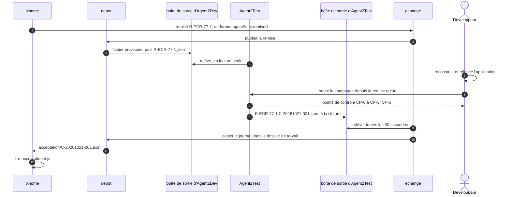

# Module `echange` (D25)

Le `binome` rend la remise et lit le journal de tests (module `binome`). L'échange en assure le transport, selon le mode de la configuration humaine :

- `manuel`, le défaut : le développeur porte les fichiers. Le tableau de bord propose la remise au téléchargement, au format `agent2test.remise/1`, à côté de son texte au format du skill ; le développeur la dépose dans Agent2Test, puis donne à Agent2Dev le chemin du journal de tests (module `binome`, section 2).
- `dossiers` : le `depot` publie la remise dans la boîte de sortie de l'instance ; Agent2Test l'y lit, puis dépose le journal de tests de la campagne close dans sa propre boîte de sortie, où l'échange le relève.

L'échange ne décide rien : le développeur valide toujours ses points, reconstruit et relance l'application, et ouvre la campagne lui-même. Agent2Dev ne dépend jamais de l'échange (D25.INV-1).

## 1. Configuration

```json
{ "echange": {
    "mode": "dossiers",
    "sortie": "~/.agent2dev/echanges/sortie",
    "entree": "/mnt/c/Users/fred/.agent2test/echanges/sortie",
    "intervalleSecondes": 30
} }
```

- `mode` vaut `manuel`, par défaut, ou `dossiers`. En mode `manuel`, aucun dossier d'échange n'est lu ni écrit.
- `sortie` est la boîte de sortie de l'instance, dans ses propres dossiers : `~/.agent2dev/echanges/sortie/` pour l'instance `principale`, `instances/<nom>/echanges/sortie/` pour une autre (module `exploitation`, section 2). Agent2Test la déclare parmi ses boîtes d'entrée.
- `entree` est la boîte de sortie d'Agent2Test, que l'échange lit en lecture seule.
- Chaque chemin est absolu, une fois `~` développé, et hors du dépôt d'Agent2Dev comme du projet ; sinon, le démarrage est refusé avec son motif.
- `intervalleSecondes`, entre 5 et 300, 30 par défaut : la relève scrute la boîte plutôt que de compter sur les notifications de fichiers, qui passent mal entre Windows et WSL2.

## 2. Déroulé en mode `dossiers`



## 3. Publication de la remise (D25.INV-4)

- La remise est celle du module `binome`, section 1, au format `agent2test.remise/1` que définit la spécification agent2test (module `echange`, section 3) : identifiant, date, demande, racine, plan (adaptateur, dossier, sources et leurs empreintes), commit, plage de changements, critères et leurs statuts, scénarios jouables et non jouables avec leur motif, rôles requis, préalables. Elle ne porte aucun contenu de fichier, aucun jeton, aucun secret.
- `racine` est le chemin de l'arbre de la demande, pour l'affichage : Agent2Test retrouve sa propre racine par le commit remis.
- En mode `dossiers`, le `binome` remet la remise à l'échange, qui la fait écrire par le `depot` dans la boîte de sortie, sous `R-<CLÉ>-<n>.json` : d'abord sous `.R-<CLÉ>-<n>.json.tmp`, puis par renommage. Une remise publiée n'est jamais réécrite : une nouvelle remise porte le numéro suivant.
- En mode `manuel`, la même remise se télécharge depuis le tableau de bord, octet pour octet celle qu'aurait publiée le mode `dossiers` ; rien n'est écrit dans la boîte.

## 4. Relève du journal de tests (D25.INV-2, D25.INV-3)

- Pendant l'attente du journal (module `binome`, section 2), toutes les `intervalleSecondes`, l'échange liste la boîte `entree`. Il n'y retient que les fichiers `<remise courante>.<campagne>.json`, et ignore les noms qui commencent par un point, les liens symboliques et les fichiers de plus de 1 Mo, signalés une fois. Il n'y écrit, n'y renomme ni n'y supprime rien.
- Un fichier retenu doit porter le format `agent2test.journal-de-tests/1` et la clé de la demande (`demande.cle`) ; sinon, il est refusé avec son motif, présenté au développeur.
- Le `depot` le copie dans le dossier de travail : `<sortie>/<CLÉ>/acceptation/<campagne>.json` ; en mode parallèle, `travail/<CLÉ>/acceptation/<campagne>.json`, comme le skill le prévoit pour un journal déposé (`binome-agent2test`, section 9).
- L'`executant` lance `lire-acceptation.mjs` sur cette copie, comme sur un journal déposé à la main : la suite est celle du module `binome`, sections 3 à 5.
- Une campagne déjà relevée ne produit qu'une lecture, et le journal d'une remise dépassée n'est pas retenu.

## 5. Ce que l'échange ne fait jamais

- décider un point, une attente, ou CP-4 ;
- ouvrir une campagne d'Agent2Test ;
- joindre Agent2Test : il ne fait que lire et écrire des fichiers ;
- écrire un fichier lui-même : la remise publiée et la copie du journal passent par le `depot`, dans la boîte de sortie de l'instance et dans le dossier de travail de la demande, et nulle part ailleurs.

## 6. Pièges connus

- **Fichier lu à moitié écrit** : un lecteur qui prendrait un fichier en cours d'écriture lirait un JSON tronqué ; l'écriture sous un nom provisoire, puis le renommage, l'évitent.
- **Notifications de fichiers** : entre Windows et WSL2, une surveillance par notifications manquerait des fichiers ; la relève scrute à intervalle.
- **Remise réécrite** : une remise publiée ne change plus ; une correction appelle une nouvelle remise, au numéro suivant.
- **Boîte commune à deux instances** : chaque instance a sa boîte, et ne relève que les journaux nommés d'après ses propres remises.
- **Journal provisoire** : Agent2Test n'en dépose pas ; s'il en venait un, `lire-acceptation.mjs` le dirait.

## 7. Migration depuis la version 1.0.0 (D23 remplacée)

En 1.0.0, la dimension D23 confiait le transport au relais n8n, qui appelait les serveurs MCP des deux têtes. D25 la remplace :

| 1.0.0 | 1.1.0 | Ce qui change |
|---|---|---|
| D23.INV-1 : Agent2Dev ne dépend jamais du relais n8n, et n'ouvre aucune connexion vers lui ni vers Agent2Test | D25.INV-1 | plus de relais : en mode `dossiers`, Agent2Dev écrit sa boîte et lit celle d'Agent2Test, sans aucune connexion |
| D23.INV-2 : rôle `relais` limité à trois outils | — | le rôle `relais` et les outils `a2d_remise` et `a2d_remise_relayee` sont retirés : plus rien n'appelle Agent2Dev pour porter le binôme |
| D23.INV-3 : journal reçu par son contenu, rangé par le `depot`, lu comme un journal déposé à la main | D25.INV-3 | inchangé, pour un journal relevé dans la boîte d'Agent2Test |
| D23.INV-4 : configuration fournie pour n8n | — | n8n n'est plus fourni : ni workflow ni composition |

Une instance 1.0.0 qui avait activé le relais retire `relais` et l'utilisateur au rôle `relais` de la configuration humaine, que la version 1.1.0 refuse tant qu'elle les porte, supprime `secrets/<instance>/relais.jeton`, et arrête n8n. Pour un transport automatique, elle règle `echange.mode` à `dossiers`.

## 8. Tests (scénarios)

| Scénario | Vérifie | Cas |
|---|---|---|
| EC1 | D25.INV-1 | en mode `manuel`, aucun dossier d'échange n'est lu ni écrit, et une demande simulée va jusqu'à V5 par le binôme à la main, à l'identique |
| EC2 | D25.INV-1 | en mode `dossiers`, pendant une demande simulée complète, Agent2Dev n'ouvre aucune connexion sortante (`fetch`, `http.request` et `net.connect` interceptés), et n'écrit, pour l'échange, que dans sa boîte de sortie et dans le dossier de travail |
| EC3 | D25.INV-2 | dans la boîte d'Agent2Test, un lien symbolique, un fichier de plus de 1 Mo, un fichier en point ou le journal d'une autre remise est ignoré ; rien n'y est jamais écrit, renommé ni supprimé |
| EC4 | D25.INV-3 | un journal relevé est copié dans `acceptation/<campagne>.json`, `travail/ECR-77/acceptation/` en mode parallèle, et donne la même lecture que ce journal déposé à la main |
| EC5 | D25.INV-3 | un journal d'une autre demande ou d'un autre format est refusé avec son motif ; une campagne relevée deux fois ne produit qu'une lecture |
| EC6 | D25.INV-4 | la remise publiée de l'exemple ECR-77 est la remise d'exemple de la spécification agent2test (module `echange`, section 3), champ pour champ, empreintes et commit calculés sur le projet de démonstration ; elle s'écrit par un fichier provisoire renommé ensuite, et une remise publiée n'est jamais réécrite |
| EC7 | D25.INV-4 | en mode `manuel`, la remise téléchargée est octet pour octet celle qu'aurait publiée le mode `dossiers` ; aucune décision ni ouverture de campagne ne passe par l'échange (analyse des contrats du bus) |
| EC8 | D25.INV-1 | une configuration qui porte encore `relais` est refusée au démarrage avec son motif ; une boîte d'échange placée dans un dépôt git est refusée |

## 9. Fichiers à produire

- `src/agents/echange/agent.js`, `src/agents/echange/releve.js`
- `test/echange/*.test.js`
