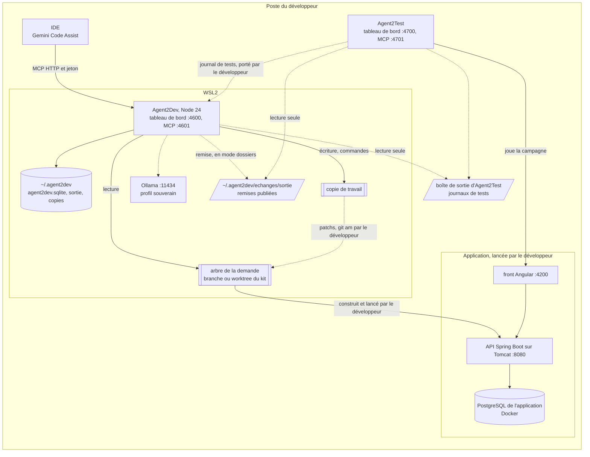

# Module `exploitation` (D20)

Ce module décrit le poste d'exécution et ce qu'il faut pour installer et lancer Agent2Dev, sans assistance.

## 1. Topologie locale (D20.INV-3)



- L'application, sa base et ses batchs sont lancés par le développeur ; Agent2Dev n'y touche pas (D6.INV-2).
- Agent2Dev et Agent2Test ne s'appellent pas : le développeur porte la remise et le journal de tests de l'un à l'autre (module `binome`), ou l'échange par dossiers les dépose et les relève, s'il l'a activé (module `echange`).
- Agent2Dev tourne sous WSL2, avec le projet dans le système de fichiers de WSL2 (module `profil`, section 4). L'IDE, sous Windows ou dans WSL2, joint le serveur MCP sur `127.0.0.1`.

## 2. Dossiers (D20.INV-2)

| Chemin | Contenu | Écrit par |
|---|---|---|
| `~/.agent2dev/humaine.json` | configuration humaine (section 4) | un humain, jamais le système |
| `~/.agent2dev/profils/<projet>/v<n>.json` | profils ratifiés | le `profil`, une version nouvelle par décision V0 |
| `~/.agent2dev/secrets/<instance>/` | jetons du MCP et du tableau de bord | le script d'installation, en mode 0600 |
| `~/.agent2dev/donnees/agent2dev.sqlite` | le fichier de données unique (module `donnees`) | le seul agent médiateur `donnees` |
| `~/.agent2dev/echanges/sortie/` | boîte de sortie de l'échange, en mode `dossiers` : les remises publiées (module `echange`) | le `depot` |
| `~/.agent2dev/sortie/<CLÉ>/` | dossier de travail et de sortie de la demande : outils, `demande.json`, patchs, rapport, projet de commentaire, livrable | le `depot` ; le livrable, le `journal` |
| `~/.agent2dev/copies/<CLÉ>/` | copie de travail de la demande | le `depot` |

- La configuration humaine se lit dans `~/.agent2dev/humaine.json`, ou au chemin que donne la variable `AGENT2DEV_CONFIG`. La racine des autres dossiers se règle dans la configuration (`dossiers.racine`) ; elle est créée en mode 0700. Une racine, ou une configuration, placée dans un dépôt git, celui d'Agent2Dev comme celui du projet, est refusée au démarrage.
- Ces chemins sont ceux de l'instance `principale` ; une autre instance range `donnees/`, `sortie/`, `copies/` et `echanges/` sous `instances/<nom>/` (section 3). La configuration humaine, les profils et les secrets restent à la racine.

## 3. Instances (D12.INV-2)

Une instance porte une demande à la fois. Pour mener plusieurs demandes en parallèle, une par worktree du kit, le développeur lance une instance par demande :

```json
{ "instances": {
  "principale": { "tableauDeBord": 4600, "mcp": 4601 },
  "ECR-77": { "tableauDeBord": 4610, "mcp": 4611 }
} }
```

- `npm start` lance l'instance `principale` ; `npm start -- --instance ECR-77`, une autre. Une instance absente de la configuration humaine, ou dont les jetons n'ont pas été créés par `scripts/installer.sh --instance <nom>`, est refusée au démarrage.
- Chaque instance a ses données, son journal, son référentiel et ses jetons. Elle pose un verrou, `<dossier de l'instance>/verrou`, avec le numéro de son processus ; un second processus sur la même instance est refusé `INSTANCE_DEJA_LANCEE`, et un verrou dont le processus n'existe plus est repris.
- Les instances ne partagent que la configuration humaine et les profils ratifiés. En 1.x, une leçon ratifiée dans une instance n'agit que dans celle-ci.

## 4. Configuration humaine (D20.INV-2)

```json
{
  "methode": { "skill": "agent-tdd-jira", "version": "1.3.2", "transmission": "/home/fred/agent2prompt/transmissions/agent-tdd-jira-1.3.2.md" },
  "ecritureCode": { "autorisee": false, "reference": "", "par": "" },
  "moteur": { "adaptateur": "externe", "nom": "gemini", "plafondContexte": 120000,
              "autorisationExterne": { "accordee": true, "reference": "<décision DSI et RSSI>", "par": "fred" } },
  "points": { "V0": { "regime": "presenter" }, "V1": { "regime": "presenter" }, "V2": { "regime": "presenter" },
              "V3": { "regime": "presenter" }, "V4": { "regime": "presenter" }, "V5": { "regime": "presenter" } },
  "utilisateurs": [ { "id": "fred", "roles": ["developpeur", "referent"] } ],
  "instances": { "principale": { "tableauDeBord": 4600, "mcp": 4601 } },
  "echange": { "mode": "manuel" },
  "origines": [],
  "alertes": { "seuils": { "pas.essais.p95": 3, "scenario.rougesNonValables.taux": 0.2, "demande.defautsConfirmes": 1 } },
  "dossiers": { "racine": "~/.agent2dev" }
}
```

Au démarrage, Agent2Dev lit ce fichier et le contrôle ; il ne l'écrit jamais (D1.INV-6), et une modification prend effet au démarrage suivant. Chaque écart arrête le démarrage avec son motif :

- méthode autre qu'agent-tdd-jira 1.3.2, ou transmission non vérifiée (point E2, module `methode`) ;
- adaptateur inconnu (point E1), moteur hors du poste sans autorisation externe (module `mcp`, section 2) ;
- régime d'un point autre que `presenter` (point E4) ;
- `ecritureCode.autorisee` à `true` sans référence ni auteur (module `depot`, section 1) ;
- instance absente, port déjà pris ou partagé par deux instances ;
- échange en mode `dossiers` sans boîte d'entrée lisible, ou boîte d'échange placée dans un dépôt ; configuration qui porte encore `relais`, de la version 1.0.0 (module `echange`, sections 1 et 7) ;
- racine des dossiers dans un dépôt.

## 5. Commandes

| Commande | Rôle |
|---|---|
| `scripts/installer.sh [--instance <nom>]` | contrôle Node et git, crée la racine en mode 0700, copie `configuration/humaine.exemple.json` s'il n'y a pas de configuration, crée les jetons de l'instance en mode 0600, puis invite à publier la constitution |
| `npm start [-- --instance <nom>]` | démarre les agents, le tableau de bord et le serveur MCP ; affiche l'URL d'amorçage |
| `npm test` | lance la suite, en simulation, sans réseau (`node --test`) |
| `npm run constitution:publier [-- --instance <nom>]` | commande humaine : inscrit l'empreinte de la constitution au grand livre de l'instance (module `noyau`, section 5) |
| `npm run donnees:purger -- --demande <CLÉ> [--instance <nom>]` | commande humaine : purge d'une demande close (module `donnees`, section 3) |

Aucune installation de paquets n'est nécessaire : Agent2Dev n'a aucune dépendance (section 6). Les scripts sont en ASCII pur.

## 6. Contraintes d'exécution (D20.INV-1, D20.INV-3)

- Au démarrage, une version de Node antérieure à 22.13 arrête Agent2Dev avec le message « Node 22.13 ou plus récent requis (24 recommandé) » ; une version de git antérieure à 2.30, avec « git 2.30 ou plus récent requis ».
- `package.json` ne déclare ni `dependencies` ni `devDependencies` : modules natifs de Node seulement, `node:sqlite` et `node:test` compris. Un test vérifie que chaque import est un module `node:` ou un chemin relatif.
- Sous Windows natif, le démarrage est refusé avec le motif « exécuter Agent2Dev sous WSL2 ».
- Tout s'exécute sur le poste : les interfaces n'écoutent que sur `127.0.0.1`, et aucun moteur hors du poste n'est joint sans autorisation (module `mcp`, section 2).
- L'échange par dossiers ne demande aucun logiciel : des chemins de fichiers, de part et d'autre de la frontière entre Windows et WSL2 (module `echange`).

## 7. Guide de démarrage

`GUIDE.md` suffit, seul, à installer et lancer Agent2Dev : prérequis (WSL2, Node 24, git) ; installation ; configuration humaine (transmission du skill, écriture du code, moteur et autorisation) ; publication de la constitution ; configuration de Gemini Code Assist (`configuration/gemini/settings.json`, `GEMINI.md`) ; première demande sur l'exemple ECR-77, de V0 à V5 ; application des patchs par `git am -3` ; binôme avec Agent2Test, à la main, puis par l'échange par dossiers en option ; mode parallèle avec le kit et une instance par worktree ; arrêt et purge.

## 8. Tests (scénarios)

| Scénario | Vérifie | Cas |
|---|---|---|
| IN1 | D20.INV-1 | le contrôle de version, appelé avec `22.12.0`, refuse le démarrage avec le message prévu ; avec `22.13.0` et `24.0.0`, il l'accepte |
| IN2 | D20.INV-1 | `package.json` ne déclare aucune dépendance, et chaque import des sources est un module `node:` ou un chemin relatif (analyse des sources) |
| IN3 | D20.INV-2 | une racine des dossiers placée dans un dépôt git, celui d'Agent2Dev ou celui du projet de démonstration, est refusée au démarrage, comme une configuration humaine que `AGENT2DEV_CONFIG` y désigne |
| IN4 | D20.INV-2 | aucun agent n'écrit `humaine.json` ni un fichier de `secrets/` (garde d'écriture et analyse des sources) ; les secrets sont en mode 0600, la racine en 0700 |
| IN5 | D20.INV-3 | toutes les interfaces de deux instances écoutent sur `127.0.0.1`, chacune sur ses ports ; deux instances qui déclarent le même port sont refusées |
| IN6 | D12.INV-2 | un second processus sur la même instance est refusé `INSTANCE_DEJA_LANCEE` ; une instance non déclarée est refusée ; un verrou orphelin est repris |
| IN7 | D20.INV-3 | sous `process.platform === "win32"`, le démarrage est refusé « exécuter Agent2Dev sous WSL2 » |
| IN8 | D20.INV-1 | les scripts ne contiennent que des caractères ASCII |
| IN9 | D25.INV-1 | en mode `dossiers`, une boîte d'entrée absente ou illisible, ou une boîte d'échange placée dans un dépôt git, refuse le démarrage avec son motif ; en mode `manuel`, aucun dossier d'échange n'est créé ni lu |

## 9. Fichiers à produire

- `package.json`, `scripts/installer.sh`
- `src/demarrage.js` (contrôles de version, de plateforme et de configuration), `src/instances.js`
- `configuration/humaine.exemple.json`, `GUIDE.md`
- `test/exploitation/*.test.js`
