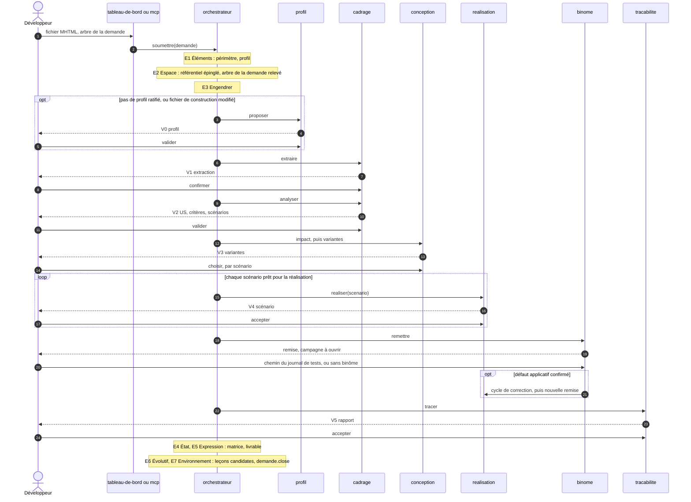

# Module `orchestrateur` (D12)

L'`orchestrateur` déroule les cycles des échelles Système et Demande avec la seule classe `Cycle7E` du noyau ; le `realisation` déroule ceux des échelles Scénario et Pas. Il tient la file, les points de validation, les attentes et les budgets. Il ne rédige, n'écrit et n'exécute rien.

## 1. Parcours d'une demande



À l'E2, l'orchestrateur demande `referentiel.epingler(demande)` : toute la demande lit fiches et règles à travers cet instantané (D17.INV-1).

| État | Il en sort |
|---|---|
| `en-file` | quand l'instance est libre |
| `profil` | à la décision V0 |
| `extraction` | à la confirmation V1 |
| `analyse` | à la validation V2, ou au rejet de la demande |
| `conception` | à la décision V3 de chaque scénario |
| `realisation` | à l'acceptation V4 du dernier scénario prêt |
| `remise` | quand la remise est rendue |
| `attente-journal` | quand le développeur donne le chemin du journal de tests, ou déclare la demande sans binôme |
| `correction` | à l'acceptation V4 de la dernière correction, vers une nouvelle remise |
| `tracabilite` | à l'acceptation V5 |
| `suspendue` | à la reprise, décision humaine |
| `close` | jamais : `acceptee`, `rejetee` ou `abandonnee` |

## 2. Points de validation (D12.INV-1, point E4)

- Un point ouvert met la demande en attente ; l'événement `point.ouvert` alerte le tableau de bord et le MCP.
- Chaque point porte `regime: "presenter"` (point E4) : il est présenté chaque fois, même quand rien n'a changé depuis la présentation précédente, et aucun délai ne le valide par défaut. Une configuration qui donne un autre régime est refusée au démarrage.
- Aucune étape ne consomme une sortie qui attend une décision : l'analyse attend V1, la conception attend V2, la réalisation attend V3 et la ligne de `suivi.md`, le scénario suivant attend V4, la clôture attend V5.
- Un point qui présente plusieurs éléments reçoit une décision par élément : V3, une par scénario.

## 3. Attentes hors des points

Certaines situations arrêtent le pas en cours sans être des points du skill. Elles s'ouvrent comme un point, avec leurs décisions, et se journalisent de même (D12.INV-5) :

| Attente | Ouverte par | Décisions |
|---|---|---|
| validation explicite | `depot` | autoriser · refuser, commentaire obligatoire |
| écriture étrangère | `depot` | intégrer · retirer |
| patchs manquants à la remise, conflit de mise à jour de la copie | `depot` | appliquer les patchs manquants, puis vérifier de nouveau · mon arbre fait foi, commentaire obligatoire |
| refus d'un garde-fou du kit | `depot` | corriger selon la règle · suspendre |
| régression après une mise à jour ou une synchronisation | `executant` | corriger dans la demande, comme un ajustement · continuer, la régression va au rapport · suspendre |
| test vert du premier coup | `realisation` | contre-épreuve · réécrire le test, commentaire obligatoire · scénario déjà réalisé |
| gros pas | `realisation` | découper le scénario, par une nouvelle analyse et V2 · garder le pas, commentaire obligatoire |
| budget épuisé | l'agent du pas | relancer avec un budget neuf, commentaire obligatoire · abandonner la demande |
| plafond de contexte | `methode` | réduire les fichiers visés · abandonner ; relever le plafond passe par CP-4 |
| défaut non confirmé, régression d'une autre demande | `binome` | décisions du module `binome`, section 5 |

## 4. Décisions (D12.INV-5)

```json
{
  "id": "DEC-118", "demande": "ECR-77", "point": "V4", "cible": "ECR-77-S02", "decision": "accepter",
  "auteur": "fred", "canal": "tableau-de-bord", "date": "2026-10-21T14:02:11Z", "commentaire": "",
  "regime": "presenter", "objet": "<sha256 de la présentation décidée>"
}
```

- La cible est un scénario, un critère, une question, un patch, un fichier, une commande ou la demande.
- Une correction, un ajustement, un refus de validation, « mon arbre fait foi », un pas gardé au-delà de sa taille, un budget neuf et un abandon exigent un commentaire ; sans lui, la décision est refusée `COMMENTAIRE_OBLIGATOIRE`.
- `objet` est l'empreinte de ce qui a été présenté. Si l'objet a changé entre la présentation et la décision, la décision est refusée `OBJET_PERIME`, et le point est présenté de nouveau.
- Les décisions sont en ajout seul (module `donnees`). Le canal est `tableau-de-bord` ou `mcp` ; une décision CP-4 ne vient que du tableau de bord (D18.INV-2).

## 5. Une demande à la fois (D12.INV-2)

- Une instance porte une demande à la fois. Une demande soumise pendant qu'une autre est ouverte attend en file, dans l'ordre d'arrivée ; le développeur peut la retirer de la file.
- L'attente du journal de tests occupe l'instance. Pour mener une autre demande en parallèle, le développeur lance une autre instance, dans le worktree de cette demande (module `exploitation`, section 3).

## 6. Budgets (D12.INV-3)

| Budget | Règle | Défaut | Portée |
|---|---|---|---|
| sorties non conformes renvoyées au moteur | `budget.tentativesSortie` | 2 | un appel de fiche |
| essais d'un pas : rouge, vert, écarts du script | `budget.tentativesPas` | 3 | un pas |
| corrections après un défaut confirmé | `budget.correctionsParScenario` | 3 | un scénario |
| travail du système sur une demande | `duree.demande` | 4 heures, attentes du développeur exclues | une demande |

Un budget épuisé arrête le pas et ouvre l'attente « budget épuisé » ; aucune boucle ne se relance seule. Les budgets consommés sont journalisés et figurent au livrable. Les valeurs se lisent dans l'instantané épinglé (module `referentiel`, section 4).

## 7. Arrêt d'urgence et reprise (D12.INV-4)

- `suspendre(demande)`, depuis le tableau de bord ou le MCP, lève un drapeau lu entre deux pas : le pas en cours se termine, puis la demande passe à l'état `suspendue`. Avec l'option « arrêter maintenant », la commande en cours est arrêtée avec son arborescence, et le pas interrompu reprendra à son début.
- `reprendre(demande)` est une décision humaine, journalisée.
- L'état de chaque cycle est écrit à chaque fin de phase. Après un redémarrage du processus, une demande en cours reprend au début du pas interrompu : le `depot` restaure d'abord les fichiers que ce pas avait écrits (module `depot`, section 3), et le passage interrompu reste au journal.

## 8. Synchronisation annoncée

Entre deux scénarios, le développeur peut annoncer une synchronisation de son arbre (`agt sync`, ou un commit) depuis le tableau de bord. La mise à jour de la copie, ou le relevé de l'arbre de la demande si l'écriture est autorisée, et les suites se lancent tout de suite, sans attendre le scénario suivant (`agent-tdd-jira:D9.INV-7`). Pendant un scénario, l'annonce attend la décision V4.

## 9. Actions et événements

| Action | Rôle |
|---|---|
| `soumettre(demande)` | entrée d'une demande : fichier MHTML, arbre de la demande, mode ; périmètre vérifié (D1.INV-5) |
| `decider(point, decision)` | décision humaine sur un point ou une attente |
| `suspendre(demande, options)`, `reprendre(demande)` | arrêt d'urgence, reprise |
| `synchronisation(demande)` | synchronisation annoncée |
| `retirer(demande)` | retire une demande de la file |
| `abandonner(demande)` | clôt la demande « abandonnée », commentaire obligatoire |
| `etat(demande)` | état, pas courant, point ou attente ouverts, budgets consommés |

Événements : `point.ouvert`, `point.decide`, `attente.ouverte`, `demande.suspendue`, `demande.reprise`, `demande.close`.

## 10. Pièges connus

- **Point validé à l'expiration d'un délai** : jamais ; un point attend sa décision.
- **Décision sur une présentation périmée** : elle porterait sur un autre objet que celui que le développeur a vu ; `OBJET_PERIME`.
- **Rejeu partiel après redémarrage** : le pas repart de son début, fichiers restaurés, pas de la commande interrompue.
- **Orchestrateur qui agit** : il n'écrit dans aucun arbre et ne lance aucune commande ; il demande au `depot` et à l'`executant`.

## 11. Tests (scénarios)

| Scénario | Vérifie | Cas |
|---|---|---|
| OR1 | D12.INV-1 | l'analyse ne démarre pas avant la confirmation V1, ni la conception avant V2 |
| OR2 | D12.INV-1 | un point dont la présentation n'a pas changé est présenté quand même ; aucun délai ne le valide |
| OR3 | point E4 | un `regime` autre que `presenter` dans la configuration humaine est refusé au démarrage |
| OR4 | D12.INV-1 | V3 attend une décision par scénario ; un scénario sans décision ne démarre pas |
| OR5 | D12.INV-2 | une seconde demande soumise attend en file ; retirée, elle n'est jamais traitée |
| OR6 | D12.INV-3 | trois rouges non valables épuisent `budget.tentativesPas` : le pas s'arrête, l'attente « budget épuisé » s'ouvre, et rien ne se relance sans décision |
| OR7 | D12.INV-4 | un arrêt d'urgence pendant une commande suspend la demande à la fin du pas ; « arrêter maintenant » arrête la commande et ses processus enfants |
| OR8 | D12.INV-4 | un processus arrêté après l'écriture d'un pas, avant sa fin, reprend au début de ce pas, fichiers restaurés ; le journal garde le passage interrompu |
| OR9 | D12.INV-4 | sans décision de reprise, une demande suspendue ne reprend pas, même après un redémarrage |
| OR10 | D12.INV-5 | chaque décision enregistre cible, auteur, canal, date, commentaire et objet ; un ajustement sans commentaire est refusé `COMMENTAIRE_OBLIGATOIRE` |
| OR11 | D12.INV-5 | une décision envoyée après un changement de l'objet présenté est refusée `OBJET_PERIME`, et le point est présenté de nouveau |
| OR12 | D1.INV-5 | une demande hors périmètre est refusée à la soumission, avant V0 |
| OR13 | D1.INV-1 | une demande simulée complète journalise les sept phases aux échelles Système et Demande |
| OR14 | D6.INV-4 | une synchronisation annoncée entre deux scénarios relance les suites ; une régression ouvre son attente, sans être imputée au scénario suivant |
| OR15 | D6.INV-1 | l'orchestrateur ne lance aucune commande et n'écrit dans aucun arbre (analyse des sources : ni `child_process`, ni écriture de fichier) |

## 12. Fichiers à produire

- `src/agents/orchestrateur/agent.js`, `src/agents/orchestrateur/systeme.js`, `src/agents/orchestrateur/demande.js`
- `src/agents/orchestrateur/points.js`, `src/agents/orchestrateur/attentes.js`, `src/agents/orchestrateur/decisions.js`
- `src/agents/orchestrateur/file.js`, `src/agents/orchestrateur/budgets.js`, `src/agents/orchestrateur/reprise.js`
- `schemas/decision.json`
- `test/orchestrateur/*.test.js`
