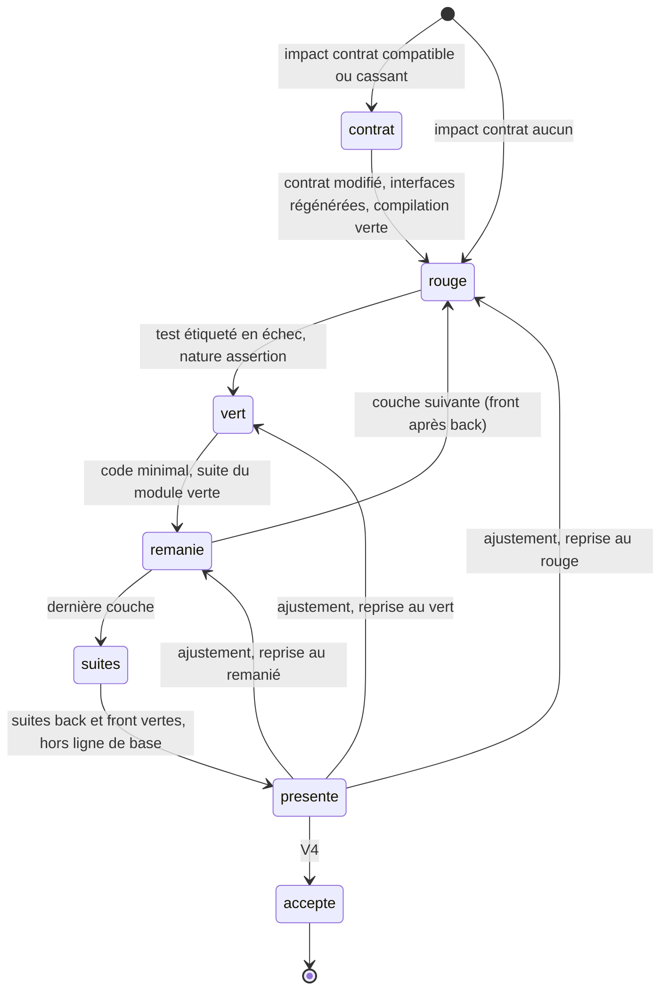

# Module `realisation` (D9)

Le `realisation` applique le module `cycle-tdd` du skill à chaque scénario retenu en V3, dans l'ordre du fichier Gherkin. Il instancie le cycle de l'échelle Scénario ; chaque pas est un cycle de l'échelle Pas.

## 1. Cycle d'un scénario (D9.INV-1, D9.INV-5)



- Un seul scénario est en cours ; le suivant attend son acceptation à V4 (`agent-tdd-jira:D5.INV-4`).
- Tout se passe dans l'arbre de travail : la copie de travail par défaut, l'arbre de la demande si l'écriture du code est autorisée (module `depot`, section 1). Avant chaque scénario, la copie est mise à jour (module `depot`, section 2) ; avant le premier, le développeur est prévenu des modifications non commitées de son arbre, qui ne sont pas dans la copie.
- Les couches suivent les étiquettes `@back` et `@front` du scénario et la variante choisie ; le back précède le front.
- Quand l'impact sur le contrat n'est pas `aucun`, le pas `contrat` vient d'abord : la fiche `contrat` modifie `api/openapi.yaml`, puis l'`executant` lance `regenerer-contrat` et `compiler-back` (`agent-tdd-jira:D5.INV-5`).

## 2. Rouge (D9.INV-2)

La fiche `rouge` applique `cycle-tdd`, section 3, avec les invariants de tests des référentiels. Sortie :

```json
{
  "modifications": [ { "creer": "back/src/test/java/fr/exemple/feedback/FeedbackCsvTest.java", "contenu": "…" } ],
  "tests": [ { "fichier": "back/src/test/java/fr/exemple/feedback/FeedbackCsvTest.java", "nom": "exportCommenceParLeBomEtUtiliseLePointVirgule" } ],
  "raisonAttendue": "le fichier ne commence pas encore par la marque d'ordre des octets"
}
```

- `rouge.fichiers-de-test` : seuls des fichiers de test sont touchés (`src/test/**`, `*.spec.ts`).
- `realisation.test-etiquete` : chaque test nouveau porte l'étiquette du scénario : `@Tag("ECR-77-S02")` et `@DisplayName` en JUnit, libellé du `describe` côté front (`agent-tdd-jira:D6.INV-2`).
- L'`executant` lance `tester-scenario-back` (`{scenario}`) ou `tester-scenario-front` (`{fichiersTest}`). Le rouge est valable si un test étiqueté du scénario échoue avec la nature `assertion`, et si aucun autre test hors ligne de base n'échoue. Le message d'échec est gardé pour la présentation V4.

| Résultat | Suite |
|---|---|
| échec `assertion` du test étiqueté | rouge valable, passage au vert |
| échec `compilation` | sous-pas `signature` : la fiche `rouge` crée la signature minimale demandée par le compilateur, puis l'`executant` relance |
| échec `erreur` ou `delai` | écart rendu au moteur, dans le budget du pas |
| test vert du premier coup | question au développeur (section 3) |

Une signature minimale est contrôlée par `realisation.signature-minimale` : déclarations seulement, chaque corps de méthode réduit au retour d'une valeur vide (`return null;`, collection vide, `0`, `false`, chaîne vide, `undefined`), ou vide pour une méthode sans résultat, comme le skill le décrit (`cycle-tdd`, section 3). Aucun autre code de production ne précède le rouge.

## 3. Test qui passe du premier coup

Le skill le signale : soit le comportement existe déjà, soit le test ne teste rien (`cycle-tdd`, section 8). Le pas s'arrête et le développeur choisit :

- **contre-épreuve** : la fiche `rouge` propose une modification temporaire du code qui devrait faire échouer le test ; le `depot` l'applique, l'`executant` lance le test, le `depot` restaure le fichier. Si le test échoue alors avec la nature `assertion`, la contre-épreuve tient lieu de rouge, et la présentation V4 le dit ;
- **réécrire le test**, avec un commentaire ;
- **scénario déjà réalisé** : le scénario passe aux suites, sans vert ni remanié, et la présentation V4 le mentionne.

## 4. Vert

La fiche `vert` applique `cycle-tdd`, section 4, et les invariants des référentiels. Elle ne touche aucun fichier de test (`vert.sans-test`). Le nombre de lignes modifiées par pas est borné (`taille.lignesParPas`, 200 par défaut), comme le nombre de fichiers touchés par le scénario (`taille.fichiersParScenario`, 25 par défaut) : au-delà, le pas s'arrête, et la question de découper le scénario va au développeur (`cycle-tdd`, section 8, « gros pas » ; module `orchestrateur`, section 3).

L'`executant` lance le test du scénario, puis la suite du module concerné (`tester-back` ou `tester-front`). Le vert est constaté quand ils passent, hors ligne de base. Sinon, les échecs structurés reviennent au moteur, dans le budget du pas (`budget.tentativesPas`).

## 5. Remanié (D9.INV-4)

La fiche `remanie` applique `cycle-tdd`, section 5, et propose le message de commit (`commitPropose`, au format `<CLÉ> Snn : …`). Elle peut remanier le code et les tests, sans les affaiblir. `realisation.tests-non-affaiblis` compare chaque fichier de test avant et après : nombre de tests et d'assertions non diminué, aucun `@Disabled`, `fit`, `fdescribe`, `xit`, `xdescribe` ni `.only` ajouté. Le même contrôle s'applique à tout pas.

## 6. Suites et V4 (D9.INV-3, D9.INV-6)

Après la dernière couche, l'`executant` lance `tester-back`, `tester-front` et `linter-front`, selon les couches du projet. Le scénario n'est présenté qu'avec les trois verts, hors ligne de base.

La présentation est rendue depuis le journal, sans moteur, au format du skill (`cycle-tdd`, section 6) :

```markdown
## @ECR-77-S02 : encodage et séparateur du fichier

- **Critère d'acceptation** : ECR-77-CA02
- **Variante** : B1 (front non concerné)
- **Rouge** : `FeedbackCsvTest.exportCommenceParLeBomEtUtiliseLePointVirgule` en échec :
  « Expecting actual: [] to start with: [-17, -69, -65] »
- **Vert** : `FeedbackCsv.write` écrit le BOM puis les lignes séparées par « ; »
- **Remanié** : constantes extraites, `FeedbackRow` en record ; suite verte
- **Suites** : back `./mvnw verify` vert (412 tests) ; front non concerné
- **Fichiers** : FeedbackCsv.java, FeedbackRow.java, FeedbackCsvTest.java
- **Commit proposé** : « ECR-77 S02 : BOM UTF-8 et séparateur point-virgule »

Accepter ce scénario et passer au suivant ?
```

Agent2Dev y joint le diff du scénario, les avertissements de la garde statique, les validations déjà données et les essais consommés.

| Décision à V4 | Copie de travail, par défaut | Écriture du code autorisée |
|---|---|---|
| accepter | le `depot` commite le scénario dans la copie et remet son patch (module `depot`, sections 2 et 7) ; le tableau de bord donne son chemin et la commande `git am -3` ; scénario suivant | case « commiter » cochée : le `depot` commite dans l'arbre de la demande ; sinon, le commit reste au développeur ; scénario suivant |
| ajuster, commentaire obligatoire | le développeur désigne le pas de reprise : `contrat` s'il y en a un, `rouge` (par défaut), `vert` ou `remanie` ; le cycle reprend à ce pas, sur l'état courant du scénario, avec le commentaire en entrée de sa fiche | même suite |

Un commit par scénario : le commit par phase, que le skill accepte quand le développeur le préfère (`cycle-tdd`, section 7), n'est pas proposé en 1.x.

## 7. Cycle de correction

Un défaut applicatif confirmé par Agent2Test (module `binome`) rouvre son scénario au rouge. La fiche `rouge` reçoit le défaut : critère, étape échouée, attendu, signaux, et les preuves que le développeur a fournies. Le test rouge doit reproduire le défaut à la couche où il se trouve (skill, `binome-agent2test`, section 7). La présentation V4 porte l'en-tête « correction, campagne <campagne> », et le commit proposé cite la campagne : `ECR-77 S04 : correction, … (Agent2Test C-20261021-001)`. En copie de travail, son patch porte l'objet `S04-correction`.

## 8. Pièges connus

- **Rouge de compilation pris pour un rouge** : la nature de l'échec, pas le code de retour, décide.
- **Test retouché au vert** : interdit par `vert.sans-test` ; c'est la dérive que le `reflexif` surveille.
- **Ajustement au milieu d'un pas** : un commentaire reçu pendant un pas attend la fin de ce pas.
- **Suites lancées sur le seul scénario** : V4 exige les suites complètes.

## 9. Tests (scénarios)

| Scénario | Vérifie | Cas |
|---|---|---|
| RE1 | D9.INV-1 | le deuxième scénario ne démarre qu'après la décision V4 du premier |
| RE2 | D9.INV-2 | une modification de code de production proposée par la fiche `rouge` est refusée par `rouge.fichiers-de-test` |
| RE3 | D9.INV-2 | un échec de nature `compilation` ouvre le sous-pas `signature` ; une signature qui contient de la logique est refusée |
| RE4 | D9.INV-2 | le vert ne démarre qu'après un échec de nature `assertion` d'un test étiqueté du scénario |
| RE5 | D9.INV-2 | un test vert du premier coup ouvre la question ; la contre-épreuve applique, lance, restaure, et le fichier est identique après |
| RE6 | D9.INV-3 | un échec de `tester-front` hors ligne de base empêche la présentation V4 |
| RE7 | D9.INV-4 | un remaniement qui retire une assertion, ou ajoute `@Disabled` ou `fit`, est refusé |
| RE8 | D9.INV-4 | la fiche `vert` qui modifie un fichier de test est refusée par `vert.sans-test` |
| RE9 | D9.INV-5 | un scénario à impact « compatible » passe par le pas `contrat` avant le rouge du back |
| RE10 | D9.INV-6 | la présentation V4 de l'exemple ECR-77-S02, rendue depuis un journal simulé sans appel au moteur, est identique à l'exemple du skill (`cycle-tdd`, section 6) |
| RE11 | D9.INV-6 | « ajuster » sans pas désigné reprend le cycle au rouge, avec le commentaire en entrée de la fiche `rouge` ; avec `remanie`, il reprend au remanié, et la présentation suivante le dit |
| RE12 | D9.INV-2 | un défaut confirmé rouvre le scénario au rouge, avec le défaut en entrée de la fiche, et la présentation porte l'en-tête de correction |
| RE13 | D5.INV-7 | en copie de travail, « accepter » commite S02 dans la copie et remet `002-S02.patch` ; l'arbre de la demande est inchangé |

## 10. Fichiers à produire

- `src/agents/realisation/agent.js`, `src/agents/realisation/cycle-scenario.js`, `src/agents/realisation/pas.js`
- `src/agents/realisation/controles.js`, `src/agents/realisation/presentation.js`
- `schemas/fiche.contrat.sortie.json`, `schemas/fiche.rouge.sortie.json`, `schemas/fiche.vert.sortie.json`, `schemas/fiche.remanie.sortie.json`
- `test/realisation/*.test.js`, `test/fixtures/moteur/{contrat,rouge,vert,remanie}/`
