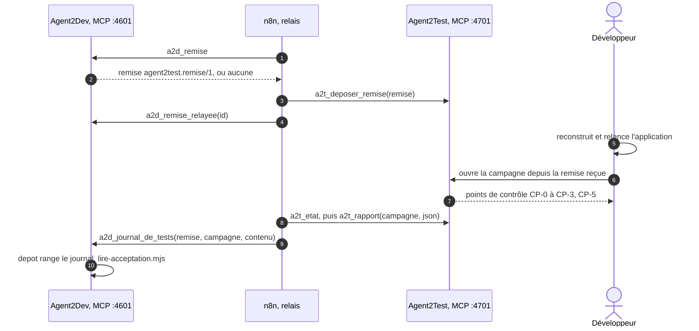

# Module `relais` (D23)

Sans relais, le développeur porte les fichiers entre les deux têtes : il ouvre la campagne d'Agent2Test à partir de la remise, puis donne à Agent2Dev le chemin du journal de tests (module `binome`). Le relais n8n, facultatif, porte ces deux objets à sa place. Il ne décide rien : le développeur valide toujours ses points, redémarre l'application et ouvre la campagne lui-même. Agent2Dev ne dépend jamais de lui (D23.INV-1).

## 1. Activation

Le relais est désactivé par défaut. Pour l'activer, le développeur :

1. porte `"relais": { "actif": true }` dans la configuration humaine, et un utilisateur `relais`, au seul rôle `relais` ;
2. crée son jeton par `scripts/installer.sh --relais [--instance <nom>]`, dans `secrets/<instance>/relais.jeton`, en mode 0600 ;
3. recopie ce jeton dans le magasin d'identifiants de n8n, sous le nom `agent2dev-relais`, avec celui d'Agent2Test (`agent2test-relais`).

Relais désactivé, aucun jeton au rôle `relais` n'est accepté.

## 2. Ce que porte le relais

- La remise est celle du module `binome`, section 1, au format `agent2test.remise/1` que définit la spécification agent2test (module `relais`, section 3) : identifiant, date, demande, racine, plan (adaptateur, dossier, sources et leurs empreintes), commit, plage de changements, critères et leurs statuts, scénarios jouables et non jouables avec leur motif, rôles requis, préalables. Agent2Test la refuse si elle n'est pas conforme, et la tient pour périmée si, à l'ouverture de la campagne, le commit ou une source a changé.
- Le journal de tests est celui qu'Agent2Test rend au format `agent2test.journal-de-tests/1` ; le relais le transmet tel quel.

## 3. Outils du rôle `relais` (D23.INV-2)

| Outil | Rôle |
|---|---|
| `a2d_remise` | lecture : la remise courante de la demande, avec son identifiant (`R-<CLÉ>-<n>`) et son état de relais, ou aucune |
| `a2d_remise_relayee(id)` | consigne au journal que la remise a été déposée chez Agent2Test ; le tableau de bord l'affiche |
| `a2d_journal_de_tests({ remise, campagne, contenu })` | transmet un journal de tests par son contenu |

Tout autre outil est refusé à ce rôle `DROIT_INSUFFISANT`, et en particulier `a2d_decider`, `a2d_soumettre`, `a2d_suspendre`, `a2d_reprendre` et `a2d_soumettre_demande` : aucune décision, aucune rédaction, aucun arrêt ni reprise ne passe par le relais.

## 4. Journal reçu (D23.INV-3)

- Le journal arrive par son contenu, jamais par un chemin. Agent2Dev vérifie que la remise citée est la remise courante de la demande, que le format est `agent2test.journal-de-tests/1` et que `demande.cle` est la clé de la demande ; sinon, il le refuse avec son motif.
- Le `depot` le range dans le dossier de travail : `<sortie>/<CLÉ>/acceptation/<campagne>.json` ; en mode parallèle, `travail/<CLÉ>/acceptation/<campagne>.json`, comme le skill le prévoit pour un journal déposé (`binome-agent2test`, section 9).
- L'`executant` lance `lire-acceptation.mjs` sur ce fichier, comme sur un journal déposé à la main : la suite est celle du module `binome`, sections 3 à 5.
- Un même journal transmis deux fois ne produit qu'une lecture : la campagne est déjà connue, et le doublon est consigné sans effet.

## 5. Workflow fourni

`configuration/n8n/relais-binome.json` est le workflow à importer dans n8n. Deux flux, chacun déclenché par minuterie, chaque minute :

1. **remise** : `a2d_remise` sur Agent2Dev ; s'il y a une remise non relayée, `a2t_deposer_remise` sur Agent2Test, puis `a2d_remise_relayee` ;
2. **journal** : `a2t_etat` sur Agent2Test ; pour chaque campagne close issue d'une remise et pas encore relayée, `a2t_rapport` au format `json`, puis `a2d_journal_de_tests` sur Agent2Dev.

- Chaque appel est un nœud HTTP qui poste un `tools/call` JSON-RPC sur `http://127.0.0.1:4601/mcp` ou `http://127.0.0.1:4701/mcp`, avec l'identifiant d'en-tête de n8n. Le serveur MCP n'exige pas de session (module `mcp`, section 4).
- Le workflow ne contient aucun jeton, aucun autre nœud qui joigne le réseau, et aucun appel hors des outils du rôle `relais` des deux têtes.
- Une instance d'Agent2Dev par worktree (module `exploitation`, section 3) : une copie du workflow par instance, avec son port.

## 6. n8n sur le poste (D23.INV-4)

n8n ne fait partie ni d'Agent2Dev ni d'Agent2Test : il est publié sous la Sustainable Use License, qui permet l'usage interne mais n'est pas une licence open source. L'installer est le choix du développeur et de son organisation. `configuration/n8n/compose.yaml` le lance ainsi, sous Docker Engine dans WSL2, ou à l'identique par `npx n8n` :

- image `docker.n8n.io/n8nio/n8n` à une version épinglée, réseau de l'hôte, `N8N_LISTEN_ADDRESS=127.0.0.1`, `N8N_PORT=5678` ;
- base SQLite, celle de n8n par défaut : `DB_TYPE=sqlite`, `DB_SQLITE_POOL_SIZE=1` pour le mode WAL, volume `/home/node/.n8n` ; aucun conteneur Postgres ;
- aucun appel sortant : `N8N_DIAGNOSTICS_ENABLED=false`, `N8N_VERSION_NOTIFICATIONS_ENABLED=false`, `N8N_TEMPLATES_ENABLED=false`, `N8N_PERSONALIZATION_ENABLED=false`, `N8N_HIRING_BANNER_ENABLED=false`.

## 7. Ce que le relais ne fait jamais

- décider un point, une attente, ou CP-4 ;
- ouvrir une campagne d'Agent2Test : la remise déposée attend qu'un humain l'ouvre (spécification agent2test, module `relais`) ;
- écrire un fichier, dans un arbre du projet ou ailleurs : le `depot` range le journal ;
- joindre un hôte autre que `127.0.0.1`.

## 8. Pièges connus

- **Relais pris pour un décideur** : un workflow modifié qui appelle `a2d_decider` reçoit `DROIT_INSUFFISANT` ; le rôle fait la limite, pas le workflow.
- **Chemin au lieu du contenu** : il obligerait Agent2Dev à lire hors de son dossier de travail ; refusé.
- **Journal provisoire** : relayé avant la clôture de la campagne, il est lu comme tel, et `lire-acceptation.mjs` le dit.
- **Minuterie trop rapide** : une minute suffit ; le relais ne remplace pas le temps que prend la campagne.

## 9. Tests (scénarios)

Les tests jouent le relais par un client MCP simulé, au rôle `relais`, contre Agent2Dev et un Agent2Test simulé ; n8n n'est pas nécessaire.

| Scénario | Vérifie | Cas |
|---|---|---|
| RL1 | D23.INV-1 | relais désactivé : une demande simulée va jusqu'à V5 par le binôme à la main, à l'identique, et un jeton au rôle `relais` est refusé |
| RL2 | D23.INV-1 | relais activé : pendant une demande simulée complète, Agent2Dev n'ouvre aucune connexion sortante (`fetch`, `http.request` et `net.connect` interceptés) |
| RL3 | D23.INV-2 | un jeton au rôle `relais` qui appelle `a2d_decider`, `a2d_soumettre`, `a2d_suspendre` ou `a2d_reprendre` est refusé `DROIT_INSUFFISANT` |
| RL4 | D23.INV-2 | pour l'exemple ECR-77, `a2d_remise` rend la remise d'exemple de la spécification agent2test (module `relais`, section 3), champ pour champ, empreintes et commit calculés sur le projet de démonstration, avec les jouables de la remise du tableau de bord |
| RL5 | D23.INV-3 | un journal reçu par son contenu est rangé dans `acceptation/<campagne>.json`, `travail/ECR-77/acceptation/` en mode parallèle, et donne la même lecture que ce journal déposé à la main |
| RL6 | D23.INV-3 | un chemin donné au lieu du contenu, un journal d'une autre demande, ou d'une remise dépassée, est refusé avec son motif |
| RL7 | D23.INV-3 | un même journal transmis deux fois ne produit qu'une lecture |
| RL8 | D23.INV-4 | la composition et le workflow fournis : écoute sur `127.0.0.1`, base SQLite, télémétrie, notifications et modèles coupés, appels limités à `127.0.0.1` et aux outils du rôle `relais`, aucun jeton dans les fichiers (analyse statique) |

## 10. Fichiers à produire

- `src/interfaces/mcp/relais.js`
- `configuration/n8n/relais-binome.json`, `configuration/n8n/compose.yaml`
- `test/relais/*.test.js`
