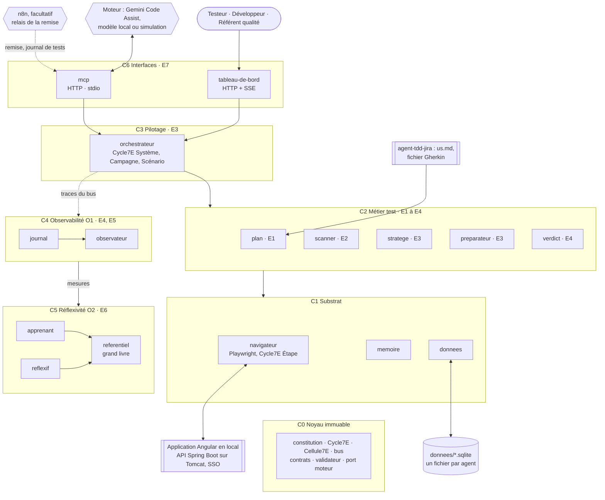

# Agent2Test, spécification 1.1.0

Ce document est le point d'entrée du package. Il donne le principe, la carte du système, les points de contrôle, le registre des dimensions, les règles communes et les invariants. Les détails techniques sont dans `modules/`. Le fichier `manifest.json` déclare quels modules sont actifs.

La spécification reprend le dossier de conception d'Agent2Test (cadrage, architecture globale et cahier des charges du 25 septembre 2026), adapté aux décisions du 21 octobre 2026 : exécution locale, plan produit par agent-tdd-jira, connexion SSO silencieuse, batchs lancés par le développeur. La section 11 en donne la filiation. Depuis la version 1.1.0, les données tiennent dans un fichier SQLite par agent, sans serveur de base de données, et un relais n8n facultatif peut déposer la remise d'Agent2Dev (section 12).

## 1. Ordre de lecture

1. Ce document, sections 2 à 12.
2. `manifest.json` : modules actifs et réservés.
3. Les modules actifs, dans cet ordre :
   1. `noyau` : cycle 7E, bus, contrats, validateur, constitution, port moteur.
   2. `donnees` : un fichier SQLite par agent, contrats nommés, oracle en lecture seule.
   3. `journal` : journal chaîné, journal de tests.
   4. `referentiel` : fiches, règles, épinglage, grand livre.
   5. `plan` : import du plan, demande, campagne.
   6. `memoire` : recherche hybride.
   7. `navigateur` : Playwright, session, origines, preuves.
   8. `scanner` : cartographie des sources et des écrans.
   9. `stratege` : sélection des tests essentiels.
   10. `preparateur` : profil d'environnement, parcours, exécution probatoire, réparation.
   11. `verdict` : statuts, causes présumées, preuves.
   12. `orchestrateur` : campagne, file, points de contrôle.
   13. `observateur` : métriques, alertes, traces.
   14. `apprenant`, `reflexif` : leçons candidates, mesures de second ordre, recalibrage.
   15. `mcp` : moteurs et serveur MCP.
   16. `relais` : remises déposées par le relais n8n, facultatif.
   17. `tableau-de-bord` : IHM par rôle.
   18. `exploitation` : installation et lancement sur le poste.
4. `modules/accessibilite/SKILL.md` et `modules/profil-recette/SKILL.md` : seulement pour comprendre les points d'extension E2 à E4. Ne pas les implémenter en 1.x.

## 2. Mode de travail pour l'IA qui produit le code

1. Lisez tous les modules actifs avant d'écrire la moindre ligne de code.
2. Proposez le plan de fichiers, en reprenant la section « Fichiers à produire » de chaque module, et listez les choix que la spécification ne couvre pas. Attendez la validation du développeur.
3. Implémentez par lots, dans l'ordre de l'en-tête de transmission. Chaque lot doit passer ses tests, en simulation, avant le suivant.
4. En cas d'ambiguïté, posez une question. N'inventez ni action, ni champ, ni schéma, ni comportement absent de la spécification.
5. Les identifiants de code sont sans accents. Les commentaires, les textes de l'IHM, les messages et les journaux sont en français.
6. Chaque test cite l'invariant ou le scénario qu'il vérifie, par exemple `// D8.INV-1, VE3`. Un invariant sans test n'est pas implémenté.
7. N'implémentez aucun module au statut `reserved` dans `manifest.json`, sauf les tests d'inertie de ses points d'extension.

## 3. Objectif et principe

Pour une demande donnée, Agent2Test désigne les tests essentiels parmi les scénarios existants, les rend exécutables, les exécute sur l'application en marche sous contrôle humain, et produit un journal de tests opposable. Il ne modifie jamais l'application et n'adopte jamais seul une règle nouvelle.

**Le moteur conçoit, le noyau exécute, l'humain ratifie.**

- Le moteur (Gemini Code Assist par défaut, tout LLM par le port moteur) ne produit que des données : une sélection argumentée, des parcours, des réparations, des leçons candidates. Chaque sortie est validée contre un schéma fermé et des contrôles nommés.
- Seuls des agents déterministes agissent : `navigateur` sur l'IHM, `donnees` sur les fichiers SQLite d'Agent2Test. Le moteur n'a accès ni au navigateur ni aux données.
- Un parcours ratifié se rejoue sans moteur. Le moteur intervient à la conception et à la réparation, jamais pendant l'exécution : un verdict qui ne se reproduit pas ne prouve rien.
- L'humain ratifie aux points de contrôle CP-0 à CP-5 (section 5). Entre deux points, les agents avancent seuls.
- n8n est facultatif : activé, il dépose la remise d'Agent2Dev et relève le journal de tests d'une campagne close, par le serveur MCP, et rien d'autre. Une remise déposée n'ouvre aucune campagne : un humain l'ouvre (module `relais`).

Chaîne de traçabilité, depuis agent-tdd-jira :

`demande Jira → US → critères d'acceptation → scénarios Gherkin → parcours → exécutions → verdicts par critère → journal de tests`

Toutes les flèches passent par le bus ; aucun agent n'importe un autre agent. Les agents cognitifs, qui appellent le port moteur, sont `stratege` et `preparateur`, et en option `scanner` et `apprenant`.

| Responsabilité | Lieu unique |
|---|---|
| lire le code source de l'application | `scanner` |
| lire les fichiers du plan (`us.md`, fichier Gherkin, annexe A) | `plan` |
| piloter un navigateur | `navigateur` |
| accéder aux données : fichiers SQLite, oracle en lecture seule | `donnees` |
| appeler un moteur | port moteur du noyau, par les agents cognitifs |
| valider une sortie | validateur du noyau |
| dérouler un cycle | `Cycle7E` du noyau |
| écrire le journal | `journal` |
| stocker des vecteurs | `memoire`, dans son fichier SQLite |
| versionner une règle ou une fiche | `referentiel` |
| recevoir une remise déposée par n8n | `relais`, par le serveur MCP |
| ouvrir une campagne | un humain, testeur ou développeur, depuis le tableau de bord ou par MCP ; jamais le relais |

## 4. Cycle 7E

L'énoncé de l'Axiome 7E : « Les Éléments dans l'Espace Engendrent un État d'Expression Évolutif de l'Environnement ». Agent2Test l'applique à quatre échelles, avec une seule classe de cycle, `Cycle7E`, récursive (D1.INV-1).

| Phase | Opération | Étape | Scénario | Campagne | Système |
|---|---|---|---|---|---|
| E1 Éléments | recenser | action, cible, valeur | étapes, données, critères couverts | demande, US, critères, scénarios | fiches, règles, seuils, constitution |
| E2 Espace | situer | page courante, résolution de la cible | session, URL d'entrée, données préfixées | carte, mémoire, référentiel épinglé | file des campagnes, verrous |
| E3 Engendrent | produire | acte Playwright | cycles d'étapes | sélection, parcours, cycles de scénarios | cycles de campagnes |
| E4 État | constater | observation contre assertion | verdict par critère | matrice critères × verdicts | métriques de fonctionnement (O1) |
| E5 Expression | exprimer | ligne de journal, preuve | compte rendu de scénario | journal de tests | tableaux de bord |
| E6 Évolutif | ajuster | attente, alternative déclarée | nouvel essai, soupçon d'instabilité | réparation, leçons candidates | réflexivité (O2) |
| E7 Environnement | coupler | résultat remonté au scénario | résultat remonté à la campagne | rapport aux équipes, mémoire | gouvernance humaine |

Règle de récursion : l'E3 d'une échelle est la suite des cycles complets de l'échelle inférieure, et l'E7 de chaque cycle inférieur alimente l'E4 de l'échelle supérieure.

Chaque agent traite chaque message comme un cycle 7E, par sa classe de base `Cellule7E` : valider l'entrée (E1), charger fiche, mémoire et règles épinglées (E2), agir (E3), valider la sortie (E4), répondre (E5), corriger dans son budget de premier ordre (E6), remettre la trace au bus (E7). Un agent déterministe laisse vides les phases sans objet.

Clause de second ordre : Agent2Test observe une application et s'observe lui-même. Le premier ordre (O1, `journal`, `observateur`) constate son fonctionnement ; le second ordre (O2, `apprenant`, `reflexif`, `referentiel`) juge ses manières de juger et d'apprendre, propose, et ne décide jamais seul. La régression s'arrête à la constitution et à la gouvernance humaine : ce que le système ne peut pas changer de lui-même rend ses observations comparables dans le temps.

## 5. Points de contrôle

| CP | Moment | Qui décide | Décisions | Ce qui attend |
|---|---|---|---|---|
| CP-0 Session | la connexion silencieuse a échoué, ou la session a expiré pendant un scénario | l'opérateur | se connecter dans la fenêtre ouverte ; le système vérifie seul la session obtenue | tout accès à l'IHM |
| CP-1 Sélection | après la sélection (E3 de la campagne) | testeur | valider · corriger, commentaire obligatoire · rejeter | la préparation |
| CP-2 Mise en place | profil d'environnement au premier passage ; parcours nouveaux ou modifiés, après exécution probatoire | testeur ou développeur | valider · corriger · rejeter | leur exécution en campagne |
| CP-3 Verdicts | après E4, pour les échecs, les indéterminés et les scénarios bloqués | testeur | confirmer · contester, le désaccord est consigné à côté du verdict · demander une réparation | la clôture |
| CP-4 Gouvernance | proposition de règle : leçon, recalibrage, quarantaine | référent qualité, depuis le tableau de bord seulement | ratifier · amender · refuser | rien : asynchrone, effet à la campagne suivante |
| CP-5 Préalable | avant de jouer un scénario qui exige un batch Java | développeur | batch lancé et terminé · scénario non joué, avec son motif | ce scénario |

Un parcours ratifié et inchangé ne repasse pas par CP-2. Le niveau d'autonomie de chaque point, présenter tout ou présenter l'écart seulement, est fixé par la configuration humaine, que le système ne peut pas modifier (D9.INV-1).

Une remise déposée par le relais n8n n'ouvre aucun point et n'en décide aucun : elle attend qu'un testeur ou le développeur ouvre la campagne, une fois l'application redémarrée sur le commit remis (module `relais`).

## 6. Registre des dimensions

| ID | Dimension | Introduite | Statut 1.1.0 | Dépend de | Module |
|---|---|---|---|---|---|
| D1 | Noyau 7E, bus et constitution | 1.0 | active | | `noyau` |
| D2 | Données isolées par agent, sur PostgreSQL | 1.0 | superseded | D1 | remplacée en 1.1.0 par D21 (`donnees`) |
| D3 | Plan canonique et demande | 1.0 | active | D1, D21 | `plan` |
| D4 | Navigateur, session et preuves | 1.0 | active | D1 | `navigateur` |
| D5 | Cartographie de l'application | 1.0 | active | D4, D21 | `scanner` |
| D6 | Sélection des tests essentiels | 1.0 | active | D3, D5, D12 | `stratege` |
| D7 | Préparation des parcours | 1.0 | active | D4, D5, D6 | `preparateur` |
| D8 | Verdicts et causes présumées | 1.0 | active | D4, D7 | `verdict` |
| D9 | Orchestration et points de contrôle | 1.0 | active | D1, D3 à D8 | `orchestrateur` |
| D10 | Journal et journal de tests | 1.0 | active | D1, D21 | `journal` |
| D11 | Observabilité de premier ordre | 1.0 | active | D10 | `observateur` |
| D12 | Mémoire et recherche hybride | 1.0 | active | D3, D5, D21 | `memoire` |
| D13 | Apprentissage | 1.0 | active | D9, D10, D15 | `apprenant` |
| D14 | Réflexivité de second ordre | 1.0 | active | D11, D13, D15 | `reflexif` |
| D15 | Référentiel, versions et grand livre | 1.0 | active | D1, D21 | `referentiel` |
| D16 | Moteurs et serveur MCP | 1.0 | active | D1, D9 | `mcp` |
| D17 | Tableau de bord par rôle | 1.0 | active | D9, D10, D11 | `tableau-de-bord` |
| D18 | Exploitation locale | 1.0 | active | D4, D21 | `exploitation` |
| D19 | Accessibilité des parcours (axe) | 1.0 | reserved | D4, D7, D8 | `accessibilite` |
| D20 | Profil recette et conteneur | 1.0 | reserved | D4, D18 | `profil-recette` |
| D21 | Données par agent, en SQLite | 1.1 | active | D1 | `donnees` |
| D22 | Relais du binôme par n8n, facultatif | 1.1 | active | D3, D9, D16, D17 | `relais` |

Statuts : `active` (implémentée et testée), `reserved` (points d'extension posés, fonctionnalité absente), `superseded` (remplacée ; la version de remplacement est indiquée).

## 7. Contrat de version et points d'extension

### 7.1 Contrat

1. Chaque version déclare son numéro dans le frontmatter de ce document et dans `manifest.json`, et ajoute une entrée à la section 12.
2. Une version mineure ajoute au moins une dimension ou un point d'extension. Sinon, c'est un correctif : seul le numéro de patch change.
3. Une dimension `reserved` ne passe à `active` que si ses invariants ont des tests dans la suite de la version.
4. Une dimension `active` ne sort du registre qu'en passant à `superseded`, avec la version de remplacement et une section de migration.
5. Un invariant ne s'affaiblit jamais. Il peut être remplacé par un invariant plus fort, signalé dans la section 12.
6. Le schéma de chaque fichier de données évolue uniquement par migrations numérotées ; une migration appliquée quelque part n'est jamais modifiée.
7. Chaque ligne du journal porte la version de spécification qui l'a produite. Un journal écrit dans une version reste lisible dans toute version de la même famille majeure.
8. Avant de publier une nouvelle version, la précédente est archivée dans `archives/SKILL-vX.Y.Z.md`. Une archive n'est jamais éditée.

### 7.2 Points d'extension

Un point d'extension n'est pas une fonctionnalité. En 1.x, il n'a qu'un test qui prouve qu'il est inerte.

- **E1** : les adaptateurs d'entrée du plan forment un ensemble ouvert. En 1.x, seuls `agent-tdd-jira` et `annexe-a` existent ; tout autre format est refusé avec le motif « format d'entrée non pris en charge ».
- **E2** : le jeu d'actions des parcours réserve l'action `auditer`, destinée à l'accessibilité (D19). En 1.x, un parcours qui l'emploie est rejeté par le validateur avec le motif « action réservée ».
- **E3** : les profils d'environnement réservent `recette` et `conteneur` (D20). En 1.x, un profil de ce type est refusé au démarrage avec le motif « profil réservé ».
- **E4** : la stratégie de session `etat`, une session importée pour un navigateur sans tête, est réservée à D20 ; en 1.x, elle est refusée au démarrage.
- **E5** : le port moteur accepte de nouveaux adaptateurs par version ; en 1.x : `simulation`, `externe` (MCP) et `compatible-openai`. Un adaptateur inconnu est refusé au démarrage.

## 8. Règles globales

- **Périmètre** : Agent2Test n'agit que pour tester. Il ne modifie jamais l'application ni ses sources, qu'il lit seulement ; il ne démarre, n'arrête ni ne déploie l'application et ne lance aucun batch. Il ne rédige ni ne corrige le plan de tests.
- **Projet séparé** : Agent2Test est un projet à part, hors du dépôt de l'application. Il lit le dossier `docs/demandes/<CLÉ>/` et les sources du projet de l'application en lecture seule, à l'emplacement que la configuration désigne.
- **Local** : en 1.x, tout s'exécute sur le poste du développeur, contre l'application lancée en local. Les interfaces n'écoutent que sur `127.0.0.1`.
- **Secrets** : aucun identifiant SSO n'est détenu. La session, les jetons des interfaces et la configuration des moteurs viennent de fichiers hors dépôt, en mode 0600, ou de l'environnement ; ils n'apparaissent jamais dans le journal, les preuves, les messages ni le contexte transmis au moteur.
- **Données de test** : toute donnée créée par un parcours porte le préfixe `A2T-<campagne>-`. La base de l'application n'est pas touchée.
- **Données d'Agent2Test** : un fichier SQLite par agent propriétaire, ouvert par le module intégré `node:sqlite`, dans le dossier de données de la configuration (`~/.agent2test/donnees/` par défaut), hors du dépôt d'Agent2Test et du projet de l'application. Aucun serveur de base de données, aucun port.
- **Configuration humaine** : un fichier `configuration/humaine.json`, lu au démarrage et jamais écrit par le système, fixe l'autonomie des points de contrôle, les origines autorisées, l'autorisation du moteur externe, l'oracle SQL, les rôles des utilisateurs d'Agent2Test, les rôles de l'application que porte la session, l'activation du relais n8n et les racines admises pour une remise.
- **Langue** : identifiants de code sans accents ; textes de l'IHM, messages, journal et journal de tests en français.
- **Node** : Node 24 recommandé, Node 22.13 au minimum, première version où `node:sqlite` se passe d'option ; deux dépendances d'exécution seulement, `playwright`, et `pg` pour l'oracle.
- **Relais n8n** : facultatif et désactivé par défaut. n8n dépose une remise et relève le journal de tests d'une campagne close, par le serveur MCP, au rôle `relais` ; il ne décide rien et n'ouvre aucune campagne. Agent2Test n'en dépend jamais et n'ouvre aucune connexion vers lui.

## 9. Critères d'acceptation globaux

- `npm test` passe sans accès réseau, en simulation : moteur `simulation`, application de démonstration servie sur `127.0.0.1` par les tests, fournisseur SSO simulé.
- Chaque invariant en vigueur de la section 10 apparaît dans au moins un test ; ceux de D2, remplacée, ne sont plus implémentés. Un script vérifie cette correspondance.
- Sur l'application cible, une campagne va de la demande au journal de tests sans intervention hors des points de contrôle.
- Le rejeu d'un parcours ratifié, application inchangée, donne le même verdict.
- En simulation, chaque défaut injecté reçoit la cause attendue : cible obsolète, session expirée, défaut applicatif, instabilité, application injoignable.
- Une altération du journal faite hors du système, par un outil SQLite qui en retire les déclencheurs, est détectée au démarrage suivant, et la première ligne rompue est nommée.
- Relais désactivé, une campagne se mène à l'identique, sans n8n ; activé, une remise déposée n'ouvre aucune campagne d'elle-même, et une remise périmée est refusée à l'ouverture.
- Aucun module `reserved` n'est chargé ; chaque point d'extension a son test d'inertie.
- Le guide de démarrage suffit, seul, à installer et lancer le kit sur le poste du développeur.
- Le journal de tests JSON de l'exemple ECR-77 respecte le contrat de lecture d'agent-tdd-jira 1.3.1 (module `journal`, section 3) : sources du plan et leurs empreintes, état git à l'ouverture, verdicts de la liste fermée, cible de chaque décision.

## 10. Invariants

Chaque invariant est vérifié par au moins un test de son module.

**D1 : noyau**

- **D1.INV-1** : chaque cycle déroule les sept phases E1 à E7, dans l'ordre, à chacune des quatre échelles (Système, Campagne, Scénario, Étape) ; l'E3 d'une échelle est la suite des cycles complets de l'échelle inférieure, et chaque ligne de journal porte son échelle et sa phase.
- **D1.INV-2** : les agents ne communiquent que par le bus ; le bus refuse tout appel ou événement absent du contrat déclaré de l'agent, et aucun agent n'importe un autre agent.
- **D1.INV-3** : toute sortie du moteur est validée contre un schéma fermé et des contrôles nommés avant d'être consommée ; une sortie non conforme n'est jamais utilisée.
- **D1.INV-4** : au démarrage, une constitution dont l'empreinte SHA-256 diffère de celle inscrite au grand livre empêche le démarrage, avec un message explicite.
- **D1.INV-5** : toute demande étrangère aux tests (modifier le code, déployer, administrer) est refusée avec le motif « hors périmètre ».
- **D1.INV-6** : aucune action d'agent n'écrit la constitution, le code, les schémas du journal ou du grand livre, ni la configuration humaine.

**D2 : données sur PostgreSQL, remplacée en 1.1.0 par D21**

Ces invariants ne sont plus en vigueur ; ils restent ici pour la migration d'une instance 1.0.0 (module `donnees`, section 9). D21.INV-1 remplace D2.INV-1 ; D21.INV-2 à D21.INV-4 reprennent mot pour mot D2.INV-2 à D2.INV-4 ; D21.INV-5 s'y ajoute.

- **D2.INV-1** : chaque agent propriétaire a son schéma et son rôle PostgreSQL ; une écriture d'un agent dans le schéma d'un autre est refusée par la base elle-même.
- **D2.INV-2** : seuls des contrats nommés s'exécutent ; une requête SQL libre est refusée.
- **D2.INV-3** : la base de l'application n'est jamais accédée, sauf par l'oracle en lecture seule, activé explicitement dans la configuration humaine et limité à des contrats de lecture nommés.
- **D2.INV-4** : les preuves sont purgées au-delà de leur durée de conservation ; le journal garde leurs empreintes.

**D3 : plan**

- **D3.INV-1** : le système ne rédige ni ne corrige aucune US, aucun critère, aucun scénario ; un critère qu'aucun scénario ne couvre est marqué « trou de couverture », et aucun scénario n'est créé pour lui.
- **D3.INV-2** : chaque US, critère et scénario a un identifiant canonique unique ; deux éléments de même identifiant bloquent l'import, et le message cite leurs deux emplacements.
- **D3.INV-3** : un scénario dont un prérequis sort du périmètre (redémarrage, écriture directe en base) est marqué « non automatisable » avec son motif ; un prérequis de batch Java devient un préalable confié au développeur (CP-5).
- **D3.INV-4** : le plan est versionné : réimporter des sources inchangées ne crée aucune version, une source modifiée en crée une nouvelle, et la précédente reste consultable.
- **D3.INV-5** : seul un scénario validé, qui illustre au moins un critère validé, est jouable ; un scénario proposé non validé, en attente d'une question, limité au back, ou qui exige un rôle que la session n'a pas, est « non jouable », avec son motif.
- **D3.INV-6** : un critère cité par la demande et absent du plan est signalé avant la sélection.

**D4 : navigateur**

- **D4.INV-1** : seul `navigateur` pilote Playwright ; aucun autre module n'ouvre de navigateur.
- **D4.INV-2** : le navigateur ne charge que les origines déclarées au profil ; une navigation vers une autre origine est bloquée avant chargement, et le journal indique l'origine visée.
- **D4.INV-3** : le système ne détient aucun identifiant SSO et ne saisit rien dans les pages du fournisseur SSO ; la session est un secret local (fichier hors dépôt, mode 0600), jamais journalisée ni transmise au moteur, et les traces conservées sont expurgées des en-têtes `Authorization`, `Cookie` et `Set-Cookie`.
- **D4.INV-4** : seules les actions du jeu fermé s'exécutent ; aucun code produit par le moteur n'atteint la page, ni par script, ni par évaluation.
- **D4.INV-5** : une étape n'attend que des états, dans un délai borné ; aucune étape n'attend une durée fixe.
- **D4.INV-6** : une étape de mutation exécutée n'est jamais rejouée ; une étape `verifier`, ou une étape dont l'action n'a pas eu lieu, est retentée deux fois au plus, et un succès au réessai classe l'étape `INSTABILITE`, jamais « réussie ».
- **D4.INV-7** : la session s'établit d'abord sans action humaine, par la stratégie configurée ; si cela échoue, CP-0 s'ouvre, et seul le système le ferme, après avoir atteint seul une page protégée.

**D5 : cartographie**

- **D5.INV-1** : le scan ne crée, ne modifie ni ne supprime aucun fichier du projet de l'application, et refuse toute lecture hors de sa racine.
- **D5.INV-2** : le relevé des écrans en marche ne joue que des navigations : aucun clic, aucune saisie, aucune soumission.
- **D5.INV-3** : chaque élément interactif sans nom accessible figure dans la liste des fragilités de ciblage.
- **D5.INV-4** : pour un fichier modifié, l'impact renvoie chaque écran atteint avec le chemin qui le justifie : fichier, point d'API, service, composant, route.
- **D5.INV-5** : un second scan sans fichier modifié ne réanalyse aucun fichier.

**D6 : sélection**

- **D6.INV-1** : le palier P1 contient tous les scénarios jouables qui couvrent un critère cité par la demande ; la règle est revérifiée après la revue du moteur.
- **D6.INV-2** : le palier P3 contient tous les scénarios jouables déclarés « socle ».
- **D6.INV-3** : chaque scénario retenu ou écarté porte un motif d'une phrase, et chaque score du palier P2 se lit décomposé facteur par facteur.
- **D6.INV-4** : aucune préparation ne démarre avant la décision en CP-1 ; une correction en CP-1 exige un commentaire.
- **D6.INV-5** : sans moteur disponible, la sélection déterministe est présentée seule, avec la marque « sans revue du moteur ».

**D7 : préparation**

- **D7.INV-1** : un parcours est une donnée conforme au schéma des parcours ; une action hors du jeu fermé, ou une donnée non conforme, est rejetée avant toute exécution.
- **D7.INV-2** : chaque critère couvert par un parcours est porté par au moins une étape `verifier`.
- **D7.INV-3** : toute valeur saisie par une étape de mutation porte le préfixe `A2T-<campagne>-` ; une étape de suppression dont la cible ne porte pas ce préfixe n'est pas jouée et bloque le scénario jusqu'à la décision en CP-3.
- **D7.INV-4** : chaque parcours porte son origine : moteur, fiche et version composée, empreinte du prompt, ratificateur.
- **D7.INV-5** : un profil d'environnement ou un parcours n'est exécuté en campagne qu'une fois ratifié en CP-2 ; toute modification, réparation comprise, crée une version nouvelle soumise à CP-2.
- **D7.INV-6** : les budgets sont bornés : 3 renvois au moteur pour une sortie non conforme, 2 réparations par parcours et par campagne ; au-delà, l'échec est présenté au point de contrôle.
- **D7.INV-7** : les cibles suivent l'ordre fixé (rôle et nom accessible, libellé, identifiant de test, texte, texte indicatif, CSS) ; une cible CSS porte un motif et figure parmi les fragilités de ciblage.

**D8 : verdicts**

- **D8.INV-1** : pas de verdict sans preuve : un critère dont une preuve manque est « non vérifié », jamais « conforme » ; « conforme » et « non conforme » dérivent des critères d'acceptation, jamais du code.
- **D8.INV-2** : un verdict n'est jamais réécrit ; un désaccord humain est consigné à côté.
- **D8.INV-3** : chaque échec reçoit une cause de la liste fermée (`DEFAUT_APPLICATIF`, `DEFAUT_PARCOURS`, `SESSION_EXPIREE`, `ENVIRONNEMENT`, `INSTABILITE`, `INDETERMINE`) et cite les signaux qui la fondent.
- **D8.INV-4** : chaque verdict porte l'empreinte SHA-256 de ses preuves.
- **D8.INV-5** : une session expirée n'impute aucun échec : après CP-0, le scénario est rejoué depuis son début.

**D9 : orchestration**

- **D9.INV-1** : aucun point de contrôle n'est supprimé, sauté ou validé par le système ; aucune phase ne consomme une sortie non ratifiée, et le niveau d'autonomie de chaque point se lit dans la configuration humaine.
- **D9.INV-2** : chaque décision enregistre son auteur, son canal, sa date et son commentaire.
- **D9.INV-3** : avant le premier scénario, une sonde vérifie que l'application répond ; sinon, la campagne est refusée avec ce motif.
- **D9.INV-4** : une seule campagne s'exécute à la fois sur une application cible ; les autres attendent en file.
- **D9.INV-5** : l'arrêt d'urgence suspend la campagne au plus tard à la fin de l'étape en cours.
- **D9.INV-6** : après un redémarrage du processus, la campagne reprend au début du scénario interrompu, sans perte de journal.
- **D9.INV-7** : Agent2Test ne démarre, n'arrête ni ne déploie l'application, et ne lance aucun batch ; un scénario à préalable de batch attend en CP-5 que le développeur l'ait lancé et l'ait déclaré terminé.

**D10 : journal**

- **D10.INV-1** : le journal est en ajout seul, imposé par des déclencheurs de la base qui refusent toute modification et toute suppression, et chaîné par empreintes ; au démarrage, un déclencheur absent ou une chaîne rompue empêche le démarrage, et `verifierChaine` nomme la première ligne rompue, même quand l'altération vient d'un outil SQLite, hors du système.
- **D10.INV-2** : le journal de tests d'une campagne est produit en Markdown, JSON, JUnit XML et HTML à partir de la même source, et sa matrice critères × verdicts couvre tous les critères de la demande, trous de couverture compris.
- **D10.INV-3** : tout contenu produit par le moteur est marqué comme tel dans le journal de tests, avec moteur, fiche et version.
- **D10.INV-4** : l'empreinte de fin de chaîne du journal de tests est celle du journal à la clôture de la campagne.

**D11 : observabilité**

- **D11.INV-1** : chaque appel entre agents produit une trace portant corrélation, parent, échelle, phase et vecteur des sept durées.
- **D11.INV-2** : pour chaque campagne, toute échelle dont les sept phases ne figurent pas dans l'ordre au journal est signalée comme violation de D1.INV-1.
- **D11.INV-3** : aucun module du premier ordre n'appelle un module du second ordre ; le graphe des appels du bus le vérifie.
- **D11.INV-4** : une dérive d'indicateur au-delà de son seuil lève une alerte visible au tableau de bord.

**D12 : mémoire**

- **D12.INV-1** : la recherche fonctionne par le plein texte seul ; avec un modèle de plongement local, plein texte et vecteurs sont fusionnés par rang réciproque.
- **D12.INV-2** : tout fragment injecté dans une consigne appartient aux versions épinglées de la campagne, et ses identifiants sont journalisés avec l'appel au moteur.
- **D12.INV-3** : avant injection, les secrets, adresses électroniques et noms de personnes déclarés sont masqués, et un fragment trop long est tronqué avec la marque « tronqué ».

**D13 : apprentissage**

- **D13.INV-1** : chaque correction ou rejet commenté en CP-1, CP-2 ou CP-3 produit une leçon candidate, liée à sa fiche, à son moteur et à sa décision source.
- **D13.INV-2** : aucune leçon n'entre dans une fiche avant sa ratification en CP-4.
- **D13.INV-3** : une leçon ratifiée ne s'applique qu'au moteur sur lequel elle a été apprise ; l'étendre à un autre moteur est une ratification distincte.

**D14 : réflexivité**

- **D14.INV-1** : pour chaque contrôle automatique, l'accord avec les décisions humaines est mesuré par fiche, version et moteur dès l'exposition minimale, et la précision des alertes O1 est mesurée à partir de leur qualification par l'opérateur.
- **D14.INV-2** : le système revient seul au dernier état ratifié quand une leçon ou un recalibrage dégrade sa mesure au-delà de la marge ; il n'adopte jamais seul une règle nouvelle, n'élargit aucune borne et n'assouplit aucun point de contrôle.
- **D14.INV-3** : un écart entre la répartition des causes présumées et les reclassements humains en CP-3 lève une alerte au référent qualité.
- **D14.INV-4** : chaque proposition nomme la règle, l'échelle et la phase touchées, la valeur actuelle, la valeur proposée, les preuves et l'effet attendu, et reste dans les bornes de la constitution.
- **D14.INV-5** : le second ordre lit le premier ordre et ne l'écrit jamais.

**D15 : référentiel**

- **D15.INV-1** : chaque campagne s'exécute avec le référentiel épinglé à son E2 ; une règle ratifiée ne s'applique qu'à partir de la campagne suivante.
- **D15.INV-2** : le grand livre est en ajout seul et chaîné par empreintes ; il inscrit chaque version publiée de la constitution, chaque ratification, refus, suspension et retour arrière.
- **D15.INV-3** : chaque fiche porte une version composée ; pour toute sortie du moteur, le prompt se reconstitue à partir de la fiche, de sa version et des fragments journalisés, et son empreinte égale celle du journal.
- **D15.INV-4** : les pouvoirs sont séparés : proposer (`apprenant`, `reflexif`), ratifier (un humain, en CP-4, hors du canal MCP), appliquer (`referentiel`), mesurer (`reflexif`).
- **D15.INV-5** : les règles modifiables se limitent à la liste fermée de la constitution, chacune dans ses bornes ; une valeur hors bornes est refusée.

**D16 : moteurs et MCP**

- **D16.INV-1** : le serveur MCP n'écoute que sur `127.0.0.1` ; une requête HTTP sans jeton valide, ou venant d'une origine non autorisée, est refusée.
- **D16.INV-2** : une décision CP-4 reçue par le canal MCP est refusée ; l'arrêt d'urgence y reste permis.
- **D16.INV-3** : le contexte transmis au moteur, par MCP ou par un autre adaptateur, est minimisé, borné et masqué ; aucun secret ni identifiant n'y figure.
- **D16.INV-4** : changer de moteur ne demande aucune modification de code ; chaque appel au moteur est journalisé avec fiche et version composée, moteur, empreinte du prompt, fragments injectés et usage.
- **D16.INV-5** : aucun contenu du projet de l'application n'est transmis à un moteur externe tant que la configuration humaine ne porte pas l'autorisation de l'envoyer.
- **D16.INV-6** : avec le profil souverain, une campagne complète aboutit sans autre connexion sortante que vers l'application cible et son fournisseur SSO.

**D17 : tableau de bord**

- **D17.INV-1** : le tableau de bord n'écoute que sur `127.0.0.1` et exige un jeton porteur.
- **D17.INV-2** : les droits de décision suivent les rôles : testeur (CP-0 à CP-3), développeur (CP-2, CP-5), référent qualité (CP-4, seulement depuis le tableau de bord).
- **D17.INV-3** : l'IHM ne présente aucune non-conformité RGAA 4.1 de niveau A ou AA.
- **D17.INV-4** : les textes de l'IHM, les messages et le journal de tests sont en français.

**D18 : exploitation**

- **D18.INV-1** : sous une version de Node antérieure à 22.13, le kit refuse de démarrer avec un message explicite.
- **D18.INV-2** : le kit n'a que deux dépendances d'exécution, `playwright` et `pg`, épinglées par un fichier de verrouillage et installées par `npm ci` ; toutes ses dépendances et images sont sous licence open source.
- **D18.INV-3** : les données d'Agent2Test sont des fichiers SQLite, hors de son dépôt et du projet de l'application, sans serveur ni port ; la seule base de l'application qu'il joint est celle de l'oracle, en lecture seule (D21.INV-3).
- **D18.INV-4** : seul le profil d'environnement `local` est accepté ; un profil `recette` ou `conteneur` est refusé tant que la dimension D20 est réservée.

**D21 : données SQLite**

- **D21.INV-1** : chaque agent propriétaire a son propre fichier SQLite, sur une connexion qui n'est qu'à lui ; un contrat ne s'exécute que sur la connexion de son propriétaire, et aucun contrat n'attache un autre fichier ni ne charge d'extension : un agent n'a aucun moyen d'écrire dans les données d'un autre.
- **D21.INV-2** : seuls des contrats nommés s'exécutent ; une requête SQL libre est refusée.
- **D21.INV-3** : la base de l'application n'est jamais accédée, sauf par l'oracle en lecture seule, activé explicitement dans la configuration humaine et limité à des contrats de lecture nommés.
- **D21.INV-4** : les preuves sont purgées au-delà de leur durée de conservation ; le journal garde leurs empreintes.
- **D21.INV-5** : chaque écriture est une transaction : un arrêt du processus, même brutal, ne laisse aucun enregistrement partiel ; un fichier qui échoue au contrôle d'intégrité de SQLite empêche le démarrage, avec son nom.

**D22 : relais n8n**

- **D22.INV-1** : Agent2Test ne dépend jamais du relais n8n : désactivé par défaut, une campagne s'ouvre et se mène à la main, à l'identique ; activé, c'est le relais qui appelle le serveur MCP, et Agent2Test n'ouvre aucune connexion vers n8n ni vers Agent2Dev.
- **D22.INV-2** : un jeton au rôle `relais` n'atteint que `a2t_deposer_remise`, `a2t_etat` et `a2t_rapport`, qui ne lui montrent que les remises et les campagnes qui en sont issues ; toute décision, toute ouverture de campagne, l'arrêt d'urgence et la reprise lui sont refusés.
- **D22.INV-3** : une remise déposée n'ouvre aucune campagne : un testeur ou le développeur l'ouvre, depuis le tableau de bord ou par MCP ; à l'ouverture, un commit, un fichier suivi modifié ou une empreinte de source qui diffère de la remise la rend périmée, et aucune campagne ne s'ouvre.
- **D22.INV-4** : une remise n'est reçue que conforme au schéma fermé `agent2test.remise/1`, sans contenu de fichier ni secret, et pour une racine admise : celle du profil d'environnement, ou une racine de `remises.racines` dans la configuration humaine.

## 11. Filiation avec le dossier de conception

Le dossier du dépôt Agent2Test (`00-cadrage.md`, `01-architecture.md`, `02-cahier-des-charges.md`) reste la source des choix. Ses invariants I1 à I15 deviennent des invariants de dimension ; ses décisions d'architecture, notées ici DA1 à DA20 pour ne pas les confondre avec les dimensions, sont reprises dans les modules.

| Dossier | Spécification |
|---|---|
| I1 cycle 7E | D1.INV-1, D11.INV-2 |
| I2 périmètre | D1.INV-5 |
| I3 application jamais modifiée | D5.INV-1, section 8 |
| I4 le moteur ne produit que des données | D1.INV-3, D4.INV-4, D7.INV-1 |
| I5 pas de verdict sans preuve | D8.INV-1 |
| I6 verdict jamais réécrit | D8.INV-2 |
| I7 journal et grand livre en ajout seul | D10.INV-1, D15.INV-2 |
| I8 points de contrôle intangibles | D9.INV-1 |
| I9 auto-modification asymétrique | D13.INV-2, D14.INV-2 |
| I10 séparation des pouvoirs | D15.INV-4, D16.INV-2 |
| I11 aucun identifiant SSO détenu | D4.INV-3 |
| I12 origines déclarées, contexte minimisé | D4.INV-2, D12.INV-3, D16.INV-3 |
| I13 écritures préfixées, aucune requête libre | D21.INV-2, D7.INV-3 |
| I14 origine des productions du moteur | D7.INV-4, D10.INV-3 |
| I15 paliers obligatoires de sélection | D6.INV-1, D6.INV-2 |

Ce qui change par rapport au dossier :

| Point du dossier | Décision du 21 octobre 2026 | Effet dans la spécification |
|---|---|---|
| H1 : plan en Markdown ou sortie JSON d'Agent2Dev | Agent2Dev applique agent-tdd-jira | adaptateur `agent-tdd-jira` (us.md, fichier Gherkin), annexe A en second format (E1) |
| Décision 8 du cahier : chaîne sans Gherkin | « critères d'acceptation puis Gherkin, toujours » | les étapes Gherkin tiennent lieu du texte libre des scénarios (module `plan`) |
| H2 : application lancée, sondée | application sur Tomcat en local, lancée par le développeur | D9.INV-3, D9.INV-7 |
| H3 : connexion SSO humaine | connexion SSO réglée automatiquement sur le poste | stratégie `integree` par défaut, CP-0 en repli (D4.INV-7) |
| CA-1.5 : batch non automatisable | batch lancé par le développeur à un point de contrôle | point CP-5 (D3.INV-3, D9.INV-7) |
| H9 : pas de test d'accessibilité | accessibilité réservée | dimension D19, point d'extension E2 |
| CA-9.4, profil conteneur : recette | tout reste en local | dimension D20, points d'extension E3 et E4, D18.INV-4 |
| T1 : envoi des sources à Gemini | à autoriser par la DSI et le RSSI | D16.INV-5 |
| H12, US-29 : AI Act | mis de côté | hors périmètre ; restent l'origine des productions (D10.INV-3) et la conservation des preuves (D21.INV-4) |
| absent du dossier : rôle de l'application exigé par un scénario | ratifié pour le binôme (pull request n° 5) : la session SSO du poste porte des rôles déclarés par un humain | étiquette `@role-<nom>`, configuration `session.roles`, scénario non jouable si le rôle manque (D3.INV-5) |
| absent du dossier : lecture du journal par l'agent de développement | ratifié pour le binôme (pull request n° 5) | contrat de lecture du journal JSON : sources du plan et leurs empreintes, état git relevé à l'ouverture, cible de chaque décision (module `journal`) |
| stockage en 1.0.0 : PostgreSQL et pgvector, un schéma et un rôle par agent | SQLite dès le départ, pour Agent2Test comme pour Agent2Dev | D2 remplacée par D21 : un fichier SQLite par agent, `node:sqlite`, plein texte FTS5, aucun serveur (D18.INV-3) ; migration d'une instance 1.0.0 (module `donnees`, section 9) |
| absent du dossier : enchaînement avec Agent2Dev | n8n facultatif, en relais de transport seulement | D22 : remise déposée par MCP, campagne ouverte par un humain, journal de tests relevé par MCP (module `relais`) |

Les valeurs par défaut H14 à H19 du cahier (budgets, conservation, langue, méta-critères, réparations) sont reprises dans la constitution, au module `referentiel`.

## 12. Journal de révision

**1.0.0** (2026-10-21) : première version, tirée du dossier de conception d'Agent2Test et des décisions du 21 octobre 2026. Dimensions D1 à D18 actives, D19 (accessibilité) et D20 (profil recette et conteneur) réservées. Points d'extension E1 à E5. Entrée : us.md et fichier Gherkin d'agent-tdd-jira 1.3.0, qui la référence en retour pour le travail en binôme (sa dimension D7) ; le journal de tests JSON porte ce que lit agent-tdd-jira : sources du plan et leurs empreintes, état git de la racine relevé à l'ouverture, cible de chaque décision et de chaque désaccord. Un scénario qui exige un rôle absent de la session est non jouable.

**1.1.0** (2026-10-22) : dimensions D21 et D22 actives ; D2 passe à `superseded`, remplacée par D21. Données : un fichier SQLite par agent propriétaire, ouvert par le module intégré `node:sqlite`, au lieu des schémas PostgreSQL ; contrats nommés exécutés sur la seule connexion de leur propriétaire, sans `ATTACH` ni extension ; chaque écriture en transaction ; plein texte FTS5 et vecteurs rangés avec les fragments pour la mémoire ; aucun serveur de base de données ni conteneur de données, `pg` gardé pour l'oracle seul ; migration d'une instance 1.0.0 (module `donnees`, section 9). Relais n8n facultatif et désactivé par défaut (module `relais`) : au rôle `relais`, n8n dépose une remise au format `agent2test.remise/1` et relève le journal de tests d'une campagne close ; une remise déposée n'ouvre aucune campagne, un humain l'ouvre, et une remise périmée est refusée à l'ouverture. Invariants remplacés par des invariants plus forts : D10.INV-1 (ajout seul imposé par des déclencheurs, dont la présence et la chaîne sont vérifiées à chaque démarrage), D18.INV-1 (Node 22.13 au minimum), D18.INV-3 (données sans serveur ni port, hors du dépôt et du projet). D21.INV-1 remplace D2.INV-1 ; D21.INV-2 à D21.INV-4 reprennent D2.INV-2 à D2.INV-4 ; D21.INV-5 et D22.INV-1 à D22.INV-4 s'ajoutent. Entrée : agent-tdd-jira 1.3.1. Décisions du développeur (21 octobre 2026) : SQLite dès le départ, pour Agent2Test comme pour Agent2Dev ; n8n facultatif, en relais de transport seulement, sur sa base SQLite. Archive : `archives/SKILL-v1.0.0.md`.
