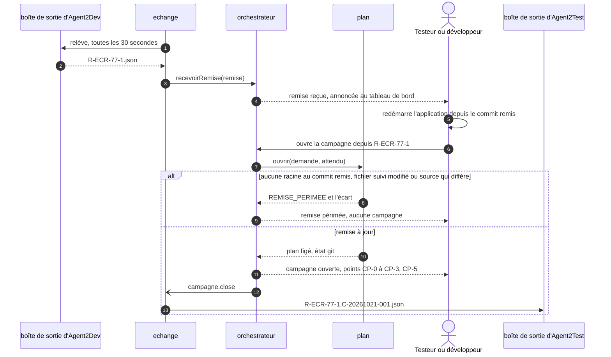

# Module `echange` (D24)

La tête de développement, Agent2Dev ou un agent qui applique agent-tdd-jira, remet à Agent2Test le plan validé et commité. Deux modes, fixés par la configuration humaine :

- `manuel`, le défaut : le développeur porte la remise. Il dépose le fichier de remise dans la vue « Remises reçues » du tableau de bord, ou ouvre la campagne à la main sur la demande et le dossier du plan, comme sans remise ; puis il rapporte le journal de tests à la tête de développement.
- `dossiers` : Agent2Test lit les remises dans la boîte de sortie de chaque instance d'Agent2Dev, et dépose dans la sienne le journal de tests d'une campagne close issue d'une remise. Rien d'autre ne circule.

Dans les deux modes, l'échange ne décide rien : un testeur ou le développeur ouvre la campagne, une fois l'application redémarrée. Les deux têtes ne s'appellent jamais, et Agent2Test ne dépend pas de l'échange (D24.INV-1).

## 1. Configuration

```json
{ "echange": {
    "mode": "dossiers",
    "sortie": "~/.agent2test/echanges/sortie",
    "entrees": ["\\\\wsl.localhost\\Ubuntu\\home\\fred\\.agent2dev\\echanges\\sortie"],
    "intervalleSecondes": 30
  },
  "remises": { "racines": ["\\\\wsl.localhost\\Ubuntu\\home\\fred\\depot\\wt\\ECR-77"] } }
```

- `mode` vaut `manuel`, par défaut, ou `dossiers`. En mode `manuel`, aucun dossier d'échange n'est lu ni écrit : l'échange ne fait que valider les remises déposées dans le tableau de bord.
- `sortie` est la boîte de sortie d'Agent2Test, dans ses propres dossiers ; `entrees` liste la boîte de sortie de chaque instance d'Agent2Dev, une par worktree en mode parallèle. Chaque chemin est absolu, une fois `~` développé, et hors du dépôt d'Agent2Test comme du projet de l'application ; sinon, le démarrage est refusé avec son motif.
- `intervalleSecondes`, entre 5 et 300, 30 par défaut : la relève scrute les boîtes plutôt que de compter sur les notifications de fichiers, qui passent mal entre Windows et WSL2.
- `remises.racines` liste les racines où une remise peut s'ouvrir, en plus de celle du profil d'environnement : les worktrees du mode parallèle, par exemple.

## 2. Déroulé en mode `dossiers`



En mode `manuel`, l'opérateur dépose le fichier à la place des étapes 1 et 2, et rien n'est déposé dans une boîte de sortie.

## 3. Remise `agent2test.remise/1` (D24.INV-3)

```json
{
  "format": "agent2test.remise/1",
  "id": "R-ECR-77-1",
  "date": "2026-10-21T16:02:00Z",
  "demande": { "cle": "ECR-77", "texte": "Export des retours d'expérience en CSV" },
  "racine": "/home/fred/projets/ecr",
  "plan": {
    "adaptateur": "agent-tdd-jira",
    "dossier": "docs/demandes/ECR-77",
    "sources": [
      { "chemin": "docs/demandes/ECR-77/us.md", "empreinte": "<sha256>" },
      { "chemin": "docs/demandes/ECR-77/ECR-77.feature", "empreinte": "<sha256>" }
    ]
  },
  "commit": "<sha1 de HEAD>",
  "changements": { "git": "origin/develop...HEAD" },
  "criteres": [
    { "id": "ECR-77-CA01", "statut": "validé" },
    { "id": "ECR-77-CA02", "statut": "validé" },
    { "id": "ECR-77-CA03", "statut": "en attente de Q1" },
    { "id": "ECR-77-CA04", "statut": "validé" }
  ],
  "jouables": ["ECR-77-S01", "ECR-77-S04"],
  "nonJouables": [
    { "scenario": "ECR-77-S02", "motif": "limité au back" },
    { "scenario": "ECR-77-S03", "motif": "en attente de Q1" }
  ],
  "roles": ["LECTEUR"],
  "prealables": []
}
```

- `schemas/remise.json` est fermé : un champ inconnu, absent ou mal formé fait refuser la remise `REMISE_NON_CONFORME`, avec la liste de ses écarts. La remise ne porte aucun contenu de fichier, aucun jeton, aucun secret : des chemins, des empreintes et des identifiants.
- `id` vaut `R-<CLÉ>-<n>`. La même remise reçue deux fois ne crée qu'une remise ; un même identifiant au contenu différent est refusé `REMISE_DIFFERENTE`.
- `racine` est le chemin de l'arbre du côté de la tête de développement. Il est affiché, jamais ouvert : Agent2Test, sous Windows, ne lirait pas un chemin de WSL2 ; il retrouve la racine par le commit (section 4).
- `plan.dossier` vaut `docs/demandes/<CLÉ>`, et chaque source est un chemin relatif sous ce dossier, sans `..` ; `plan` applique ensuite son propre confinement (module `plan`).
- `criteres`, `jouables`, `nonJouables`, `roles` et `prealables` sont la prévision de la tête de développement. La vue des remises les montre à côté de ce qu'Agent2Test établit à l'ouverture, écarts signalés ; Agent2Test décide (D3.INV-5).
- Une remise reçue est gardée par l'`orchestrateur`, dans la table `orchestration__remises`, à l'état « reçue », et s'inscrit au journal (`remise.recue`).

## 4. Ouvrir une campagne depuis une remise (D24.INV-2, D24.INV-3)

1. La remise reste « reçue » tant qu'un testeur ou le développeur ne l'ouvre pas : bouton « ouvrir la campagne » de la vue des remises (module `tableau-de-bord`), ou `a2t_demarrer_campagne({ remise })` avec un jeton humain, la remise étant son contenu ou l'identifiant d'une remise reçue. Aucun délai ne l'ouvre ; aucune sonde ni session ne se lance avant.
2. Avant le bouton, la vue rappelle de redémarrer l'application sur le Tomcat local depuis le commit remis ; Agent2Test ne la démarre pas (D9.INV-7).
3. La racine est, parmi les racines admises, celle du profil d'environnement et celles de `remises.racines`, celle dont `HEAD` est le commit remis et qui contient `plan.dossier` ; le `scanner` relève leur état git. S'il y en a plusieurs, l'opérateur choisit ; s'il n'y en a aucune, l'ouverture est refusée `REMISE_PERIMEE`, avec le motif « aucune racine admise au commit remis ».
4. `plan.ouvrir` reçoit la demande, le dossier, la plage de changements et `attendu : { commit, sources }`. Si un fichier suivi est modifié, ou si l'empreinte d'une source diffère, l'ouverture est refusée `REMISE_PERIMEE`, avec l'écart ; la remise passe à « périmée » (`remise.perimee`), et une nouvelle remise est attendue.
5. Sinon, la campagne s'ouvre comme une campagne ouverte à la main, avec les mêmes points de contrôle ; elle garde l'identifiant de sa remise, et la remise passe à « ouverte » (`remise.ouverte`).

Une campagne ouverte depuis une remise est celle qu'aurait donnée une ouverture à la main sur le même dossier et le même commit : même plan figé, même état git, même sélection.

## 5. Boîtes d'échange (D24.INV-1, D24.INV-4)

- **Relève** : toutes les `intervalleSecondes`, l'échange liste chaque boîte d'`entrees`. Il ne retient que les noms `R-<CLÉ>-<n>.json`, et ignore ceux qui commencent par un point, qui sont des fichiers en cours d'écriture. Un lien symbolique, un fichier de plus de 1 Mo ou un autre nom est ignoré et signalé une fois. L'échange lit ces boîtes ; il n'y écrit, n'y renomme ni n'y supprime rien. Une remise nouvelle passe par `orchestrateur.recevoirRemise`, et le tableau de bord l'annonce.
- **Dépôt** : à la clôture d'une campagne issue d'une remise, l'échange copie dans `sortie` son journal de tests JSON, octet pour octet depuis `rapports/<campagne>/journal-de-tests.json`, sous le nom `<remise>.<campagne>.json`. Il l'écrit d'abord sous `.<nom>.tmp`, puis le renomme, pour qu'aucun lecteur ne voie un fichier à moitié écrit. Seul un journal clos, qui porte son empreinte de fin (D10.INV-4), y est déposé, et rien d'autre.
- Chaque instance d'Agent2Dev ne relève, dans cette boîte, que les journaux nommés d'après ses propres remises.
- `npm run purger` retire de la boîte de sortie les journaux plus anciens que la durée de conservation des preuves ; ceux de `rapports/` restent.

## 6. Ce que l'échange ne fait jamais

- ouvrir une campagne, la suspendre ou la reprendre, ou décider un point de contrôle ;
- joindre Agent2Dev : il ne fait que lire et écrire des fichiers ;
- écrire ailleurs que dans la boîte de sortie, et en particulier dans le projet de l'application ;
- ouvrir le chemin `racine` qu'une remise cite.

## 7. Pièges connus

- **Remise prise pour un ordre** : une remise reçue ne lance rien ; seul un humain ouvre la campagne, après avoir redémarré l'application.
- **Application sur un autre commit** : Agent2Test vérifie la racine, pas l'application en marche ; le rappel avant l'ouverture et la vérification du commit et des fichiers suivis réduisent l'écart, et la sonde reste celle de toute campagne (D9.INV-3).
- **Fichier lu à moitié écrit** : un lecteur qui prendrait un fichier en cours d'écriture lirait un JSON tronqué ; l'écriture sous un nom provisoire, puis le renommage, l'évitent.
- **Notifications de fichiers** : entre Windows et WSL2, une surveillance par notifications manquerait des fichiers ; la relève scrute à intervalle.
- **Chemin de l'émetteur** : le chemin `racine` d'une remise venue de WSL2 ne s'ouvre pas sous Windows ; la racine se retrouve par le commit.

## 8. Migration depuis la version 1.1.0 (D22 remplacée)

En 1.1.0, la dimension D22 confiait le transport au relais n8n, qui appelait le serveur MCP au rôle `relais`. D24 la remplace :

| 1.1.0 | 1.2.0 | Ce qui change |
|---|---|---|
| D22.INV-1 : Agent2Test ne dépend jamais du relais n8n | D24.INV-1 | plus de relais : en mode `dossiers`, Agent2Test lit une boîte et écrit la sienne, sans aucune connexion |
| D22.INV-2 : rôle `relais` limité à trois outils | — | le rôle `relais` et l'outil `a2t_deposer_remise` sont retirés : plus rien n'appelle Agent2Test pour lui porter une remise |
| D22.INV-3 : une remise déposée n'ouvre aucune campagne, une remise périmée est refusée | D24.INV-2 | inchangé, pour une remise déposée par l'opérateur ou lue dans une boîte |
| D22.INV-4 : schéma fermé, racine admise par son chemin | D24.INV-3 | la racine se retrouve par le commit remis, parmi les racines admises, et non plus par le chemin |

Une instance 1.1.0 qui avait activé le relais retire `relais` de la configuration humaine, que la version 1.2.0 refuse tant qu'elle le porte, supprime `<secrets>/relais.jeton` et désactive le workflow dans n8n. Pour un transport automatique, elle règle `echange.mode` à `dossiers`. Les remises déjà reçues restent, une fois les données reprises (module `donnees`, section 9).

## 9. Tests (scénarios)

| Scénario | Vérifie | Cas |
|---|---|---|
| EC1 | D24.INV-1 | en mode `manuel`, aucun dossier d'échange n'est lu ni écrit, et une campagne simulée se mène à la main, à l'identique ; une remise déposée dans le tableau de bord suit le même parcours qu'une remise lue dans une boîte |
| EC2 | D24.INV-1 | en mode `dossiers`, pendant la relève, l'ouverture et une campagne simulée complète, Agent2Test n'ouvre aucune connexion hors de l'application cible et de son fournisseur SSO (`fetch`, `http.request` et `net.connect` interceptés), et n'écrit, pour l'échange, que dans sa boîte de sortie |
| EC3 | D24.INV-1 | dans une boîte d'entrée, un lien symbolique, un fichier de plus de 1 Mo ou un nom qui n'est pas celui d'une remise est ignoré et signalé, un fichier provisoire est ignoré ; rien n'y est jamais écrit, renommé ni supprimé |
| EC4 | D24.INV-2 | une remise reçue laisse la file et les campagnes inchangées : aucune sonde, aucune session, aucun point ne s'ouvre avant qu'un humain l'ouvre |
| EC5 | D24.INV-2 | à l'ouverture, un fichier suivi modifié ou une source dont l'empreinte diffère rendent la remise « périmée », avec l'écart nommé ; aucune campagne ne s'ouvre |
| EC6 | D24.INV-3 | entre deux racines admises, la campagne s'ouvre sur celle dont `HEAD` est le commit remis ; sans racine admise à ce commit, la remise est « périmée » ; le chemin `racine` de la remise n'est jamais ouvert (accès aux fichiers interceptés) |
| EC7 | D24.INV-3 | une remise à champ inconnu, ou sans `commit`, est refusée `REMISE_NON_CONFORME` avec ses écarts ; la même remise reçue deux fois ne crée qu'une remise ; un même identifiant au contenu différent est refusé `REMISE_DIFFERENTE` |
| EC8 | D24.INV-4 | à la clôture d'une campagne issue d'une remise, la boîte de sortie reçoit son journal JSON, octet pour octet, sous `<remise>.<campagne>.json`, par un fichier provisoire renommé ensuite ; une campagne ouverte à la main n'y dépose rien, un journal provisoire non plus |
| EC9 | D24.INV-2 | la remise de l'exemple ECR-77, ouverte sur le commit remis, donne la même campagne qu'une ouverture à la main sur le même dossier : même plan figé, même état git, mêmes jouables |

## 10. Fichiers à produire

- `src/agents/echange/agent.js`, `src/agents/echange/releve.js`, `src/agents/echange/boite.js`
- `schemas/remise.json`
- `test/echange/*.test.js`, `test/fixtures/remises/` (la remise de l'exemple ECR-77 et ses variantes)
