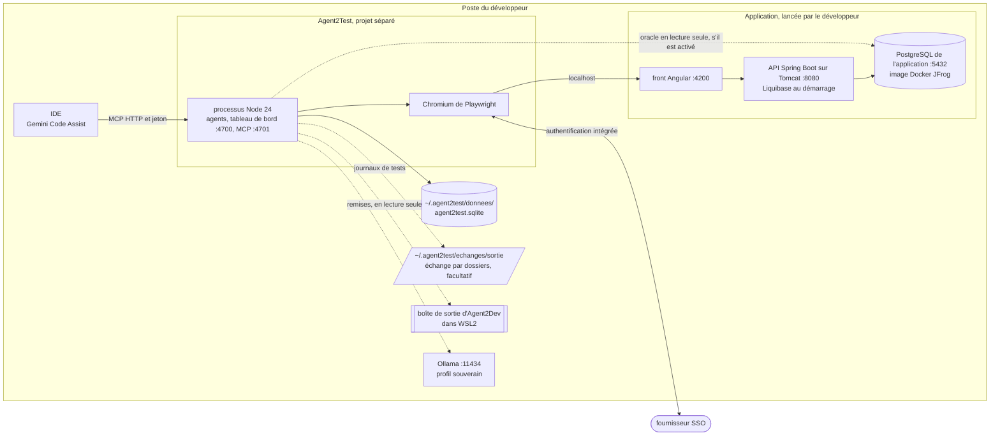

# Module `exploitation` (D18)

Ce module décrit le poste d'exécution et ce qu'il faut pour installer et lancer le kit, sans assistance.

## 1. Topologie locale

- L'application, son PostgreSQL et ses batchs sont lancés par le développeur ; Agent2Test ne fait que les sonder (D9.INV-7).
- Les données d'Agent2Test tiennent dans un fichier SQLite unique, que seul l'agent médiateur `donnees` ouvre, dans le processus Node : aucun serveur de base de données, aucun port (D18.INV-3).
- En mode `dossiers`, Agent2Test, sous Windows, lit la boîte de sortie d'Agent2Dev par `\\wsl.localhost\…`, et Agent2Dev lit celle d'Agent2Test par `/mnt/c/…` : l'échange ne demande aucun réglage réseau entre Windows et WSL2 (module `echange`).
- Le processus Node et Chromium tournent sur le système où la session SSO du poste fonctionne : sous Windows pour l'authentification intégrée. Sous WSL2, les stratégies `profil` et `cdp` restent possibles.

## 2. Services Docker Compose

| Service | Image | Port | Profil Compose |
|---|---|---|---|
| `ollama` | Ollama (registre configurable, par exemple le miroir JFrog) | `127.0.0.1:11434` | `souverain` |

Le profil par défaut ne lance aucun service : Docker n'est nécessaire qu'au profil souverain. Le profil Compose `conteneur` n'existe pas en 1.x (D20, point E3).

## 3. Scripts

- `scripts/installer.sh` et `scripts/installer.cmd`, `scripts/lancer.sh` et `scripts/lancer.cmd`, en ASCII pur.
- Installation : contrôle de Node, `npm ci`, téléchargement de Chromium par `npx playwright install chromium`, création du dossier de données et migrations (`npm run migrer`), copie de `configuration/humaine.exemple.json` vers le dossier de configuration s'il n'existe pas, puis invitation à publier la constitution (`npm run constitution:publier`, commande humaine).
- En mode `dossiers`, l'installation crée aussi la boîte de sortie de l'échange, en mode 0700 (module `echange`, section 1).
- Lancement : démarrage des agents, du tableau de bord et du serveur MCP ; affichage de l'URL d'amorçage du tableau de bord.

## 4. Contraintes d'exécution (D18.INV-1 à D18.INV-4)

- Au démarrage, une version de Node antérieure à 22.13 arrête le kit avec le message « Node 22.13 ou plus récent requis (24 recommandé) ».
- `package.json` n'a que deux dépendances d'exécution, `playwright` et `pg`, celle-ci pour l'oracle seul, à versions épinglées ; `package-lock.json` est versionné et l'installation passe par `npm ci`. `npm run licences` liste la licence de chaque dépendance et de chaque image ; toutes sont open source.
- Les données tiennent dans `agent2test.sqlite`, dans le dossier de données de la configuration (`~/.agent2test/donnees/` par défaut). La configuration refuse un dossier de données ou d'échange situé dans le dépôt d'Agent2Test ou sous la racine du projet de l'application, et tout DSN hors de l'oracle (D23.INV-3).
- Seul le profil d'environnement `local` est accepté. Un profil `recette` ou `conteneur` est refusé au démarrage avec le motif « profil réservé » (point E3).

## 5. Configuration

| Fichier | Contenu | Écrit par |
|---|---|---|
| `<config>/humaine.json` | autonomie des points de contrôle ; origines autorisées ; SSO (stratégie, domaines, URL protégée, rôles de l'application que porte la session, `session.roles`) ; moteur et autorisation externe ; oracle ; utilisateurs et rôles ; seuils d'alerte ; budgets ; conservation ; racine du projet de l'application ; dossier du profil de session ; dossiers de données et de sauvegarde ; échange (`echange.mode`, `manuel` par défaut, et ses dossiers) et racines admises pour une remise (`remises.racines`) | un humain, jamais le système (D1.INV-6) |
| `<secrets>/` | jetons du MCP et du tableau de bord, DSN de l'oracle, codes d'amorçage | les scripts d'installation, en mode 0600 ; le DSN de l'oracle, par un humain |

`<config>`, `<secrets>`, le dossier de données et la boîte de sortie de l'échange sont hors du dépôt d'Agent2Test, par défaut dans `~/.agent2test/`. Le dépôt ne contient que `configuration/humaine.exemple.json`.

## 6. Guide de démarrage

`GUIDE.md` suffit, seul, à installer et lancer le kit : prérequis (Node 22.13 ou plus récent, application lancée ; Docker pour le profil souverain seulement), installation, configuration humaine, publication de la constitution, première campagne sur l'exemple ECR-77, lecture du journal de tests, sauvegarde des données, arrêt. Une annexe décrit l'échange par dossiers, facultatif : réglage des deux têtes, chemins entre Windows et WSL2, ouverture d'une campagne depuis une remise reçue.

## 7. Tests (scénarios)

| Scénario | Vérifie | Cas |
|---|---|---|
| IN1 | D18.INV-1 | le contrôle de version, appelé avec `20.18.0` ou `22.12.0`, refuse le démarrage avec le message prévu ; avec `22.13.0` et `24.0.0`, il l'accepte |
| IN2 | D18.INV-2 | `package.json` n'a que `playwright` et `pg` en dépendances d'exécution, à versions exactes ; `package-lock.json` existe |
| IN3 | D18.INV-2 | `npm run licences` ne relève aucune licence non open source |
| IN4 | D18.INV-3 | une configuration dont le dossier de données ou la boîte de sortie de l'échange est dans le dépôt d'Agent2Test ou sous la racine de l'application, ou qui porte un DSN hors de l'oracle, est refusée ; le kit lancé n'écoute sur aucun port pour ses données |
| IN5 | D18.INV-4 | un profil `recette` et un profil `conteneur` sont refusés « profil réservé » |
| IN6 | D18.INV-2 | les scripts `.cmd` et `.sh` ne contiennent que des caractères ASCII |

## 8. Fichiers à produire

- `docker-compose.yml` (profil souverain), `package.json`, `package-lock.json`
- `scripts/installer.sh`, `scripts/installer.cmd`, `scripts/lancer.sh`, `scripts/lancer.cmd`, `scripts/licences.js`
- `src/demarrage.js` (contrôles de version, de profil et de configuration)
- `configuration/humaine.exemple.json`, `GUIDE.md`
- `test/exploitation/*.test.js`
