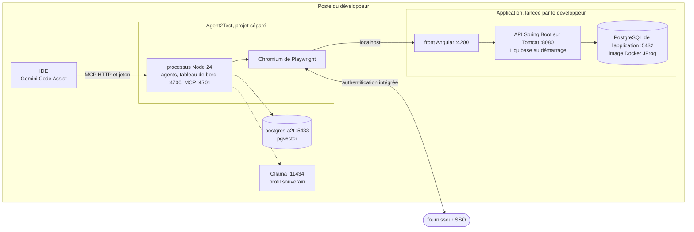

# Module `exploitation` (D18)

Ce module décrit le poste d'exécution et ce qu'il faut pour installer et lancer le kit, sans assistance.

## 1. Topologie locale

- L'application, son PostgreSQL et ses batchs sont lancés par le développeur ; Agent2Test ne fait que les sonder (D9.INV-7).
- Le processus Node et Chromium tournent sur le système où la session SSO du poste fonctionne : sous Windows pour l'authentification intégrée. Sous WSL2, les stratégies `profil` et `cdp` restent possibles.

## 2. Services Docker Compose

| Service | Image | Port | Profil Compose |
|---|---|---|---|
| `postgres-a2t` | pgvector, PostgreSQL 17 ou plus récent (registre configurable, par exemple le miroir JFrog) | `127.0.0.1:5433` | défaut |
| `ollama` | Ollama | `127.0.0.1:11434` | `souverain` |

Le profil Compose `conteneur` n'existe pas en 1.0.0 (D20, point E3).

## 3. Scripts

- `scripts/installer.sh` et `scripts/installer.cmd`, `scripts/lancer.sh` et `scripts/lancer.cmd`, en ASCII pur.
- Installation : contrôle de Node, `npm ci`, téléchargement de Chromium par `npx playwright install chromium`, `docker compose up -d postgres-a2t`, migrations, copie de `configuration/humaine.exemple.json` vers le dossier de configuration s'il n'existe pas, puis invitation à publier la constitution (`npm run constitution:publier`, commande humaine).
- Lancement : démarrage des agents, du tableau de bord et du serveur MCP ; affichage de l'URL d'amorçage du tableau de bord.

## 4. Contraintes d'exécution (D18.INV-1 à D18.INV-4)

- Au démarrage, une version de Node antérieure à 22 arrête le kit avec le message « Node 22 ou plus récent requis (24 recommandé) ».
- `package.json` n'a que deux dépendances d'exécution, `playwright` et `pg`, à versions épinglées ; `package-lock.json` est versionné et l'installation passe par `npm ci`. `npm run licences` liste la licence de chaque dépendance et de chaque image ; toutes sont open source.
- Le PostgreSQL d'Agent2Test écoute sur 5433. La configuration refuse le port 5432 et tout DSN qui désigne la base de l'application, hors oracle (D2.INV-3).
- Seul le profil d'environnement `local` est accepté. Un profil `recette` ou `conteneur` est refusé au démarrage avec le motif « profil réservé » (point E3).

## 5. Configuration

| Fichier | Contenu | Écrit par |
|---|---|---|
| `<config>/humaine.json` | autonomie des points de contrôle ; origines autorisées ; SSO (stratégie, domaines, URL protégée, rôles de l'application que porte la session, `session.roles`) ; moteur et autorisation externe ; oracle ; utilisateurs et rôles ; seuils d'alerte ; budgets ; conservation ; racine du projet de l'application ; dossier du profil de session | un humain, jamais le système (D1.INV-6) |
| `<secrets>/` | jetons du MCP et du tableau de bord, mot de passe de `postgres-a2t`, codes d'amorçage | les scripts d'installation, en mode 0600 |

`<config>` et `<secrets>` sont hors du dépôt d'Agent2Test, par défaut dans `~/.agent2test/`. Le dépôt ne contient que `configuration/humaine.exemple.json`.

## 6. Guide de démarrage

`GUIDE.md` suffit, seul, à installer et lancer le kit : prérequis (Node, Docker, application lancée), installation, configuration humaine, publication de la constitution, première campagne sur l'exemple ECR-77, lecture du journal de tests, arrêt.

## 7. Tests (scénarios)

| Scénario | Vérifie | Cas |
|---|---|---|
| IN1 | D18.INV-1 | le contrôle de version, appelé avec `20.18.0`, refuse le démarrage avec le message prévu ; avec `22.0.0` et `24.0.0`, il l'accepte |
| IN2 | D18.INV-2 | `package.json` n'a que `playwright` et `pg` en dépendances d'exécution, à versions exactes ; `package-lock.json` existe |
| IN3 | D18.INV-2 | `npm run licences` ne relève aucune licence non open source |
| IN4 | D18.INV-3 | une configuration qui donne le port 5432 à `postgres-a2t` est refusée |
| IN5 | D18.INV-4 | un profil `recette` et un profil `conteneur` sont refusés « profil réservé » |
| IN6 | D18.INV-2 | les scripts `.cmd` et `.sh` ne contiennent que des caractères ASCII |

## 8. Fichiers à produire

- `docker-compose.yml`, `package.json`, `package-lock.json`
- `scripts/installer.sh`, `scripts/installer.cmd`, `scripts/lancer.sh`, `scripts/lancer.cmd`, `scripts/licences.js`
- `src/demarrage.js` (contrôles de version, de profil et de configuration)
- `configuration/humaine.exemple.json`, `GUIDE.md`
- `test/exploitation/*.test.js`
