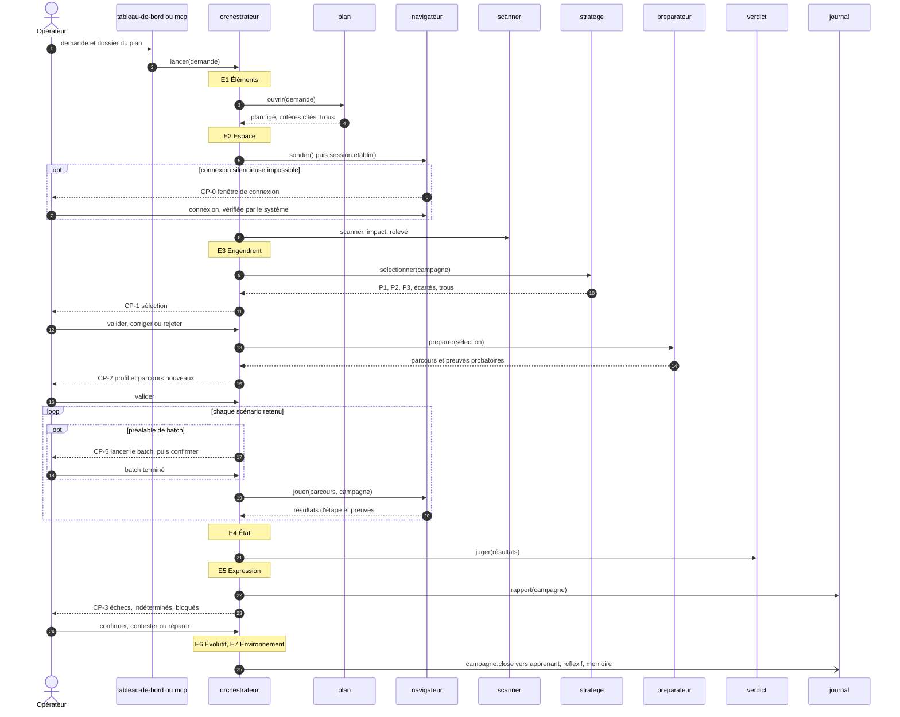

# Module `orchestrateur` (D9)

L'`orchestrateur` déroule les cycles des échelles Système, Campagne et Scénario, avec la seule classe `Cycle7E` du noyau. Il tient la file des campagnes, les verrous et les points de contrôle. Il ne juge pas et ne rédige rien.

## 1. Campagne nominale

À l'E2, l'orchestrateur demande aussi `referentiel.epingler(campagne)` : toute la campagne lit fiches et règles à travers cet instantané (D15.INV-1).

Une campagne s'ouvre aussi depuis une remise que le relais n8n a déposée : l'orchestrateur la garde, avec son état, sans rien lancer, jusqu'à ce qu'un testeur ou le développeur l'ouvre ; `lancer` reçoit alors la remise, et `plan.ouvrir` vérifie qu'elle n'est pas périmée avant tout le reste (module `relais`, section 4).

## 2. Points de contrôle (D9.INV-1, D9.INV-2)

- Un point ouvert met la campagne en attente ; l'événement `point.ouvert` alerte le tableau de bord et le MCP.
- Le niveau d'autonomie de chaque point se lit dans `configuration/humaine.json` : `tout` présente tout ; `ecarts` ne présente que ce qui est nouveau ou modifié. Quand il n'y a rien de nouveau, par exemple des parcours tous ratifiés et inchangés, le point n'a rien à présenter et ne s'ouvre pas ; ce n'est pas un point sauté.
- Aucune phase ne consomme une sortie qui attend une ratification : la préparation attend CP-1, l'exécution attend CP-2, la clôture attend CP-3.
- Chaque décision enregistre sa cible (scénario, critère, parcours ou préalable), son auteur, son canal (`tableau-de-bord` ou `mcp`), sa date et son commentaire ; un point qui présente plusieurs éléments reçoit une décision par élément. Une correction en CP-1 exige un commentaire (D6.INV-4).
- Une décision CP-4 n'est reçue que depuis le tableau de bord (D16.INV-2) ; CP-4 n'arrête aucune campagne.

## 3. Sonde, file et verrous (D9.INV-3, D9.INV-4)

- Avant le premier scénario, `navigateur.sonder()` vérifie que l'application répond. Sinon, la campagne est refusée avec le motif « application injoignable ». Agent2Test ne la démarre pas.
- Une seule campagne s'exécute à la fois sur une application cible ; le verrou porte sur l'URL de base. Les autres campagnes attendent en file, dans l'ordre d'arrivée.

## 4. Arrêt d'urgence et reprise (D9.INV-5, D9.INV-6)

- `suspendre(campagne)`, depuis le tableau de bord ou le MCP, lève un drapeau lu entre deux étapes : l'étape en cours se termine, puis la campagne passe à l'état `suspendue`. `reprendre(campagne)` est une décision humaine.
- L'état de chaque cycle est écrit à chaque fin de phase dans `orchestration.sqlite`, en une transaction. Après un redémarrage du processus, une campagne `en cours` reprend au début du scénario interrompu ; le passage interrompu reste au journal.

## 5. Préalable de batch (D9.INV-7)

Avant de jouer un scénario qui porte un préalable `{ type: "batch", nom }` (module `plan`), l'orchestrateur ouvre CP-5 : « Lancer le batch `<nom>` sur l'application locale, puis confirmer quand il est terminé. » Le développeur répond « batch lancé et terminé » ou « scénario non joué », avec un motif. Agent2Test ne lance ni batch, ni application, ni déploiement.

## 6. Actions et événements

| Action | Rôle |
|---|---|
| `lancer(demande)` | ouvre une campagne ou la met en file ; avec `{ remise }`, la demande, le dossier du plan, la racine et la plage sont ceux de la remise, et seul un utilisateur humain peut l'appeler (D22.INV-3) |
| `recevoirRemise(remise)` | garde une remise déposée par le relais, à l'état « reçue » ; n'ouvre rien (module `relais`) |
| `decider(point, decision)` | décision humaine sur un point ouvert |
| `suspendre(campagne)`, `reprendre(campagne)` | arrêt d'urgence, reprise |
| `etat(campagne)` | état, phase courante, point ouvert |

Événements : `point.ouvert`, `point.decide`, `campagne.suspendue`, `campagne.close`, `remise.recue`, `remise.ouverte`, `remise.perimee`.

## 7. Pièges connus

- **Point validé par défaut à l'expiration d'un délai** : jamais ; un point attend sa décision.
- **Rejeu partiel après redémarrage** : la reprise repart du début du scénario, pas de l'étape.
- **Batch lancé « pour aider »** : Agent2Test n'exécute aucune commande sur l'application.

## 8. Tests (scénarios)

| Scénario | Vérifie | Cas |
|---|---|---|
| OR1 | D9.INV-1 | une sélection non validée en CP-1 ne déclenche aucune préparation |
| OR2 | D9.INV-1 | avec l'autonomie `ecarts`, des parcours tous ratifiés et inchangés n'ouvrent pas CP-2 ; un parcours nouveau l'ouvre |
| OR3 | D9.INV-1 | aucune action du système ne modifie `configuration/humaine.json` ; le niveau lu est celui du fichier |
| OR4 | D9.INV-2 | chaque décision enregistre auteur, canal, date et commentaire ; une correction sans commentaire en CP-1 est refusée |
| OR5 | D9.INV-3 | application injoignable : la campagne est refusée avec le motif, avant tout scénario |
| OR6 | D9.INV-4 | deux campagnes sur la même application : la seconde attend en file |
| OR7 | D9.INV-5 | un arrêt d'urgence pendant une étape suspend la campagne à la fin de cette étape, pas avant |
| OR8 | D9.INV-6 | un processus arrêté au milieu d'un scénario reprend au début de ce scénario ; le journal garde le passage interrompu |
| OR9 | D9.INV-7 | un scénario `@batch-remplissage-modules` ouvre CP-5 ; il n'est joué qu'après la confirmation du développeur |
| OR10 | D9.INV-7 | aucune commande système n'est exécutée par l'orchestrateur (analyse des sources : ni `child_process` ni `exec`) |
| OR11 | D1.INV-1 | une campagne complète journalise les sept phases aux échelles Système, Campagne et Scénario |

## 9. Fichiers à produire

- `src/agents/orchestrateur/agent.js`, `src/agents/orchestrateur/campagne.js`, `src/agents/orchestrateur/scenario.js`, `src/agents/orchestrateur/systeme.js`
- `src/agents/orchestrateur/points.js`, `src/agents/orchestrateur/file.js`, `src/agents/orchestrateur/reprise.js`, `src/agents/orchestrateur/remises.js`
- `configuration/humaine.exemple.json`
- `test/orchestrateur/*.test.js`
